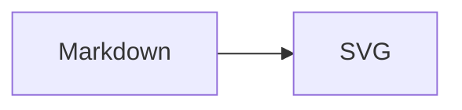

# @velezanthony/design

Una librería, no un sitio. Contiene el sistema de diseño y la integración de Astro para
documentación con la que se construye la documentación de los repositorios de
[velezanthony](https://github.com/velezanthony), de modo que los docs de todos los repos se vean y
se comporten igual.

A un repo consumidor le da, desde un único archivo de configuración: páginas localizadas
(`en`/`es`), el layout, la barra lateral, la tabla de contenidos, la búsqueda (Pagefind, por
idioma; la tecla `/` enfoca el buscador), el tema claro/oscuro, un banner de consentimiento de analítica, etiquetas SEO en el head,
`sitemap.xml` y un `404.html` que responde en el idioma del visitante. También puede publicar
archivos de la raíz como `README.md` o `CHANGELOG.md` como páginas, así que GitHub y el sitio de
docs leen la misma fuente.

## Requisitos

- Node `>=22.23.4`
- Astro `^7.4.12`
- Tailwind CSS `^4.3.5` con `@tailwindcss/vite`
- `@astrojs/markdown-satteri` `>=0.4.10 <0.5` (el procesador de Markdown que usa Astro 7; se
  respeta un procesador Sätteri propio, cualquier otro procesador rompe el build)

Los cuatro son peer dependencies: instálalos en el consumidor.

## Instalación

No está publicado en npm. Instálalo desde GitHub, fijado a una etiqueta de release:

```sh
npm install github:velezanthony/design#v0.1.0
npm install astro tailwindcss @tailwindcss/vite @astrojs/markdown-satteri
```

El paquete distribuye fuentes TypeScript y `.astro` (sin paso de build); las compila Astro. Para
actualizar, cambia la etiqueta e instala de nuevo.

Para comprobar los tipos del sitio (`astro check`), añade también las herramientas:
`npm install -D @astrojs/check typescript` y un script `"check": "astro check"`. El scaffold de
Astro (`npm create astro`) no trae ninguna de las dos.

## Configuración del consumidor

Las rutas de abajo están escritas para una carpeta `docs/` dentro del repo; en un proyecto creado con
`npm create astro` el proyecto de Astro es la raíz del repo, así que quita el prefijo `docs/` y
ajusta las rutas relativas (`../CHANGELOG.md` pasa a ser `./CHANGELOG.md`). Empieza borrando la
página del scaffold `src/pages/index.astro`: la home es `src/content/docs/index.md`, y una página
propia en `/`, `/404` o `/sitemap.xml` (o `/es/`, `/es/404` para otros idiomas) rompe el build,
porque Astro la renderizaría en lugar de los docs.

Declara la configuración una sola vez en `docs.config.mjs` y pásala a `docs()` en
`astro.config.mjs`. El `content.config.ts` es una línea que no la importa: la colección toma la
configuración del módulo virtual de la integración, que es la que `docs(config)` ya resolvió. Así hay
una única carga de la config y integración y loader no pueden usar configs distintas.

```js
// docs/docs.config.mjs
import { defineDocsConfig, MissingTranslation } from '@velezanthony/design/integration';

export default defineDocsConfig({
  name: 'My repo',
  locales: ['en', 'es'],
  translations: { missing: MissingTranslation.LINK },
  external: [{ slug: 'changelog', file: '../CHANGELOG.md' }],
});
```

```js
// docs/astro.config.mjs
import { defineDocsSite } from '@velezanthony/design/integration';
import docsConfig from './docs.config.mjs';

export default defineDocsSite(docsConfig, { base: '/my-repo' });
```

`defineDocsSite(docsConfig, options)` es una función pura que devuelve la config de Astro. `base` es
obligatorio (la ruta del repo en GitHub Pages; `'/'` en un sitio de usuario u organización) y falla
con un error claro si falta o no empieza por `/`. `site` es opcional y por defecto es
`https://velezanthony.github.io`. Para añadir más config de Astro usa la clave `astro`, que se
fusiona: `integrations` y `vite.plugins` se añaden después de `docs()` y de Tailwind, el resto de
claves de `vite` se fusionan en superficial y las demás claves de primer nivel pisan los valores por
defecto (por ejemplo `trailingSlash`).

```js
export default defineDocsSite(docsConfig, {
  base: '/my-repo',
  site: 'https://example.dev',
  astro: { integrations: [miIntegracion()], vite: { plugins: [miPlugin()] } },
});
```

Equivale a esta forma larga, que sigue funcionando:

```js
import tailwindcss from '@tailwindcss/vite';
import { defineConfig } from 'astro/config';
import { docs } from '@velezanthony/design/integration';
import docsConfig from './docs.config.mjs';

export default defineConfig({
  site: 'https://velezanthony.github.io', // obligatorio
  base: '/my-repo',
  trailingSlash: 'always',
  vite: { plugins: [tailwindcss()] },
  integrations: [docs(docsConfig)],
});
```

```ts
// docs/src/content.config.ts
export { collections } from '@velezanthony/design/content';
```

`@velezanthony/design/content` necesita la integración registrada: sin `docs(config)` en
`astro.config.mjs` el build falla con un error que lo dice.

### Forma explícita del loader (casos avanzados)

Si prefieres montar la colección tú, usa `docsLoader(config)` con el mismo objeto que das a
`docs(config)`:

```ts
// docs/src/content.config.ts
import { defineCollection } from 'astro:content';
import { docsLoader, docsSchema } from '@velezanthony/design/loader';
import docsConfig from '../docs.config.mjs';

export const collections = {
  docs: defineCollection({ loader: docsLoader(docsConfig), schema: docsSchema() }),
};
```

Pon las páginas nativas en `docs/src/content/docs/` (o en otra carpeta con la opción `content`, ver
[Docs fuera del proyecto de Astro](#docs-fuera-del-proyecto-de-astro)). La librería inyecta todas las rutas (páginas,
`404`, `sitemap.xml`), el tema, las fuentes (IBM Plex) y el índice de búsqueda; el consumidor no
escribe ningún layout, ningún import de CSS ni ningún `@source`.

Páginas nativas: `index.md` es la home, `guide.md` es `/guide/`, `guide.es.md` es su gemela en
español (el idioma por defecto no lleva sufijo). El título es el primer `h1` (o el `title` del
frontmatter); una página sin ninguno de los dos rompe el build.

## Referencia de configuración

Las claves desconocidas rompen el build indicando la ruta de la clave (`ui.es.search.placeholdr`).

| Opción          | Significado                                                                                                                                              |
| --------------- | -------------------------------------------------------------------------------------------------------------------------------------------------------- |
| `name`          | Nombre del sitio (cabecera, pie, plantilla de título por defecto). Obligatorio.                                                                          |
| `content`       | Carpeta de las páginas nativas, relativa a la raíz del proyecto de Astro; puede estar fuera (`'../docs'`). Por defecto `'src/content/docs'`. Ver [Docs fuera del proyecto de Astro](#docs-fuera-del-proyecto-de-astro). |
| `locales`       | Idiomas; `en` y `es` tienen textos de UI incluidos. Por defecto `['en']`.                                                                                |
| `defaultLocale` | Archivos sin sufijo y `/`. Por defecto: el primer idioma.                                                                                                |
| `seo`           | Base SEO de todo el sitio, ver abajo.                                                                                                                    |
| `translations`  | `{ missing: MissingTranslation.LINK }` (`LINK`, `OMIT`, `FALLBACK`), por defecto `LINK`. Ver abajo.                                                      |
| `ui`            | Sobrescritura de textos de UI por idioma, combinada clave a clave: `ui: { es: { 'search.placeholder': 'Buscar' } }`. Las claves desconocidas rompen.     |
| `external`      | Archivos fuera de la carpeta de contenido (`content`) publicados como páginas: `{ slug, file, locales?, seo?, translations? }`.                                          |
| `sidebar`       | Orden de la barra lateral: slugs y grupos `{ label, slug?, items }`. La home es `'index'`. Los slugs desconocidos rompen el build. El resto va después. |
| `nav`           | Elementos de la cabecera, cada sección con su propia barra lateral: `{ label, dir, sidebar? }`, `{ label, slug }`, `{ label, href, icon? }`. Ver abajo. |
| `footer`        | Licencia, autor y enlaces extra del pie: `{ license?, author?, links? }`. Ver abajo.                                                                     |
| `editUrl`       | Base de edición del repo (`https://github.com/o/r/edit/main`). Añade "Edit this page" apuntando al archivo fuente real.                                  |
| `repoRoot`      | Raíz del repo relativa al proyecto de Astro (por defecto: el ancestro más cercano con `.git`). Necesario para `editUrl` cuando no hay `.git`.            |
| `favicon`       | Icono de la pestaña: un archivo en `public/` (`'favicon.svg'` o `'/favicon.svg'`, debe existir) o una URL `https://`. Por defecto: el icono del paquete. Ver abajo. |
| `gtmId`         | Id de Google Tag Manager. Sobrescritura opcional de `PUBLIC_GTM_ID` (la configuración gana al entorno). Ver [Analítica](#analítica).                     |
| `privacyUrl`    | Sobrescritura opcional del enlace a la política de privacidad: una URL o una por idioma. Por defecto: la página del portfolio. Ver [Analítica](#analítica). |
| `layout`        | Barras laterales plegables y ancho de lectura / completo: `{ sidebar?, toc?, width?, toggles? }`. Ver abajo.                                             |
| `social`        | `{ github }`. También alimenta los enlaces de repositorio y "Report a bug" del pie.                                                                      |

### `seo`

```js
seo: {
  titleSuffix: 'My repo', // texto, uno por idioma, o false; por defecto 'Anthony Vélez Tapia'
  description: { en: 'My repo docs', es: 'Documentación de mi repo' }, // string o por idioma
  image: { src: '/og.png', alt: { en: 'Card', es: 'Tarjeta' } }, // bajo public/ o https absoluta
}
```

Una página sobrescribe la base campo a campo: `seo` en el frontmatter en las páginas nativas,
`external[].seo` en las externas. Forma: `{ title?, titleSuffix?, description?, image?: { src, alt? }, noindex? }`.

El `<title>` tiene dos partes, título y sufijo, y se forma `título | sufijo` (separador fijo). Cada
parte se resuelve por separado: página > sitio > librería. `seo.title` cambia el título solo en el
head (el H1 no se toca) y `titleSuffix` acepta texto, uno por idioma o `false` (sin sufijo, y gana
también a un sufijo del sitio). Si el título es igual al sufijo no se repite, y `og:title` /
`twitter:title` nunca llevan sufijo.

```md
<!-- docs.config.mjs: seo: { titleSuffix: 'My repo' } -->
---
seo:
  title: Instalar en cualquier sistema # <title>: «Instalar en cualquier sistema | My repo»
---
---
seo:
  titleSuffix: false # <title>: solo el título del H1
---
```

Sin `titleSuffix` en el sitio ni en la página, el sufijo es el de la librería (`Anthony Vélez Tapia`).
`titleTemplate` ya no existe: dejarlo en la config falla el build.
La imagen OG debería medir unos 1,91:1 y pesar menos de 300 KB (si no, avisa). Las páginas
`noindex` salen de `sitemap.xml` y de la búsqueda.

### `favicon`

Todas las páginas (docs, rutas de respaldo y 404) emiten `<link rel="icon" href type>`. Por defecto
el paquete sirve su propio icono en `<base>/_design/favicon.png`, una ruta con espacio de nombres que
nunca choca con tu `public/`. Define `favicon` para usar el tuyo:

```js
favicon: 'favicon.svg', // un archivo en public/ (con o sin barra inicial), el href recibe el base
favicon: 'https://cdn.example.dev/icon.png', // se usa tal cual, sin comprobar (http:// se rechaza)
```

`type` se infiere de la extensión (`svg`, `png`, `ico`; cualquier otra lo omite). Un archivo de
`public/` que no exista rompe el build indicando el campo y el archivo. El `public/favicon.svg` y el
`public/favicon.ico` que trae el scaffold de Astro NO se usan salvo que apuntes `favicon` a uno de
ellos; bórralos si te quedas con el valor por defecto.

### `sidebar`

Las entradas son slugs (`'guide/install'`) o grupos `{ label, slug?, items }`. La página home se
escribe `'index'` (su slug interno está vacío). Un slug que no coincide con ninguna página, en
ningún idioma, rompe el build con un único error agregado que nombra cada uno de ellos y su ruta
(`sidebar[2].items[0]`). Las páginas no listadas van después de las declaradas, por `order` del
frontmatter y luego por slug.

### `nav`

Elementos de la cabecera tras el nombre del sitio (desde `lg`; por debajo abren el Menu móvil, por
encima de la barra lateral). Sin `nav` no cambia nada: una única `sidebar` de primer nivel para todo
el sitio.

```js
import { NavIcon } from '@velezanthony/design/integration';

nav: [
  { label: { en: 'Guide', es: 'Guía' }, dir: 'users', sidebar: ['users/install'] }, // sección
  { label: 'Changelog', slug: 'changelog' }, // una sola página
  { label: 'GitHub', href: 'https://github.com/o/r', icon: NavIcon.GITHUB }, // externo, solo https
],
```

- **Sección** `{ label, dir, sidebar? }`: pertenece a ella toda página (nativa o externa) cuyo slug
  sea `dir` o empiece por `dir/`. Sus páginas muestran SOLO el árbol de esa sección a la izquierda, y
  anterior / siguiente nunca salen de ella. `sidebar` ordena la sección (misma forma que la de primer
  nivel, los slugs deben estar dentro de `dir`); el resto sigue por `order` y luego por slug,
  agrupado bajo `dir` (la carpeta en sí no es un nivel). El elemento enlaza a la página índice de
  `dir` si existe y, si no, a la primera página de la sección.
- **Página** `{ label, slug }`: un enlace a una sola página. Esa página no pertenece a ninguna
  sección.
- **Enlace** `{ label, href, icon? }`: externo, solo `https://`, con `rel="noopener"` y un marcador
  de enlace externo. Con `icon` (`NavIcon.GITHUB`) solo se dibuja el icono y el label queda para los
  lectores de pantalla.
- **Páginas fuera de toda sección** (la home, páginas sueltas, cualquier otra) usan la `sidebar` de
  primer nivel si das una (se ignoran las entradas que pertenecen a una sección) y, si no, una lista
  automática de solo esas páginas. Anterior / siguiente se quedan entre ellas.
- La sección o página actual lleva `aria-current` (`page` en su propia página, `true` en una sección
  cuando estás dentro). `label` puede ser un string o uno por idioma; un idioma ausente recurre al
  idioma por defecto, como cualquier otro label. Un elemento de página cuya página no está traducida
  sigue `translations.missing` (`link`/`fallback` apuntan al original, `omit` oculta el elemento).
- Rompe el build, de forma agregada y con la ruta de configuración (`nav[1].dir`): un `dir` sin
  páginas, `dir` solapados (iguales, o uno dentro de otro), un slug de `sidebar` de sección que es
  desconocido o está fuera de su `dir`, un `slug` de página que no es una página o que vive dentro
  de una sección, y un `href` que no es https.
- Textos de UI: `nav.label` (el landmark de navegación) y `nav.external` (el marcador para lectores
  de pantalla).

### `footer`

Dos filas, iguales en todas las páginas (la 404 incluida). Todo es opcional.

```js
footer: {
  license: { label: 'MIT', href: 'https://github.com/o/r/blob/main/LICENSE' }, // o solo 'MIT'
  author: { name: 'Ana', href: 'https://ana.dev' }, // por defecto: Anthony Vélez; false lo oculta
  links: [
    { label: { en: 'Changelog', es: 'Cambios' }, slug: 'changelog' }, // una página
    { label: 'Blog', href: 'https://blog.dev' }, // externo, solo https
  ],
},
```

- **Fila 1, izquierda**: `© <año> <name> by <author>` como una sola frase. El año sale del
  reloj del visitante; el del build queda como respaldo sin JavaScript.
- **Fila 1, derecha** (un `<nav>`): primero tus `links`, y después repositorio y "Report a bug"
  (`<repo>/issues/new`) a partir de `social.github`.
- **Fila 2** (más pequeña y tenue, una lista): la licencia, la política de privacidad (se muestra
  cuando la analítica está activada, o cuando defines `privacyUrl`) y, solo con la analítica
  activada, un botón "Cookie preferences" que reabre el banner de consentimiento (retirar el
  consentimiento es tan fácil como darlo). Da solo el nombre de la licencia (`'MIT'`,
  `'Apache-2.0'`): la página muestra "MIT License" / "Licencia MIT" (un enlace cuando das `href`).
  Solo muestra lo que existe; sin nada, la fila no se pinta.
- `label` y el label de la licencia pueden ser un string o uno por idioma, con el recurso habitual.
  Un enlace `slug` sigue `translations.missing`; `omit` lo oculta donde la página no está traducida.
- Rompe el build, con la ruta (`footer.links[1].slug`): un `slug` que no es una página, un enlace con
  ambos o ninguno de `slug` / `href`, y cualquier `href` que no sea https.
- Textos de UI: `footer.label`, `footer.repository`, `footer.report`, `footer.by`.

### `layout`

```js
import { LayoutWidth, PanelState } from '@velezanthony/design/integration';

layout: {
  sidebar: PanelState.OPEN, // 'open' (por defecto) | 'collapsed': estado inicial de la navegación (lg y superior)
  toc: PanelState.OPEN, // igual para "On this page" (xl y superior)
  width: LayoutWidth.READING, // 'reading' (por defecto) | 'full'
  toggles: true, // false elimina todos los controles e ignora lo que guardó un visitante
}
```

Cada columna lateral tiene un botón con chevron que la pliega en un raíl de 44px (una etiqueta
vertical y el botón; el panel está `inert` mientras está plegado). La cabecera incorpora un
interruptor Reading / Full (desde `md`). En `reading` la página va centrada (80rem) y la barra
lateral es un plano que mide solo su columna, pegado a la cabecera. En `full` el diseño se ancla: la
barra lateral pega al borde izquierdo de la ventana (18rem, de arriba abajo, con borde solo a la
derecha), la cabecera ocupa todo el ancho con el nombre del sitio sobre la barra, y el contenido y el
índice llenan el resto; la medida del texto crece un poco. El código, las tablas, las pestañas y las
imágenes ocupan toda la columna siempre que un lado esté plegado o el ancho sea `full`. En ambos
modos la barra lateral es pegajosa y se desplaza por su cuenta. Por debajo de `lg` no
cambia nada: la navegación se queda detrás del "Menu". La elección del visitante se guarda en
`localStorage` (`docs:layout`) y se aplica antes del primer pintado, así que al recargar no hay
saltos. Las animaciones respetan `prefers-reduced-motion`. Los valores desconocidos fallan la
validación.

La barra lateral recuerda su posición de scroll entre páginas (`sessionStorage`, clave
`docs:sidebar-scroll`, solo desde `lg`); sin posición guardada, deja a la vista el enlace de la
página actual.

### `translations`

`MissingTranslation` se exporta desde `@velezanthony/design/integration` (valor y tipo), así que la
configuración se lee `MissingTranslation.LINK`. En el YAML del frontmatter los mismos valores son
strings simples: `translations: link | omit | fallback`.

Cuando una página existe en un idioma y no en otro, `translations.missing` decide qué muestra el otro
idioma: `link` (la barra lateral enlaza al original, con una insignia de su idioma), `omit` (nada) o
`fallback` (el original se renderiza bajo la URL del otro idioma con un aviso, `noindex` y un
canonical al original). Una página sobrescribe la base: `translations: omit` en el frontmatter de las
páginas nativas, `external[].translations` en las externas. Los archivos de una misma página que no
coinciden rompen el build; una gemela ausente sin política declarada solo avisa.

### Archivos externos

`external[].file` es relativo al proyecto de Astro (`../CHANGELOG.md`). `CHANGELOG.es.md` es su
gemela en español. El archivo del idioma por defecto es obligatorio; `locales` hace obligatorios
también los demás. Los enlaces e imágenes relativos que contienen se resuelven contra su ubicación
real, así que siguen funcionando en GitHub. Las páginas nativas se enlazan entre sí con rutas `.md`
relativas (`./guide.md`), y a un archivo externo con su ruta relativa real
(`../../../../CHANGELOG.md#anchor` desde `src/content/docs/`; con `content: '../docs'` es
`../../CHANGELOG.md#anchor` desde `docs/users/`). Un archivo externo también enlaza de vuelta a las
páginas nativas por su ruta real (`./docs/users/guia.md`). Los enlaces relativos a archivos
nativos o externos se resuelven a la URL de la página en el idioma de la página que enlaza (con
recurso como en la barra lateral) y se validan, `#anchor` incluido; una ruta relativa a un archivo
que no es ni una página ni un asset declarado rompe el build. Los enlaces `https://` se permiten
pero no se validan.

### Docs fuera del proyecto de Astro

Si el repo ya guarda sus docs como `.md` sueltos (por ejemplo los de un MkDocs), no hace falta
moverlos: pon el proyecto de Astro en `site/` y apunta `content` a la carpeta de siempre.

```text
repo/
├── docs/            # páginas nativas, tal cual (index.md, index.es.md, users/guia.md, img/…)
├── CHANGELOG.md     # external, fuera de ambos
└── site/            # proyecto de Astro (astro.config.mjs, docs.config.mjs, package.json)
```

```js
// site/docs.config.mjs
export default defineDocsConfig({
  name: 'Mi repo',
  locales: ['en', 'es'],
  content: '../docs',
  external: [{ slug: 'changelog', file: '../CHANGELOG.md' }],
  editUrl: 'https://github.com/o/r/edit/main',
  repoRoot: '..',
});
```

Reglas de `content`:

- Es una ruta **relativa a la raíz del proyecto de Astro** (`../docs`), con `/`. Se rechazan las
  URLs, las rutas absolutas (no sobreviven a otra máquina ni a CI) y la propia raíz (recorrería
  `node_modules`). `./docs/` y `docs` son lo mismo.
- Si la carpeta no existe (o es un archivo) la carga falla con la ruta ya resuelta.
- Solo los `.md` son páginas; `requirements.txt`, imágenes u otros archivos de la carpeta no lo son.
  Las imágenes que una página referencia (`img/captura.png`, `../assets/x.png`) se publican y se
  amplían como siempre.
- Todo se resuelve contra la ubicación real del archivo: enlaces entre páginas y a `external`
  (y de vuelta), anclas, imágenes y «Editar esta página» (`docs/users/guia.md`, con `repoRoot`).
  Los sufijos de idioma, las sub-carpetas y `nav[].dir` funcionan igual; `dir` es relativo a la
  carpeta de contenido.
- Los plugins de Markdown de la librería (admonitions, Mermaid, pestañas…) y las reglas estrictas se
  aplican a esa carpeta; los errores nombran el archivo con su ruta real (`../docs/users/guia.md:12`).
- `astro dev` vigila la carpeta: editar un `.md` o añadir/borrar uno recarga la página. Si la
  carpeta queda fuera de la raíz del proyecto, la integración la añade a `server.fs.allow` de Vite
  (junto con la raíz del workspace) para servir sus imágenes.
- Una imagen relativa sin `./` (`img/x.png`, lo normal en MkDocs) se trata como `./img/x.png`.

## Markdown

Ambas sintaxis producen la misma admonición, `note | info | tip | warning | danger | question`:

```md
> [!NOTE]
> Alerta de GitHub (NOTE, TIP, IMPORTANT, WARNING, CAUTION). También se renderiza en GitHub.

:::tip[Custom title]
Admonición con directiva.
:::

:::warning[Folded]{collapsed}
Plegada en un `<details>`.
:::
```

Pestañas (sin JavaScript los paneles se apilan con las etiquetas visibles):

```md
::::tabs
:::tab[npm]
npm i x
:::
:::tab[pnpm]
pnpm add x
:::
::::
```

Los bloques de código usan Shiki (`github-light-default` / `github-dark-default`); Shiki ya
entiende `console`, `py`, `js`, `ts`, `yml`, `sh`, `zsh`, `jsonc`, `dockerfile` y `docker`, y la
librería añade alias: `django` y `htmldjango` se resaltan como `jinja`, `pycon` como `python`, `env`
y `.env` como `dotenv`, `terminal` y `shell-session` como `shellsession` (igual que `console`). Los
`langAlias` de tu `markdown.shikiConfig` se fusionan con estos y, si chocan, mandan los tuyos.
Cada bloque resaltado lleva arriba a la izquierda una etiqueta discreta con el lenguaje tal como lo
escribió el autor (`python`, `bash`, `console`…), en una franja que comparte con el botón de copiar
sin tapar nunca el código; los bloques sin lenguaje o con `text`, `txt`, `plain` y `plaintext` no
llevan etiqueta. Es CSS puro sobre `data-language`, sin JavaScript. No soportado: ids de encabezado personalizados `{ #id }` ni iconos de
Material (`:material-x:` se queda como texto). Los nombres de contenedor desconocidos (`:::foo`)
rompen el build; los dos puntos sueltos (`12:30`, `http://`) se dejan en paz.

Diagramas Mermaid: un bloque con el lenguaje `mermaid` se dibuja como SVG en el navegador, con la
paleta y el tema claro/oscuro del sitio (se vuelve a dibujar al cambiar de tema). Mermaid solo se
descarga en las páginas que tienen algún diagrama. No pasa por Shiki, pero es un bloque de código
más: lleva la etiqueta `mermaid` y el botón de copiar, que copia el código original y no el SVG.
Otro botón lo abre a pantalla completa (mismo diálogo que la ampliación de imágenes: Escape, el
botón de cerrar o un clic fuera lo cierran): allí se acerca y se aleja (botones, `+` `-` `0`, rueda
sobre el puntero o pellizco, de 0.25× a 8×) y se mueve arrastrando o con las flechas; empieza
ajustado a la pantalla. Si cambia el tema con el visor abierto, se cierra. Sin JavaScript, o si el
diagrama es inválido, el lector ve su código. Un `accTitle` en el diagrama es su nombre accesible;
si no, se usa el texto de UI `diagram.label`. Los textos de los botones son las claves
`diagram.expand`, `diagram.zoomIn`, `diagram.zoomOut` y `diagram.fit`.

````md

````

## Transiciones y zoom de imágenes

Las páginas usan la View Transitions API, todo ello tras `prefers-reduced-motion: no-preference` y
con un recurso instantáneo donde la API no existe:

- **Navegación** (solo CSS): la cabecera, la barra lateral y la tabla de contenidos se quedan quietas
  mientras el contenido aparece con un fundido.
- **Interruptor de tema**: el nuevo tema se revela con un círculo que crece desde el botón.
- **Pestañas**: el panel hace un fundido cruzado.
- **Menú móvil**: se abre y se cierra con suavidad donde se soporta `::details-content`.
- **Zoom de imágenes**: las imágenes de contenido (`.prose img`) con un `alt` no vacío se abren en un
  `<dialog>` modal y se transforman desde la miniatura hasta la imagen ampliada. Las imágenes
  decorativas (`alt=""`), las imágenes dentro de enlaces, las imágenes declaradas de menos de 96px y
  las imágenes con `data-no-zoom` se dejan como están. Las etiquetas son los textos de UI `zoom.open`
  y `zoom.close`.

## Analítica

La analítica está **desactivada por defecto**: sin un id de Google Tag Manager no hay script de GTM,
ni banner de consentimiento, ni botón "Cookie preferences", ni nada guardado en el navegador. El id
viene del entorno, nunca de código versionado:

```sh
# .env (dev) o .env.production (build); ambos están en el .gitignore. Copia .env.example.
PUBLIC_GTM_ID=GTM-XXXXXXX
```

Con el id definido, los visitantes ven el banner de consentimiento, GTM se carga solo después de que
acepten, y el pie recibe un botón "Cookie preferences" para que cambien de opinión. Un valor que no
sea `GTM-` más letras mayúsculas y dígitos rompe el build (el error nombra la variable, nunca imprime
el valor). Un valor vacío o en blanco cuenta como no definido.

- La variable se lee con `loadEnv` de Vite para el comando actual (`dev` lee `.env.development`,
  `build` lee `.env.production`); las variables que ya están en el entorno del proceso (CI) ganan a
  los archivos.
- `gtmId` en la configuración es una sobrescritura explícita y gana al entorno. Úsalo solo si un repo
  debe fijar un contenedor; déjalo fuera en caso contrario.
- Política de privacidad: existe una, la del portfolio. Por defecto el banner y el pie enlazan a
  `https://velezanthony.github.io/privacidad/` (`es`) y `https://velezanthony.github.io/en/privacy/`
  (`en`), según el idioma. Define `privacyUrl` (un string, o `{ en: '...', es: '...' }`) solo para
  sobrescribirla; también se enlaza desde el pie sin analítica. Con la analítica activada, un idioma
  sin URL resoluble rompe el build.

En GitHub Actions pasa la variable al paso de build (el portfolio la guarda como secret; una variable
de repositorio también sirve, el id es público en la página de todos modos):

```yaml
- run: npm run build
  env:
    PUBLIC_GTM_ID: ${{ secrets.PUBLIC_GTM_ID }}
```

Sin ella, los builds locales y de forks quedan sin rastreo y sin ningún camino de código propio.

### Página de privacidad propia (`privacy`)

Por defecto no se genera ninguna página: si la analítica está activa (o defines `privacyUrl`), el
footer y el aviso de consentimiento enlazan a la política del portfolio, una por idioma
(`https://velezanthony.github.io/privacidad/` en `es` y `https://velezanthony.github.io/en/privacy/`
en `en`).

Para que el sitio publique la suya, actívala:

```js
export default defineDocsConfig({
  name: 'Portfolio',
  locales: ['es', 'en'],
  privacy: {
    page: true,
    // Opcional. Por defecto, el responsable del portfolio.
    controller: { name: 'Tu Nombre', email: 'tu@correo.dev' },
  },
});
```

| Opción               | Descripción                                                                                                                                                           |
| -------------------- | --------------------------------------------------------------------------------------------------------------------------------------------------------------------- |
| `privacy.page`       | `true` inyecta la página de privacidad en cada idioma (`es` → `/privacidad/`, `en` → `/privacy/`, con el prefijo de idioma y la `base` que corresponda). Por defecto `false`. |
| `privacy.controller` | `{ name, email }` del responsable que aparece en el texto. Por defecto, el del portfolio.                                                                              |

- La página lleva la cabecera, el pie y el aviso de consentimiento de la documentación, pero sin barra
  lateral. Es indexable: entra en `sitemap.xml` y lleva `hreflang` entre idiomas.
- El enlace de privacidad del footer y del aviso apunta entonces a esta página (relativo a la `base`),
  salvo que definas `privacyUrl`, que siempre gana.
- El texto cubre este sitio y las webs de documentación de `velezanthony.github.io/<repo>/` (mismo
  responsable, misma analítica, mismo consentimiento). Describe qué se guarda (tema, disposición y
  elección de cookies en `localStorage`; cookies de GTM/GA solo tras aceptar), la base legal, la
  conservación, los derechos y cómo retirar el consentimiento con «Preferencias de cookies».
- Solo hay texto en `es` y `en`: con `page: true` y otro idioma en `locales`, la construcción falla con
  un error claro.
- Si ya tienes un fichero en `src/pages/` que ocupa `/privacidad/` o `/en/privacy/`, la integración
  falla y te dice cuál.

## SEO on page (solo en desarrollo)

Con `astro dev` el sitio sirve un panel para revisar el SEO de cada página mientras escribes, sin
configurar nada:

- `/<base>/seo-on-page/`: resumen que separa las páginas con problemas (error o aviso), las solo
  informativas y las sin nada, y las incidencias por gravedad y por tipo.
- `/<base>/seo-on-page/pages`: tabla filtrable (gravedad, idioma, tipo, texto) de las páginas e
  idiomas, con el `<title>` final y su longitud contra el límite, el origen de la descripción y los
  problemas. Sin filtros enseña solo errores y avisos (un enlace muestra también lo informativo).
  Los filtros van en la URL.
- `/<base>/seo-on-page/page?slug=…&locale=…`: inspector de una página, con vista previa de buscador y
  Open Graph, canonical, esquema de encabezados y traducciones lado a lado.

No hay rastreo ni lectura de HTML: lee la colección con la que se genera el sitio y reutiliza la
misma cascada de metadatos. Con `astro build` no se inyecta ninguna de estas rutas (un test de build
comprueba que `dist/` no las menciona). Si tienes una página propia en esa ruta, en dev el build
falla como con cualquier otra colisión. Más en la documentación: «SEO on page».

## Reglas estrictas de build

El build falla por: un enlace relativo o `#anchor` roto, un sufijo de idioma que no está en `locales`
(`x.fr.md`), una página sin `h1` ni `title`, una admonición desconocida, un archivo externo ausente,
una imagen SEO o un favicon de `public/` ausentes, políticas de traducción en conflicto y un sitemap
de más de 50 000 URLs. Avisos: traducciones ausentes sin declarar, una imagen OG demasiado grande o
mal proporcionada, un lenguaje de Shiki desconocido y un bloque de código con fence sin lenguaje
(el aviso lleva archivo y línea; usa ` ```text ` si es texto plano: `text`, `txt`, `plain` y
`plaintext` nunca avisan).

## Despliegue en GitHub Pages

- `site` debe ser el origen del usuario y `base` la ruta del repo; el build es totalmente estático.
- `sitemap.xml` (con alternativas `hreflang`) se emite en `<base>/sitemap.xml`; no hay `robots.txt`
  (el portfolio en el origen del usuario es el dueño).
- GitHub Pages sirve un único `<base>/404.html`. Está en el idioma por defecto y se cambia solo al
  idioma de la URL fallida (`/repo/es/nope/` muestra español, la URL no cambia).
- El índice de búsqueda se construye tras `astro build` en `dist/pagefind/`; la búsqueda necesita un
  build de producción.
- El tema y el consentimiento se guardan en `localStorage` bajo `theme` y `consent`, así que se
  comparten con cualquier sitio del mismo origen que use las mismas claves.
- Instalar desde `github:` en CI necesita un token si este repositorio es privado.

## Desarrollo

```sh
npm install
npm run dev           # página raíz mínima
npm run playground:dev    # consumidor con contenido real (snapshot de los docs de snake-orm)
npm test              # Vitest
npm run lint          # ESLint
npm run format:check  # Prettier
npm run check         # astro check
```

`playground/` es un consumidor real (workspace de npm, la librería se enlaza desde `src/`, así que
las ediciones se recargan en caliente) construido con el scaffold oficial de Astro más un snapshot de
los docs de snake-orm, y sigue la configuración del consumidor de arriba (depende de `"file:.."` en
lugar de `github:velezanthony/design#vX.Y.Z`). Regéneralo con
`scripts/playground-snapshot/refresh.sh <snake-orm checkout> <python with griffe2md>`. El codemod
solo etiqueta un bloque sin lenguaje (o `text`) cuando es inequívoco: `console` si empieza por una
orden `$ ` y `sql` si empieza por `SELECT`, `INSERT`, `UPDATE`, `DELETE`, `CREATE`, `ALTER` o `WITH`;
cada cambio queda en el registro como `code-language`. Nunca adivina Python ni otros lenguajes.

Para migrar un repo MkDocs **sin mover sus `.md`**: `node scripts/migrate-mkdocs/cli.ts --repo <repo> --in-place`
convierte la sintaxis de MkDocs en `docs/` (solo los ficheros que cambian), se niega a correr si el
repo no es git o `docs/` tiene cambios sin confirmar (`--force` lo salta; se desaconseja) y termina
con un resumen, los restos de sintaxis que no ha entendido y las páginas `--8<--` que conviene
publicar con `external[]`. Luego: `git diff docs/` y commit, o `git checkout docs/` para descartarlo.

CI ejecuta lint, format, check y test en cada push y pull request a `main`.

## Publicación de versiones

Sube `version` en `package.json`, haz commit, etiqueta ese commit y sube la etiqueta:

```sh
git tag v0.1.0
git push origin v0.1.0
```
