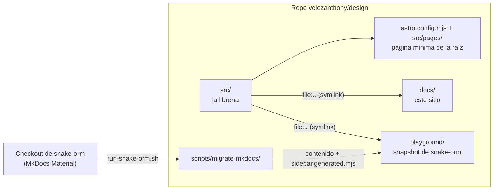

# Playground, este sitio y la migración

Alrededor de `src/` hay tres piezas que no se distribuyen pero sin las que la librería sería mucho
más difícil de mantener.



## La raíz: `npm run dev`

El `astro.config.mjs` de la raíz y `src/pages/index.astro` son un proyecto de Astro mínimo, sin la
integración, que solo sirve para comprobar que el paquete compila (`npm run check`, `npm run dev`).
`src/pages/` queda fuera del paquete con `!src/pages` en `"files"`.

## `playground/`: un consumidor con contenido real

Un consumidor de verdad, creado con el scaffold oficial de Astro y configurado exactamente como
indica la [Integración](../integracion/index.md), con una diferencia: depende de
`"@velezanthony/design": "file:.."` en lugar de una etiqueta de GitHub. Como es un workspace, npm
enlaza el paquete con un symlink a la raíz del repo, y **editar `src/` recarga el playground en
caliente**.

Su contenido es un _snapshot_ de la documentación de snake-orm (inglés y español, referencia de API
generada, un `CHANGELOG.md` externo), así que ejercita casi todo: dos idiomas con
`MissingTranslation.LINK`, secciones de `nav`, un `external`, `editUrl` con `repoRoot` simulado, una
licencia en el pie y una imagen OG. La página `showcase/` existe solo en el playground para probar lo
que snake-orm no usa (zoom de imágenes, pestañas, admonición plegada).

```sh
npm run playground:dev     # servidor de desarrollo
npm run playground:build   # build completo (con búsqueda)
npm run playground:check   # astro check del playground
```

Está fuera de ESLint, de Prettier y de `tsconfig.json` de la raíz: tiene sus propias
comprobaciones.

## `docs/`: este sitio

El segundo consumidor: la documentación de la propia librería, con un solo idioma (`es`), cuatro
secciones de `nav` y sin analítica. Se configura en `docs/docs.config.mjs` y su contenido vive en
`docs/src/content/docs/`. Como el playground, depende de `file:..`.

```sh
npm run docs:dev     # servidor de desarrollo
npm run docs:build   # build completo; debe terminar sin avisos
npm run docs:check   # astro check del sitio
```

Se publica en `https://velezanthony.github.io/design/` con `.github/workflows/docs.yml` (ver
[Publicar una versión](../mantenimiento/versiones.md#el-sitio-de-documentación)).

> [!TIP]
> Este sitio es también el mejor test de humo: si un cambio en `src/` rompe algo de lo que se usa
> aquí (diagramas, alertas, tablas, enlaces con anclas acentuadas), `npm run docs:build` falla.

## `scripts/migrate-mkdocs/`: de MkDocs a la librería

La documentación de snake-orm se escribió para MkDocs Material. Este codemod convierte una carpeta `docs/`
de MkDocs en contenido de la librería **sin escribir nunca en el origen**:

| Archivo | Qué hace |
| --- | --- |
| `cli.ts` | Envuelve todo con E/S: lee `mkdocs.yml` y `docs/`, escribe contenido, sidebar e informe. |
| `transform.ts` | Transformación **pura** del Markdown: admoniciones de Material → directivas o alertas de GitHub, pestañas, etiquetas de lenguaje inequívocas (`console`, `sql`). Devuelve el texto y un registro de cada cambio. |
| `nav.ts` | El `nav` de `mkdocs.yml` → `sidebar` de la config, con `nav_translations` para `es`. |
| `rewrite-links.ts` | Los enlaces a páginas publicadas se quedan; los que apuntan a código del repo pasan a URLs absolutas de GitHub. |
| `anchors.ts` | MkDocs genera ids sin acentos y la librería los conserva (como GitHub): corrige `#el-catalogo` a `#el-catálogo`. |
| `generate-api.py` | Genera la referencia de API con griffe2md para los `::: identificador` de mkdocstrings. |
| `api-postprocess.ts` | Limpia la salida de griffe2md para que pase el build estricto. |
| `run-snake-orm.sh` | Regenera el playground desde un checkout de snake-orm. |

```sh
scripts/migrate-mkdocs/run-snake-orm.sh <ruta a snake-orm> <python con griffe2md>
```

El codemod solo etiqueta un bloque sin lenguaje cuando es inequívoco: `console` si empieza por
`$ `, `sql` si empieza por `SELECT`, `INSERT`, `UPDATE`, `DELETE`, `CREATE`, `ALTER` o `WITH`.
Nunca adivina Python ni otros lenguajes. Sus tests (`*.test.ts` de la carpeta) entran en `npm test`
por el `include` de `vitest.config.ts`.
