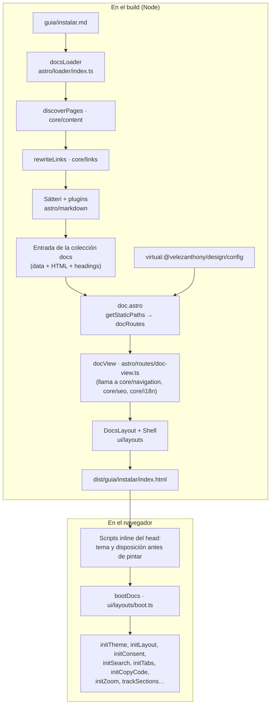
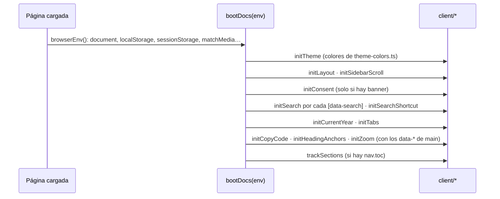

# Una página de principio a fin

Sigamos a un archivo concreto, `src/content/docs/guia/instalar.md` de un consumidor, desde el disco
hasta que el visitante pulsa el botón de tema.



## 1. Del archivo a la colección

El loader (ver [Cómo funciona por dentro](../integracion/por-dentro.md#el-loader)) lee el archivo, separa
el frontmatter, deduce:

- **slug** `guia/instalar` (por la ruta, `core/content/slug.ts`);
- **idioma**: el por defecto, porque no lleva sufijo (`core/i18n/locale.ts`);
- **título**: el primer `# h1` o `title` (`core/content/title.ts`);

reescribe sus enlaces, lo renderiza con el pipeline de Markdown y guarda la entrada
`es/guia/instalar` con su HTML y sus encabezados. Si algo falla, el error lleva archivo y línea.

## 2. De la colección a la ruta

`doc.astro` es la ruta `/[...slug]` que inyectó la integración:

1. `getStaticPaths` lee todas las entradas y llama a `docRoutes`, que devuelve una ruta por página
   real (y por cada reserva, si la política es `fallback`). Para nuestro archivo, `param` es
   `guia/instalar`.
2. En el render busca la entrada por `slug` y `contentLocale`, y llama a `renderDoc`.
   **`render(entry)` va en el contenedor, no en el layout**: renderizar dentro de un layout rompe el
   `<head>` en desarrollo (astro#13724).
3. Lee las dimensiones de las imágenes SEO y llama a `docView`, que reúne con funciones puras de
   `core/` todo lo que la página necesita: barra lateral de su sección, cabecera, anterior/siguiente,
   etiquetas del head, pie, textos del idioma, URL de edición.
4. Pasa ese objeto a `DocsLayout`. Las fuentes (`<Font>` de `astro:assets`) se inyectan en la ranura
   `head` desde el contenedor, porque `ui/` no puede importar `astro:*`.

## 3. Del layout al HTML

- `Shell.astro` pinta `<html lang>` con los atributos de disposición, importa `theme.css` (la única
  importación de CSS de toda la librería), los `<meta name="theme-color">` y los scripts inline que
  aplican el tema y la disposición guardados **antes del primer pintado**.
- `Head.astro` pinta las etiquetas que calculó `core/seo/head.ts`.
- `DocsLayout.astro` monta cabecera, barra lateral, contenido (`.prose`), índice y pie. En el
  `<main>` deja los textos que el cliente necesitará como atributos `data-*` (`data-copy-label`,
  `data-anchor-label`, `data-zoom-label`…) y marca con `data-pagefind-body` lo que se indexa.

## 4. El arranque del cliente

Al final de `DocsLayout.astro` hay un único `<script>` de módulo:

```astro
<script>
  import { bootDocs } from './boot';

  bootDocs();
</script>
```

`bootDocs` (`src/ui/layouts/boot.ts`) cablea todo el cliente en un orden fijo:



Tres decisiones que conviene conocer antes de tocarlo:

- **`BootEnv` inyectable.** `bootDocs` recibe el entorno (documento, almacenamiento, consultas de
  medios, portapapeles…) como parámetro, con `browserEnv()` como valor por defecto. Así
  `boot.test.ts` lo ejecuta con dobles, sin globales del navegador.
- **Cada `init*` ignora lo que la página no tiene.** Una página sin pestañas no falla en
  `initTabs`; simplemente no hay nada que cablear.
- **Los textos llegan por `data-*`.** `client/` no puede importar valores de `core/`, así que el
  catálogo ya resuelto viaja en el HTML.

La 404 usa `bootNotFound`: primero sustituye el cuerpo por el del idioma de la URL y **solo después**
llama a `bootDocs`, para que los `init*` vean el DOM definitivo.

## Dónde mirar cuando algo falla

| Síntoma | Empieza por |
| --- | --- |
| La página no existe o tiene otra URL | `core/content/discovery.ts`, `core/i18n/availability.ts` |
| Un enlace interno roto o mal reescrito | `core/links/rewrite.ts` |
| Algo raro en el HTML del Markdown | `astro/markdown/` (el plugin concreto) |
| Barra lateral, cabecera o anterior/siguiente | `core/navigation/` |
| Etiquetas del head | `core/seo/meta.ts`, `core/seo/head.ts` |
| Un dato de la config no llega a la página | `astro/virtual/data.ts`, `astro/routes/doc-view.ts` |
| Un comportamiento en el navegador | `client/` y su llamada en `ui/layouts/boot.ts` |
| Aspecto visual | `ui/styles/theme.css` y el componente en `ui/` |
