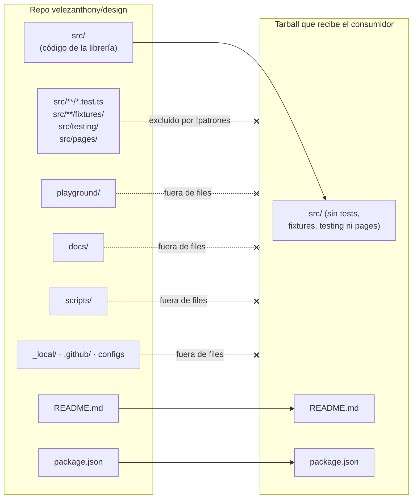

# Por qué no entra en el paquete

Este repo aloja tres cosas a la vez:

- **La librería**, en `src/`: lo único que se distribuye.
- **`playground/`**: un consumidor real con el contenido de snake-orm, para probar la librería con
  documentación de verdad.
- **`docs/`**: este sitio, que documenta la librería usando la propia librería.

Las tres comparten `node_modules` porque `playground/` y `docs/` son **workspaces de npm** (campo
`"workspaces"` del `package.json` de la raíz). La pregunta lógica es: si un consumidor instala
`github:velezanthony/design#v0.1.0`, ¿no se lleva también el playground, este sitio y sus
dependencias? **No**, y no por casualidad: hay seis barreras independientes, y cualquiera de ellas
basta para la mayoría de los casos.

## Lo que va en el tarball y lo que se queda en el repo



## Las seis barreras

### 1. La lista blanca `"files"` del `package.json`

```json
"files": [
  "src",
  "!src/pages",
  "!src/testing",
  "!src/**/fixtures",
  "!src/**/*.test.ts",
  "README.md"
]
```

`"files"` es una **lista blanca**: lo que no aparece, no se empaqueta. Entra `src/` entero y
después se restan, con patrones negados:

- `src/pages/`: la página mínima que usa `npm run dev` en la raíz (con el `astro.config.mjs` de la
  raíz). Si viajara, Astro del consumidor la vería como una página más.
- `src/testing/`: utilidades de test (renderizado con el contenedor de Astro, doble del módulo
  virtual, build de fixtures, contraste WCAG…).
- `src/**/fixtures/`: los mini-proyectos de Astro que construyen los tests de integración.
- `src/**/*.test.ts`: los tests, que viven junto a su código.

npm añade siempre `package.json` (y un `README`/`LICENSE` si existen), con o sin lista. `playground/`,
`docs/`, `scripts/`, `_local/` y `.github/` no figuran: no viajan.

### 2. Una dependencia de git también se empaqueta

Podría parecer que `npm install github:velezanthony/design#v0.1.0` copia el repo clonado tal cual.
No es así: npm clona el repo en una carpeta temporal, ejecuta su script `prepare` si existe (aquí no
hay ninguno) y después lo **empaqueta con las mismas reglas que `npm pack`**. Lo que se instala en
`node_modules/@velezanthony/design` es el contenido de ese tarball. Por eso la lista `"files"` es la
única fuente de verdad, se instale desde el registro, desde un `.tgz` o desde git.

### 3. Los workspaces de una dependencia se ignoran

El campo `"workspaces"` solo tiene efecto en el **proyecto raíz** que ejecuta `npm install`. Cuando
el paquete es una dependencia de otro proyecto, npm no mira sus workspaces: no instala las
dependencias de `playground/` ni de `docs/` (Astro, Pagefind… del sitio) en el consumidor. Y de todas
formas, por la barrera 1, esas carpetas ni siquiera están en el tarball.

### 4. Tailwind solo escanea `src/`

Los componentes de la librería usan clases de utilidad, y Tailwind necesita leerlas para generar el
CSS. En `src/components/styles/theme.css`:

```css
@source '../../';
```

La ruta es relativa al propio `theme.css` (`src/components/styles/`), así que `../../` es **`src/`**, ni un
nivel más. Funciona igual venga el paquete de `node_modules` o de un symlink del workspace. El
contenido del playground o de este sitio nunca se escanea como si fuera de la librería, y las clases
que usen sus páginas no engordan el CSS de los consumidores. Un test de
`src/components/styles/theme.test.ts` fija que el `@source` apunte a `src/`.

### 5. Un test de guarda con `npm pack --dry-run`

Las barreras anteriores son configuración, y la configuración se rompe en silencio (alguien añade
`"docs"` a `"files"` sin pensar). Por eso `src/testing/package-contents.test.ts` ejecuta
`npm pack --dry-run --json --ignore-scripts`, lee la lista de archivos y **falla si aparece algo
fuera de `src/`** que no sea `README.md` o `package.json`, o si se cuela un test, una fixture,
`src/testing/`, `src/pages/`, `playground/` o `docs/`. Así un cambio accidental se ve en `npm test` y
en la CI, no en el `node_modules` de un consumidor.

### 6. Cada workspace tiene su propia salida y su propio despliegue

- `playground/dist/` y `docs/dist/` (con sus `.astro/`) están en el `.gitignore` de la raíz: no se
  versionan, así que ni siquiera existen en el árbol que npm empaqueta desde git.
- Este sitio se despliega con **su propio workflow**, `.github/workflows/docs.yml`, que construye
  `docs/` y sube `docs/dist/` a GitHub Pages. La CI de la librería (`ci.yml`) no publica nada.
- `.gitattributes` marca `playground/**` como documentación para que GitHub no cuente sus archivos en
  las estadísticas de lenguajes del repo.

## Cómo comprobarlo tú mismo

Desde la raíz del repo:

```sh
npm pack --dry-run
```

Lista cada archivo que entraría en el tarball, su tamaño y el total, sin escribir nada. Si quieres
filtrar por lo que NO es `src/`:

```sh
npm pack --dry-run --json | node -e 'const [p] = JSON.parse(require("fs").readFileSync(0)); console.log(p.files.map((f) => f.path).filter((f) => !f.startsWith("src/")))'
```

La salida esperada es exactamente:

```text
[ 'README.md', 'package.json' ]
```

> [!WARNING]
> Si algún día añades una carpeta nueva al repo (otro workspace, scripts, assets), no hace falta
> tocar nada para que se quede fuera: `"files"` es una lista blanca. Lo que SÍ requiere cuidado es
> añadir algo dentro de `src/` que no deba viajar (una fixture con otro nombre, un helper de tests
> fuera de `src/testing/`). En ese caso, añade su patrón negado a `"files"` y comprueba el resultado
> con `npm pack --dry-run`.
