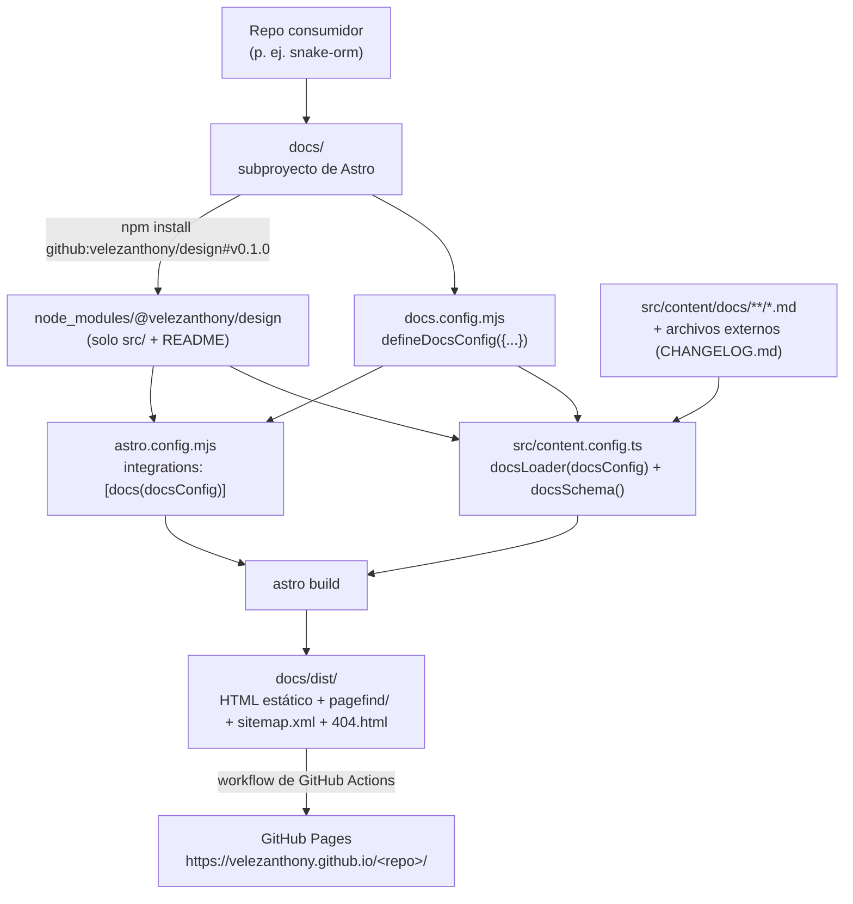

# Dónde se monta

La librería no es una aplicación que se despliega sola: siempre vive **dentro de otro repo**, en un
subproyecto de Astro que normalmente se llama `docs/`. Ese subproyecto es lo único que el repo
consumidor añade para tener documentación.

## El recorrido completo

1. El repo consumidor crea `docs/` con el scaffold de Astro.
2. Instala la librería desde GitHub, **fijada a una etiqueta**: `github:velezanthony/design#v0.1.0`.
   No está en el registro de npm.
3. Escribe `docs.config.mjs` con `defineDocsConfig` y lo importa en dos sitios: en
   `astro.config.mjs` (para la integración `docs()`) y en `src/content.config.ts` (para el loader).
4. Escribe sus páginas en `docs/src/content/docs/`.
5. `astro build` genera `docs/dist/`, totalmente estático.
6. Un workflow publica `docs/dist/` en GitHub Pages, bajo `https://velezanthony.github.io/<repo>/`.

El paso a paso con el código exacto está en [Integración](../integracion/index.md).

> [!NOTE]
> ¿Por qué la configuración va en un archivo aparte y no directamente en `astro.config.mjs`? Porque
> Astro valida la lista de integraciones y **descarta las propiedades que no conoce**. El loader de
> contenido no tiene forma de leer la config desde la integración, así que ambos importan el mismo
> módulo. Lo explica el comentario de `defineDocsConfig` en `src/astro/integration/index.ts`.

## Qué pone la librería y qué pone el consumidor

La frontera es deliberadamente gruesa: el consumidor decide **qué** se publica; la librería decide
**cómo** se ve y se comporta.

| La librería (`@velezanthony/design`) | El consumidor (`docs/` de su repo) |
| --- | --- |
| Estilos, tokens y paleta (`src/ui/styles/theme.css`) | El contenido Markdown |
| Tema claro/oscuro y su selector | `docs.config.mjs`: nombre, idiomas, `nav`, `sidebar`, SEO base |
| Fuentes (IBM Plex vía la API de fuentes de Astro) | `site` y `base` en `astro.config.mjs` |
| Componentes genéricos: cabecera, barra lateral, índice, pie, pestañas, admoniciones | Imágenes de `public/` (imagen OG, favicon propio si quiere) |
| Todas las rutas: páginas, `404`, `sitemap.xml`, favicon por defecto, privacidad | El workflow de despliegue y, si quiere analítica, `PUBLIC_GTM_ID` |
| SEO: plantilla de título, descripción, Open Graph, canonical, `hreflang` | Componentes propios, solo si algo es específico de su proyecto |
| Búsqueda (índice de Pagefind generado al terminar el build) | |
| Idiomas: URLs por idioma, textos de interfaz, política de traducciones ausentes | |
| Validación estricta: enlaces, anclas, títulos, lenguajes de código | |
| Banner de consentimiento y carga diferida de Google Tag Manager | |

Lo que el consumidor **no** escribe nunca: un layout, un `import` de CSS, un `@source` de Tailwind o
una página en `src/pages/`. De hecho, una página propia en `/`, `/404` o `/sitemap.xml` rompe el
build (`src/astro/integration/route-collisions.ts`), porque Astro la serviría en lugar de los docs.

## Por qué se distribuye como fuente

El paquete publica `.ts` y `.astro` **sin paso de build**: no hay `dist/` de la librería. Quien
compila es el Astro del consumidor. Ventajas:

- No hay un compilado que se desincronice del código fuente.
- En el `playground/` y en este sitio, editar `src/` recarga en caliente, porque el workspace enlaza
  el paquete por symlink.

El precio es doble: el consumidor necesita las _peer dependencies_ (`astro`, `tailwindcss`,
`@tailwindcss/vite`, `@astrojs/markdown-satteri`), y el código no puede usar sintaxis de TypeScript
que no sea borrable. Por eso ESLint prohíbe los `enum` (ver
[Arquitectura](../arquitectura/index.md#el-resto-de-reglas-de-eslint)).

## Siguiente lectura

Cómo conviven en este repo la librería, el `playground/` y esta documentación sin que nada de lo
segundo llegue a los consumidores: [Por qué no entra en el paquete](./fuera-del-paquete.md).
