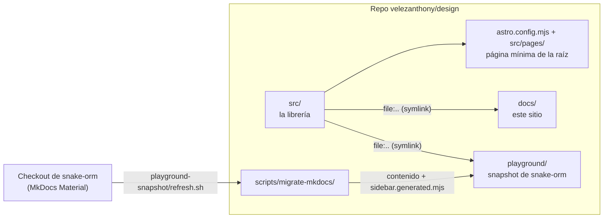

---
seo:
  title: "Playground, este sitio y la migración desde MkDocs"
  description: "Las piezas que rodean a la librería sin distribuirse: el playground con la documentación de snake-orm, este sitio y el script de migración desde MkDocs."
---

# Playground, este sitio y la migración

Alrededor de `src/` hay tres piezas que no se distribuyen pero sin las que la librería sería mucho
más difícil de mantener.



## La raíz: `npm run dev`

El `astro.config.mjs` de la raíz y `src/pages/index.astro` son un proyecto de Astro mínimo, sin la
integración, que solo sirve para comprobar que el paquete compila (`npm run check`, `npm run dev`).
`src/pages/` queda fuera del paquete con `!src/pages` en `"files"`.

## `playground/`: un consumidor con contenido real

Un consumidor de verdad, creado con el scaffold oficial de Astro y configurado exactamente como
indica la [Integración](../guia/primeros-pasos.md), con una diferencia: depende de
`"@velezanthony/design": "file:.."` en lugar de una etiqueta de GitHub. Como es un workspace, npm
enlaza el paquete con un symlink a la raíz del repo, y **editar `src/` recarga el playground en
caliente**.

Su contenido es un _snapshot_ de la documentación de snake-orm (inglés y español, referencia de API
generada, un `CHANGELOG.md` externo), así que ejercita casi todo: dos idiomas con
`MissingTranslation.LINK`, secciones de `nav`, un `external`, `editUrl` con `repoRoot` simulado, una
licencia en el pie y una imagen OG. La página `showcase/` existe solo en el playground para probar lo
que snake-orm no usa (zoom de imágenes, pestañas, admonición plegada).

```sh
npm run playground:dev     # servidor de desarrollo
npm run playground:build   # build completo (con búsqueda)
npm run playground:check   # astro check del playground
```

Está fuera de ESLint, de Prettier y de `tsconfig.json` de la raíz: tiene sus propias
comprobaciones.

## `docs/`: este sitio

El segundo consumidor: la documentación de la propia librería, con un solo idioma (`es`), cuatro
secciones de `nav` y analítica solo en el despliegue (el workflow pasa `PUBLIC_GTM_ID` desde el
secreto del repo). Se configura en `docs/docs.config.mjs` y su contenido vive en
`docs/src/content/docs/`. Como el playground, depende de `file:..`.

```sh
npm run docs:dev     # servidor de desarrollo
npm run docs:build   # build completo; debe terminar sin avisos
npm run docs:check   # astro check del sitio
```

Se publica en `https://velezanthony.github.io/design/` con `.github/workflows/docs.yml` (ver
[Publicar una versión](./versiones.md#el-sitio-de-documentación)).

> [!TIP]
> Este sitio es también el mejor test de humo: si un cambio en `src/` rompe algo de lo que se usa
> aquí (diagramas, alertas, tablas, enlaces con anclas acentuadas), `npm run docs:build` falla.

## `scripts/migrate-mkdocs/`: de MkDocs a la librería

La librería lee los `.md` de un repo **donde ya están** (`content: '../docs'`, ver «Docs fuera del
proyecto de Astro» en el README), así que migrar no es mover ficheros: solo hay que convertir una vez
la sintaxis que es propia de MkDocs Material. Este codemod lo hace.

### Flujo habitual: `--in-place`

```sh
node scripts/migrate-mkdocs/cli.ts --repo <ruta al repo> --in-place
git -C <ruta al repo> diff docs/      # revisa SOLO la conversión
git -C <ruta al repo> commit ...       # o: git checkout docs/  para descartarla
```

Reescribe `docs/**/*.md` en su sitio, solo los ficheros que cambian y respetando sus saltos de
línea (LF o CRLF). Convierte admoniciones (`!!!`, `???`, `???+`), pestañas (`=== "x"`), iconos de
Material, `attr_list` y ids de encabezado, y reescribe las anclas (`#ancla`) a los ids que genera la
librería (ver más abajo). Los enlaces
`.md` relativos **se quedan tal cual**: la librería los resuelve y los valida ella. No toca ficheros
que no sean `.md`. Si ejecutas el comando dos veces, la segunda no cambia nada.

Reglas de seguridad, para que `git diff docs/` enseñe únicamente la conversión:

- Si el repo no es git, o `git status --porcelain -- docs` no está vacío (cambios sin confirmar en
  `docs/`), se niega a correr y sale con error sin tocar nada.
- `--force` se salta esa comprobación. Se **desaconseja**: tu diff se mezclaría con lo que ya
  tuvieras a medias.
- `--in-place` es incompatible con `--out` (y con las opciones que solo usa el modo carpeta).
- **`--dry-run`** (en los dos modos) no escribe nada: ni `docs/`, ni `--out`, ni la config ni el
  informe, y por eso tampoco exige `docs/` limpio. Imprime el plan: los ficheros que cambiarían con
  lo que cambia en cada uno, los restos, la config sugerida y los avisos. Sin `--dry-run` aplica lo
  mismo.

Al terminar imprime un resumen: ficheros cambiados, conversiones por tipo (admoniciones, pestañas,
iconos quitados, anclas reescritas…), stubs, restos y el siguiente paso (`git diff docs/`).

**`mkdocs.yml` también en `--in-place`.** Si está en la raíz del repo se lee y se imprime una **config
sugerida** (`--config-out <fichero>` la escribe, sin pisar nada más): `locales` y `defaultLocale` de
`plugins.i18n.languages`, `translations.missing: 'fallback'` si hay `fallback_to_default: true`,
`exclude` desde `exclude_docs` (sin comentarios) y `nav`: cada grupo de primer nivel es una
**sección con solo `sidebar`** (sin `dir`), con la etiqueta de cada idioma sacada de `nav_translations`.
Con `docs_dir: .` lo que vive fuera de `docs/` (`README.md`, `CHANGELOG.md`…) va como `external`
en esa misma sugerencia, y los slugs se reparten por el `nav`. Es un punto de partida: revisa los
slugs de los externos y las etiquetas antes de pegarla en `docs.config.mjs`.

**`--api` en `--in-place`.** `--api <api.json>` (el que genera `api/generate-api.py`) sustituye las
directivas `::: paquete.Símbolo` de mkdocstrings por la referencia generada; sin él quedan como una
nota, como siempre.

**Anclas.** MkDocs y la librería no numeran ni limpian igual los encabezados, y un `[x](#ancla)`
escrito para uno rompe en el otro. El migrador calcula, por encabezado, el id de MkDocs
(Python-Markdown: sin acentos, los separadores seguidos se juntan, los repetidos van con `_1`, y un
`{ #id }` explícito manda) y el de la librería (github-slugger: acentos conservados, cada espacio un
guion, los repetidos con `-1`) y reescribe los enlaces del primero al segundo, también entre
ficheros y desde la página traducida a su gemela. Si `toc.slugify` es propio (`pymdownx.slugs`) se
supone un id con acentos como el de la librería y solo cambia la numeración. Un ancla que ya es un id
de la librería no se toca.

**Lo que ignora.** Al final lista lo que `mkdocs.yml` declara y no se traduce: tema de Material,
`extra_css`/`extra_javascript`, `hooks`, plugins sin equivalente, extensiones de Markdown que no
convierte, `docs_dir` distinto de `docs`, datos del sitio que hay que pasar a mano (`site_name`,
`site_url`, `repo_url`…) y los `!` de `exclude_docs`. Nada se pierde en silencio.

**Comprobación de restos.** Tras convertir se revisa el _resultado_: cualquier línea, fuera de
bloques de código y de código en línea, que siga empezando por `!!!` o `???`, por `===` con un
título entre comillas (también `===+`), que lleve un código de icono (`:material-…:`,
`:octicons-…:`, `:fontawesome-…:`, `:simple-…:`) o un `--8<--` se lista como
`fichero:línea  tipo  vista previa` y el código de salida es 1. La detección es por líneas, como la
de Python-Markdown; el riesgo está en convertir bloques anidados o con sangrías raras, y esta red
lo cubre.

**Stubs de snippet.** Una página cuyo cuerpo es solo `--8<-- "CHANGELOG.md"` (con, como mucho,
frontmatter, comentarios HTML y un título) no se convierte ni se borra. Se lista aparte con la
entrada exacta para `external[]` de `docs.config.mjs`
(`{ slug: 'changelog', file: '../CHANGELOG.md' }`), y también los enlaces que apuntan al stub con
la ruta real que los sustituiría (`../../CONTRIBUTING.md`). Después, borra el stub.

### Modo carpeta: `--out`

Para migraciones que sí cambian de sitio los ficheros (como el playground con snake-orm):
`--repo`, `--out`, `--repo-url`, y opcionalmente `--branch`, `--api`, `--external`/`--external-out`,
`--sidebar-out`, `--config-out`, `--dry-run` y `--report`. Lee `mkdocs.yml` (nav, `exclude_docs`, traducciones), reescribe los
enlaces a código del repo como URLs de GitHub, genera el sidebar y **no escribe nunca en el
origen**. Comprueba restos igual que `--in-place`.

```sh
scripts/playground-snapshot/refresh.sh <ruta a snake-orm> <python con griffe2md>
```

### Cómo está hecho

Cada conversión es una **función pura** (sin `fs`, git ni `process`) en su propio módulo, con su
`*.test.ts` al lado. Reciben texto y devuelven `{ output, log }`. La E/S va aparte y llega
_inyectada_. La carpeta se divide por responsabilidad:

| Carpeta | Responsabilidad |
| --- | --- |
| `cli.ts` | Solo parsea argumentos y cablea los módulos. |
| `conversions/blocks/` | Conversiones de bloque: `admonitions` (`!!!`, `???`), `tabs` (`=== "x"`), `fences` (código intacto y etiquetas inequívocas), `api-directive` (mkdocstrings) y `html-wrappers` (tarjetas `<div markdown>`). |
| `conversions/inline/` | Conversiones de texto corrido, línea a línea y fuera del código en línea: `icons`, `attr-lists`, `heading-ids`, `autorefs` y `links`. |
| `checks/` | Comprobaciones sobre el resultado: `leftovers` (restos de sintaxis y stubs `--8<--`), `stub-links` (enlaces a un stub) y `anchors` (ids de MkDocs a ids de la librería; desde `x.es.md` valida contra la gemela). |
| `pipeline/` | La composición, pura: `transform` (un documento, en orden fijo y documentado) y `pipeline` (un conjunto de ficheros), más sus utilidades (`lines`, `newlines`, `frontmatter`, `types`). |
| `modes/` | Los dos modos de la CLI: `in-place`, con E/S inyectada, y `to-folder` (`--out`), con lo que solo usa este último: `rewrite-links` y `nav` (el sidebar de `--sidebar-out`). Los dos comparten `mkdocs` (lee `mkdocs.yml`), `config-suggestion` (la config sugerida), `ignored` (los avisos) y `api-resolver` (`--api`). |
| `api/` | La API de Python para `--api`: `generate-api.py` la genera con griffe2md desde el código de un paquete y `api-postprocess` limpia ese Markdown. Sirve para cualquier repo de Python. |
| `io/` | Lo que toca el exterior o lo describe: `node-io` (fs y git de Node), `git-guard`, `options` (validación de flags) y `report` (textos del informe). |

Al lado, `scripts/playground-snapshot/refresh.sh` es lo único propio del playground: ejecuta el conversor
contra un checkout de snake-orm para regenerar la copia de su documentación. Vive fuera de
`migrate-mkdocs/` porque lo usa, no forma parte de él: el conversor no depende de snake-orm.

Sus tests (`*.test.ts` de todas las subcarpetas) entran en `npm test` por el `include` de
`vitest.config.ts`.
