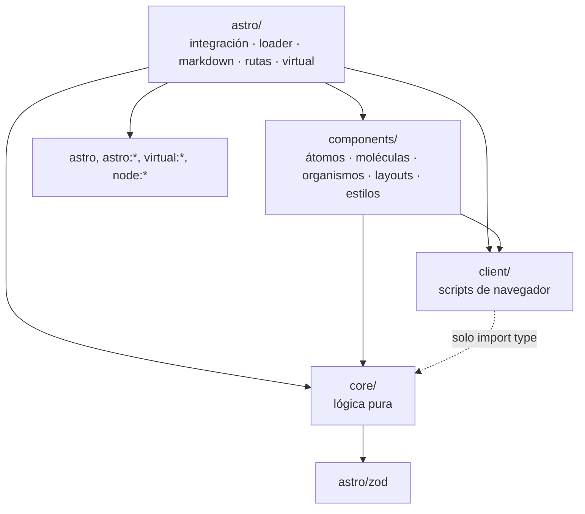

---
seo:
  title: "Arquitectura por capas de la librería"
  description: "Las capas core, client, components, astro y testing, qué puede importar cada una y cómo lo hace cumplir ESLint: la lógica que decide no sabe nada de Astro."
---

# Capas

`src/` se divide en cuatro capas con una **regla de dependencia** estricta, más una carpeta de
utilidades de test. La idea es la de una arquitectura hexagonal: la lógica que decide (qué URL tiene
una página, qué va en la barra lateral, qué etiquetas lleva el head) no sabe nada de Astro ni del
navegador, y por eso se puede probar con tests unitarios rápidos y sin montar nada.

| Capa | Qué contiene | Puede importar |
| --- | --- | --- |
| `core/` | Lógica pura: config, contenido, enlaces, navegación, i18n, SEO, analítica. | Solo `core/` y `astro/zod`. |
| `client/` | JavaScript del navegador: tema, búsqueda, consentimiento, pestañas, zoom… | Solo **tipos** de `core/` (`import type`). |
| `components/` | Componentes `.astro` presentacionales y estilos. Reciben props, no buscan datos. | `core/` y `client/`. Nada de `astro`, `astro:*`, `virtual:*` ni la carpeta `astro/`. |
| `astro/` | El adaptador: integración, loader, plugins de Markdown, rutas, módulo virtual. | Todo, con las reglas de subcapa de más abajo. Es la única capa que conoce Astro. |
| `testing/` | Utilidades de test (no se distribuye). | Todo. |



Las flechas son las únicas direcciones permitidas. Fíjate en lo que **no** hay:

- `core/` no apunta a nada salvo a zod: ni Node (`node:*`), ni Astro, ni el módulo virtual. Es puro.
- `client/` no importa valores del núcleo. El código de navegador se empaqueta para el cliente, y
  arrastrar valores de `core/` metería en el bundle código que no pinta nada en el navegador. Los
  datos que necesita le llegan por atributos `data-*` del HTML.
- `components/` no ve `astro/`: un componente no lee la colección ni el módulo virtual. Eso lo hacen las
  **rutas** de `astro/routes/` (contenedores), que le pasan el modelo a las páginas de
  `components/pages/` (presentacionales: solo pintan).

### Subcapas de `astro/`

Dentro de `astro/` los datos y la presentación tampoco se importan entre sí: solo `routes/` conoce a los dos.

- `views/` (modelos de vista) no importa `astro:*`, el paquete `astro` ni `data/`, y tampoco `components/`.
- `loader/` no importa `integration/`.
- `data/` no importa `routes/`, `views/` ni `components/` (tampoco sus tipos). Si una ruta necesita
  datos y una vista, los lee de `data/` y se los pasa a `views/`: `routes/doc.astro` lee las fechas de
  commit y optimiza las portadas (`data/covers.ts`) y llama a `docListingView`.
  Sin excepciones: el adaptador del panel (`data/seo-on-page/`) tampoco; las rutas del panel arman
  sus enlaces (`views/seo-on-page/hrefs`).
- La ruta construye el contexto del sitio (`siteContext`) una vez por render y lo pasa a cada vista
  (`docView`, `docListingView`, `docNavTrees`); `docRoutes` resuelve el listado de cada ruta una vez.

### Valla del panel de desarrollo

El panel `seo-on-page` solo existe en desarrollo, así que nada de lo publicado puede importarlo: ni
`components/` (fuera de `components/seo-on-page/`), ni `client/` (fuera de `client/seo-on-page/`), ni
`astro/routes/` (fuera de `routes/seo-on-page/`). Los textos del panel viven en
`core/seo-on-page/labels.ts` para que tanto sus vistas como sus componentes los lean sin cruzarse.

## Cómo lo hace cumplir ESLint

La regla vive en `eslint.config.mjs`, con `@typescript-eslint/no-restricted-imports` aplicada por
carpeta mediante una función `layer(folder, paths, patterns)`:

- Los imports **relativos** se detectan con una expresión regular sobre el nombre de la carpeta
  (`relativeTo(['client', 'components', 'astro'])` atrapa `../../components/atoms/Link`).
- Los **esquemas** (`astro:*`, `virtual:*`, `node:*`) se bloquean por patrón.
- El paquete `astro` va por `paths` (coincidencia exacta). Como patrón, `astro` también atraparía
  `astro/zod`, y un patrón no puede volver a permitir algo que cuelga de una carpeta ya excluida.
- Las subcapas de `astro/` usan `siblingOf([...])`, que solo atrapa la carpeta hermana (`../data`) y no
  `../virtual/data`; la valla del panel usa `relativeTo(['seo-on-page'])` con `ignores` para el propio panel.
- En `client/`, la regla de `core/` lleva `allowTypeImports: true`: los `import type` pasan, los
  valores no.

Y para que nadie relaje una regla sin darse cuenta, `src/testing/boundaries.test.ts` lintea
fragmentos en memoria con la ruta que tendrían en cada capa y comprueba que cada import prohibido
**sigue saltando** (y que los permitidos no). Si alguien borra una regla de `eslint.config.mjs`, el
test correspondiente falla.

## El resto de reglas de ESLint

- **Sin `enum`.** El paquete publica `.ts` sin compilar y `enum` no es sintaxis borrable. En su
  lugar, un objeto `as const` más un tipo derivado:

  ```ts
  export const MissingTranslation = { LINK: 'link', OMIT: 'omit', FALLBACK: 'fallback' } as const;
  export type MissingTranslation = (typeof MissingTranslation)[keyof typeof MissingTranslation];
  ```

  Así están `MissingTranslation`, `PanelState`, `LayoutWidth` y `NavIcon`.
- **Sin linting con tipos.** `astro check` ya es el dueño de los tipos, y el parser tendría que
  generar un `.tsx` por cada `.astro`.
- **Accesibilidad.** `eslint-plugin-astro` con su configuración `jsx-a11y-recommended`.
- **Formato.** `eslint-config-prettier` va el último: el formato es solo cosa de Prettier.
- `playground/` está en `ignores`: es un consumidor con sus propias comprobaciones.

## Por qué así

- **Tests rápidos y fiables.** Casi toda la lógica está en `core/` y se prueba con funciones puras.
  Lo que necesita Astro se prueba con el contenedor de Astro (`testing/render.ts`) o con builds de
  fixtures.
- **Un solo sitio que cambia con Astro.** Cuando Astro cambia una API, el impacto queda en
  `astro/`. El resto no lo nota.
- **Componentes reutilizables.** Como `components/` solo recibe props, un componente se puede renderizar en
  un test o en otra página sin montar la colección ni el módulo virtual.

Sigue con el [mapa de `src/`](./mapa-de-src.md).
