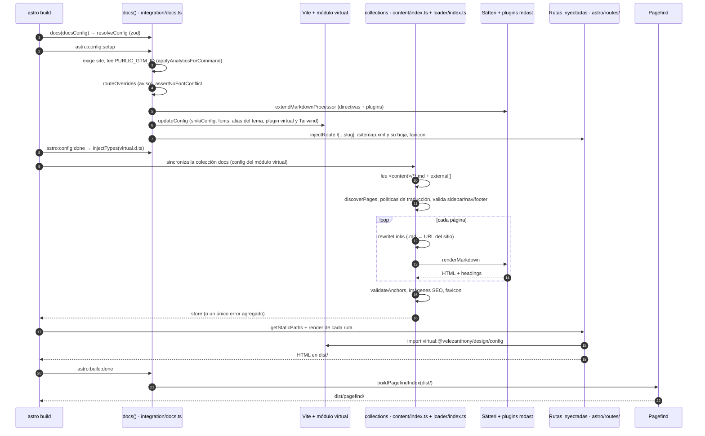
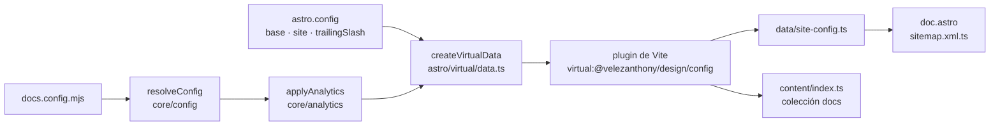

---
seo:
  title: "Cómo funciona la integración de Astro por dentro"
  description: "Qué hace la integración en cada hook de Astro, el módulo virtual, las rutas inyectadas y el loader de contenido, siguiendo un astro build de principio a fin."
---

# Cómo funciona por dentro

La integración tiene dos puertas de entrada, una por cada archivo que toca el consumidor:

- `docs(config)` en `astro.config.mjs` → `src/astro/integration/docs.ts` (`index.ts` solo reexporta la API pública).
- La colección de `content.config.ts` (`@velezanthony/design/content`) →
  `src/astro/content/index.ts` y `src/astro/loader/index.ts`.

La config se carga UNA vez: `astro.config.mjs` importa `docs.config.mjs` y se lo pasa a `docs()`, que
lo pasa por `resolveConfig` (`src/core/config/resolve.ts`: valida con el esquema zod y rellena los
valores por defecto). La config resuelta tiene la misma forma que la pública: `{ site, i18n, content }`,
cada grupo con su esquema, su tipo y su resolución en su módulo (`site.ts`, `i18n.ts`, `content.ts`);
una función que solo necesita una parte la pide con `ConfigPick` (`ConfigPick<'name', 'locales'>`). Un error ahí sale como `AstroError` con la ruta de la clave (`toAstroError`, en
`src/astro/errors.ts`).

El loader se evalúa fuera de la integración y Astro descarta las propiedades que esta le adjunte a
su objeto, así que no puede leerla de ahí. Tampoco hace falta que importe `docs.config.mjs` por su
cuenta: la colección de `@velezanthony/design/content` importa el módulo virtual
`virtual:@velezanthony/design/config` (ver más abajo), que sirve la config que la integración ya
resolvió. Hay una sola fuente por construcción: dos configs distintas no son posibles, y no hace falta
ninguna comprobación que lo vigile. Ojo: Astro solo reinicia `astro dev` cuando cambia el propio
`astro.config.mjs`, no lo que este importa. Por eso la integración registra `docs.config.mjs` (o su
variante `.js`/`.ts`) con `addWatchFile` si existe en la raíz: solo lo vigila, no lo carga.

## `astro build` paso a paso

## Los hooks de la integración

### `astro:config:setup`

Es donde ocurre casi todo. En orden:

1. **Exige `site`.** Sin origen absoluto no hay sitemap ni canonical.
2. **Analítica.** `readAnalyticsEnv` lee `PUBLIC_GTM_ID` con `loadEnv` de Vite (en este hook los
   `.env` aún no están en `process.env`) y `applyAnalyticsForCommand` decide si se activa (exige `site.analytics.privacyUrl`). Detalle en
   [Analítica y privacidad](../guia/analitica-y-privacidad.md).
3. **Sustituciones y conflictos.** `routeOverrides` lista las rutas de la librería que el
   consumidor sustituye con un fichero de `src/pages/` (la portada, el sitemap, `/_design/`…):
   no es un error, se avisa al arrancar y las rutas exactas que ya son suyas no se inyectan.
   `assertNoFontConflict` falla si el consumidor declara una fuente con `--font-plex-sans` o
   `--font-plex-mono`.
4. **Markdown.** `extendMarkdownProcessor` modifica **en sitio** el procesador Sätteri de la config de
   Astro: activa las directivas y añade nuestros plugins. Si el procesador no es Sätteri, falla (ver
   [Markdown](../guia/markdown.md)).
5. **`updateConfig`.** Fusiona en la config de Astro:
   - `markdown.shikiConfig.langAlias`: nuestros alias más los del consumidor (mandan los suyos).
   - `markdown.shikiConfig.themes`: `github-light-default`/`github-dark-default` (`src/components/styles/code-themes.ts`),
     **solo si el consumidor no eligió temas**.
   - `fonts`: IBM Plex Sans y Mono vía la API de fuentes de Astro (`src/astro/integration/fonts.ts`).
   - `vite.resolve.alias`: `@velezanthony/design/site-theme` apunta al CSS de la opción `theme` (o a
     uno vacío del paquete), que `theme.css` importa en último lugar
     (`src/astro/integration/site-theme.ts`).
   - `vite.plugins`: el plugin del módulo virtual y el de Tailwind (`@tailwindcss/vite`), salvo que el
     sitio ya registrase el suyo (`src/astro/integration/tailwind.ts`).
   - `vite.server.fs.allow`: solo si la carpeta de contenido queda fuera del proyecto.
6. **`injectRoute`.** Todas las rutas salen de una tabla, `src/astro/routes/routes.ts` (patrón, contenedor y cuándo: `site`, `dev` o una opción); las del sitio llevan `prerender: true` y las de dev, no:

| Patrón | Contenedor | Cuándo |
| --- | --- | --- |
| `/[...slug]` | `doc.astro` | Siempre: todas las páginas de docs, en todos los idiomas. |
| `/sitemap.xml` | `sitemap.xml.ts` | Siempre: las páginas o, con `sitemap.include`, el índice. |
| `/sitemap-pages.xml` | `sitemap-pages.xml.ts` | Con `sitemap.include`: las páginas propias. |
| `/_design/sitemap.css` | `sitemap.css.ts` | Siempre (la hoja con la que el navegador pinta el sitemap). |
| `/_design/favicon.png` | `favicon.png.ts` | Siempre (el favicon por defecto, con espacio de nombres propio). |

La 404 y la página de privacidad no están en la tabla: la librería no las inyecta, las pone el sitio.

### `astro:routes:resolved` y `astro:server:setup`

`astro:routes:resolved` guarda las páginas que el sitio tiene en `src/pages/` (para el panel SEO y el
sitemap). `astro:server:setup`, solo en dev, vigila esas páginas y, si hay `static`, monta el
middleware que sirve esas carpetas (`static-folders-dev.ts`).

### `astro:config:done`

Solo una cosa: `injectTypes` copia `src/astro/virtual/virtual.d.ts` al `.astro/` del consumidor, para
que TypeScript conozca `virtual:@velezanthony/design/config`. Va aquí porque `injectTypes` no existe
en `config:setup`.

### `astro:build:done`

`runBuildDone` (`src/astro/integration/build/build-done.ts`) hace cinco cosas, en este orden, sin que el
sitio configure nada:

1. `boundAnimationLoops` reescribe los WebP animados infinitos (Sharp pierde las vueltas del GIF y los
   recodifica así) para que se reproduzcan una vez: una demo que no para es movimiento que el visitante
   no puede detener (WCAG 2.2.2).
2. `pruneOrphanAssets` borra de `_astro/` las imágenes que ningún `.html`, `.css`, `.js`, `.xml`, `.txt`
   ni `.json` del build nombra. Una imagen usada desde un `<Image>` y desde un cuerpo Markdown deja su
   original copiado junto a las derivadas; así no se publica.
3. `buildPagefindIndex` (`pagefind.ts`) indexa `dist/` con la API de Node de Pagefind y escribe
   `dist/pagefind/`. Ver [Navegación y búsqueda](../guia/navegacion-y-busqueda.md). Va después de 1 y 2 para
   no leer recursos que se van a borrar.
4. `addClientPagesToSitemap` suma al sitemap las páginas de `src/pages/`, salvo que el sitio sustituya
   el sitemap.
5. `copyStaticFolders` copia las carpetas de `static` tal cual. Va la última: lo publicado así no pasa
   por la poda, el índice ni el sitemap.

## El módulo virtual

Las páginas de `src/astro/routes/` necesitan la config resuelta, pero se ejecutan dentro de
Vite, lejos del hook que la conoce. El puente es un **módulo virtual** (el mismo patrón que usa
Starlight):

- `createVirtualData` (`src/astro/virtual/data.ts`) junta la config resuelta (`site`, `i18n` sin
  `ui`, `content`) con lo que solo sabe Astro (`base`, `siteUrl` —el `site` de Astro, renombrado para
  no chocar con el grupo `site`—, `trailingSlash`, `buildFormat`, `publicDir`, `root`) y fusiona los
  textos de interfaz por idioma en `strings`.
- `createVirtualConfigPlugin` (`src/astro/virtual/plugin.ts`) sirve ese objeto con
  `JSON.stringify` bajo el id `virtual:@velezanthony/design/config`. Solo datos: nada de funciones.
- `src/astro/data/site-config.ts` importa el módulo y le pone su tipo completo.
- `src/astro/content/index.ts` también lo importa: de ahí saca el loader la config. Sin la
  integración registrada, ese import no resuelve y la build falla con un `AstroError` que pide añadir `docs(config)`.

## El loader

`docsLoader` (o, con la config ya resuelta, `docsLoaderFromResolved`, que usa `@velezanthony/design/content`) es un loader de la Content Layer de Astro. Hace una carga completa (`sync`) en tres
pasadas y **acumula todos los errores** antes de fallar, para que un build roto te diga todo lo que
está mal de una vez, con archivo y línea:

1. **Descubrir.** Lee los `.md` de la carpeta de contenido (`content`, `src/content/docs/` por defecto, y puede estar fuera del proyecto; con su frontmatter validado) y los archivos de
   `external[]`. `discoverPages` (`src/core/content/discovery.ts`) deduce slug, idioma y título de
   cada uno. Después resuelve las políticas de traducción y valida `sidebar`, `nav` y `footer.links`
   contra los slugs reales.
2. **Reescribir y renderizar.** Para cada página: `rewriteLinks` convierte los enlaces `.md`
   relativos en URLs del sitio (y recoge referencias para validar), `context.renderMarkdown` produce el
   HTML con el pipeline de Markdown, y se guarda en el _store_ con sus datos (`docsSchema`):
   `slug`, `locale`, `title`, `sourcePath`, `order`, `seo`, `translations` y `editPath`.
3. **Validar.** Con los encabezados de TODAS las páginas ya conocidos, `validateAnchors` comprueba
   cada `#ancla`; después se comprueban las imágenes SEO y el favicon de `public/`.

En `astro dev`, `watchSources` vigila la carpeta de contenido y los externos y relanza la carga
completa al cambiar cualquier archivo (un fallo se muestra en el log sin tirar el servidor).

> [!NOTE]
> El id de cada entrada es `<idioma>/<slug>` (`es/guia/instalar`, `es/index` para la portada). Las
> rutas no usan ese id: buscan por `data.slug` y `data.locale`.

## De la colección al HTML

`doc.astro` es un **contenedor**: lee el módulo virtual y la colección, llama a funciones puras del
núcleo y pasa a `DocsLayout` (presentacional) los datos ya calculados. El recorrido completo, con el
arranque del JavaScript de cliente, está en
[Una página de principio a fin](./una-pagina.md).
