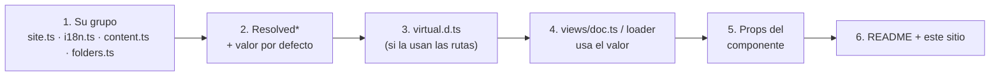

---
seo:
  title: "Recetas: componentes, opciones y textos nuevos"
  description: "Paso a paso y con todos los archivos que tocan: añadir un componente, una opción de configuración, un texto de interfaz o un idioma nuevo."
---

# Recetas

Cuatro cambios que harás a menudo, con todos los archivos que tocan. En todos el orden es el mismo:
**test primero** donde haya lógica, después el código, después la documentación.

## Un componente

1. **Elige el nivel** del diseño atómico:
   - `components/atoms/<tipo>/`: una pieza indivisible sin estado propio (`Link` en `actions/`, `Tag` e `Icon` en `display/`).
   - `components/molecules/<tipo>/`: unas pocas piezas con un propósito (`EditLink` y `PrevNext` en `navigation/`, `ThemeToggle` en `controls/`).
   - `components/organisms/<zona>/`: una zona de la página (`DocsHeader`, `Sidebar` y `ConsentBanner` en `chrome/`).

   Un organismo **solo compone** moléculas y átomos (N10). Si el marcado que vas a escribir ya está
   en otro organismo (una fecha, una insignia, un camino), extráelo antes a una molécula o un átomo,
   con su test y su línea en `mapa-de-src.md`, y úsalo en los dos: así lo hicieron `DateLabel`,
   `SectionPath` y `PageLink`.
2. **Define sus `Props`** con comentarios. Todo lo que muestra llega por props, **textos incluidos**
   (`strings: UiStrings` y `translate(strings, 'clave')`). El componente no importa `astro:*`, ni
   `virtual:*`, ni nada de `src/astro/`: ESLint lo impide.
3. **Estilos** con utilidades de Tailwind y tokens (`text-muted`, `bg-raised`). Si la regla es larga
   o compartida, va en `theme.css` con `@apply`. Nunca colores literales.
4. **Comportamiento en el navegador**, si lo tiene: una función `init*` en `src/client/` que recibe
   el documento y lo que necesite, su test en `client/`, y su llamada en `bootDocs`
   (`src/components/layouts/boot.ts`) o, si es del contenido (como las pestañas o el zoom), en `bootArticle`
   (`src/components/boot/article.ts`). Los textos que necesite el script viajan en atributos `data-*`.
5. **Test** en `components/<nivel>/<tipo>/<Componente>.test.ts` si tiene lógica de render (qué se pinta según las
   props, atributos ARIA, URLs). Usa `render()` de `src/testing/render.ts` y `stringsFor()`. Si es
   puramente visual, no lleva test.
6. **Úsalo** desde el layout o el organismo que corresponda. Si necesita datos de la config o de las
   páginas, los calcula `docView` (`src/astro/views/doc.ts`) con funciones de `core/`, y el
   layout se los pasa.
7. **Si tiene lógica** (qué entradas, qué rango, qué etiqueta), el componente no la deriva (N1): su
   modelo de vista es una función pura en `core/<dominio>/view.ts` con su test, y las URLs le llegan
   por un puerto que implementa `astro/views/`, como `buildListingView` y `ListingHrefs` en
   `core/listing/view.ts`. El componente recibe el modelo y lo pinta.

Los componentes se exportan solos: `@velezanthony/design/components/*` apunta a `src/components/*`, así que
un consumidor puede importar `@velezanthony/design/components/atoms/display/Tag.astro` sin tocar
`package.json`.

## Una opción de configuración

1. **Su grupo y su módulo** (N13). Decide dónde va: `site` (cómo se ve y se presenta), `i18n`
   (idiomas y textos) o `content` (qué se publica y cómo se navega); si cambia de una carpeta a otra,
   es un ajuste de `content.folders` (`core/config/folders.ts`, N11), heredable por hoja con
   `folderSettings`, y nadie más resuelve su precedencia. Añade el campo al esquema del grupo
   (`SiteSchema`, `I18nSchema`, `ContentSchema` o `FolderSettingsSchema`). Es un `strictObject`: hasta
   que no lo añadas, la clave rompe el build como desconocida. Las validaciones que cruzan grupos van
   en el `superRefine` de `schema.ts`, con su ruta completa
   (`issue(['site', 'analytics', 'privacyUrl', locale], …)`); las de un solo grupo, en el suyo, y zod
   les pone la ruta del grupo. Test en `schema.test.ts`. **Los tipos salen del esquema** (N5):
   `export type X = z.infer<typeof XSchema>`, no una interfaz escrita a mano que repita los campos (así
   `FoldersUserConfig`, `FolderSettingsUser`, `Frontmatter`). Si varios bloques comparten campos, un
   esquema base y `.extend()`.
2. **Valores cerrados** (N12): un objeto `as const` en el módulo de la opción, su tipo derivado y su
   esquema `z.enum(Object.values(X))`, exportado desde `src/astro/integration/index.ts` con su caso en
   `public-api.test.ts` (que sus valores sean las opciones del esquema). Las guías lo usan en los
   ejemplos.
3. **Resolución.** Añádelo al tipo resuelto del grupo (`ResolvedSite`, `ResolvedI18n`,
   `ResolvedContent`) y pon el valor por defecto en su `resolve*` (`resolveSite`…): los valores por
   defecto viven ahí, **no** en el esquema. La config resuelta tiene la misma forma que la pública.
   Test en `resolve.test.ts`.
4. **Módulo virtual.** `createVirtualData` copia la config resuelta entera, así que el valor ya viaja.
   Pero `src/astro/virtual/virtual.d.ts` es autocontenido (se copia al `.astro/` del consumidor y no
   puede importar nada): añade ahí el tipo a mano.
5. **Uso.** Quien la lee pide solo su parte con `ConfigPick`. Si depende de las páginas (por ejemplo,
   un slug que debe existir), valídalo en el loader con una función de `core/` que devuelva errores,
   como `validateFooter`. Si afecta a la vista, calcúlalo en `docView` y pásalo como prop.
6. **Frontmatter, no** (N14): el frontmatter solo lleva el contenido de la página (`title`, `slug`,
   `order`, `seo`, `index`, `translations`). El comportamiento de una carpeta va en `content.folders`.
7. **Tipos públicos** (N15): si cambia lo que acepta `defineDocsConfig`, añade su caso a
   `src/testing/config-types.ts` (lo comprueba `npm run check`).
8. **Documentación.** Añade la fila a la «Referencia de configuración» del `README.md`, en su grupo, y,
   si cambia cómo se integra, a [Integración](../guia/primeros-pasos.md).
9. **Pruébala de verdad** en `playground/docs.config.mjs` o en este sitio.

## Un texto de interfaz

1. Añade la clave al catálogo `en` de `src/core/i18n/ui-strings.ts`. Las claves son **estables y con
   espacio de nombres** (`'footer.report'`), no la frase: así reescribir un texto no rompe a quien lo
   sobrescribe.
2. Añade la misma clave al catálogo `es`. `ui-strings.test.ts` comprueba que toda clave existe en
   todos los idiomas y que ninguna está vacía: si te olvidas, falla.
3. Si lleva variables, escríbelas como `{nombre}` y pásalas con `translate(strings, 'clave', { nombre })`.
4. Úsala en el componente con `translate(strings, 'clave')`.

No hace falta tocar nada más: `UiKey` y `uiKeys` salen del catálogo `en`, y el esquema estricto de
`i18n.ui` en la config se genera desde `uiKeys`, así que los consumidores ya pueden sobrescribir la
clave nueva (`i18n: { ui: { es: { 'footer.report': '…' } } }`) y una errata en el nombre sigue rompiendo el build.

## Un idioma nuevo

Añade su catálogo completo a `ui-strings.ts` (y a `defaultStrings` y `localeNames`). El test de
completitud te dirá qué falta. 
