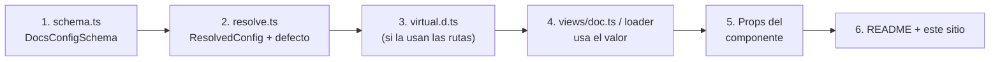

---
seo:
  title: "Recetas: componentes, opciones y textos nuevos"
  description: "Paso a paso y con todos los archivos que tocan: añadir un componente, una opción de configuración, un texto de interfaz o un idioma nuevo."
---

# Recetas

Cuatro cambios que harás a menudo, con todos los archivos que tocan. En todos el orden es el mismo:
**test primero** donde haya lógica, después el código, después la documentación.

## Un componente

1. **Elige el nivel** del diseño atómico:
   - `components/atoms/<tipo>/`: una pieza indivisible sin estado propio (`Link` en `actions/`, `Tag` e `Icon` en `display/`).
   - `components/molecules/<tipo>/`: unas pocas piezas con un propósito (`EditLink` y `PrevNext` en `navigation/`, `ThemeToggle` en `controls/`).
   - `components/organisms/<zona>/`: una zona de la página (`DocsHeader`, `Sidebar` y `ConsentBanner` en `chrome/`).
2. **Define sus `Props`** con comentarios. Todo lo que muestra llega por props, **textos incluidos**
   (`strings: UiStrings` y `translate(strings, 'clave')`). El componente no importa `astro:*`, ni
   `virtual:*`, ni nada de `src/astro/`: ESLint lo impide.
3. **Estilos** con utilidades de Tailwind y tokens (`text-muted`, `bg-raised`). Si la regla es larga
   o compartida, va en `theme.css` con `@apply`. Nunca colores literales.
4. **Comportamiento en el navegador**, si lo tiene: una función `init*` en `src/client/` que recibe
   el documento y lo que necesite, su test en `client/`, y su llamada en `bootDocs`
   (`src/components/layouts/boot.ts`) o, si es del contenido (como las pestañas o el zoom), en `bootArticle`
   (`src/components/boot/article.ts`). Los textos que necesite el script viajan en atributos `data-*`.
5. **Test** en `components/<nivel>/<tipo>/<Componente>.test.ts` si tiene lógica de render (qué se pinta según las
   props, atributos ARIA, URLs). Usa `render()` de `src/testing/render.ts` y `stringsFor()`. Si es
   puramente visual, no lleva test.
6. **Úsalo** desde el layout o el organismo que corresponda. Si necesita datos de la config o de las
   páginas, los calcula `docView` (`src/astro/views/doc.ts`) con funciones de `core/`, y el
   layout se los pasa.

Los componentes se exportan solos: `@velezanthony/design/components/*` apunta a `src/components/*`, así que
un consumidor puede importar `@velezanthony/design/components/atoms/display/Tag.astro` sin tocar
`package.json`.

## Una opción de configuración

1. **Esquema** (`src/core/config/schema.ts`). Añade el campo a `DocsConfigSchema`. Es un
   `strictObject`: hasta que no lo añadas, la clave rompe el build como desconocida. Si tiene valores
   cerrados, crea un objeto `as const` (como `PanelState` en `core/config/layout.ts`) y expórtalo en
   `src/astro/integration/index.ts`. Las validaciones que cruzan campos van en el `superRefine`, con
   su ruta (`issue(['privacyUrl', locale], …)`). Test en `schema.test.ts`.
2. **Resolución** (`src/core/config/resolve.ts`). Añádelo a `ResolvedConfig` y pon el valor por
   defecto en `resolveConfig`: los valores por defecto viven aquí, **no** en el esquema. Test en
   `resolve.test.ts`.
3. **Módulo virtual.** `createVirtualData` copia la config resuelta entera, así que el valor ya viaja.
   Pero `src/astro/virtual/virtual.d.ts` es autocontenido (se copia al `.astro/` del consumidor y no
   puede importar nada): añade ahí el tipo a mano.
4. **Uso.** Si depende de las páginas (por ejemplo, un slug que debe existir), valídalo en el loader
   con una función de `core/` que devuelva errores, como `validateFooter`. Si afecta a la vista,
   calcúlalo en `docView` y pásalo como prop.
5. **Documentación.** Añade la fila a la tabla «Referencia de configuración» del `README.md` y, si
   cambia cómo se integra, a [Integración](../guia/primeros-pasos.md).
6. **Pruébala de verdad** en `playground/docs.config.mjs` o en este sitio.

## Un texto de interfaz

1. Añade la clave al catálogo `en` de `src/core/i18n/ui-strings.ts`. Las claves son **estables y con
   espacio de nombres** (`'footer.report'`), no la frase: así reescribir un texto no rompe a quien lo
   sobrescribe.
2. Añade la misma clave al catálogo `es`. `ui-strings.test.ts` comprueba que toda clave existe en
   todos los idiomas y que ninguna está vacía: si te olvidas, falla.
3. Si lleva variables, escríbelas como `{nombre}` y pásalas con `translate(strings, 'clave', { nombre })`.
4. Úsala en el componente con `translate(strings, 'clave')`.

No hace falta tocar nada más: `UiKey` y `uiKeys` salen del catálogo `en`, y el esquema estricto de
`ui` en la config se genera desde `uiKeys`, así que los consumidores ya pueden sobrescribir la clave
nueva (`ui: { es: { 'footer.report': '…' } }`) y una errata en el nombre sigue rompiendo el build.

## Un idioma nuevo

Añade su catálogo completo a `ui-strings.ts` (y a `defaultStrings` y `localeNames`). El test de
completitud te dirá qué falta. 
