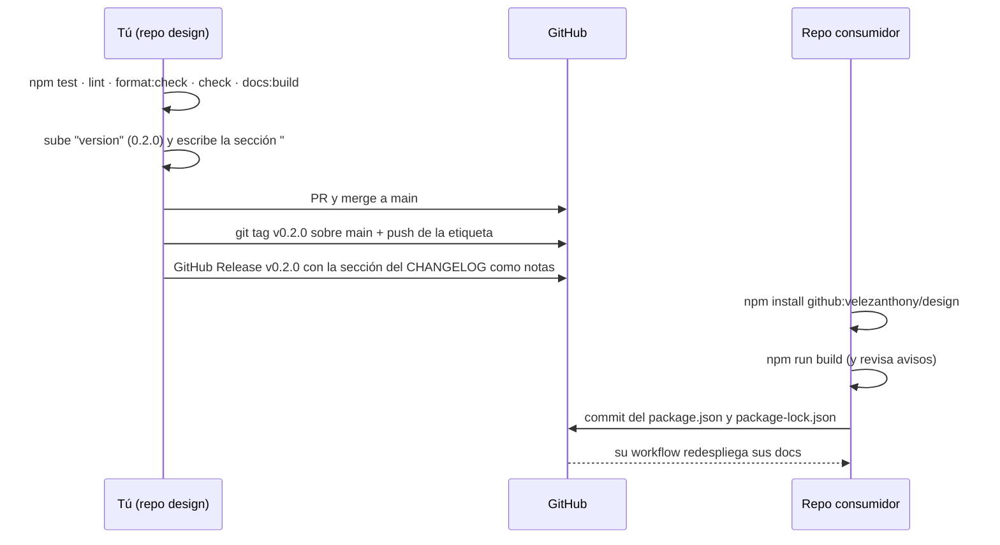

---
seo:
  title: "Publicar una versión de la librería"
  description: "Una versión es una etiqueta de git: cómo publicarla, qué número le toca y cómo actualizar los repos que la consumen, y cómo se despliega este sitio."
---

# Publicar una versión

La librería no está en el registro de npm. Una «versión» es **una etiqueta de git** en este repo, y
los consumidores la instalan con `github:velezanthony/design#<etiqueta>`.



## Paso a paso

1. **Comprueba que todo está verde** en `main`: `npm test`, `npm run lint`, `npm run format:check`,
   `npm run check` y `npm run docs:build` sin avisos. Mira también `npm pack --dry-run` si has
   tocado algo de la estructura (ver [Por qué no entra en el paquete](../guia/fuera-del-paquete.md)).
2. **Sube `version`** en el PR con `npm version <número> --no-git-tag-version` (actualiza
   `package.json` y `package-lock.json` sin etiquetar), siguiendo semver:
   - _patch_ (`0.1.1`): arreglos sin cambios visibles en la config.
   - _minor_ (`0.2.0`): opciones o componentes nuevos, compatibles.
   - _major_ (`1.0.0`): algo que obliga a los consumidores a cambiar su config, su contenido o sus
     imports (una opción renombrada, una regla estricta nueva que puede romper builds, un archivo
     movido de una subruta de `"exports"`).

   Mientras la versión sea `0.x`, un cambio incompatible sube el _minor_. En el mismo PR,
   añade encima de la anterior la sección `## 0.2.0` (sin fecha) del `CHANGELOG.md` con los cambios
   de la versión.
3. **Etiqueta y publica la Release** una vez hecho el merge a `main`, sobre el commit del merge:

   ```sh
   git checkout main && git pull
   git tag v0.2.0
   git push origin v0.2.0
   ```

   Luego crea la Release en GitHub (Releases → _Draft a new release_ sobre esa etiqueta, o
   `gh release create v0.2.0 --verify-tag --title v0.2.0`) y pega como notas la sección `## 0.2.0` del
   `CHANGELOG.md`.

4. **Actualiza cada consumidor** cambiando la etiqueta:

   ```sh
   npm install --prefix docs github:velezanthony/design#v0.2.0
   ```

   El `package-lock.json` fija el commit exacto de la etiqueta, así que un consumidor nunca recibe
   cambios que no ha pedido. Construye, revisa avisos y haz commit.

> [!WARNING]
> No muevas una etiqueta ya publicada. Un consumidor con el lockfile apuntando al commit anterior
> seguiría instalando lo viejo, y uno sin lockfile recibiría algo distinto con la misma versión. Si
> una versión sale mal, publica la siguiente.

## Qué ve el consumidor de cada cambio

Como el paquete es fuente sin compilar, **cualquier** cambio en `src/` (excepto tests, fixtures,
`testing/` y `pages/`) llega al consumidor en la siguiente etiqueta. Antes de publicar, pregúntate:

- ¿He cambiado el esquema? Una opción más estricta puede romper configs que antes pasaban.
- ¿He añadido una regla estricta? Un contenido que antes construía puede fallar ahora.
- ¿He cambiado un texto de interfaz? Si el consumidor lo sobrescribía, sigue viendo el suyo; si no,
  verá el nuevo.
- ¿He movido un archivo bajo una subruta de `"exports"`? Es un cambio incompatible.

Prueba la versión en el `playground/` (dos idiomas, externos, API generada) antes de etiquetar: es el
consumidor que más superficie ejercita.

## El sitio de documentación

Este sitio **no** se publica con las etiquetas, sino con cada push a `main` que toque algo que le
afecte. `.github/workflows/docs.yml`:

- Se dispara con push a `main` si cambian `docs/**`, `src/**`, `package.json`, `package-lock.json` o
  el propio workflow; y a mano con `workflow_dispatch`.
- Permisos `contents: read`, `pages: write`, `id-token: write` (este último porque `deploy-pages` se
  autentica con un token OIDC).
- `concurrency: pages` sin cancelar: un despliegue nunca se interrumpe a medias.
- Job `build`: checkout, Node 24 con caché de npm, `configure-pages`, `npm ci` en la raíz (instala
  el workspace `docs/` enlazado a `src/`), `npm run docs:build` y `upload-pages-artifact` con
  `docs/dist`. El paso de build recibe `PUBLIC_GTM_ID` del secreto del repo: con él hay analítica, y
  `docs/docs.config.mjs` declara `site.analytics.privacyUrl` (la política del sitio de la raíz del dominio) porque la analítica la exige;
  sin el secreto, el sitio sale sin rastreo.
- Job `deploy`: `deploy-pages` en el entorno `github-pages`.

Como `docs/` usa `file:..`, el sitio siempre documenta y se construye con **el código de ese mismo
commit**, no con una etiqueta. Requisito único en GitHub: **Settings → Pages → Source: GitHub
Actions**.
