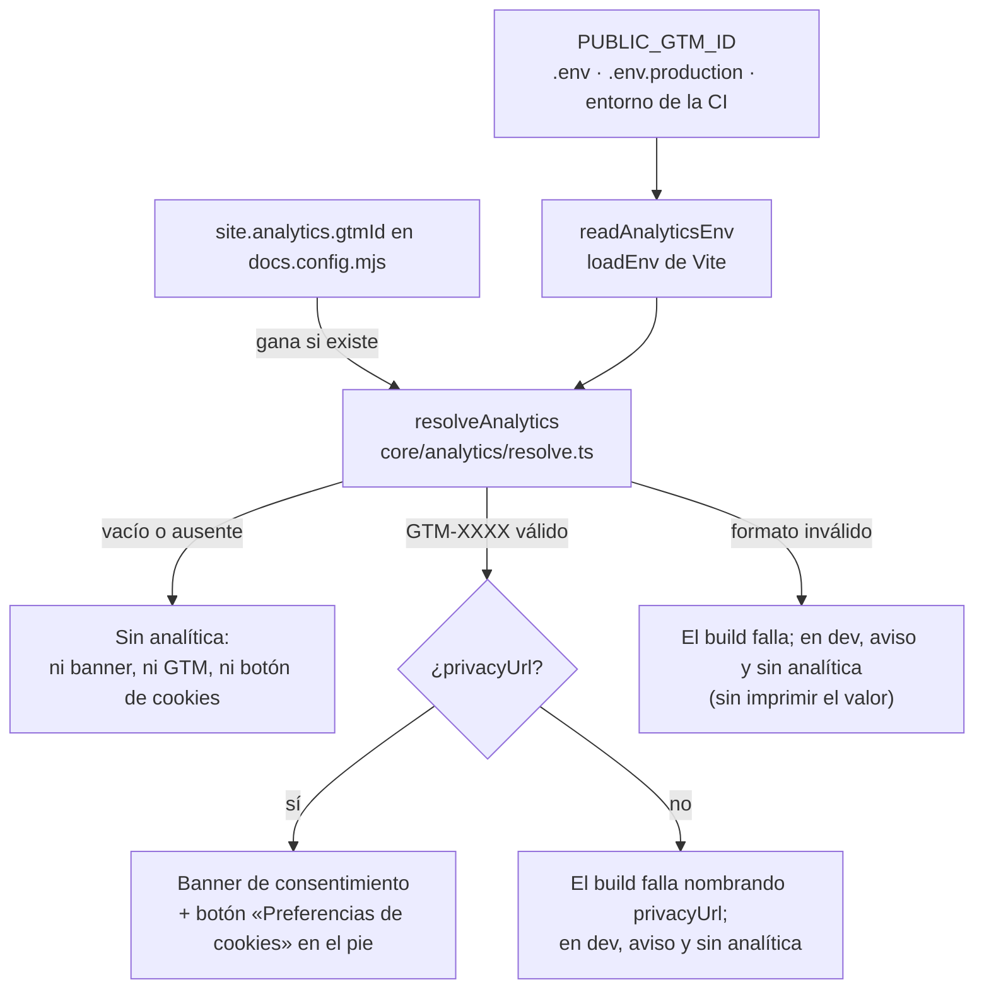
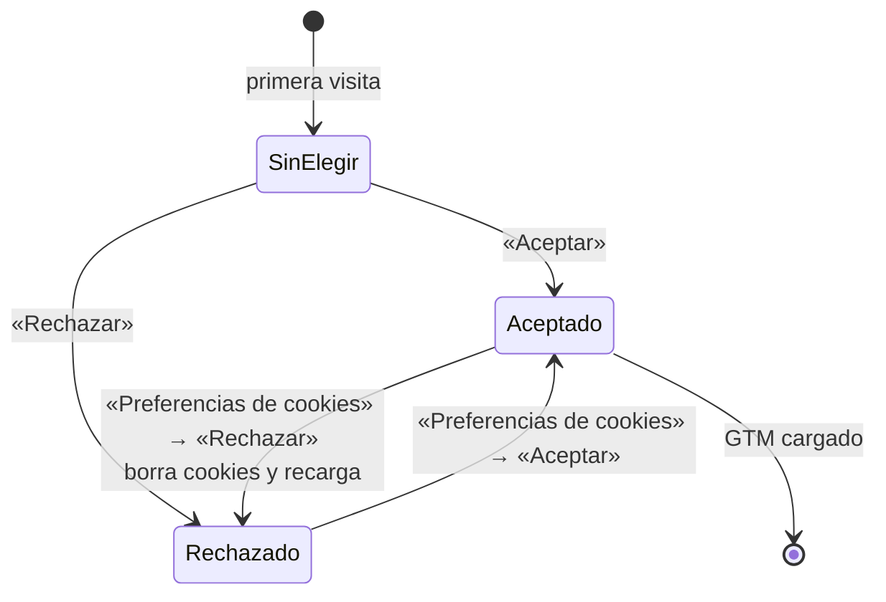

---
seo:
  title: "Analítica con consentimiento y privacidad"
  description: "Sin consentimiento no se carga nada: de dónde sale el id de Google Tag Manager, cómo funciona el aviso de cookies y qué opciones hay para la privacidad."
---

# Analítica y privacidad

La regla de diseño es simple: **sin consentimiento no se carga nada**, y sin un id de Google Tag
Manager ni siquiera existe el mecanismo. Un build local o el de un fork queda sin rastreo sin
necesitar un camino de código propio. La librería **no trae ninguna página de privacidad**: la política
la publica el sitio (una vez para todo el dominio) y la librería solo la enlaza con
`site.analytics.privacyUrl`.

## De dónde sale el id



- `readAnalyticsEnv` (`src/astro/integration/analytics-env.ts`) usa `loadEnv` de Vite porque en
  `astro:config:setup` los `.env` aún no están en `process.env`. El modo depende del comando: `dev`
  lee `.env.development`, `build` lee `.env.production`; las variables del proceso (la CI) ganan.
- `resolveAnalytics` exige el formato `GTM-` más mayúsculas y dígitos. Un valor en blanco cuenta como
  no definido. Si el formato es imposible, falla en el build: un id mal escrito no debe convertirse
  en un aviso que nunca carga nada. El mensaje nombra la variable, **nunca el valor**. Solo en `astro dev`
  un `PUBLIC_GTM_ID` inválido no tumba el servidor: avisa con ese mismo mensaje y arranca sin analítica
  (`envValueForCommand`); un `gtmId` inválido de la config falla también en dev.
- Un id válido **exige `privacyUrl`**: el banner enlaza a la política y no hay otra por defecto.
  Sin ella, `astro build` falla con un error que nombra `privacyUrl`; `astro dev` avisa y arranca sin
  analítica (`applyAnalyticsForCommand`), igual que con un `PUBLIC_GTM_ID` mal formado.
- `site.analytics.gtmId` en la config es una sobrescritura explícita. Úsalo solo si un repo debe fijar un
  contenedor; lo normal es el entorno.

En GitHub Actions el id se pasa al paso de build (como _secret_ o como variable de repositorio; el id
es público en la página de todos modos):

```yaml
- run: npm run build
  env:
    PUBLIC_GTM_ID: ${{ secrets.PUBLIC_GTM_ID }}
```

Este sitio lo usa así: no declara `site.analytics.gtmId` en su config (sí `privacyUrl`, que la
analítica exige) y su
workflow pasa `PUBLIC_GTM_ID` desde el secreto del repo. Un build local o el de un fork sale sin
rastreo, sin necesitar nada aparte.

## El consentimiento en el navegador

`initConsent` (`src/client/preferences/consent.ts`) lo gestiona todo a partir del banner
(`src/components/organisms/chrome/ConsentBanner.astro`), que solo se pinta con analítica activa:



- La elección se guarda en `localStorage` bajo `consent`, con una versión (`CONSENT_VERSION`): si
  algún día cambia lo que se pide, subir la versión vuelve a preguntar a todo el mundo.
- GTM se inyecta **solo** tras «Aceptar» o con un `granted` guardado.
- Retirar el consentimiento es tan fácil como darlo: el botón del pie reabre el banner. Como un
  contenedor de GTM en marcha no se puede descargar, un rechazo posterior borra las cookies de
  analítica del dominio (`analyticsCookiesToDelete`) y recarga la página.
- Las claves `consent` y `theme` viven en el mismo origen (`usuario.github.io`), así que el
  sitio de la raíz y todos los sitios de docs **comparten** la elección del visitante.

Un sitio con su propio layout ([BaseLayout](./layout-propio.md)) pasa `gtmId` y `privacyUrl` al layout,
pero no hace falta calcularlas: `@velezanthony/design/site` exporta `gtmId` y `privacyUrl(locale)`, ya
resueltas desde la config (la URL es un solo texto, la del idioma de la página). `BaseLayout` falla con
un error que la nombra si recibe `gtmId` sin `privacyUrl`.

## Política de privacidad

La librería no genera la página ni la ruta: la política es del sitio (o del dominio, si varios sitios
comparten una). `site.analytics.privacyUrl` es la URL absoluta o la ruta del sitio donde está, y admite una por idioma:

```js
export default defineDocsConfig({
  site: {
    name: 'Mi proyecto',
    analytics: {
      gtmId: 'GTM-XXXXXXX', // o PUBLIC_GTM_ID en el entorno
      privacyUrl: {
        es: 'https://mi-dominio.dev/privacidad/',
        en: 'https://mi-dominio.dev/en/privacy/',
      },
    },
  },
  i18n: { locales: ['es', 'en'] },
});
```

| `site.analytics` | Resultado |
| --- | --- |
| `gtmId` (o `PUBLIC_GTM_ID`) + `privacyUrl` | Analítica, banner de cookies y enlace en el pie |
| Solo `privacyUrl` | Solo el enlace en el pie |
| Solo `gtmId` | Error en build; en dev, aviso y sin analítica |
| Ninguno | Nada |

Una cadena sirve para todos los idiomas. En un objeto, un idioma sin entrada usa la del idioma por
defecto; si tampoco esa existe, la validación falla nombrando el idioma. Una clave de `privacyUrl` que
no está en `i18n.locales` también falla.

> [!NOTE]
> `privacy.page` y `privacy.controller` ya no existen: la config es estricta, así que dejarlas falla
> con «opción desconocida». Lo mismo vale para la 404: la librería no la inyecta, la pone el sitio.
