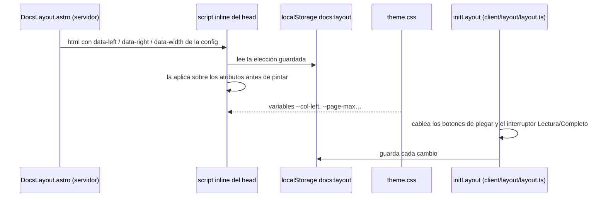

# Disposición, tema y transiciones

## Modos de disposición (`layout`)

```js
import { LayoutWidth, PanelState } from '@velezanthony/design/integration';

layout: {
  sidebar: PanelState.OPEN, // o COLLAPSED: estado inicial de la navegación (desde lg)
  toc: PanelState.OPEN, // igual para «En esta página» (desde xl)
  width: LayoutWidth.READING, // o FULL
  toggles: true, // false quita los controles e ignora lo que guardó el visitante
  tocDepth: 3, // último nivel que lista «En esta página»: 2 (solo h2) a 6; por defecto 3
  tocMaxHeight: '60vh', // opcional: longitud CSS; pasada, la lista hace scroll por dentro
},
```

- **`reading`** (por defecto): la página va centrada (80rem) y la barra lateral es un plano que mide
  solo su columna.
- **`full`**: el diseño se ancla. La barra lateral pega al borde izquierdo de la ventana, la cabecera
  ocupa todo el ancho y el contenido llena el resto; la medida del texto crece un poco
  (`--container-measure-full`).
- Cada columna lateral se **pliega** en un raíl de 44px (`--rail`) con una etiqueta vertical. El
  panel plegado es `inert`.
- Con un lado plegado o en `full`, el código, las tablas, las pestañas y las capturas ocupan toda la
  columna (`--wide-max`, `--img-max`).
- **`tocDepth`** y **`tocMaxHeight`** ajustan el índice: con `tocDepth: 4` entran también los `h4`
  (sangrados un nivel más) y con `tocMaxHeight` una página con muchos encabezados no desborda la
  ventana. Quien monta `TableOfContents` a mano los recibe como props `depth` y `maxHeight`.
- Por debajo de `lg` no cambia nada: la navegación está tras el botón «Menú».

### Dónde vive el estado

El estado está en atributos de `<html>`: `data-left`, `data-right` y `data-width`. El CSS de
`theme.css` reacciona a ellos redefiniendo variables (`--col-left`, `--col-right`, `--page-max`,
`--prose-measure`…), de modo que **ningún componente necesita saber en qué modo está**.



El estado inicial lo escribe el servidor en `<html>` (`DocsLayout.astro`, a través de `htmlAttrs` de `BaseLayout`), así que la config manda también
sin JavaScript. El script inline (`layoutBootstrapScript` en `client/layout/layout.ts`) solo lo pisa con lo
que guardó el visitante, y corre en el `<head>` para que al recargar **no haya saltos**: si esperara
al módulo de cliente, la página se pintaría primero abierta y después se plegaría. Los valores por
defecto salen de `core/config/layout.ts`; los desconocidos fallan la validación.

## Tema claro/oscuro

- Sin elección, manda el sistema (`prefers-color-scheme`). Con elección, `<html data-theme>` y
  `localStorage` bajo `theme` (`client/preferences/theme.ts`).
- `theme.css` declara las paletas oscuras **dos veces**: una para el sistema
  (`@media (prefers-color-scheme: dark)` con `:root:not([data-theme='light'])`) y otra para la
  elección (`:root[data-theme='dark']`). Un test (`theme.test.ts`) exige que sean idénticas.
- `<meta name="theme-color">` no puede leer variables CSS, así que `src/components/styles/theme-colors.ts`
  repite el `--color-canvas` de cada tema; otro test los sujeta a `theme.css`.

## Impresión

Con `@media print` se ocultan los elementos que solo sirven en pantalla y flotan sobre el texto: el
botón «volver arriba» y el banner de cookies (con el hueco que reserva al pie).

## Transiciones

Todas usan la View Transitions API y van tras `prefers-reduced-motion: no-preference`: con movimiento
reducido no hay ninguna, y donde la API no existe el cambio es instantáneo.

| Transición | Cómo | Dónde |
| --- | --- | --- |
| Navegación entre páginas | Solo CSS: `@view-transition { navigation: auto; }`. Cabecera, barra lateral e índice tienen nombre propio y se quedan quietos; el contenido entra con un fundido. | `theme.css` |
| Cambio de tema | El tema nuevo se revela con un círculo que crece desde el botón. | `client/preferences/theme.ts`, `client/transition.ts` |
| Pestañas | Fundido cruzado del panel. | `client/content/tabs.ts` |
| Menú móvil | Apertura suave donde existe `::details-content`. | `theme.css` |
| Zoom de imágenes | La miniatura se transforma en la imagen ampliada dentro de un `<dialog>`. | `client/content/zoom.ts` |

Las transiciones dentro del mismo documento (tema, pestañas, zoom) marcan `<html data-transition>`
mientras duran, y entonces el cromo **pierde** su nombre de transición para que el efecto cubra
toda la página.

### Zoom de imágenes

Se pueden ampliar las imágenes de contenido (`.prose img`) con `alt` no vacío. Se quedan como están
las decorativas (`alt=""`), las que están dentro de un enlace, las declaradas de menos de 96px y las
que llevan `data-no-zoom`.
