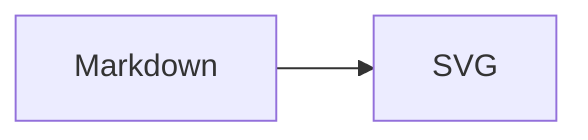

# Writing pages

This page gathers what you can write in a page: the frontmatter, the Markdown the library understands
and the rules the build checks. The Markdown works across the whole project: documentation pages,
`external` files and any other collection you render with `Article`. Only `::nav-tree` is exclusive to
the documentation.

## Frontmatter

Every key is optional; unknown keys are ignored (other tools write their own).

::::tabs
:::tab[The usual]
```yaml
---
title: Installation
seo:
  description: How to install the project.
---
```
:::
:::tab[Every key]
```yaml
---
title: Installation
slug: tutorials/installation
order: 2
seo:
  title: Install on any system
  titleSuffix: false
  description: How to install the project.
  image: { src: /og-install.png, alt: Screenshot of the first run }
  noindex: false
  schema: [{ '@type': TechArticle, headline: Install on any system }]
translations: omit
index:
  summary: Summary for the folder listing.
  image: ./cover.png
  imageAlt: What the image shows
---
```
:::
::::

| Key | Type | What it does |
| --- | --- | --- |
| `title` | string | Title. Without it, the first `# h1`; without either, the build fails. |
| `slug` | string | Its own URL, relative to the content root, without language, `base` or slashes at the ends. See [A translated URL](./idiomas-seo-y-analitica.md#a-translated-url-slug). |
| `order` | number | Order in the sidebar among the pages the `sidebar` does not declare. |
| `seo.title` | text | Title for the `<head>` only. |
| `seo.titleSuffix` | text or `false` | Suffix of the `<title>`; `false`, none. |
| `seo.description` | text | Page description. |
| `seo.image` | `{ src, alt? }` | Image for sharing, in `public/` or `https://`. Without `alt`, the title. |
| `seo.noindex` | boolean | `true` removes it from the sitemap and search. |
| `seo.schema` | list of JSON-LD or `false` | **Added** to the site's; `false` leaves none. |
| `translations` | `link`, `omit` or `fallback` | Policy if a translation is missing; every version must match. |
| `index.summary` | string | Summary in the folder listing; without it, `seo.description`. |
| `index.image` | path or `false` | Cover in the listing: relative to the `.md` or from `public/`. |
| `index.imageAlt` | string | Alternative text of the cover; without it, it is decorative. |

"Text" is a string or one per language. A folder's behaviour is configured in `content.folders`, not
in the frontmatter. An `external` file has no frontmatter: its `seo` and `translations` go in its
config entry.

## Markdown

| You want… | Write |
| --- | --- |
| A callout | `> [!NOTE]` or `:::tip[Title]` |
| A collapsed callout | `:::warning[Title]{collapsed}` |
| Tabs | `::::tabs` with `:::tab[Label]` |
| The tree of the sections | `::nav-tree` |
| A diagram | A ` ```mermaid ` block |
| A link to another page | `[text](./other.md#anchor)` |

### Callouts

A callout highlights a paragraph: a note, a tip or a warning. Both syntaxes produce the same HTML. The
types are `note`, `info`, `tip`, `warning`, `danger` and `question`.

::::tabs
:::tab[GitHub alert]
```md
> [!WARNING]
> Also looks right on GitHub.
```
:::
:::tab[Directive]
```md
:::danger[Custom title]{collapsed}
Collapsed in a `<details>`; without `{collapsed}`, open.
:::
```
:::
::::

- GitHub alerts accept `NOTE`, `TIP`, `IMPORTANT` (rendered as `info`), `WARNING` and `CAUTION` (as
  `danger`). Use them in files that are also read on GitHub.
- An unknown container (`:::foo`) breaks the build; stray colons (`12:30`) are left alone.

### Tabs and `::nav-tree`

```md
::::tabs
:::tab[npm]
npm i x
:::
:::tab[pnpm]
pnpm add x
:::
::::
```

Without JavaScript, the panels are stacked. `::nav-tree` is explained in
[Folder indexes](./navegacion.md#the-section-tree-in-a-page-nav-tree).

### Code

Each block is highlighted with Shiki and gets a label with its language and a copy button. Always set a
language: a block without one warns at build time; for plain text use `text`.

:::note[Themes and aliases]{collapsed}
- Themes `github-light-default` and `github-dark-default`, unless you choose others in
  `markdown.shikiConfig`.
- Added aliases: `django`/`htmldjango` → `jinja`, `pycon` → `python`, `env`/`.env` → `dotenv`,
  `terminal`/`shell-session` → `shellsession`. Your own `langAlias` win.
- `text`, `txt`, `plain` and `plaintext` get no label and never warn.
:::

### Diagrams (Mermaid)

````md

````

- Drawn in the browser with the site's palette and theme, and Mermaid is only downloaded on pages that
  have a diagram. Copy copies the original code.
- A button opens it full screen, with zoom (from 0.25× to 8×) and panning.
- If it fails or there is no JavaScript, the code is shown. `accTitle:` gives it an accessible name.

:::warning[`accTitle` and `accDescr` break `block` diagrams]{collapsed}
With Mermaid 11.17.2, a `block-beta` diagram with an `accTitle:` or `accDescr:` line is not drawn: it
is a Mermaid bug and the block shows the code. Use another diagram type, such as `flowchart`, or remove
those lines.
:::

### Images, tables and links

- An image **alone in its paragraph** is a screenshot (column width, border and rounded corners). The
  rest keep their natural size; `` floats as on GitHub.
- Images with `alt` zoom in when clicked. An image without `./` (`img/x.png`) is treated as
  `./img/x.png`.
- A wide table scrolls horizontally.
- `[x](./other.md#anchor)` leads to the page in the language of the linking page, checking file and
  anchor. An external file is linked by its real path, and so is a file in a
  [static folder](./navegacion.md#static-folders-contentstatic). `https://` links are not checked.
- Custom heading ids (`{ #id }`) and Material icons (`:material-x:`) are not supported.

## Strict build rules

If something is wrong and cannot work, the build fails; if it works but could be better, it warns.
Errors come out **all at once**, with file, line and a hint.

**Break the build:**

- a broken relative link or `#anchor`, or a link to an excluded or unpublished file;
- a language suffix not in `i18n.locales` (`x.fr.md`) or a page with neither `h1` nor `title`;
- an unknown `:::` container;
- a missing external file, SEO image or `public/` favicon;
- different translation policies between versions of a page;
- an unknown configuration key, or a `sidebar`, `nav` or `footer` slug that is not a page;
- a malformed or repeated `slug`, or an `_index.md` in a folder without `listing.generate`;
- analytics without `privacyUrl` or with a malformed id (in `astro dev` it only warns);
- a Markdown processor that is not Sätteri, or a sitemap with more than 50,000 URLs.

**Only warn:** a missing translation with no declared policy, an Open Graph image that is too large or
badly proportioned, a language Shiki does not know, a code block without a language and a cover that
does not exist.

## Next step

Organise the header, the sidebar and the indexes: [Navigation and indexes](./navegacion.md).
