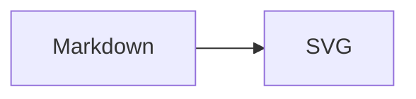

---
seo:
  title: "Referencia de páginas: frontmatter, Markdown y reglas del build"
  description: "Las claves del frontmatter, todo lo que puedes escribir en el cuerpo (cajas de aviso, pestañas, código, Mermaid, imágenes y enlaces) y lo que rompe el build o solo avisa."
---

# Escribir páginas

Esta página reúne lo que puedes escribir en una página: el frontmatter, el Markdown que entiende la
librería y las reglas que comprueba el build. El Markdown vale en todo el proyecto: las páginas de la
documentación, los `external` y cualquier otra colección que pintes con `Article`. Solo `::nav-tree`
es exclusivo de la documentación.

## Frontmatter

Todas las claves son opcionales; las ajenas se ignoran (otras herramientas escriben las suyas).

::::tabs
:::tab[Lo habitual]
```yaml
---
title: Instalación
seo:
  description: Cómo instalar el proyecto.
---
```
:::
:::tab[Todas las claves]
```yaml
---
title: Instalación
slug: tutorials/installation
order: 2
seo:
  title: Instalar en cualquier sistema
  titleSuffix: false
  description: Cómo instalar el proyecto.
  image: { src: /og-instalar.png, alt: Captura del primer arranque }
  noindex: false
  schema: [{ '@type': TechArticle, headline: Instalar en cualquier sistema }]
translations: omit
index:
  summary: Resumen para el listado de la carpeta.
  image: ./portada.png
  imageAlt: Lo que muestra la imagen
---
```
:::
::::

| Clave | Tipo | Qué hace |
| --- | --- | --- |
| `title` | cadena | Título. Sin él, el primer `# h1`; sin ninguno, el build falla. |
| `slug` | cadena | URL propia, relativa a la raíz del contenido, sin idioma, `base` ni barras en los extremos. Ver [Una URL traducida](./idiomas-seo-y-analitica.md#una-url-traducida-slug). |
| `order` | número | Orden en la barra lateral entre las páginas que el `sidebar` no declara. |
| `seo.title` | texto | Título solo para el `<head>`. |
| `seo.titleSuffix` | texto o `false` | Sufijo del `<title>`; `false`, ninguno. |
| `seo.description` | texto | Descripción de la página. |
| `seo.image` | `{ src, alt? }` | Imagen al compartir, en `public/` o `https://`. Sin `alt`, el título. |
| `seo.noindex` | booleano | `true` la saca del sitemap y de la búsqueda. |
| `seo.schema` | lista de JSON-LD o `false` | Se **suma** a los del sitio; `false` no deja ninguno. |
| `translations` | `link`, `omit` o `fallback` | Política si falta una traducción; todas las versiones deben coincidir. |
| `index.summary` | cadena | Resumen en el listado de la carpeta; sin él, `seo.description`. |
| `index.image` | ruta o `false` | Portada en el listado: relativa al `.md` o de `public/`. |
| `index.imageAlt` | cadena | Texto alternativo de la portada; sin él, es decorativa. |

«Texto» es una cadena o una por idioma. El comportamiento de una carpeta se configura en
`content.folders`, no en el frontmatter. Un archivo `external` no tiene frontmatter: su `seo` y su
`translations` van en su entrada de la config.

## Markdown

| Quieres… | Escribe |
| --- | --- |
| Una caja de aviso | `> [!NOTE]` o `:::tip[Título]` |
| Una caja de aviso plegada | `:::warning[Título]{collapsed}` |
| Pestañas | `::::tabs` con `:::tab[Etiqueta]` |
| El árbol de las secciones | `::nav-tree` |
| Un diagrama | Un bloque ` ```mermaid ` |
| Un enlace a otra página | `[texto](./otra.md#ancla)` |

### Cajas de aviso

Una caja de aviso destaca un párrafo: una nota, un consejo o una advertencia. Las dos sintaxis dan el
mismo HTML. Los tipos son `note`, `info`, `tip`, `warning`, `danger` y `question`.

::::tabs
:::tab[Alerta de GitHub]
```md
> [!WARNING]
> También se ve bien en GitHub.
```
:::
:::tab[Directiva]
```md
:::danger[Título propio]{collapsed}
Plegada en un `<details>`; sin `{collapsed}`, abierta.
:::
```
:::
::::

- Las alertas de GitHub admiten `NOTE`, `TIP`, `IMPORTANT` (se pinta como `info`), `WARNING` y
  `CAUTION` (como `danger`). Úsalas en archivos que también se leen en GitHub.
- Un contenedor desconocido (`:::foo`) rompe el build; los dos puntos sueltos (`12:30`) se respetan.

### Pestañas y `::nav-tree`

```md
::::tabs
:::tab[npm]
npm i x
:::
:::tab[pnpm]
pnpm add x
:::
::::
```

Sin JavaScript, los paneles se ven apilados. `::nav-tree` se explica en
[Índices de carpeta](./navegacion.md#el-árbol-de-secciones-en-una-página-nav-tree).

### Código

Cada bloque se resalta con Shiki y lleva la etiqueta de su lenguaje y un botón de copiar. Pon siempre
un lenguaje: un bloque sin él avisa en el build; para texto plano usa `text`.

:::note[Temas y alias]{collapsed}
- Temas `github-light-default` y `github-dark-default`, salvo que elijas otros en
  `markdown.shikiConfig`.
- Alias añadidos: `django`/`htmldjango` → `jinja`, `pycon` → `python`, `env`/`.env` → `dotenv`,
  `terminal`/`shell-session` → `shellsession`. Los `langAlias` tuyos mandan.
- `text`, `txt`, `plain` y `plaintext` no llevan etiqueta ni avisan.
:::

### Diagramas (Mermaid)

````md

````

- Se dibuja en el navegador con la paleta y el tema del sitio, y Mermaid solo se descarga en las
  páginas que tienen un diagrama. Copiar copia el código original.
- Un botón lo abre a pantalla completa, con zoom (de 0,25× a 8×) y desplazamiento.
- Si falla o no hay JavaScript, se ve el código. `accTitle:` le da nombre accesible.

:::warning[`accTitle` y `accDescr` rompen los diagramas `block`]{collapsed}
Con Mermaid 11.17.2, un diagrama `block-beta` con una línea `accTitle:` o `accDescr:` no se dibuja: es
un fallo de Mermaid y el bloque enseña el código. Usa otro tipo de diagrama, como `flowchart`, o quita
esas líneas.
:::

### Imágenes, tablas y enlaces

- Una imagen **sola en su párrafo** es una captura (ancho de la columna, borde y esquinas). Las demás
  conservan su tamaño natural; `` flota como en GitHub.
- Las imágenes con `alt` se amplían al pulsarlas. Una imagen sin `./` (`img/x.png`) se trata como
  `./img/x.png`.
- Una tabla ancha se desplaza en horizontal.
- `[x](./otra.md#ancla)` lleva a la página en el idioma de la que enlaza, validando archivo y ancla.
  Un archivo externo se enlaza con su ruta real, y un archivo de una
  [carpeta estática](./navegacion.md#carpetas-estáticas-contentstatic), también. Los
  enlaces `https://` no se validan.
- No se admiten ids de encabezado propios (`{ #id }`) ni iconos de Material (`:material-x:`).

## Reglas estrictas del build

Si algo está mal y no puede funcionar, el build falla; si funciona pero es mejorable, avisa. Los errores
salen **todos a la vez**, con archivo, línea y una pista.

**Rompen el build:**

- un enlace relativo o un `#ancla` rotos, o un enlace a un archivo excluido o que no se publica;
- un sufijo de idioma que no está en `i18n.locales` (`x.fr.md`) o una página sin `h1` ni `title`;
- un contenedor `:::` desconocido;
- un archivo externo, una imagen SEO o un favicon de `public/` ausentes;
- políticas de traducción distintas entre versiones de una página;
- una clave de configuración desconocida o un slug de `sidebar`, `nav` o `footer` que no es una página;
- un `slug` mal formado o repetido, o un `_index.md` en una carpeta sin `listing.generate`;
- analítica sin `privacyUrl` o con un id mal formado (en `astro dev` solo avisa);
- un procesador de Markdown que no es Sätteri, o un sitemap de más de 50 000 URLs.

**Solo avisan:** una traducción ausente sin política declarada, una imagen Open Graph grande o mal
proporcionada, un lenguaje que Shiki no conoce, un bloque de código sin lenguaje y una portada que no
existe.

## Siguiente paso

Organiza la cabecera, la barra lateral y los índices: [Navegación e índices](./navegacion.md).
