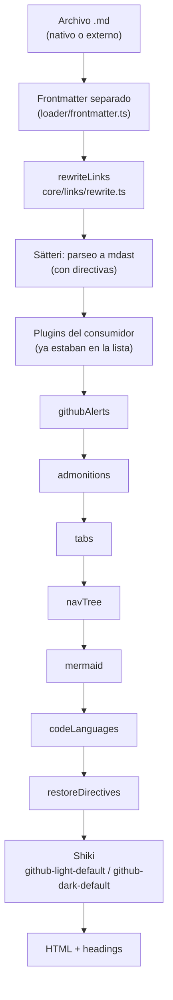

---
seo:
  title: "Markdown: Sätteri, Shiki, directivas y Mermaid"
  description: "Cómo extiende la librería el Markdown de Astro: los plugins en orden, admoniciones y alertas de GitHub, bloques de código, diagramas y reglas estrictas."
---

# Markdown

Astro 7 procesa Markdown con **Sätteri** (`@astrojs/markdown-satteri`), un procesador basado en
árboles mdast. La librería no trae su propio procesador: **extiende el del consumidor** en
`astro:config:setup`, igual que hace Starlight. Todo vive en `src/astro/markdown/`.

## Por qué solo Sätteri

`extendMarkdownProcessor` (`processor.ts`) comprueba con `isSatteriProcessor` que el procesador de
la config sea Sätteri y, si no lo es, rompe el build con un mensaje que dice cómo arreglarlo. No hay
degradación silenciosa: las admoniciones y las pestañas son **contenido**, y un sitio que las
pintara como texto plano sin avisar sería un sitio roto.

Si lo es, hace dos cosas sobre el objeto **en sitio** (respetando lo que el consumidor ya configuró):

1. `processor.options.features.directive = true`: activa la sintaxis `:::` de directivas.
2. Añade nuestros plugins al final de `processor.options.mdastPlugins`.

## El pipeline



El orden lo fija `markdownPlugins` en `register.ts`, y no es arbitrario:

| Plugin | Archivo | Qué hace |
| --- | --- | --- |
| `githubAlerts` | `github-alerts.ts` | Convierte `> [!NOTE]` en la misma admonición que la directiva. `IMPORTANT` se pinta como `info` y `CAUTION` como `danger`. |
| `admonitions` | `admonitions.ts` | `:::tip[Título]` → `<aside class="admonition" data-kind>`; con `{collapsed}`, un `<details>`. Un contenedor con nombre desconocido rompe el build. |
| `tabs` | `tabs.ts` | `::::tabs` con `:::tab[Etiqueta]` dentro → pestañas. Sin JavaScript se ven apiladas con su etiqueta. |
| `navTree` | `nav-tree.ts` | `::nav-tree` → un `##` por sección de `nav` y el hueco de su árbol, que rellena la ruta en el idioma que pinta. Ver [Índice generado](navegacion-y-busqueda.md#índice-generado-nav-tree). |
| `mermaid` | `mermaid.ts` | Un bloque `mermaid` pasa a `.docs-mermaid[data-mermaid]` con el código dentro, sin Shiki. El cliente lo sustituye por el SVG; sin JavaScript se lee el código. |
| `codeLanguages` | `code-languages.ts` | Avisa de bloques con fence sin lenguaje y de lenguajes que Shiki no conoce. |
| `restoreDirectives` | `restore-directives.ts` | **El último**: devuelve a texto las directivas que nadie reclamó. |

¿Por qué `restoreDirectives` al final? Con las directivas activas, Sätteri interpreta `12:30` o
`http://x` como directivas de texto y se las traga. Este plugin recupera el trozo exacto del fuente
para todo lo que ningún plugin anterior reclamó. ¿Y por qué `mermaid` antes de `codeLanguages`?
Porque `mermaid` no es un lenguaje de Shiki, y no queremos un aviso por algo que es intencionado.

Todos los plugins se crean con `docsPlugin` (`env.ts`), que los **limita a la documentación**: solo
participan en archivos de la carpeta de contenido (`content`, `src/content/docs/` por defecto) y en los `external` declarados
(`path-filter.ts`). Cualquier otro Markdown del proyecto del consumidor queda intacto.

## Las dos sintaxis de admonición

Ambas producen exactamente el mismo HTML. Los tipos son `note`, `info`, `tip`, `warning`, `danger`
y `question`.

```md
> [!WARNING]
> Alerta de GitHub: también se ve bien en la vista de GitHub del repo.

:::tip[Título propio]
Directiva: admite título y la variante plegada.
:::

:::danger[Plegada]{collapsed}
Dentro de un `<details>`.
:::
```

Las alertas de GitHub son la opción preferida para archivos que también se leen en GitHub (el
`README`, el `CHANGELOG`); las directivas, para lo que solo vive en el sitio.

## Bloques de código

- **Shiki** resalta con `github-light-default`/`github-dark-default`, salvo que el consumidor elija sus temas.
- **Alias** (`SHIKI_LANG_ALIAS` en `code-languages.ts`): `django`/`htmldjango` → `jinja`, `pycon` →
  `python`, `env`/`.env` → `dotenv`, `terminal`/`shell-session` → `shellsession`. Los `langAlias`
  del consumidor se fusionan y, si chocan, mandan los suyos (`mergeLangAlias`).
- Cada bloque lleva una **etiqueta con el lenguaje** tal como lo escribió el autor y un botón de
  copiar (`client/content/copy-code.ts`). La etiqueta es CSS puro sobre `data-language`.
- `text`, `txt`, `plain` y `plaintext` significan «texto plano a propósito»: ni avisan ni llevan
  etiqueta.

## Imágenes

Una imagen **sola en su párrafo** (`` en su propia línea) es una captura: bloque,
ancho de la columna con su desborde (`--img-bleed`, `--img-max`), borde y esquinas redondeadas. Las
demás conservan su tamaño natural, en línea y sin borde, con `max-width: 100%`: insignias, varias
imágenes en el mismo párrafo, una imagen dentro del texto o de un enlace y un ``
escrito en HTML. Un `` (o `left`) flota como en GitHub.

El CSS no distingue un párrafo con texto de uno sin él, así que la captura se marca en positivo:
`Article` pone `p.docs-screenshot` en el párrafo cuyo único contenido es una imagen
(`core/content/screenshots.ts`), y el CSS pinta como captura solo ese párrafo. Vale en los docs y en
cualquier página propia que pinte su Markdown con `Article`; sin `Article` (o con `prose={false}`)
ninguna imagen se pinta como captura.

## Tablas

Una tabla se desplaza en horizontal dentro de su `div.table-scroll`, enfocable con el teclado. Lo pone
`Article`, también en las páginas propias del sitio que lo usan; una tabla que ya va en su
`.table-scroll` (escrita a mano) no se envuelve otra vez. Quien pinte el HTML de la colección sin
`Article` no tiene el envoltorio.

## Diagramas

Un bloque con lenguaje `mermaid` se renderiza como diagrama en el navegador. Este mismo sitio los usa
en casi todas las páginas. El código fuente del diagrama viaja en el HTML, así que sin JavaScript
sigue siendo legible.

Mientras Mermaid se descarga y dibuja, el bloque muestra una caja «Cargando diagrama…» (el texto
`diagram.loading` del catálogo, en el idioma de la página) en lugar del código, desde el primer
pintado y solo si el navegador tiene JavaScript activo. El bloque se anuncia ocupado (`aria-busy`)
hasta que termina. Nunca se queda ahí:

- si Mermaid o el diagrama fallan, el bloque pasa a `data-state="error"` y se ve el código;
- si el JavaScript no llega a ejecutarse, el CSS retira la caja a los **10 segundos** y deja el
  código a la vista.

Con movimiento reducido la caja no tiene brillo, pero el plazo se mantiene.

Un `accTitle: …` en el diagrama es su nombre accesible; sin él, el bloque usa el texto
`diagram.label`. `accTitle` y `accDescr` son las líneas de
[accesibilidad de Mermaid](https://mermaid.js.org/config/accessibility.html) y funcionan en
`flowchart` y en los demás tipos que las admiten.

:::warning[`accTitle` y `accDescr` rompen los diagramas `block`]
Con Mermaid 11.17.2, un diagrama `block-beta` con una línea `accTitle:` o `accDescr:`, en cualquier
posición, no se dibuja: Mermaid da un error de sintaxis (`Expecting 'BLOCK_DIAGRAM_KEY' … got
'acc_title'`) y el bloque pasa al estado de error, con el código a la vista. Es un fallo de Mermaid:
su analizador conoce esas palabras, pero la gramática de `block` no las acepta. Para un título
accesible usa otro tipo de diagrama, como `flowchart`, o quita esas líneas: el diagrama se anuncia
entonces con el nombre genérico.
:::

## Reglas estrictas

El build **falla** (con archivo y línea, todos los errores a la vez) por:

- un enlace relativo o un `#ancla` rotos;
- un sufijo de idioma que no está en `i18n.locales` (`x.fr.md`);
- una página sin `h1` ni `title`;
- una admonición desconocida (`:::foo`);
- un archivo externo ausente, o una imagen SEO o un favicon de `public/` ausentes;
- políticas de traducción en conflicto;
- un sitemap de más de 50 000 URLs.

Y **avisa** (sin romper) por: traducciones ausentes sin política declarada, una imagen OG demasiado
grande o mal proporcionada, un lenguaje que Shiki no conoce y un bloque con fence sin lenguaje.

> [!TIP]
> Trata los avisos como errores. Este sitio se construye sin ninguno; si `npm run docs:build` muestra
> un aviso, arréglalo antes de hacer commit.

## Enlaces

`rewriteLinks` (`src/core/links/rewrite.ts`) se ejecuta en el loader, **antes** del procesador:

- `./otra.md#ancla` se convierte en la URL de la página en el idioma de la página que enlaza (con el
  mismo recurso que la barra lateral si no está traducida).
- Un archivo externo se enlaza con su ruta real (`../../../../CHANGELOG.md` desde
  `src/content/docs/`), y dentro de un externo los enlaces relativos se resuelven contra su
  ubicación real. Así el mismo archivo funciona en GitHub y en el sitio. Un externo también puede
  enlazar de vuelta a una página nativa por su ruta real (`./docs/users/guia.md`).
- Una imagen relativa sin `./` (`img/captura.png`) se trata como `./img/captura.png`: Astro importa
  las imágenes como módulos y una ruta sin prefijo no la encontraría.
- Un enlace relativo a un archivo de una carpeta de `static` (`../htmlcov/index.html`) se reescribe a
  su URL publicada: `base` + `to` + el resto, con su query y su ancla. Si el `exclude` de esa entrada
  lo deja fuera, falla nombrando `static[n].exclude`. Cualquier otro archivo que no sea un `.md`
  publicado es un enlace roto; la pista dice qué funciona: un `.md`, un archivo de `static` o una
  URL absoluta con el `base`.
- Los enlaces `https://` no se validan.
- `core/links/fences.ts` evita tocar lo que hay dentro de bloques de código.
