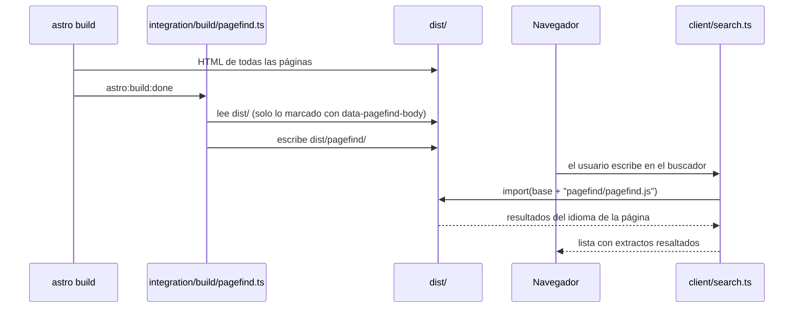

---
seo:
  title: "Navegación, barra lateral y búsqueda"
  description: "Cómo se calculan la cabecera, la barra lateral, los archivos externos y el pie, y cómo funciona la búsqueda con Pagefind, que se indexa al construir."
---

# Navegación y búsqueda

## Las piezas de la navegación

```mermaid
flowchart TD
  cfg["docs.config.mjs<br/>nav · sidebar · external · footer"] --> val["Validación contra los slugs reales<br/>(en el loader)"]
  pages["Páginas descubiertas<br/>order · slug · idioma"] --> val
  val --> nav["buildNav<br/>core/navigation/nav-entries.ts"]
  val --> sb["buildScopedSidebar<br/>core/navigation/nav-sidebar.ts"]
  sb --> pn["prevNext<br/>core/navigation/prev-next.ts"]
  val --> ft["buildFooter<br/>core/navigation/footer.ts"]
  nav --> hdr["DocsHeader"]
  sb --> side["Sidebar + SidebarList"]
  pn --> prev["PrevNext"]
  ft --> foot["DocsFooter"]
```



Todo el cálculo es puro y vive en `src/core/navigation/`; los componentes de `src/components/` solo pintan
lo que reciben.

### Cabecera (`nav`)

Tres tipos de elemento, distinguidos por su forma:

- **Sección** `{ label, dir?, sidebar? }`: le pertenece toda página cuyo slug es `dir` o empieza por
  `dir/`, y también las que nombra su `sidebar`, vivan donde vivan (páginas sueltas, `external`).
  Sin `dir`, la forman solo las del `sidebar`. Dentro de una sección la barra lateral muestra
  **solo** su árbol, y anterior/siguiente nunca salen de ella. El elemento enlaza al `index.md` de la carpeta si existe y, si no, a su
  primera página. Es lo que usa este sitio: dos secciones, Guía (`guia/`) y Desarrollo (`desarrollo/`).

  ```js
  // El README de la raíz y un REFERENCE.md suelto son «Para usuarios» sin vivir en `users/`.
  { label: 'Para usuarios', dir: 'users', sidebar: ['readme', 'users/instalar', 'REFERENCE'] },
  // Sin carpeta común: la sección es solo su sidebar.
  { label: 'Referencia', sidebar: ['REFERENCE', 'changelog'] },
  ```

  Sin `sidebar`, las páginas de la sección van ordenadas por `order` y luego **alfabéticamente por
  slug**; para otro orden, decláralo. Una página no puede ser de dos secciones (ni ir suelta en el
  `nav` si una sección la nombra): falla en el build con la ruta.
- **Página** `{ label, slug }`: un enlace a una sola página, que no pertenece a ninguna sección.
- **Enlace** `{ label, href, icon? }`: externo, solo `https://`. Con `icon: NavIcon.GITHUB` solo se
  ve el icono y el `label` queda para lectores de pantalla.

La validación de forma (https, `dir` solapados) se hace en el esquema; la que necesita conocer las
páginas (un `dir` sin páginas, un `slug` que no existe) en el loader, con `validateNav`
(`core/navigation/nav-sections.ts`). Desde `lg` los elementos están en la cabecera; por debajo
aparecen en el menú móvil.

### Barra lateral (`sidebar`)

- Entradas: slugs (`'guia/instalar'`) o grupos `{ label, slug?, items }`. La portada es `'index'`.
- Lo que no declaras va **después**, ordenado por `order` del frontmatter y luego por slug. Este
  sitio declara la `sidebar` de cada sección: los grupos (`{ label, slug?, items }`) y el orden no son los de las
  carpetas, y un grupo con `slug` enlaza a su propia página (la del `index.md` o la que lo abre).
- Un slug desconocido rompe el build con un único error que nombra todos (`sidebar[2].items[0]`).
- Las páginas fuera de toda sección (como la portada de este sitio) usan la `sidebar` de primer
  nivel o, sin ella, una lista automática de solo esas páginas.
- La barra recuerda su desplazamiento entre páginas en `sessionStorage` (`docs:sidebar-scroll`,
  `client/layout/sidebar-scroll.ts`); sin posición guardada, deja a la vista la página actual.

### Índice generado (`::nav-tree`)

Una página índice (la de un blog, la de una guía) no necesita copiar a mano el árbol de las
secciones: la directiva `::nav-tree`, sola en su línea, lo pinta desde la config.

```md
# Tutoriales

Tutoriales paso a paso, agrupados por nivel.

::nav-tree
```

Por cada sección de `nav` (las que tienen `sidebar` o `dir`, en su orden) escribe un `##` con la
etiqueta de la sección y, debajo, su árbol: los grupos como listas anidadas con la etiqueta en
negrita, y cada página como un enlace con su título seguido de la `seo.description` de su
frontmatter, si la tiene. Las etiquetas salen de la config (ya traducidas), los títulos y las
descripciones de cada página: no hay texto escrito a mano que mantener ni traducir, y una página
nueva aparece en el índice en cuanto entra en un `sidebar`.

| Atributo | Qué hace |
| --- | --- |
| `section="Avanzado"` | Solo esa sección. Se nombra por su etiqueta en cualquier idioma o por su `dir`. |
| `descriptions="false"` | Solo los títulos, sin las descripciones. Sin él, salen. |

```md
::nav-tree{section="Avanzado" descriptions="false"}
```

- **El árbol es el de la barra lateral.** Lo calcula `buildSectionSidebar`, así que respeta el orden
  declarado, `order` y la política de traducción: con `link`, la página sin traducción enlaza al
  original con su insignia; con `omit`, no sale.
- **En una ruta de reserva** (`/en/tutoriales/` sin traducción), el texto es el del contenido
  original, como el resto de la página; las URLs son las de la barra lateral de esa ruta, así que
  quien lee en `/en/` sigue en `/en/`.
- **Los `##` son encabezados de verdad:** tienen ancla, salen en «En esta página» y otra página puede
  enlazarlos (`[avanzado](tutoriales/index.md#avanzado)`), con la validación de anclas de siempre.
- **Cómo funciona.** El plugin `navTree` (`astro/markdown/nav-tree.ts`) escribe los `##` y deja un
  hueco por sección; la ruta de las páginas de docs calcula los árboles del idioma que pinta
  (`docNavTrees`, `core/navigation/nav-tree.ts`) y `DocPage` pinta cada uno en su hueco con `NavTree`.
  Todo en el HTML del build: sin JavaScript y dentro del índice de búsqueda.
- **Rompe el build,** con el archivo y la línea: una `section` que no existe (el mensaje lista las
  que hay), un atributo desconocido, un `descriptions` que no es `true` ni `false`, la directiva sin
  secciones en `nav`, con texto (`::nav-tree[…]`) o como contenedor (`:::nav-tree`).

### Índices de carpeta (`_index.md` e `indexes`)

Un blog o una guía necesitan una página que liste lo que cuelga de su carpeta. La librería la
genera, como Hugo, a partir de un `_index.md` en esa carpeta o, sin él, de la opción `indexes`.

```md
<!-- tutoriales/_index.md -->
---
seo:
  description: "Tutoriales paso a paso, agrupados por nivel."
listing:
  layout: cards # list (por defecto) | table | cards
  pageSize: 12 # por defecto 12 en tarjetas y 10 en tabla; la lista no se pagina
  perPageOptions: [12, 24, 48] # selector «Por página»; por defecto [12, 24, 48] o [10, 25, 50]
  covers: true # política de portadas: true (la de la librería) | false
---

# Tutoriales

Tutoriales paso a paso, desde la instalación hasta el despliegue.
```

`/tutoriales/` pinta el cuerpo del `_index.md` (el `#` y la entradilla, con el estilo de siempre) y,
debajo, el listado de la carpeta. **El `_index.md` no es una página propia:** no tiene ruta
(`/tutoriales/_index/` no existe), su página es la de la carpeta. Su slug es el de la carpeta, así que
`sidebar: ['tutoriales']` o un `nav` con `slug: 'tutoriales'` lo enlazan, y un enlace del Markdown a
`tutoriales/_index.md` lleva a `/tutoriales/`. Se traduce como cualquier página (`_index.en.md`), con
la política de `translations` de siempre: sin traducción, `/en/tutoriales/` es una ruta de reserva con el
texto original y las URLs de `/en/`. Cada traducción lleva su propio bloque `listing`.

Dos bloques, cada uno con un significado:

- **`listing:`** dice cómo es el listado de la carpeta. Solo vale en un `_index.md`; en cualquier otro
  archivo (también en un `index.md`) rompe el build nombrando el campo.
- **`index:`** dice cómo sale una página en el listado de su carpeta (resumen y portada; ver
  [Portadas](#portadas-tarjetas)). Lo admite cualquier página, también un `_index.md`: es su ficha en
  el listado de la carpeta padre.

**Es la forma recomendada de dar título y entradilla a un índice:** todo lo que se traduce vive en
Markdown, no en la config.

| En la carpeta | Qué se publica en `/carpeta/` |
| --- | --- |
| `index.md` | Esa página, normal (puede usar `::nav-tree`). Gana siempre: si también hay `_index.md`, se ignora con un aviso. |
| `_index.md` (sin `index.md`) | El índice generado, con el título, la entradilla y el `seo` del `_index.md`. No hace falta config. |
| Ninguno de los dos | El índice generado si `indexes` activa la carpeta; si no, nada (como hasta ahora). |

#### Qué lista y en qué orden

Las páginas de la carpeta (y sus subcarpetas) que están en la navegación, con la resolución de la
barra lateral y de `::nav-tree`: el árbol de cada sección de `nav` y luego el de las páginas sin
sección, con su orden, sus URLs y la política de traducción (`link` enlaza al original con su
insignia; `omit` no la lista). De cada página salen su título, su resumen (`index.summary` o, sin él,
`seo.description`), su camino (sección › grupos) y la fecha de su último commit.

| `layout` | Cómo se ve |
| --- | --- |
| `list` | El árbol: un `##` por sección de `nav` (entra en «En esta página»), los grupos en negrita y cada página con su resumen y su fecha discreta a la derecha. Sin paginar. |
| `table` | Título, resumen, sección y fecha, de la más reciente a la más antigua. En móvil, cada fila es una tarjeta apilada (`table-cards`). |
| `cards` | Tarjetas de blog: portada 16:9, camino, título (toda la tarjeta es el enlace), resumen en tres líneas y fecha. Una columna en móvil, dos o tres según el ancho del contenido. |

- **Fechas.** Las del último commit de cada archivo (el mismo historial de git que el `lastmod` del
  sitemap). Una página sin commit (un borrador aún sin publicar) no muestra fecha y, en la tabla y
  las tarjetas, va **delante**: es lo más nuevo. Sin git o en un clon superficial no hay fechas y el
  orden es el del árbol.
- **Paginación** (tabla y tarjetas): la página 1 es la de la carpeta (`/tutoriales/`) y las demás,
  `/tutoriales/2/`, `/tutoriales/3/`… con el `Pagination` de la librería. Desde la 2 se repite el
  título del `_index.md` con «Página 2 de 3» y **no** la entradilla (no duplica contenido). Son
  `noindex` con `canonical` a sí mismas, llevan `rel="prev"`/`rel="next"`, no entran en el sitemap ni
  en la búsqueda: lo que se indexa es la página 1 y cada página de la carpeta. Una
  página real en `tutoriales/2.md` choca con esa URL y rompe el build.
- **Tamaño de página por defecto:** 12 en las tarjetas (con 12, 24 o 48 las filas quedan completas
  tanto a dos como a tres columnas) y 10 en la tabla (la medida redonda de una tabla).
- **Sitemap.** La página de la carpeta entra con `lastmod` = la fecha más reciente entre su
  `_index.md` y sus páginas.

#### Selector «Por página» (tabla y tarjetas)

Debajo del listado, una sola fila de pie lleva a la izquierda un `<select>` nativo con la etiqueta
«Por página» («Per page») y a la derecha el rango («Mostrando 1–12 de 18») y el paginador; en móvil
la fila se parte. Es la misma pieza que el pie de la tabla del panel SEO (`PaginationBar`). No hay
copia arriba: con 12 entradas por página la fila queda cerca. El selector deja elegir cuántas
entradas se ven: por defecto 12, 24 o 48 en las tarjetas y 10, 25 o 50 en la tabla. Las
opciones salen de `perPageOptions` (en `indexes`, en `indexes.overrides[carpeta]` o en el `listing`
del `_index.md`, con la precedencia de siempre) y deben ser enteros positivos; si el `pageSize` no está
entre ellas, se añade (y se ordenan). No sale en la lista, con una sola opción ni si todo cabe en la
más pequeña.

- **Mejora progresiva.** Sin JavaScript el selector no se ve y el índice es el de siempre: rutas
  estáticas (`/tutoriales/`, `/tutoriales/2/`…) del `pageSize` configurado, la 1 indexable y canónica.
  Lo enseña el script del artículo (`client/content/index-pager.ts`).
- **Sin marcado duplicado ni red.** La página 1 trae todas las entradas de su carpeta (las de más,
  `hidden`) y un paginador por cada tamaño y página, pintados por los mismos componentes del
  servidor; el script solo decide qué se ve. Con 200 entradas la página 1 pesa más (cada tarjeta
  son unos cientos de bytes comprimidos), pero no hay un JSON aparte que mantener ni plantillas que
  imiten a los componentes. El listado queda fuera de la búsqueda (`data-pagefind-ignore`): cada
  entrada ya está indexada en su página.
- **La URL manda:** `?por=18&pagina=2` (los mismos nombres en todos los idiomas), así que se puede
  compartir y sobrevive a recargar; atrás y adelante vuelven a cada estado. Cambiar el tamaño vuelve
  a la página 1. Con el tamaño de la config, el paginador enlaza las rutas estáticas: es lo que ven
  los buscadores y quien no tiene JavaScript. Los enlaces con query cambian de página sin recargar.
- **Se recuerda por índice** en `localStorage` (`docs:index-per-page:<URL de la carpeta>`): al volver
  a la página 1 sin query se aplica lo elegido. Si el navegador bloquea el almacenamiento, funciona
  igual, sin recordar.
- **Desde la página 2** (que solo trae sus entradas), cambiar el tamaño lleva a la página de la
  carpeta con `?por=…`.
- **Accesibilidad.** El rango es una región `aria-live="polite"`: se ve siempre (también sin
  JavaScript, con el de la página estática) y anuncia «Mostrando 1–18 de 18» tras cada cambio de
  quien lee; el ajuste al cargar (por la URL o lo recordado) se hace sin anunciar. Al cambiar de
  página el foco va al principio del listado. Todo es nativo:
  `<select>` y enlaces, con teclado.

#### Portadas (tarjetas)

En el frontmatter de cada página (también de un `_index.md`, para su ficha en el listado padre):

```yaml
index:
  summary: "Resumen para el listado." # opcional; sin él, seo.description
  image: ./portada.png # relativa al .md (astro:assets) o de public/ (/portadas/x.png) | false
  imageAlt: "Lo que muestra la imagen" # opcional
```

Precedencia, de más a menos: `index.image` de la página → `listing.covers` del `_index.md` (o
`covers` de `indexes.overrides[carpeta]`) → `indexes.covers` → la portada de la librería. `false` en
un nivel quita la imagen salvo que uno más alto ponga una real. `index.image` es siempre la portada
de la página (una ruta o `false`); la **política** del listado (`true`/`false`) es `covers`.

- La portada de la librería es un dibujo (rejilla, diagonales o puntos, estable por página) hecho
  solo con los tokens del tema, con el grupo de la página como etiqueta pequeña.
- Una ruta relativa pasa por `astro:assets` (se optimiza a WebP); una de `public/` se sirve tal cual,
  con la `base` del sitio. Si el archivo no existe, el build **avisa** y pone la de la librería: no
  falla.
- La de la librería va siempre debajo de la imagen: si no carga en el navegador, se ve ella.
- **Texto alternativo:** decorativa por defecto (`alt=""`), porque el título enlazado va al lado y
  se anunciaría dos veces; `imageAlt` le da un `alt` real. La de la librería es `aria-hidden`.

#### La opción `indexes`

Pone los valores por defecto de todos los listados y activa el índice generado en las carpetas sin
`index.md` ni `_index.md`. Lo que diga un `_index.md` gana.

```js
indexes: {
  layout: 'list', // 'list' (por defecto) | 'table' | 'cards'
  pageSize: 12, // por defecto 12 en tarjetas y 10 en tabla
  perPageOptions: [12, 24, 48], // por defecto [12, 24, 48] en tarjetas y [10, 25, 50] en tabla
  covers: true, // política de portadas por defecto
  include: 'all', // 'all' (por defecto) o las carpetas exactas: ['tutoriales', 'guia/avanzado']
  exclude: ['borradores'], // carpetas que no, aunque `include` las abarque
  overrides: {
    guia: { layout: 'table', pageSize: 20, covers: false, title: { es: 'Guía', en: 'Guide' }, description: { es: '…', en: '…' } },
  },
},
```

- **Todas:** `indexes: {}`. **Todas menos unas:** `exclude`. **Solo unas:** `include: [...]`.
  Las carpetas se nombran por su ruta en el contenido, exactas (`tutoriales` no incluye
  `tutoriales/viejos`); una que no existe rompe el build con su ruta (`indexes.include[1]`).
- La página generada de una carpeta sin `_index.md` se titula con el `title` de `overrides`, o con la
  etiqueta de la sección de `nav` con ese `dir` (ya traducida), o con el nombre de la carpeta
  (`notas-de-version` → «Notas de version»). Su entradilla y su `seo.description` son la
  `description` de `overrides`, si la hay. Existe en todos los idiomas del sitio.
- Sin `indexes`, todo queda como antes: solo los `_index.md` generan índices.
- **Cómo funciona.** El descubrimiento convierte `carpeta/_index.md` en la página de `carpeta`
  (`core/content/discovery.ts`) y el loader añade las generadas (`generatedListingPages`,
  `core/content/generated-listings.ts`); la ruta de las páginas de docs resuelve el listado
  (`resolveListing`) y lo calcula (`buildListing`), los dos en `core/listing/`, con `docListingView`, y `DocPage` lo pinta
  debajo del contenido, fuera de `.prose`, con `IndexListing` (`IndexList`, `IndexTable`,
  `IndexCards` y el átomo `CoverPlaceholder`). Los textos de la interfaz son las claves `index.*`.
- **Forma explícita del loader:** las portadas relativas necesitan el `image()` de Astro:
  `schema: ({ image }) => docsSchema(image)`. Con `docsSchema()` a secas, una portada relativa cae a
  la de la librería.

### Excluir archivos

`exclude` deja fuera de la publicación los `.md` de la carpeta de contenido que casan con sus patrones (estilo
`.gitignore`, relativos a esa carpeta), como `exclude_docs` de MkDocs: `exclude: ['drafts/', '*.borrador.md']`.
Un nombre sin `/` vale a cualquier profundidad, `/` al final es una carpeta, `**` cruza carpetas y `!` vuelve a
incluir (manda el último patrón que coincide). Lo excluido no se lee, ni se publica, ni cuenta para los enlaces;
un enlace a un archivo excluido falla con un mensaje que nombra `exclude`. Los `external` no se ven afectados.

### Archivos externos

`external` publica archivos que viven fuera de la carpeta de contenido (`src/content/docs/` por defecto), típicamente el `CHANGELOG.md` o
el `README.md` de la raíz del repo, para que GitHub y el sitio lean **la misma fuente**:

```js
external: [{ slug: 'changelog', file: '../CHANGELOG.md', translations: MissingTranslation.LINK }],
```

`file` es relativo al proyecto de Astro. Sus enlaces relativos se resuelven contra su ubicación
real, así que siguen funcionando en GitHub. El enlace «Editar esta página» apunta a ese archivo
(`editPath` se calcula contra la raíz del repo: `repoRoot` o el `.git` más cercano).

Con `slug: 'index'` el archivo es la **portada** (el `README.md` de la raíz, por ejemplo), y `slug: 'guia/index'`
es `guia`, igual que un `index.md` nativo; si además hay un `index.md` en ese idioma, la build falla nombrando
los dos archivos.

### Carpetas estáticas

`static` publica una carpeta tal cual, sin Markdown ni optimización, y la deja fuera del índice de
búsqueda y del sitemap. Sirve para lo que ya viene generado, como un informe de cobertura HTML:

```js
static: [{ from: '../htmlcov', to: 'coverage' }], // → <base>/coverage/
```

`from` es relativa a la raíz del proyecto de Astro y debe existir al construir; si falta, el build
falla con `static[0].from`. `to` no puede ser `_astro`, `pagefind` ni un idioma, y dos destinos no
pueden solaparse.

`exclude` deja fuera archivos de la carpeta. Son patrones al estilo `.gitignore`, los mismos que el
`exclude` de la config, pero relativos a `from`. Lo excluido no se copia a `dist/` y `astro dev`
responde 404, igual que si no existiera. Las reglas se aplican a cada archivo:

```js
static: [{ from: '../htmlcov', to: 'coverage', exclude: ['assets/script/', '*.py'] }],
```

Una página la enlaza con una ruta relativa a su archivo, como en GitHub
(`[Cobertura](../htmlcov/index.html)`), y `rewriteLinks` la cambia por la URL publicada
(`<base>/coverage/index.html`).

El build la copia a `dist/` al final de `astro:build:done`
(`astro/integration/build/copy-static-folders.ts`) y `astro dev` la sirve con un middleware
(`astro/integration/static-folders-dev.ts`). La validación de forma vive en
`core/content/static-folders.ts`.

### Pie

Dos filas iguales en todas las páginas: copyright, tus `links` y los enlaces al repositorio y a
«Informar de un error» (a partir de `social.github`); debajo, licencia, privacidad y «Preferencias de
cookies» (solo con analítica). Este sitio no declara licencia todavía. El año sale del reloj del
visitante (`client/layout/year.ts`); el del build queda como respaldo sin JavaScript.

#### Pie propio (`components.Footer`)

Un sitio que ya tiene su pie (un sitio con sus páginas propias) puede usarlo también en las páginas
de docs, como los `components` de Starlight. Se declara en `docs.config.mjs` con la ruta de un `.astro`
desde la raíz del proyecto:

```js
export default defineDocsConfig({
  name: 'Mi sitio',
  components: { Footer: './src/components/DocsFooter.astro' },
});
```

```astro
---
// src/components/DocsFooter.astro
import type { FooterProps } from '@velezanthony/design/integration';
import CookieSettingsButton from '@velezanthony/design/components/atoms/actions/CookieSettingsButton.astro';

type Props = FooterProps;

const { siteName, year, strings, privacyUrl, cookieControl } = Astro.props;
---

<footer class="surface-inverse mt-auto px-6 py-8">
  <p>© {year} {siteName}</p>
  {privacyUrl && <a href={privacyUrl}>{strings['consent.privacy']}</a>}
  {cookieControl && <CookieSettingsButton strings={strings} />}
</footer>
```

El componente sustituye entero al pie de la librería y recibe estas props (`FooterProps`):

| Prop | Tipo | Qué es |
| --- | --- | --- |
| `lang` | `string` | Idioma de la página. |
| `siteName` | `string` | El `name` de la config. |
| `year` | `number` | Año del build, para el copyright. |
| `strings` | `UiStrings` | Textos de interfaz del idioma, ya fusionados con los de `ui`. |
| `privacyUrl` | `string \| undefined` | La `privacyUrl` del idioma; sin ella, no hay enlace que pintar. |
| `cookieControl` | `boolean` | `true` con analítica: hay una elección de cookies que reabrir. |
| `footer` | `FooterView \| undefined` | Licencia, autor y enlaces de la opción `footer`, ya resueltos al idioma. |

- **Cómo llega.** La integración comprueba la ruta y sirve el módulo virtual
  `virtual:@velezanthony/design/components/Footer`, que reexporta ese archivo o, sin `components`,
  `DocsFooter`. Lo importan la ruta de las páginas de docs (`astro/routes/doc.astro`) y las del panel
  SEO (`astro/routes/seo-on-page/`), que se lo pasan a `DocsLayout` por su prop `Footer`: los
  componentes no leen módulos virtuales. Así el panel, solo de desarrollo, lleva el mismo pie que el
  sitio. Un layout propio que use
  `DocsLayout` puede pasarle su pie por esa misma prop.
- **Con analítica,** el pie propio es quien da la forma de retirar el consentimiento:
  `CookieSettingsButton` es el botón de «Preferencias de cookies» de `DocsFooter`, con el atributo
  `data-consent-open` que escucha el script de consentimiento. Recibe `strings` y una `class` opcional.
- **El `<body>` es una columna flexible:** `mt-auto` en el `<footer>` lo deja abajo en una página corta.
- **Rompe el build:** una ruta que no existe (nombra `components.Footer` y dónde se buscó), una que no
  es `.astro` o es una URL, y cualquier otra clave dentro de `components` (`components.Header: opción
  desconocida.`).

## Búsqueda

La búsqueda es **Pagefind**: un índice estático generado al final del build, sin servidor.



- **Qué se indexa.** `DocsLayout` marca con `data-pagefind-body` solo el `<main>` de las páginas
  indexables; el cromo (cabecera, barra lateral, pie) y las páginas `noindex` llevan
  `data-pagefind-ignore`. Pagefind separa los índices por el `lang` del `<html>`, así que cada idioma
  busca en el suyo.
- **La `base`.** El índice guarda rutas relativas a `dist/`; es el cliente quien antepone la `base`
  al cargar `pagefind.js` (`pagefindUrl` en `client/search.ts`).
- **En desarrollo no hay búsqueda.** `astro dev` no pasa por `astro:build:done`, así que no existe el
  índice. El buscador lo detecta (la importación falla) y muestra «La búsqueda necesita una build de
  producción». Para probarla: `npm run docs:build` y `npm run preview -w docs`.
- **Atajo.** La tecla `/` enfoca el buscador (`initSearchShortcut`), y la pista solo se muestra donde
  el atajo funciona.
