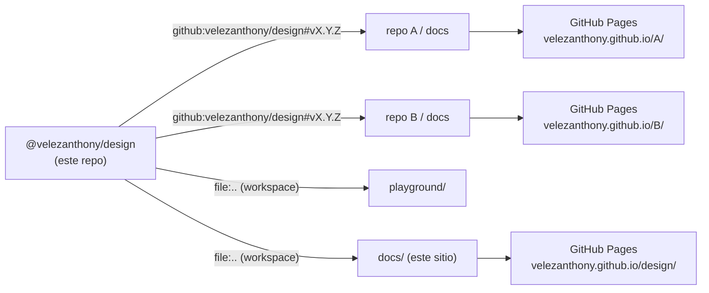

---
seo:
  title: "Sistema de diseño y documentación para Astro"
  description: "Librería de velezanthony: un sistema de diseño y un motor de documentación sobre Astro que comparten sus repos. Qué es, cómo se monta y cómo se mantiene."
---

# Design

`@velezanthony/design` es **una librería, no un sitio**. Reúne dos cosas que todos los repositorios
de [velezanthony](https://github.com/velezanthony) necesitan y que no tiene sentido rehacer en cada
uno:

1. **Un sistema de diseño**: paleta, tipografía (IBM Plex), tokens de Tailwind, tema claro/oscuro y
   componentes genéricos (átomos, moléculas, organismos).
2. **Un motor de documentación**: una integración de Astro que, a partir de una carpeta de Markdown y
   un único archivo de configuración, genera el sitio entero: rutas, barra lateral, índice,
   búsqueda, SEO, idiomas, `sitemap.xml` y aviso de cookies.

## El problema que resuelve

Sin la librería, cada repo con documentación arrastra su propio MkDocs, su propio CSS y sus propias
decisiones a medias. Cuando arreglas algo en uno, los demás se quedan atrás. Con la librería:

- El **aspecto y el comportamiento** viven en UN sitio. Un arreglo en la librería llega a todos los
  repos con solo subir la etiqueta que instalan.
- Cada repo consumidor **solo escribe lo suyo**: su Markdown, su `docs.config.mjs` y, si de verdad
  lo necesita, algún componente específico. Nada de layouts, CSS ni rutas.
- Las reglas estrictas (enlaces validados, títulos obligatorios, lenguajes en los bloques de código)
  son las mismas para todos, así que la calidad no depende de acordarse en cada repo.

Este mismo sitio está construido con la librería (_dogfooding_): vive en la carpeta `docs/` del repo
y la consume exactamente igual que `playground/`, enlazada como workspace de npm.

## Mapa del sitio

| Menú | Qué encontrarás |
| --- | --- |
| [Guía](./guia/index.md) | Para quien usa la librería en otro repo: dónde se monta y qué se queda fuera del paquete, el paso a paso para un repo nuevo, Markdown, navegación y búsqueda, rutas, SEO e idiomas, analítica, disposición, páginas propias y el panel SEO. |
| [Desarrollo](./desarrollo/index.md) | Para quien trabaja en la librería: las capas de `src/` y cómo las hace cumplir ESLint, el recorrido de una página, el mapa de carpetas, cómo funciona la integración por dentro, comandos, tests, paleta, recetas y cómo publicar una versión. |

> [!TIP]
> Si vuelves aquí tras meses sin tocar la librería, empieza por
> [Arquitectura](./desarrollo/index.md) y después lee [Mantenimiento](./desarrollo/mantenimiento.md), las dos dentro de Desarrollo.
> Cada página dice en qué archivo vive cada cosa para que puedas ir directo al código.
