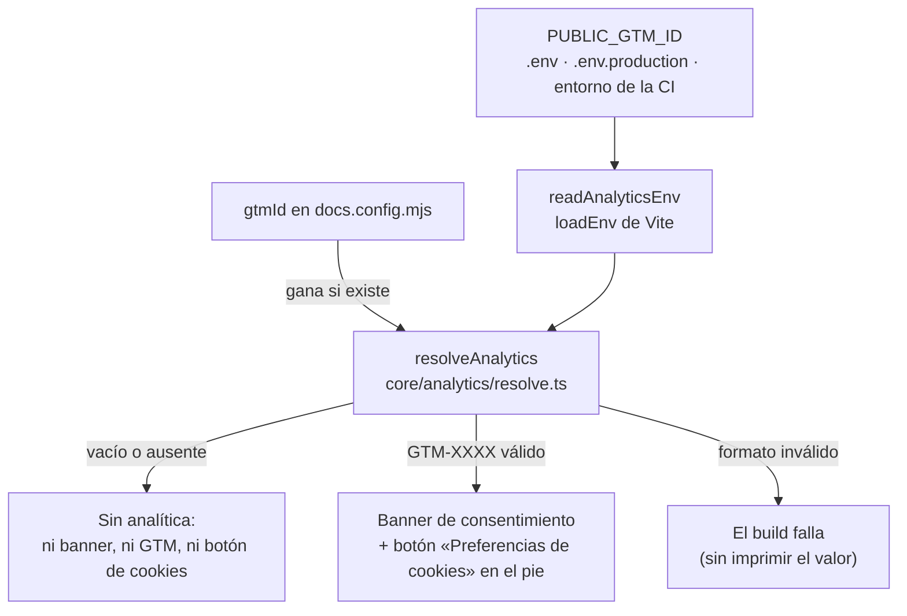
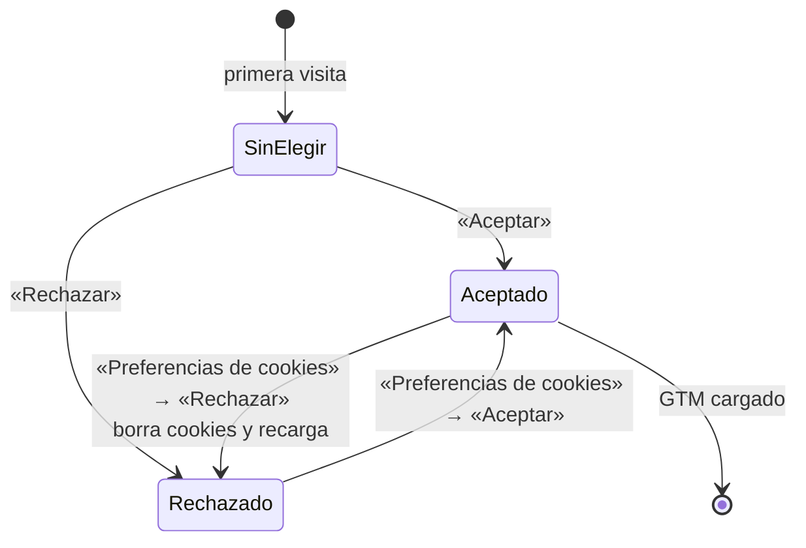

# Analítica y privacidad

La regla de diseño es simple: **sin consentimiento no se carga nada**, y sin un id de Google Tag
Manager ni siquiera existe el mecanismo. Un build local o el de un fork queda sin rastreo sin
necesitar un camino de código propio.

## De dónde sale el id



- `readAnalyticsEnv` (`src/astro/integration/analytics-env.ts`) usa `loadEnv` de Vite porque en
  `astro:config:setup` los `.env` aún no están en `process.env`. El modo depende del comando: `dev`
  lee `.env.development`, `build` lee `.env.production`; las variables del proceso (la CI) ganan.
- `resolveAnalytics` exige el formato `GTM-` más mayúsculas y dígitos. Un valor en blanco cuenta como
  no definido. Si el formato es imposible, falla en el build: un id mal escrito no debe convertirse
  en un aviso que nunca carga nada. El mensaje nombra la variable, **nunca el valor**.
- `gtmId` en la config es una sobrescritura explícita. Úsalo solo si un repo debe fijar un
  contenedor; lo normal es el entorno.

En GitHub Actions el id se pasa al paso de build (como _secret_ o como variable de repositorio; el id
es público en la página de todos modos):

```yaml
- run: npm run build
  env:
    PUBLIC_GTM_ID: ${{ secrets.PUBLIC_GTM_ID }}
```

Este sitio **no tiene analítica**: ni `gtmId` en su config ni `PUBLIC_GTM_ID` en su workflow.

## El consentimiento en el navegador

`initConsent` (`src/client/consent.ts`) lo gestiona todo a partir del banner
(`src/ui/organisms/ConsentBanner.astro`), que solo se pinta con analítica activa:



- La elección se guarda en `localStorage` bajo `consent`, con una versión (`CONSENT_VERSION`): si
  algún día cambia lo que se pide, subir la versión vuelve a preguntar a todo el mundo.
- GTM se inyecta **solo** tras «Aceptar» o con un `granted` guardado.
- Retirar el consentimiento es tan fácil como darlo: el botón del pie reabre el banner. Como un
  contenedor de GTM en marcha no se puede descargar, un rechazo posterior borra las cookies de
  analítica del dominio (`analyticsCookiesToDelete`) y recarga la página.
- Las claves `consent` y `theme` viven en el mismo origen (`velezanthony.github.io`), así que el
  portfolio y todos los sitios de docs **comparten** la elección del visitante.

## Política de privacidad

Siempre hay un enlace a una política cuando hay analítica. Por defecto apunta a la del portfolio
(`DEFAULT_PRIVACY_URLS`): `https://velezanthony.github.io/privacidad/` en `es` y
`https://velezanthony.github.io/en/privacy/` en `en`. Dos formas de cambiarlo:

- `privacyUrl`: una URL o una por idioma. Siempre gana, y además se muestra en el pie aunque no haya
  analítica.
- `privacy.page: true`: el sitio publica **su propia página** de privacidad (`/privacidad/` en `es`,
  `/privacy/` en `en`, con prefijo de idioma y `base`). La inyecta la integración
  (`privacy.astro`, `privacy-locale.astro`) con el texto de `src/core/privacy/copy.ts`, y
  `privacy.controller` cambia el responsable que aparece. Solo hay texto en `es` y `en`; otro idioma
  rompe la validación.

La página propia lleva cabecera, pie y banner, pero no barra lateral; entra en el sitemap con su
`hreflang`. Si `src/pages/` del consumidor ya ocupa esa ruta, la integración falla y dice cuál.
