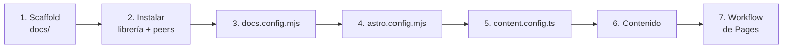

# Integrar un repo nuevo

Esta página es la receta para dar documentación a un repo que todavía no la tiene. Las demás
páginas de la sección explican qué pasa por dentro cuando sigues estos pasos.



## 1. Crear el subproyecto

En la raíz del repo consumidor:

```sh
npm create astro@latest docs -- --template minimal --no-git
```

Borra después lo que el scaffold trae y la librería ya resuelve:

- `docs/src/pages/index.astro`: la portada es el `index.md` de la carpeta de contenido (`src/content/docs/index.md` por defecto). Si dejas una página en
  `/`, `/404` o `/sitemap.xml`, el build falla a propósito (`route-collisions.ts`).
- `docs/public/favicon.svg` y `favicon.ico`, salvo que quieras usarlos con la opción `favicon`.

## 2. Instalar la librería y sus _peer dependencies_

```sh
npm install --prefix docs github:velezanthony/design#v0.1.0
npm install --prefix docs astro tailwindcss @tailwindcss/vite @astrojs/markdown-satteri
npm install --prefix docs -D @astrojs/check typescript
```

La etiqueta (`#v0.1.0`) fija la versión: el `package-lock.json` guarda el commit exacto. Para
actualizar se cambia la etiqueta y se vuelve a instalar (ver
[Publicar una versión](../mantenimiento/versiones.md)).

Las cuatro _peers_ son obligatorias porque el paquete se distribuye como fuente: es el Astro del
consumidor quien compila los `.ts` y `.astro` de la librería, con su Tailwind y su procesador de
Markdown. El rango exacto está en `peerDependencies` del `package.json` de la librería.

## 3. `docs/docs.config.mjs`

La configuración se declara UNA vez, en este archivo. Solo la importa `astro.config.mjs`, que se la
pasa a `docs()`:

```js
import { defineDocsConfig, MissingTranslation, NavIcon } from '@velezanthony/design/integration';

export default defineDocsConfig({
  name: 'Mi repo',
  locales: ['es', 'en'],
  seo: {
    titleSuffix: 'Mi repo',
    description: { es: 'Documentación de mi repo', en: 'My repo docs' },
  },
  translations: { missing: MissingTranslation.LINK },
  external: [{ slug: 'changelog', file: '../CHANGELOG.md' }],
  nav: [
    { label: { es: 'Guía', en: 'Guide' }, dir: 'guia' },
    { label: 'Changelog', slug: 'changelog' },
    { label: 'GitHub', href: 'https://github.com/velezanthony/mi-repo', icon: NavIcon.GITHUB },
  ],
  editUrl: 'https://github.com/velezanthony/mi-repo/edit/main',
  social: { github: 'https://github.com/velezanthony/mi-repo' },
});
```

`defineDocsConfig` es una función identidad: no hace nada en tiempo de ejecución, solo da
autocompletado y tipos (`DocsUserConfig`, generado desde el esquema zod de
`src/core/config/schema.ts`). La referencia completa de opciones está en el `README.md` de la
librería; el esquema es estricto, así que una clave mal escrita rompe el build con su ruta
(`seo.titleTemplat`).

## 4. `docs/astro.config.mjs`

```js
import { defineDocsSite } from '@velezanthony/design/integration';
import docsConfig from './docs.config.mjs';

export default defineDocsSite(docsConfig, { base: '/mi-repo' });
```

Equivale a la forma larga, que sigue valiendo si necesitas control total:

```js
import tailwindcss from '@tailwindcss/vite';
import { defineConfig } from 'astro/config';
import { docs } from '@velezanthony/design/integration';
import docsConfig from './docs.config.mjs';

export default defineConfig({
  site: 'https://velezanthony.github.io',
  base: '/mi-repo',
  trailingSlash: 'always',
  vite: { plugins: [tailwindcss()] },
  integrations: [docs(docsConfig)],
});
```

- `defineDocsSite(docsConfig, options)` es una función pura que devuelve esa config. `base` es
  **obligatorio** y no tiene valor por defecto: cada repo tiene el suyo. Debe empezar por `/`
  (`'/'` vale para un sitio de usuario u organización); si falta o no es una ruta, falla con un error
  que lo dice.
- `site` es opcional en la forma corta y por defecto es `https://velezanthony.github.io`
  (`options.site` lo cambia). En la larga es **obligatorio**: sin él, la integración falla en
  `astro:config:setup` porque el sitemap y las URLs canónicas necesitan un origen absoluto.
- Más config de Astro, en `options.astro`, se fusiona: `integrations` y `vite.plugins` se añaden
  después de `docs()` y de Tailwind, el resto de claves de `vite` se fusionan en superficial y las
  demás claves de primer nivel pisan los valores por defecto. `site` y `base` van en `options`.
  `markdown.processor` debe seguir siendo Sätteri: si no, `docs()` falla con un error claro.
- `docs(docsConfig)` recibe la config. Editar `docs.config.mjs` reinicia `astro dev`: la integración
  le pide a Astro que vigile ese archivo, porque por sí solo solo vigila `astro.config.mjs`.
- `site` es **obligatorio**: sin él, la integración falla en `astro:config:setup` porque el sitemap y
  las URLs canónicas necesitan un origen absoluto.
- `base` es el nombre del repo: GitHub Pages sirve las páginas de proyecto bajo
  `https://<usuario>.github.io/<repo>/`. Todos los enlaces internos, la búsqueda y la 404 lo
  respetan.
- `trailingSlash: 'always'` coincide con cómo GitHub Pages sirve los directorios (`/guia/`).
- El plugin de Tailwind sale del _peer_ `@tailwindcss/vite`, que instala el consumidor; la librería pone el CSS.

## 5. `docs/src/content.config.ts`

```ts
export { collections } from '@velezanthony/design/content';
```

Una línea, y sin importar la config. `@velezanthony/design/content` (`src/astro/content/index.ts`)
exporta la colección `docs` ya montada y le da al loader la config del módulo virtual
`virtual:@velezanthony/design/config`, el mismo que sirve la integración. Es la config que
`docs(docsConfig)` ya resolvió: hay UNA sola carga, así que integración y loader no pueden acabar con
configs distintas. Por eso mismo necesita que `docs(docsConfig)` esté en `astro.config.mjs`; sin ella
el build falla con un error que pide añadirla.

La colección **tiene que llamarse `docs`**: las rutas de la librería la piden por ese nombre
(`src/astro/data/docs-collection.ts`).

### Forma explícita

Si necesitas montar la colección tú (por ejemplo, para añadir otra), usa el loader suelto con el
MISMO objeto que das a `docs()`. Es la forma de siempre y sigue funcionando:

```ts
import { defineCollection } from 'astro:content';
import { docsLoader, docsSchema } from '@velezanthony/design/loader';
import docsConfig from '../docs.config.mjs';

export const collections = {
  docs: defineCollection({ loader: docsLoader(docsConfig), schema: docsSchema() }),
};
```

## 6. Contenido

```text
docs/src/content/docs/
├── index.md          → /mi-repo/            (portada, idioma por defecto)
├── index.en.md       → /mi-repo/en/
└── guia/
    ├── index.md      → /mi-repo/guia/
    ├── instalar.md   → /mi-repo/guia/instalar/
    └── instalar.en.md→ /mi-repo/en/guia/instalar/
```

- El archivo sin sufijo es el del idioma por defecto; `x.en.md` es su gemelo en inglés.
- El título es el primer `# h1` o el `title` del frontmatter. Sin ninguno, el build falla.
- El frontmatter admite `title`, `order`, `seo` y `translations`; las claves ajenas se ignoran
  (otras herramientas escriben las suyas), pero las nuestras se validan.
- Los enlaces entre páginas son rutas `.md` relativas (`./instalar.md#requisitos`): funcionan en
  GitHub y la librería los convierte en URLs del sitio, validando el archivo y el ancla.

Esa carpeta es la opción `content` (`'src/content/docs'` por defecto). Si el repo ya tiene sus docs
como `.md` sueltos en `docs/` (los de un MkDocs, por ejemplo), no los muevas: ver
[Docs fuera del proyecto de Astro](#docs-fuera-del-proyecto-de-astro).

## 7. Desplegar en GitHub Pages

En el repo consumidor, **Settings → Pages → Source: GitHub Actions**, y este workflow:

```yaml
name: Docs

on:
  push:
    branches: [main]
  workflow_dispatch:

permissions:
  contents: read
  pages: write
  id-token: write

concurrency:
  group: pages
  cancel-in-progress: false

jobs:
  build:
    runs-on: ubuntu-latest
    defaults:
      run:
        working-directory: docs
    steps:
      - uses: actions/checkout@v7
      - uses: actions/setup-node@v7
        with:
          node-version: 24
          cache: npm
          cache-dependency-path: docs/package-lock.json
      - uses: actions/configure-pages@v6
      - run: npm ci
      - run: npm run build
        env:
          PUBLIC_GTM_ID: ${{ secrets.PUBLIC_GTM_ID }}
      - uses: actions/upload-pages-artifact@v5
        with:
          path: docs/dist

  deploy:
    needs: build
    runs-on: ubuntu-latest
    environment:
      name: github-pages
      url: ${{ steps.deployment.outputs.page_url }}
    steps:
      - id: deployment
        uses: actions/deploy-pages@v5
```

- `PUBLIC_GTM_ID` es opcional. Sin él no hay analítica de ningún tipo (ver
  [Analítica y privacidad](./analitica-y-privacidad.md)).
- El repo de la librería es público, así que `npm ci` instala `github:velezanthony/design#…` sin
  token. Si algún día pasara a privado, el job necesitaría un token con acceso de lectura.
- El workflow de ESTE sitio (`.github/workflows/docs.yml`) es igual salvo que, al ser un workspace,
  instala desde la raíz y ejecuta `npm run docs:build`.

## Si el proyecto de Astro es la raíz del repo

Todo lo anterior vale quitando el prefijo `docs/`, y las rutas relativas cambian (`../CHANGELOG.md`
pasa a ser `./CHANGELOG.md`). Es el caso del portfolio.

## Docs fuera del proyecto de Astro

Cuando el repo ya guarda sus páginas en `docs/` y no quieres moverlas, el proyecto de Astro va en
`site/` y `content` apunta a ellas:

```text
repo/
├── docs/            # páginas nativas, tal cual (index.md, index.es.md, users/guia.md…)
├── CHANGELOG.md     # external
└── site/            # proyecto de Astro
```

```js
// site/docs.config.mjs
export default defineDocsConfig({
  name: 'Mi repo',
  content: '../docs', // relativa a la raíz del proyecto de Astro (site/)
  external: [{ slug: 'changelog', file: '../CHANGELOG.md' }],
  editUrl: 'https://github.com/velezanthony/mi-repo/edit/main',
  repoRoot: '..',
});
```

- `content` es una ruta relativa (no se admiten URLs ni rutas absolutas) y la carpeta debe existir:
  si no, el build falla con la ruta ya resuelta.
- Solo los `.md` son páginas. Un `requirements.txt` o las imágenes de la carpeta no lo son, pero las
  imágenes que una página referencia se publican y se amplían como siempre.
- Enlaces, anclas, imágenes y «Editar esta página» se resuelven contra la ubicación real de cada
  archivo; un `external` y una página nativa pueden enlazarse en ambos sentidos.
- Los plugins de Markdown y las reglas estrictas aplican a esa carpeta, y `astro dev` la vigila.
