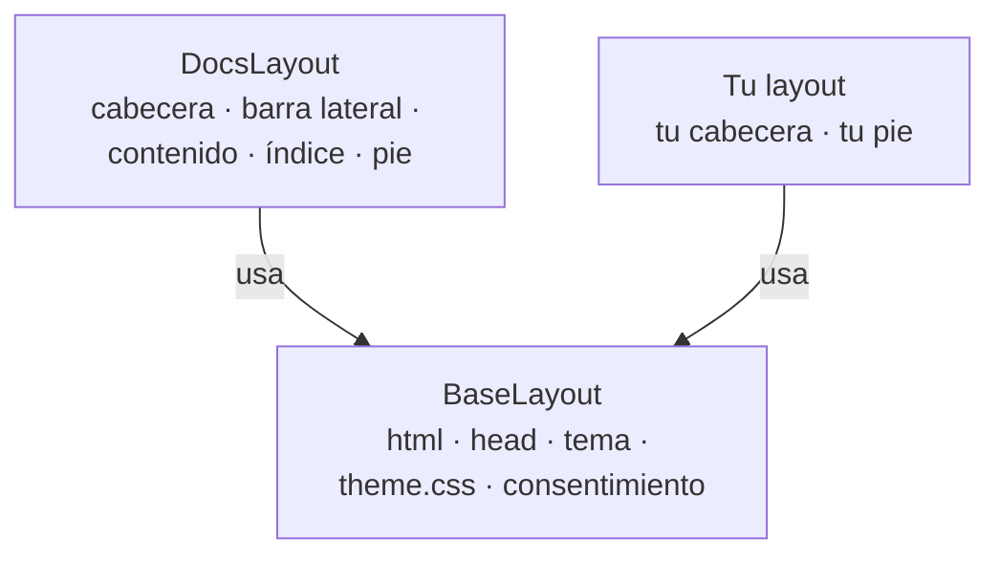

# Cabecera y pie propios con `BaseLayout`

Los layouts son dos, por composición, no por herencia:



- `BaseLayout` pinta el documento y **nada más**: `<html>`, el `<head>` (etiquetas SEO, `theme.css`,
  tema claro/oscuro, `theme-color`) y el aviso de consentimiento. No pone cabecera, pie ni diseño en
  el `<body>`.
- `DocsLayout` es el layout de las páginas de documentación, construido sobre `BaseLayout`. Es lo que
  usa la integración; no hace falta tocarlo para tener un sitio de docs.

Úsalo cuando una página del sitio (la portada, un currículum, una página legal) necesita el tema y el
consentimiento de la librería pero no la barra lateral de la documentación. Es el caso de una página
de `src/pages/`.

## Importarlo

Sale de la subruta `./components/*` del paquete, igual que cualquier componente:

```astro
---
import BaseLayout from '@velezanthony/design/components/layouts/BaseLayout.astro';
---
```

## Props

| Prop | Qué es |
| --- | --- |
| `lang` | Idioma del documento (`<html lang>`). |
| `head` | Las etiquetas del `<head>` como datos: `{ tag: 'title' \| 'meta' \| 'link' \| 'script', attrs, content? }[]`. |
| `bodyClass` | Clases de `<body>`. `BaseLayout` no impone ningún diseño: lo pones tú. |
| `htmlAttrs` | Atributos extra de `<html>`. |
| `gtmId`, `privacyUrl`, `strings` | Con `gtmId` se pinta el aviso de consentimiento, que exige `privacyUrl` y los textos de interfaz (`strings`); sin alguna de las dos, falla con un error que la nombra. |

## Ranuras

| Ranura | Dónde cae |
| --- | --- |
| `head` | Al final de `<head>`: fuentes, hojas, etiquetas propias. |
| (por defecto) | El contenido de `<body>`: tu cabecera, tu `<main>` y tu pie. |
| `scripts` | Al final de `<body>`, tras el arranque de la librería. |

## Una página con cabecera y pie propios

```astro
---
import { Font } from 'astro:assets';
import BaseLayout from '@velezanthony/design/components/layouts/BaseLayout.astro';
import ThemeToggle from '@velezanthony/design/components/molecules/controls/ThemeToggle.astro';
import config from 'virtual:@velezanthony/design/config';

/* Los textos de interfaz ya fusionados con los tuyos, por idioma. */
const strings = config.strings.es;
const head = [
  { tag: 'title', attrs: {}, content: 'Currículum · Ana' },
  { tag: 'meta', attrs: { name: 'description', content: 'Mi currículum.' } },
];
---

<BaseLayout lang="es" head={head} bodyClass="flex min-h-dvh flex-col">
  <Font slot="head" cssVariable="--font-plex-sans" preload />
  <link slot="head" rel="preload" href="/cv.pdf" as="document" />

  <header class="flex items-center justify-between px-6 py-4">
    <a href="/">Ana</a>
    <ThemeToggle strings={strings} />
  </header>
  <main id="main-content" class="mx-auto w-full max-w-3xl flex-1 px-6">
    <h1>Currículum</h1>
  </main>
  <footer class="px-6 py-4 text-sm text-muted">© 2026 Ana</footer>

  <script slot="scripts" src="/analytics-extra.js" is:inline></script>
</BaseLayout>
```

- **Contenido extra en el `head`.** Todo lo que lleve `slot="head"` va al final de `<head>`, después de
  lo que pone la librería. Sirve para las fuentes (`<Font>`), una hoja más o una etiqueta propia. Los
  elementos de la ranura se pueden agrupar con `<Fragment slot="head">`.
- **Scripts propios.** Todo lo que lleve `slot="scripts"` va al final de `<body>`. La librería ya ha
  cableado el tema y el consentimiento antes (`bootBase`), así que el `ThemeToggle` funciona sin más.
- **Tu diseño.** `bodyClass` es lo único que `BaseLayout` te deja decir sobre el `<body>`; el resto de
  clases y el orden de los bloques son tuyos.

Los textos (`strings`) salen del módulo virtual de la integración, `virtual:@velezanthony/design/config`
(`config.strings[idioma]`): ya llevan fusionadas tus sobrescrituras de `ui`.

## Lo que ya viene resuelto

- El tema claro/oscuro: el script previo al pintado y el arranque de cliente (`bootBase`).
- El aviso de consentimiento, con `gtmId`, `privacyUrl` y `strings`. Si quieres además el botón
  «Preferencias de cookies» en tu pie, usa `DocsFooter` con `cookieControl`, o el tuyo con el
  atributo `data-consent-open`.
- `theme.css`: la paleta, los tokens y los estilos base, sin que el consumidor importe CSS.

## Si quieres la disposición de las páginas de docs

No hace falta rehacerla: `DocsLayout` reexpone las ranuras `head` y `scripts` de `BaseLayout` (y
`DocPage` también), así que el contenido extra se añade igual:

```astro
<DocsLayout {...view}>
  <Font slot="head" cssVariable="--font-plex-sans" preload />
  <script slot="scripts" src="/extra.js" is:inline></script>
  <Content />
</DocsLayout>
```
