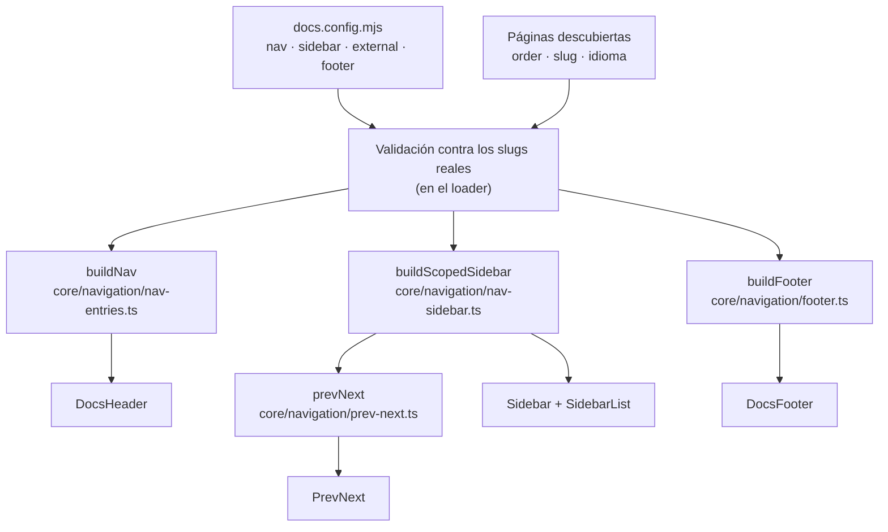
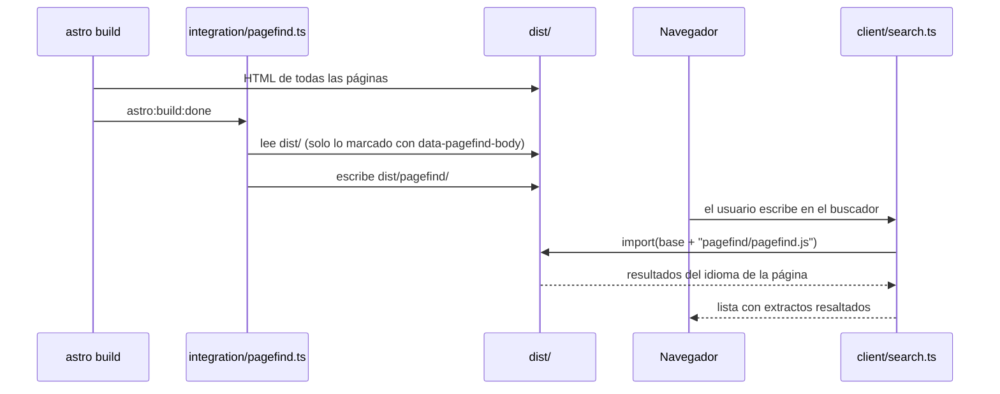

# Navegación y búsqueda

## Las piezas de la navegación



Todo el cálculo es puro y vive en `src/core/navigation/`; los componentes de `src/ui/` solo pintan
lo que reciben.

### Cabecera (`nav`)

Tres tipos de elemento, distinguidos por su forma:

- **Sección** `{ label, dir, sidebar? }`: le pertenece toda página cuyo slug es `dir` o empieza por
  `dir/`. Dentro de una sección la barra lateral muestra **solo** su árbol, y anterior/siguiente
  nunca salen de ella. El elemento enlaza al `index.md` de la carpeta si existe y, si no, a su
  primera página. Es lo que usa este sitio: Concepto, Integración, Arquitectura y Mantenimiento.
- **Página** `{ label, slug }`: un enlace a una sola página, que no pertenece a ninguna sección.
- **Enlace** `{ label, href, icon? }`: externo, solo `https://`. Con `icon: NavIcon.GITHUB` solo se
  ve el icono y el `label` queda para lectores de pantalla.

La validación de forma (https, `dir` solapados) se hace en el esquema; la que necesita conocer las
páginas (un `dir` sin páginas, un `slug` que no existe) en el loader, con `validateNav`
(`core/navigation/nav-sections.ts`). Desde `lg` los elementos están en la cabecera; por debajo
aparecen en el menú móvil.

### Barra lateral (`sidebar`)

- Entradas: slugs (`'guia/instalar'`) o grupos `{ label, slug?, items }`. La portada es `'index'`.
- Lo que no declaras va **después**, ordenado por `order` del frontmatter y luego por slug. Este
  sitio no declara ninguna `sidebar`: cada página lleva `order` y basta.
- Un slug desconocido rompe el build con un único error que nombra todos (`sidebar[2].items[0]`).
- Las páginas fuera de toda sección (como la portada de este sitio) usan la `sidebar` de primer
  nivel o, sin ella, una lista automática de solo esas páginas.
- La barra recuerda su desplazamiento entre páginas en `sessionStorage` (`docs:sidebar-scroll`,
  `client/sidebar-scroll.ts`); sin posición guardada, deja a la vista la página actual.

### Archivos externos

`external` publica archivos que viven fuera de `src/content/docs/`, típicamente el `CHANGELOG.md` o
el `README.md` de la raíz del repo, para que GitHub y el sitio lean **la misma fuente**:

```js
external: [{ slug: 'changelog', file: '../CHANGELOG.md', translations: MissingTranslation.LINK }],
```

`file` es relativo al proyecto de Astro. Sus enlaces relativos se resuelven contra su ubicación
real, así que siguen funcionando en GitHub. El enlace «Editar esta página» apunta a ese archivo
(`editPath` se calcula contra la raíz del repo: `repoRoot` o el `.git` más cercano).

### Pie

Dos filas iguales en todas las páginas: copyright, tus `links` y los enlaces al repositorio y a
«Informar de un error» (a partir de `social.github`); debajo, licencia, privacidad y «Preferencias de
cookies» (solo con analítica). Este sitio no declara licencia todavía. El año sale del reloj del
visitante (`client/year.ts`); el del build queda como respaldo sin JavaScript.

## Búsqueda

La búsqueda es **Pagefind**: un índice estático generado al final del build, sin servidor.



- **Qué se indexa.** `DocsLayout` marca con `data-pagefind-body` solo el `<main>` de las páginas
  indexables; el cromo (cabecera, barra lateral, pie) y las páginas `noindex` llevan
  `data-pagefind-ignore`. Pagefind separa los índices por el `lang` del `<html>`, así que cada idioma
  busca en el suyo.
- **La `base`.** El índice guarda rutas relativas a `dist/`; es el cliente quien antepone la `base`
  al cargar `pagefind.js` (`pagefindUrl` en `client/search.ts`).
- **En desarrollo no hay búsqueda.** `astro dev` no pasa por `astro:build:done`, así que no existe el
  índice. El buscador lo detecta (la importación falla) y muestra «La búsqueda necesita una build de
  producción». Para probarla: `npm run docs:build` y `npm run preview -w docs`.
- **Atajo.** La tecla `/` enfoca el buscador (`initSearchShortcut`), y la pista solo se muestra donde
  el atajo funciona.
