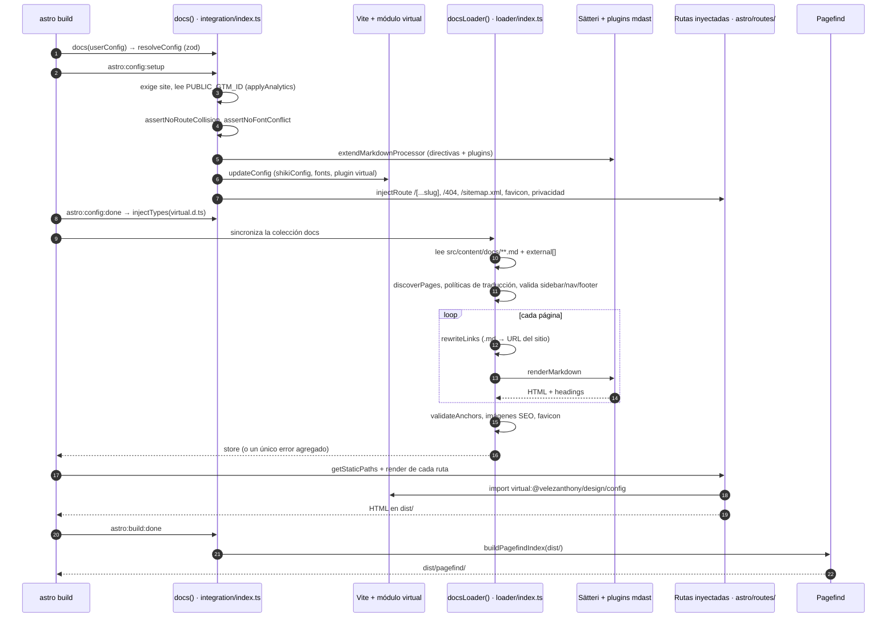
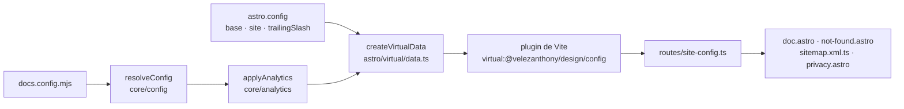

# Cómo funciona por dentro

La integración tiene dos puertas de entrada, una por cada archivo que toca el consumidor:

- `docs(config)` en `astro.config.mjs` → `src/astro/integration/index.ts`.
- `docsLoader(config)` en `content.config.ts` → `src/astro/loader/index.ts`.

Las dos reciben la misma config de `docs.config.mjs` y la pasan por `resolveConfig`
(`src/core/config/resolve.ts`), que valida con el esquema zod y rellena los valores por defecto. Un
error ahí sale como `AstroError` con la ruta de la clave (`toAstroError`, en
`src/astro/integration/errors.ts`).

## `astro build` paso a paso

## Los hooks de la integración

### `astro:config:setup`

Es donde ocurre casi todo. En orden:

1. **Exige `site`.** Sin origen absoluto no hay sitemap ni canonical.
2. **Analítica.** `readAnalyticsEnv` lee `PUBLIC_GTM_ID` con `loadEnv` de Vite (en este hook los
   `.env` aún no están en `process.env`) y `applyAnalytics` decide si se activa. Detalle en
   [Analítica y privacidad](./analitica-y-privacidad.md).
3. **Colisiones.** `assertNoRouteCollision` falla si `src/pages/` del consumidor ocupa una ruta de la
   librería; `assertNoFontConflict`, si el consumidor declara una fuente con `--font-plex-sans` o
   `--font-plex-mono`.
4. **Compañeras.** `addCompanions` inserta integraciones auxiliares tras la nuestra. Hoy la lista
   (`COMPANIONS`) está vacía: sitemap, búsqueda y 404 son propios. El mecanismo queda listo para
   cuando haga falta.
5. **Markdown.** `extendMarkdownProcessor` modifica **en sitio** el procesador Sätteri de la config de
   Astro: activa las directivas y añade nuestros plugins. Si el procesador no es Sätteri, falla (ver
   [Markdown](./markdown.md)).
6. **`updateConfig`.** Fusiona en la config de Astro:
   - `markdown.shikiConfig.langAlias`: nuestros alias más los del consumidor (mandan los suyos).
   - `markdown.shikiConfig.themes`: `github-light-default`/`github-dark-default` (`src/ui/styles/code-themes.ts`),
     **solo si el consumidor no eligió temas**.
   - `fonts`: IBM Plex Sans y Mono vía la API de fuentes de Astro (`src/astro/integration/fonts.ts`).
   - `vite.plugins`: el plugin del módulo virtual.
7. **`injectRoute`.** Todas las rutas del sitio, con `prerender: true`:

| Patrón | Contenedor | Cuándo |
| --- | --- | --- |
| `/[...slug]` | `doc.astro` | Siempre: todas las páginas de docs, en todos los idiomas. |
| `/sitemap.xml` | `sitemap.xml.ts` | Siempre. |
| `/_design/favicon.png` | `favicon.png.ts` | Siempre (el favicon por defecto, con espacio de nombres propio). |
| `/404` | `not-found.astro` | Siempre. |
| `/[locale]/404` | `not-found.astro` | Con más de un idioma. |
| `/[privacy]` y `/[locale]/[privacy]` | `privacy.astro`, `privacy-locale.astro` | Con `privacy.page: true`. |

### `astro:config:done`

Solo una cosa: `injectTypes` copia `src/astro/virtual/virtual.d.ts` al `.astro/` del consumidor, para
que TypeScript conozca `virtual:@velezanthony/design/config`. Va aquí porque `injectTypes` no existe
en `config:setup`.

### `astro:build:done`

`buildPagefindIndex` (`src/astro/integration/pagefind.ts`) indexa `dist/` con la API de Node de
Pagefind y escribe `dist/pagefind/`. Ver [Navegación y búsqueda](./navegacion-y-busqueda.md).

## El módulo virtual

Los contenedores de `src/astro/routes/` necesitan la config resuelta, pero se ejecutan dentro de
Vite, lejos del hook que la conoce. El puente es un **módulo virtual** (el mismo patrón que usa
Starlight):

- `createVirtualData` (`src/astro/virtual/data.ts`) junta la config resuelta con lo que solo sabe
  Astro (`base`, `site`, `trailingSlash`, `build.format`, `publicDir`) y fusiona los textos de
  interfaz por idioma en `strings`.
- `createVirtualConfigPlugin` (`src/astro/virtual/plugin.ts`) sirve ese objeto con
  `JSON.stringify` bajo el id `virtual:@velezanthony/design/config`. Solo datos: nada de funciones.
- `src/astro/routes/site-config.ts` es el único sitio que lo importa y le pone su tipo completo.

## El loader

`docsLoader` es un loader de la Content Layer de Astro. Hace una carga completa (`sync`) en tres
pasadas y **acumula todos los errores** antes de fallar, para que un build roto te diga todo lo que
está mal de una vez, con archivo y línea:

1. **Descubrir.** Lee los `.md` de `src/content/docs/` (con su frontmatter validado) y los archivos de
   `external[]`. `discoverPages` (`src/core/content/discovery.ts`) deduce slug, idioma y título de
   cada uno. Después resuelve las políticas de traducción y valida `sidebar`, `nav` y `footer.links`
   contra los slugs reales.
2. **Reescribir y renderizar.** Para cada página: `rewriteLinks` convierte los enlaces `.md`
   relativos en URLs del sitio (y recoge referencias para validar), `ctx.renderMarkdown` produce el
   HTML con el pipeline de Markdown, y se guarda en el _store_ con sus datos (`docsSchema`):
   `slug`, `locale`, `title`, `sourcePath`, `order`, `seo`, `translations` y `editPath`.
3. **Validar.** Con los encabezados de TODAS las páginas ya conocidos, `validateAnchors` comprueba
   cada `#ancla`; después se comprueban las imágenes SEO y el favicon de `public/`.

En `astro dev`, `watchSources` vigila la carpeta de contenido y los externos y relanza la carga
completa al cambiar cualquier archivo (un fallo se muestra en el log sin tirar el servidor).

> [!NOTE]
> El id de cada entrada es `<idioma>/<slug>` (`es/guia/instalar`, `es/index` para la portada). Las
> rutas no usan ese id: buscan por `data.slug` y `data.locale`.

## De la colección al HTML

`doc.astro` es un **contenedor**: lee el módulo virtual y la colección, llama a funciones puras del
núcleo y pasa a `DocsLayout` (presentacional) los datos ya calculados. El recorrido completo, con el
arranque del JavaScript de cliente, está en
[Una página de principio a fin](../arquitectura/una-pagina.md).
