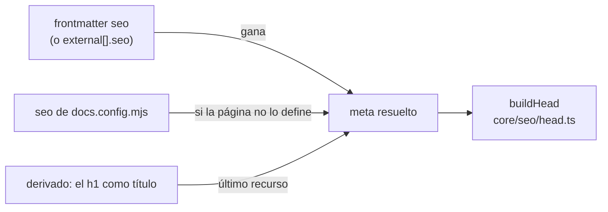
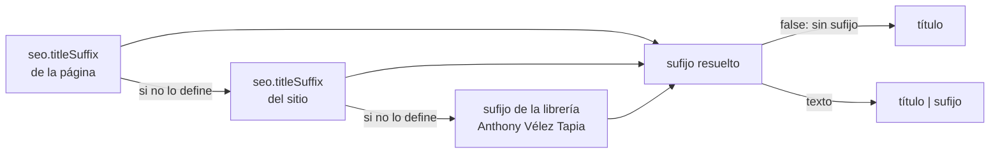

# Rutas, SEO e idiomas

Las tres cosas van juntas porque comparten una misma pieza: la **política de URLs** (`UrlPolicy`:
`base`, `trailingSlash` y `defaultLocale`). Cada URL del sitio, del sitemap, del canonical o del
`hreflang` sale de `pageUrl` (`src/core/i18n/availability.ts`), así que no hay dos sitios que
calculen la misma URL de formas distintas.

## Rutas

Todo lo sirve la integración con `injectRoute` (ver [Cómo funciona por dentro](./por-dentro.md#los-hooks-de-la-integración)).
La pieza central es `/[...slug]` → `src/astro/routes/doc.astro`:

- `getStaticPaths` llama a `docRoutes` (`src/astro/routes/doc-view.ts`), que devuelve una ruta por
  cada página real y, con la política `fallback`, una **ruta de reserva** por cada traducción
  ausente.
- El idioma por defecto va **sin prefijo** (`/guia/`); los demás, con él (`/en/guia/`). La portada
  es `/` y `/en/`.
- `docView` calcula todo lo que la página necesita (barra lateral, anterior/siguiente, head, pie,
  textos) con funciones puras de `src/core/`, y se lo pasa a `DocsLayout`.

### La 404 de GitHub Pages

GitHub Pages sirve **un único** `<base>/404.html` para cualquier URL que no existe. La librería lo
genera en el idioma por defecto e incluye, en `<template data-locale>`, el cuerpo de cada otro idioma.
Al cargar, `bootNotFound` (`src/ui/layouts/boot.ts`) deduce el idioma de la URL pedida y
`swapNotFound` (`src/client/not-found.ts`) cambia el cuerpo, el `lang` y el título **sin
redirigir**: `/repo/en/no-existe/` muestra la 404 en inglés y la URL no cambia.

### `sitemap.xml`

`src/astro/routes/sitemap.xml.ts` → `sitemapXml` (`routes/pages.ts`) → `buildSitemap`
(`core/seo/sitemap.ts`). Solo entran páginas **reales e indexables**, con sus alternativas
`hreflang`; ni rutas de reserva ni la 404. La página de privacidad propia entra si existe. No hay
`robots.txt`: es del portfolio, que vive en la raíz del dominio.

## SEO

La cascada se resuelve **campo a campo** en `resolveMeta` (`src/core/seo/meta.ts`):



- **Título.** El `<title>` tiene dos partes, título y sufijo, y sale como `título | sufijo` (el
  separador es fijo). Se resuelven por separado, con la misma prioridad: página > sitio > librería.
  `seo.title` en el frontmatter cambia solo el título del head, no el `h1`. `seo.titleSuffix`
  (en `docs.config.mjs` o en el frontmatter) acepta texto, uno por idioma o `false`; sin nada en
  ninguno de los dos, el sufijo es el de la librería, `Anthony Vélez Tapia`. Con `false` en la
  página no hay sufijo aunque el sitio defina uno, y un texto en la página gana a un `false` del
  sitio. Si el título es igual que el sufijo no se repite, y `og:title` / `twitter:title` van
  siempre sin sufijo. La 404 compone su título igual.



- **Descripción.** Una para todo el sitio o una por idioma; la página la sobrescribe.
- **Imagen OG.** Debe estar en `public/` (`/og.png`) o ser una URL https. Si una página da `src` sin
  `alt`, el `alt` es el título de esa página. Se leen sus dimensiones para `og:image:width/height`,
  y se avisa si pesa más de 300 KB o no se acerca a 1,91:1 (`core/seo/image-checks.ts`).
- **`noindex`.** Saca la página del sitemap y del índice de búsqueda.

`buildHead` emite: `<title>`, favicon, `canonical`, los `hreflang` (con `x-default`), Open Graph
(`og:title`, `og:description`, `og:url`, `og:type`, `og:site_name`, `og:locale` y alternativas,
`og:image*`) y las etiquetas `twitter:*`. Una ruta de reserva lleva `noindex` y su canonical apunta
al original.

Ejemplo de frontmatter de una página:

```yaml
---
title: Instalación
order: 2
seo:
  description: Cómo instalar la librería en un repo nuevo.
  image:
    src: /og-instalar.png
    alt: Captura del primer arranque
translations: omit
---
```

## Idiomas

`locales` lista los idiomas del sitio; `defaultLocale` (por defecto, el primero) es el que no lleva
sufijo ni prefijo. Solo `es` y `en` tienen textos de interfaz en el paquete
(`src/core/i18n/ui-strings.ts`); otro idioma rompe la validación de la config hasta que se añadan
sus textos.

### Archivos y gemelos

`guia.md` es la página en el idioma por defecto; `guia.en.md` es su gemela en inglés. Para un
externo, `CHANGELOG.md` y `CHANGELOG.es.md`. Un sufijo que no está en `locales` rompe el build.

### Cuando falta una traducción

`translations.missing` decide qué ve quien navega en un idioma sin traducción. Los valores son
`MissingTranslation.LINK`, `OMIT` y `FALLBACK` (en el frontmatter, `link`, `omit` y `fallback`):

| Política | Barra lateral del otro idioma | URL en el otro idioma |
| --- | --- | --- |
| `link` (por defecto) | Enlaza al original, con una insignia de su idioma | No existe |
| `omit` | No aparece | No existe |
| `fallback` | Aparece normal | Existe: muestra el original con un aviso, `noindex` y canonical al original |

La política se decide por **grupo de traducción** (todas las versiones de un slug) en
`resolvePolicies` (`src/core/i18n/translation-policy.ts`): la declarada por alguna de sus páginas
(frontmatter o `external[].translations`) o, si no, la base. Dos archivos del mismo grupo con valores
distintos rompen el build. Una gemela ausente **sin** política declarada solo avisa.

### Textos de interfaz

Las etiquetas de la interfaz («Editar esta página», «En esta página»…) salen de un catálogo con
claves estables. El consumidor puede sobrescribir cualquiera por idioma:

```js
ui: { es: { 'search.placeholder': 'Buscar en la guía' } },
```

El esquema de `ui` se genera desde las claves del catálogo, así que una clave mal escrita rompe el
build. Cómo añadir una clave nueva: [Recetas](../mantenimiento/recetas.md#un-texto-de-interfaz).
