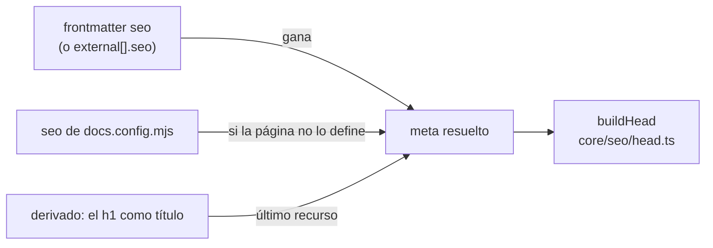
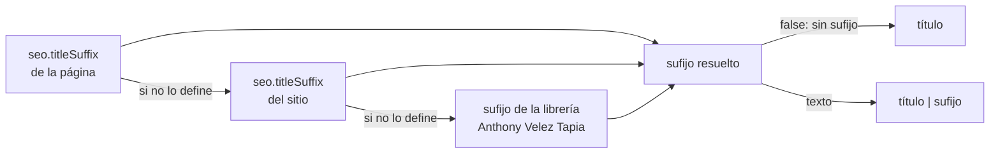

# Rutas, SEO e idiomas

Las tres cosas van juntas porque comparten una misma pieza: la **política de URLs** (`UrlPolicy`:
`base`, `trailingSlash` y `defaultLocale`). Cada URL del sitio, del sitemap, del canonical o del
`hreflang` sale de `pageUrl` (`src/core/i18n/availability.ts`), así que no hay dos sitios que
calculen la misma URL de formas distintas.

## Rutas

Todo lo sirve la integración con `injectRoute` (ver [Cómo funciona por dentro](./por-dentro.md#los-hooks-de-la-integración)).
La pieza central es `/[...slug]` → `src/astro/routes/doc.astro`:

- `getStaticPaths` llama a `docRoutes` (`src/astro/views/doc.ts`), que devuelve una ruta por
  cada página real y, con la política `fallback`, una **ruta de reserva** por cada traducción
  ausente.
- El idioma por defecto va **sin prefijo** (`/guia/`); los demás, con él (`/en/guia/`). La portada
  es `/` y `/en/`.
- `docView` calcula todo lo que la página necesita (barra lateral, anterior/siguiente, head, pie,
  textos) con funciones puras de `src/core/`, y se lo pasa a `DocsLayout`.

### La 404

La librería **no genera ninguna 404**. GitHub Pages sirve un único `<base>/404.html` para todo el
dominio, así que la pone el portfolio, una vez, en la raíz; un sitio de docs que cuelga de una
subcarpeta no puede tener la suya. Si el sitio quiere una propia, es una página más de su `src/pages/`.

### `sitemap.xml`

`src/astro/routes/sitemap.xml.ts` → `sitemapXml` (`views/pages.ts`) → `buildSitemap`
(`core/seo/sitemap.ts`). Solo entran páginas **reales e indexables**, con sus alternativas
`hreflang`; ni rutas de reserva. No hay
`robots.txt`: es del portfolio, que vive en la raíz del dominio.

Las páginas que el sitio añade en `src/pages/` también entran, leídas de lo que publica su `<head>`
(`clientSitemapEntries`): solo las indexables y canónicas de sí mismas, con los idiomas que
declaran sus `hreflang`. En `astro dev` los endpoints las piden al propio servidor
(`loadClientSitemapEntries`); en el build no hay servidor, así que `astro:build:done`
(`addClientPagesToSitemap`) reconoce cuáles de las páginas generadas son del cliente por el patrón
de su ruta, lee su HTML de `dist/` con el mismo `readHead` y las añade al sitemap ya escrito. Una
página del sitio se saca del sitemap con `<meta name="robots" content="noindex">` en su `<head>`.

#### `<lastmod>`

Cada URL lleva `<lastmod>` con la fecha de **la última modificación del archivo del que sale**: el
`.md` de la página (también los `external`, aunque estén fuera de `docs/`) o el `.astro` de
`src/pages/` (en una ruta dinámica, la plantilla). La fecha es, por este orden:

1. **El último commit que tocó el archivo** (`git log`). Se lee con una sola llamada a `git log` para
   todo el repositorio, no una por archivo.
2. **La fecha de modificación del archivo**, si no tiene commits (uno nuevo) o no hay repositorio.
3. **Ninguna**: sin `<lastmod>` si tampoco hay archivo.

Un clon superficial (`git clone --depth 1`, lo habitual en CI) **no da ninguna fecha**: su único
commit pondría la de hoy a todas las páginas, y un `<lastmod>` falso es peor que ninguno. Para tenerlas
en CI, clona con historial completo (`fetch-depth: 0` en `actions/checkout`).

Abierto en el navegador, el sitemap se ve con estilo: enlaza `_design/sitemap.css` (ruta relativa,
vale con cualquier `base`), que sirve `sitemap.css.ts` con `sitemapCss` (`components/styles/sitemap.ts`).
La paleta se lee de `theme.css` al generar el sitio, sin copiar valores, y el título y la nota salen
de `sitemap.title` y `sitemap.note` del idioma por defecto. Es CSS y no XSLT porque Chrome retira
XSLT. Los buscadores ignoran la hoja: leen el XML. Un XML no puede llevar `<meta viewport>`, así que
en el móvil se ve con el ancho de escritorio.

#### Índice con otros sitemaps del dominio

En GitHub Pages cada proyecto es una carpeta del mismo dominio y genera su propio sitemap
(`/snake-orm/sitemap.xml`) sin tocar la raíz. El sitio de la raíz, el principal, puede declarar los
demás con `sitemap.include`:

```js
// docs.config.mjs del sitio principal
sitemap: { include: ['/snake-orm/sitemap.xml', '/cotton-props/sitemap.xml'] },
```

Con `include`, `sitemap.xml` pasa a ser un índice (`sitemapIndexXml` → `buildSitemapIndex`): primero
`sitemap-pages.xml`, con las páginas propias de siempre, y luego cada sitemap declarado. Así Search
Console y `robots.txt` siguen con una sola URL; es lo que hace Yoast con su `sitemap_index.xml`. Sin
`include` no cambia nada y `sitemap-pages.xml` no existe.

Las rutas se resuelven contra el **origen** de `site`, no contra `base`. El build falla
(`sitemapIncludes`) si una es de otro dominio, porque el protocolo solo admite sitemaps del mismo
sitio, o si es el propio índice o el de páginas.

## SEO

La cascada se resuelve **campo a campo** en `resolveMeta` (`src/core/seo/meta.ts`):



- **Título.** El `<title>` tiene dos partes, título y sufijo, y sale como `título | sufijo` (el
  separador es fijo). Se resuelven por separado, con la misma prioridad: página > sitio > librería.
  `seo.title` en el frontmatter cambia solo el título del head, no el `h1`. `seo.titleSuffix`
  (en `docs.config.mjs` o en el frontmatter) acepta texto, uno por idioma o `false`; sin nada en
  ninguno de los dos, el sufijo es el de la librería, `Anthony Velez Tapia`. Con `false` en la
  página no hay sufijo aunque el sitio defina uno, y un texto en la página gana a un `false` del
  sitio. Si el título es igual que el sufijo no se repite, y `og:title` / `twitter:title` van
  siempre sin sufijo.



- **Descripción.** Una para todo el sitio o una por idioma; la página la sobrescribe.
- **Imagen OG.** Debe estar en `public/` (`/og.png`) o ser una URL https. Si una página da `src` sin
  `alt`, el `alt` es el título de esa página. Se leen sus dimensiones para `og:image:width/height`,
  y se avisa si pesa más de 300 KB o no se acerca a 1,91:1 (`core/seo/image-checks.ts`).
- **`noindex`.** Saca la página del sitemap y del índice de búsqueda.
- **JSON-LD (`seo.schema`).** La librería no inyecta ninguno por defecto: es un puente. El sitio
  declara los suyos y se pintan en el `<head>`, un `<script type="application/ld+json">` por schema.
  La cascada es la de los títulos: sin nada en ningún nivel no sale nada; los del sitio salen en
  todas las páginas; `seo.schema: [...]` en una página se **suma** a los del sitio (primero los del
  sitio); `seo.schema: false` deja esa página sin ninguno.

  ```js
  // docs.config.mjs
  seo: { schema: [{ '@type': 'SoftwareSourceCode', name: 'My repo', programmingLanguage: 'Python' }] }
  ```

  ```yaml
  ---
  seo:
    schema:
      - '@type': TechArticle
        headline: Instalar en cualquier sistema
  ---
  ```

  Cada schema es un objeto con `@type` (un string o una lista no vacía de strings) y las demás
  claves libres. Si falta `@context` se añade `https://schema.org`; si lo declaras, se respeta. Un
  fallo se nombra con su ruta (`seo.schema[1]['@type']`).

  La config viaja al sitio como JSON, así que no admite funciones. Como `docs.config.mjs` es
  JavaScript, calcula los objetos al construir y pásalos ya hechos:

  ```js
  import { author } from './src/data/author.mjs';

  const person = { '@type': 'Person', name: author.name, url: author.url, sameAs: author.profiles };
  export default defineDocsConfig({ name: 'My repo', seo: { schema: [person] } });
  ```

  El JSON sale escapando `<`, `>`, `&`, U+2028 y U+2029 (`\u003c`…): un valor con
  `</script><script>alert(1)</script>` no puede cerrar el `<script>` ni abrir otro.

`buildHead` emite: `<title>`, favicon, `canonical`, los `hreflang` (con `x-default`), Open Graph
(`og:title`, `og:description`, `og:url`, `og:type`, `og:site_name`, `og:locale` y alternativas,
`og:image*`), las etiquetas `twitter:*` y el JSON-LD declarado. Una ruta de reserva lleva `noindex` y su canonical apunta
al original.

Ejemplo de frontmatter de una página:

```yaml
---
title: Instalación
order: 2
seo:
  description: Cómo instalar la librería en un repo nuevo.
  image:
    src: /og-instalar.png
    alt: Captura del primer arranque
translations: omit
---
```

## Idiomas

`locales` lista los idiomas del sitio; `defaultLocale` (por defecto, el primero) es el que no lleva
sufijo ni prefijo. Solo `es` y `en` tienen textos de interfaz en el paquete
(`src/core/i18n/ui-strings.ts`); otro idioma rompe la validación de la config hasta que se añadan
sus textos.

`ogLocales` (opcional) da el `og:locale` con territorio de cada idioma: `ogLocales: { es: 'es_ES', en:
'en_GB' }`. Sin él, `og:locale` lleva el propio idioma (`es`, `pt_BR` para `pt-BR`). Cada clave tiene
que estar en `locales` y cada valor tiene la forma `idioma_TERRITORIO`.

### Archivos y gemelos

`guia.md` es la página en el idioma por defecto; `guia.en.md` es su gemela en inglés. Para un
externo, `CHANGELOG.md` y `CHANGELOG.es.md`. Un sufijo que no está en `locales` rompe el build.

### Cuando falta una traducción

`translations.missing` decide qué ve quien navega en un idioma sin traducción. Los valores son
`MissingTranslation.LINK`, `OMIT` y `FALLBACK` (en el frontmatter, `link`, `omit` y `fallback`):

| Política | Barra lateral del otro idioma | URL en el otro idioma |
| --- | --- | --- |
| `link` (por defecto) | Enlaza al original, con una insignia de su idioma | No existe |
| `omit` | No aparece | No existe |
| `fallback` | Aparece normal | Existe: muestra el original con un aviso, `noindex` y canonical al original |

La política se decide por **grupo de traducción** (todas las versiones de un slug) en
`resolvePolicies` (`src/core/i18n/translation-policy.ts`): la declarada por alguna de sus páginas
(frontmatter o `external[].translations`) o, si no, la base. Dos archivos del mismo grupo con valores
distintos rompen el build. Una gemela ausente **sin** política declarada solo avisa.

#### Si vienes de MkDocs

El `fallback_to_default: true` del plugin `i18n` de MkDocs (la página sin traducir se sirve en el
idioma por defecto bajo la URL del otro idioma) equivale a `fallback`. El valor por defecto de la
librería es `link`, a propósito: `fallback` duplica el contenido bajo otra URL (con `noindex` y canonical
al original, para que no compita). Para conservar el comportamiento de MkDocs:

```js
translations: { missing: MissingTranslation.FALLBACK },
```

Con `fallback_to_default: false`, `omit` es lo más cercano (la página no existe en ese idioma).

### Textos de interfaz

Las etiquetas de la interfaz («Editar esta página», «En esta página»…) salen de un catálogo con
claves estables. El consumidor puede sobrescribir cualquiera por idioma:

```js
ui: { es: { 'search.placeholder': 'Buscar en la guía' } },
```

El esquema de `ui` se genera desde las claves del catálogo, así que una clave mal escrita rompe el
build. Cómo añadir una clave nueva: [Recetas](../mantenimiento/recetas.md#un-texto-de-interfaz).
