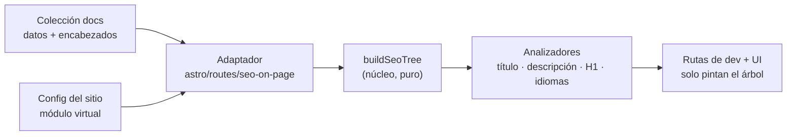

# SEO on page (solo en desarrollo)

Con `astro dev` el sitio tiene tres páginas extra, bajo `base`, para revisar el SEO de cada página
**mientras escribes**: qué `<title>` y qué descripción se van a publicar, de dónde salen, cómo se verán
en un buscador y en una tarjeta al compartir, y qué problemas tienen.

| Ruta | Qué enseña |
| --- | --- |
| `/seo-on-page/` | Totales, con las páginas separadas en con problemas (error o aviso), solo informativas y sin nada, y las incidencias por gravedad y por tipo, cada una con un enlace a la tabla ya filtrada; además, cuántas páginas llevan JSON-LD y qué `@type` se usan. |
| `/seo-on-page/pages` | Una fila por página **e idioma**: slug, `<title>` final con su longitud contra el límite («72 / 60»), origen y longitud de la descripción e insignias de problemas. |
| `/seo-on-page/page?slug=…&locale=…` | El inspector de una página (la portada tiene slug vacío): lo que se publica, vista previa del resultado de búsqueda y de la tarjeta Open Graph, canonical, `noindex`, los schemas JSON-LD con su `@type`, su origen (sitio o página) y el JSON formateado, el esquema de encabezados con los saltos marcados, sus problemas y sus traducciones lado a lado. |

> [!NOTE]
> Con `trailingSlash: 'always'` Astro solo
> sirve `/seo-on-page/pages/` con la barra final. Los enlaces del panel ya la llevan.

## Solo en desarrollo

La integración inyecta estas rutas únicamente cuando el comando de Astro es `dev`. Con `astro build`
**no se inyecta nada**: el panel no genera ficheros en `dist/` ni deja una sola referencia en él. Lo
comprueban dos tests: uno unitario (`integration.test.ts`: con `build` no hay rutas, con `dev` sí) y
otro sobre una build real (`builds/basic.test.ts`: `dist/` no contiene ninguna ruta `seo-on-page` ni
texto que la mencione). Las tres pantallas llevan `<meta name="robots" content="noindex">`.

Por lo mismo, en dev una página tuya en esas rutas (`src/pages/seo-on-page/…`) se detecta como
cualquier otra colisión con una ruta de la librería y rompe el arranque con un mensaje que dice qué
fichero borrar.

## Los mismos datos que el sitio

No hay rastreo ni lectura de HTML. La librería ya sabe cómo genera cada página, así que el panel
reutiliza esas mismas funciones: la cascada de metadatos (`resolveMeta`), el sufijo del título
(`composeTitle`), las URLs y la disponibilidad por idioma (`buildAvailability`) y las políticas de
traducción. Lo que enseña es, por construcción, lo que sale en el `<head>`.

El adaptador (`src/astro/routes/seo-on-page/adapter.ts`) es el único sitio que conoce
`astro:content`; el resto está en capas que no dependen de Astro (`core/seo-on-page/`,
`ui/seo-on-page/`). Las pantallas se pintan con `DocsLayout`, como el resto del sitio, alimentado por
`panelView` (`panel-view.ts`): barra lateral con las pantallas del panel, `noindex`, sin analítica ni
aviso de consentimiento.

## Los límites

Se miden en caracteres del texto final y son orientativos (los buscadores recortan por píxeles y
cambian de criterio): `<title>` de 15 a 60, descripción de 70 a 160 y exactamente un H1. Viven todos
en `src/core/seo-on-page/thresholds.ts`. Los problemas que detecta: título largo o corto, descripción
ausente, heredada del sitio, larga o corta, título o descripción duplicados, ningún H1 o varios,
saltos de nivel (H2 → H4) y traducciones ausentes o con políticas en conflicto.

El JSON-LD (`seo.schema`) solo se **muestra**: la librería no impone ninguno, así que no hay
incidencias por tenerlo o no. Sale de la misma cascada que `buildHead` (sitio y después página,
`schema: false` lo quita), y la tabla no tiene filtro por schema porque los filtros de la URL son de
tipo y gravedad de incidencia.

## Filtros en la URL

La tabla se filtra con un formulario `GET` (gravedad, idioma, tipo de problema y texto) sin
JavaScript: los filtros viajan en la query (`?severity=error&locale=es&kind=no-h1&q=orm`), así que
atrás/adelante y compartir el enlace funcionan.

### Qué enseña la tabla sin filtros

Casi todas las páginas tienen la incidencia informativa «descripción heredada del sitio», y mostrarlas
todas ahogaría los avisos reales. Por eso, si la URL no nombra ninguna gravedad ni ningún tipo, la
tabla parte de **errores y avisos** y lo dice en una nota con un enlace para mostrar también lo
informativo. La regla es una sola y no depende del estado:

- Lo que la URL escribe manda: `?severity=info` o `?kind=description-inherited` se ven tal cual.
- «Mostrar todo» es la URL explícita con las tres gravedades
  (`?severity=error&severity=warning&severity=info`); pedirlas a la vez equivale a no filtrar por
  gravedad, así que solo ahí aparecen también las páginas sin ninguna incidencia.
- Las casillas del formulario reflejan los filtros efectivos, de modo que enviarlo reenvía lo que se ve.

### Paginación

La tabla enseña 25 filas por página (`PAGE_SIZE`, fijo: cada fila pinta varias insignias y 25 se
escanean de una vez) con el recuento («1–25 de 75 páginas») y enlaces anterior, siguiente y de número,
sin JavaScript. La página va en la URL como `page`; la 1 es la de por defecto y no se escribe. Los
enlaces de página conservan los filtros, y cambiar un filtro, o «mostrar también las informativas»,
vuelve a la página 1. Una página fuera de rango (`page=0`, `page=abc`, `page=99`) se lleva a la más
cercana válida. Con todo en una sola página no hay paginador.

## Cómo arreglar cada problema

Cada problema trae una frase de acción que dice **qué cambiar y dónde**, con el archivo real de la
página: `seo.title` o `seo.description` en el frontmatter de ese archivo, empezarlo con `# Título`,
dejar un solo `#`, subir o bajar el nivel de un encabezado concreto, crear el archivo gemelo de una
traducción (con su ruta exacta, p. ej. `docs/x.es.md`) o declarar `translations: omit`. Se ve bajo
cada problema en el inspector y en la ayuda de cada insignia de la tabla.

Las páginas de `external[]` (p. ej. el CHANGELOG) no tienen frontmatter: su `seo` y su `translations`
viven en `docs.config.mjs`, y el arreglo lo dice (`external[].seo.description` de la entrada
«changelog»). Para saberlo, el loader guarda en cada entrada de la colección de dónde viene
(`kind`: nativa o externa). El texto se construye en el núcleo puro
(`src/core/seo-on-page/analyzers/fixes.ts`).
