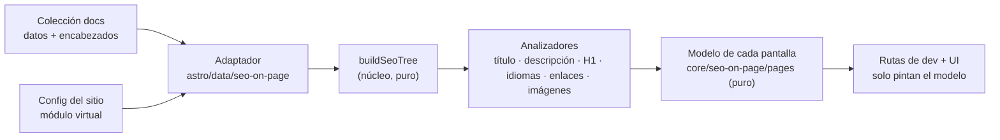

# SEO on page (solo en desarrollo)

Con `astro dev` el sitio tiene tres páginas extra, bajo `base`, para revisar el SEO de cada página
**mientras escribes**: qué `<title>` y qué descripción se van a publicar, de dónde salen, cómo se verán
en un buscador y en una tarjeta al compartir, y qué problemas tienen.

| Ruta | Qué enseña |
| --- | --- |
| `/seo-on-page/` | Totales, con las páginas separadas en con problemas (error o aviso), solo informativas y sin nada, y las incidencias por gravedad y por tipo, cada una con un enlace a la tabla ya filtrada; además, cuántas páginas llevan JSON-LD y qué `@type` se usan. |
| `/seo-on-page/pages` | Una fila por página **e idioma**: slug, `<title>` final con su longitud contra el límite («72 / 60»), origen y longitud de la descripción e insignias de problemas. |
| `/seo-on-page/page?slug=…&locale=…` | El inspector de una página (la portada tiene slug vacío): lo que se publica, vista previa del resultado de búsqueda y de la tarjeta Open Graph, canonical, `noindex`, los schemas JSON-LD con su `@type`, su origen (sitio o página) y el JSON formateado, el esquema de encabezados con los saltos marcados, sus problemas y sus traducciones lado a lado. |

> [!NOTE]
> Con `trailingSlash: 'always'` Astro solo
> sirve `/seo-on-page/pages/` con la barra final. Los enlaces del panel ya la llevan.

## Solo en desarrollo

La integración inyecta estas rutas únicamente cuando el comando de Astro es `dev`. Con `astro build`
**no se inyecta nada**: el panel no genera ficheros en `dist/` ni deja una sola referencia en él. Lo
comprueban dos tests: uno unitario (`integration.test.ts`: con `build` no hay rutas, con `dev` sí) y
otro sobre una build real (`builds/basic.test.ts`: `dist/` no contiene ninguna ruta `seo-on-page` ni
texto que la mencione). Las tres pantallas llevan `<meta name="robots" content="noindex">`.

Por lo mismo, en dev una página tuya en esas rutas (`src/pages/seo-on-page/…`) se detecta como
cualquier otra colisión con una ruta de la librería y rompe el arranque con un mensaje que dice qué
fichero borrar.

## Los mismos datos que el sitio

Para la documentación no hay rastreo ni lectura de HTML. La librería ya sabe cómo genera cada página, así que el panel
reutiliza esas mismas funciones: la cascada de metadatos (`resolveMeta`), el sufijo del título
(`composeTitle`), las URLs y la disponibilidad por idioma (`buildAvailability`) y las políticas de
traducción. Lo que enseña es, por construcción, lo que sale en el `<head>`.

El adaptador (`src/astro/data/seo-on-page/adapter.ts`) es el único sitio que conoce
`astro:content`; el resto está en capas que no dependen de Astro (`core/seo-on-page/`,
`components/seo-on-page/`). Las pantallas se pintan con `DocsLayout`, como el resto del sitio, alimentado por
`panelView` (`views/seo-on-page/panel.ts`): barra lateral con las pantallas del panel, `noindex`, sin analítica ni
aviso de consentimiento.

### Las páginas que añade el sitio en `src/pages/`

Un sitio puede tener páginas propias además de la documentación (el portfolio: portada, CV,
proyectos). De esas la librería no tiene frontmatter que leer, así que el panel las lee **como las
ve un visitante**:

1. La integración guarda sus rutas (`astro:routes:resolved`) y, en dev, el servidor de Vite
   (`astro:server:setup`), en un registro compartido (`astro/registry.ts`).
2. `loadClientPages` (`astro/data/client-pages.ts`) expande las rutas dinámicas con su
   `getStaticPaths`, pide cada URL al propio servidor de desarrollo y lee su `<head>` con `readHead`
   (`core/seo/html-head.ts`): título, descripción, noindex, canonical, `hreflang`, encabezados, Open
   Graph y JSON-LD. Lo leído se reutiliza hasta que cambia un fichero.
3. `clientFacts` (`core/seo-on-page/nodes/client-page.ts`) las convierte en páginas del árbol de tipo
   `client` (etiqueta «Astro»). Las versiones de una página en cada idioma se agrupan por sus
   `hreflang`.

Pasan por los mismos analizadores, y los duplicados se buscan entre todas las páginas. El grafo de
enlaces (huérfanas, enlaces a noindex) sigue siendo solo de la documentación: sus enlaces no se
recogen. Los arreglos nombran la etiqueta del `<head>` (`<title>`, `<meta name="description">`) y el
`.astro`, no una clave de frontmatter.

## Cómo se reparte cada pantalla

Cada pantalla es lo mismo en pequeño: **leer la URL → pedir el árbol al adaptador → pedir el modelo
al núcleo → pintar componentes**. Nada más.

| Pantalla | Página (`astro/pages/seo-on-page/`) | Modelo (`core/seo-on-page/pages/`) |
| --- | --- | --- |
| Resumen | `overview.astro` | `overview/model.ts`: totales, desglose por gravedad y por tipo, schemas |
| Páginas | `pages.astro` | `listing/model.ts`: filtros efectivos, filas de la página, paginación |
| Inspector | `page.astro` | `inspector/model.ts`: una clave por sección, con las traducciones |

Cada modelo es una función pura que devuelve exactamente lo que enseña su pantalla. Como el núcleo
no sabe formar URLs (`base`, `trailingSlash`), los modelos reciben un **puerto de enlaces**
(`PanelLinks`, en `pages/links.ts`) y devuelven los enlaces ya hechos como texto; `devHrefs`, de
`astro/views/seo-on-page/hrefs.ts`, lo implementa. Los componentes (`components/seo-on-page/organisms/`) son
una sección cada uno y reciben solo su porción del modelo; las etiquetas y los textos son suyos
(`labels.ts`), los datos no.

## Los límites

Se miden en caracteres del texto final y son orientativos (los buscadores recortan por píxeles y
cambian de criterio): `<title>` de 15 a 60, descripción de 70 a 160 y exactamente un H1. Viven todos
en `src/core/seo-on-page/thresholds.ts`. Los problemas que detecta: título largo o corto, descripción
ausente, heredada del sitio, larga o corta, título o descripción duplicados, ningún H1 o varios,
saltos de nivel (H2 → H4), traducciones ausentes o con políticas en conflicto y las cinco
comprobaciones de abajo.

### Canonical, enlaces, imágenes y tarjeta social

| Tipo (`kind`) | Gravedad | Certeza | Qué mira |
| --- | --- | --- | --- |
| `canonical-mismatch` | aviso | regla | Que el canonical de cada versión de idioma sea SU URL y no la de otro idioma. Con la URL que genera la librería no salta nunca: es una red contra regresiones. |
| `link-to-noindex` | info | regla | Una página indexable cuyo cuerpo enlaza a otra `noindex` del mismo idioma. Los enlaces de la barra lateral no cuentan (enlaza a todo y avisaría en cada página). |
| `orphan-page` | info | regla | Una página indexable que ninguna otra enlaza, ni desde el cuerpo ni desde la navegación (barra lateral de su sección, cabecera y footer, construidas con las mismas funciones que el layout). La portada y las `noindex` no se juzgan. Con la barra lateral por defecto casi nunca salta: lista todas las páginas de su sección. |
| `image-alt-missing` | aviso | regla | Imágenes Markdown (``) del cuerpo sin texto alternativo, con el recuento por página. |
| `og-image-size` | aviso o info | heurística | La imagen social contra 1200×630 (≈1,91:1, tolerancia del 2 %, la misma con la que avisa el build): aviso si la proporción es otra (las redes la recortan), info si solo es más pequeña. Las imágenes `https` no se leen y no se juzgan. |

Los enlaces y las imágenes no se detectan con una regla propia: el loader los toma de `rewriteLinks`
(`core/links/rewrite.ts`), que ya recorre el cuerpo para reescribir y validar los enlaces, y los guarda
en `rendered.metadata` de cada entrada junto a los encabezados. Solo cuentan los enlaces relativos a
un `.md` (los que `rewriteLinks` resuelve a una página); una ruta absoluta o un `<a>` en HTML no se
ven. En Markdown, `` no distingue una imagen decorativa de un olvido, así que cuenta como sin
alt; una decorativa se escribe en HTML (``), que el análisis no ve.

El JSON-LD (`seo.schema`) solo se **muestra**: la librería no impone ninguno, así que no hay
incidencias por tenerlo o no. Sale de la misma cascada que `buildHead` (sitio y después página,
`schema: false` lo quita), y la tabla no tiene filtro por schema porque los filtros de la URL son de
tipo y gravedad de incidencia.

## Filtros en la URL

La tabla se filtra con un formulario `GET` (gravedad, idioma, tipo de problema y texto) sin
JavaScript: los filtros viajan en la query (`?severity=error&locale=es&kind=no-h1&q=orm`), así que
atrás/adelante y compartir el enlace funcionan.

### Qué enseña la tabla sin filtros

Casi todas las páginas tienen la incidencia informativa «descripción heredada del sitio», y mostrarlas
todas ahogaría los avisos reales. Por eso, si la URL no nombra ninguna gravedad ni ningún tipo, la
tabla parte de **errores y avisos** y lo dice en una nota con un enlace para mostrar también lo
informativo. La regla es una sola y no depende del estado:

- Lo que la URL escribe manda: `?severity=info` o `?kind=description-inherited` se ven tal cual.
- «Mostrar todo» es la URL explícita con las tres gravedades
  (`?severity=error&severity=warning&severity=info`); pedirlas a la vez equivale a no filtrar por
  gravedad, así que solo ahí aparecen también las páginas sin ninguna incidencia.
- Las casillas del formulario reflejan los filtros efectivos, de modo que enviarlo reenvía lo que se ve.

### Vistas de la tabla

El parámetro `view` cambia cómo se ve la misma selección de páginas; un valor desconocido es
`page`. El selector es un grupo de enlaces, así que funciona sin JavaScript y se comparte.

- `page` (por defecto), **Por página**: una fila por página, con sus idiomas como insignias.
- `locale`, **Por idioma**: una fila por entrada (página + idioma); el recuento dice «N entradas
  página + idioma».
- `matrix`, **Matriz de idiomas**: una columna por idioma configurado (existe, falta, respaldo u
  omitida por política) y el hreflang y el `x-default` que el `<head>` emite. Sale del mismo estado
  que usa `buildHead`: «recíproco» con al menos dos versiones indexables, «sin par» con una y
  «omitido» si la página es `noindex`. Con un solo idioma no hay hreflang y esas columnas no salen.
- `have`, **Qué tiene**: descripción, schema, imagen OG, H1 único, traducida e indexable, cada una
  propia, heredada del sitio, ausente, de respaldo o cumplida. Cada cabecera es un enlace que
  alterna `lacks=<desc|schema|og|h1|i18n|index>` y deja solo las páginas a las que les falta eso
  propio; los «N/M» cuentan las páginas filtradas. Aquí no sale el aviso de lo común a todas las
  páginas: la columna de descripción ya lo dice.

La paginación cuenta filas de la vista que se esté viendo, y los enlaces de página, el selector de
filas y el formulario de filtros conservan `view` y `lacks`.

### Paginación

La tabla enseña 25 filas por página por defecto (`PAGE_SIZE`: cada fila pinta varias insignias y 25 se
escanean de una vez) con el recuento («1–25 de 75 páginas») y enlaces anterior, siguiente y de número,
sin JavaScript. Todo eso va en el pie de la tabla, en una sola barra: a un lado el selector «Filas por
página» (10, 25, 50 y 100, `PAGE_SIZES`, con su botón «Aplicar»), al otro el recuento y el paginador.
La página va en la URL como `page` y el tamaño como `per`; la 1 y el 25 son los de por defecto y no se
escriben en los enlaces que genera el panel (los formularios, al ser un GET, sí envían `per`). Los
enlaces de página y «mostrar también las informativas» conservan el tamaño, y cambiarlo desde el
pie vuelve a la página 1 sin perder los filtros (los reenvía como campos ocultos), y filtrar
conserva el tamaño elegido. Una página fuera de rango (`page=0`, `page=abc`, `page=99`) se lleva a
la más cercana válida, y un tamaño que no se ofrece (`per=999`) es el de por defecto. El paginador
está siempre: con todo en una sola página, o sin filas, sus controles aparecen deshabilitados.

## Cómo arreglar cada problema

Cada problema trae una frase de acción que dice **qué cambiar y dónde**, con el archivo real de la
página: `seo.title` o `seo.description` en el frontmatter de ese archivo, empezarlo con `# Título`,
dejar un solo `#`, subir o bajar el nivel de un encabezado concreto, crear el archivo gemelo de una
traducción (con su ruta exacta, p. ej. `docs/x.es.md`) o declarar `translations: omit`. Se ve bajo
cada problema en el inspector y en la ayuda de cada insignia de la tabla.

Las páginas de `external[]` (p. ej. el CHANGELOG) no tienen frontmatter: su `seo` y su `translations`
viven en `docs.config.mjs`, y el arreglo lo dice (`external[].seo.description` de la entrada
«changelog»). Para saberlo, el loader guarda en cada entrada de la colección de dónde viene
(`kind`: nativa o externa). El texto se construye en el núcleo puro
(`src/core/seo-on-page/analyzers/fixes.ts`).
