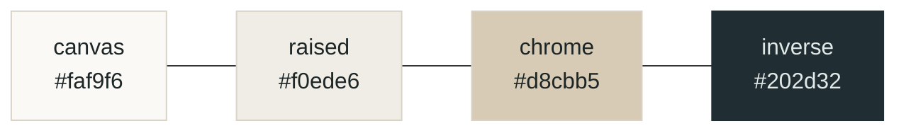

# Paleta y tokens

Todos los colores, tamaños de texto y medidas son **tokens** de Tailwind 4 declarados en el bloque
`@theme` de `src/ui/styles/theme.css`. Un token `--color-accent` genera las utilidades
`text-accent`, `bg-accent`, `border-accent`… y además existe como variable CSS. Ningún componente
escribe colores literales: un test de `theme.test.ts` lo comprueba en las reglas de prosa,
admoniciones y pestañas.

## Superficies

Cuatro planos, del más ligero al más pesado. En claro:

| Token | Valor | Dónde se usa | Contraste con el canvas |
| --- | --- | --- | --- |
| `--color-canvas` | `#faf9f6` (blanco cálido) | Fondo del contenido | — |
| `--color-raised` | `#f0ede6` (piedra) | El plano de la barra lateral | 1.10:1 |
| `--color-chrome` | `#d8cbb5` (moka) | La cabecera | 1.51:1 |
| `--color-inverse` | `#202d32` (antracita) | El pie invertido | 13.45:1 |



En oscuro los papeles se invierten (más pesado es más claro: `raised` y `chrome` aclaran sobre un
canvas `#141311`), **salvo el pie**, que sigue siendo el más oscuro.

Los neutros de texto (`ink`, `muted`, `faint`) son una rampa OKLCH de **matiz 195**, el mismo que el
acento. Por eso no se deben sustituir por los grises por defecto de Tailwind: perderían la armonía con
el verde.

## Acento: `accent` frente a `accent-line`

El verde existe en dos intensidades, y la diferencia es **de accesibilidad**, no de gusto:

- `--color-accent` (`#2b665f`): para **texto** (enlaces, la página actual). Da 6.30:1 sobre el
  canvas y 5.67:1 sobre el plano: pasa AA (4.5:1) en ambos.
- `--color-accent-line` (`#367c75`, el verde petróleo de la paleta): para lo que **no es texto**
  (subrayados, barras, bordes), donde WCAG pide 3:1. Como texto daría 4.18:1 sobre el plano y 3.06:1
  en la cabecera: no llega a AA.
- `--color-accent-soft` (`#e2efec`): fondos tintados; el acento da 5.62:1 sobre él.

Sobre la cabecera (moka) **solo se escribe en `ink`** (9.67:1): ni `muted` ni el acento llegan a
4.5:1 ahí.

## Por qué cada token lleva su ratio anotado

```css
--color-muted: #515a5a; /*  6.74:1  AA  (6.07) */
```

El primer número es el contraste contra el canvas; el del paréntesis, contra el plano. Se anotan
porque **cambiar un color sin mirar su ratio es la forma más rápida de romper la accesibilidad**, y
el comentario te obliga a verlo al editarlo. Pero el comentario no es la garantía: lo es el test.

`src/ui/styles/theme.test.ts` extrae las paletas clara y oscura de `theme.css` y comprueba una
lista de pares texto/fondo con `contrast()` (`src/testing/contrast.ts`):

- 4.5:1 para texto normal: `ink`, `muted`, `faint`, `accent`, `state-live`, `state-wip` y `danger`
  sobre `canvas` y `raised`; `accent` sobre `accent-soft`; `canvas` sobre `accent`.
- 1.2:1 para `rule` sobre `canvas` (que se vea el filete).

Si cambias un valor, actualiza el comentario con el ratio nuevo y deja que el test diga si sigue
valiendo. Si añades un token de texto, añade su par a la lista `pairs`.

## Los temas, dos veces

La paleta oscura se declara dos veces en `theme.css`:

1. `@media (prefers-color-scheme: dark) { :root:not([data-theme='light']) { … } }`: el sistema
   está en oscuro y el visitante no ha elegido claro.
2. `:root[data-theme='dark'] { … }`: el visitante eligió oscuro.

`theme.test.ts` exige que ambos bloques sean **idénticos** y completos. Si tocas un color oscuro,
tócalo en los dos. Y `src/ui/styles/theme-colors.ts` repite el canvas de cada tema para
`<meta name="theme-color">`; `theme-colors.test.ts` lo sujeta a `theme.css`.

## El pie: re-tematizado por ámbito

El pie es una superficie invertida: tinta clara sobre antracita. En vez de pintar cada pieza con
otra clase, `.docs-footer` **redefine los tokens en su ámbito**:

```css
.docs-footer {
  --color-ink: var(--color-inverse-ink);
  --color-muted: var(--color-inverse-muted);
  --color-faint: var(--color-inverse-muted);
  --color-accent: var(--color-inverse-ink);
  --color-accent-line: var(--color-inverse-muted);
  background-color: var(--color-inverse);
  color: var(--color-ink);
}
```

Todo lo de dentro (enlaces, el botón de cookies, el anillo de foco) usa las mismas utilidades de
siempre (`text-muted`, `text-accent`) y hereda los valores invertidos. Un componente nuevo en el pie
no necesita saber que está en el pie. El foco pasa a la tinta clara porque el verde daría 2.9:1 sobre
la antracita. En oscuro el pie apenas se separa del fondo (1.03:1), así que conserva un filete
arriba.

## Otros tokens

- **Estados**: `state-live` (mantenido), `state-wip` (experimental), `danger` (error). Son los
  colores de las admoniciones `tip`, `warning` y `danger`.
- **Tipografía**: `--font-sans` y `--font-mono` apuntan a las variables de IBM Plex que declara
  `fonts.ts`; `--text-display`, `--text-row`, `--text-label`, `--text-mono-list`.
- **Medidas**: `--container-measure` (42rem, unos 78 caracteres), `--container-measure-full`
  (52rem, en ancho completo), `--container-page` (80rem). La disposición usa variables propias
  (`--col-left`, `--rail`, `--wide-max`…) que cambian con los atributos de `<html>` (ver
  [Disposición](../integracion/disposicion.md)).
- **Código**: los temas de Shiki son `github-light-default` y `github-dark-default`
  (`code-themes.ts`); en oscuro el fondo de los bloques es `--code-dark-bg`, porque el de GitHub es
  azulado.
