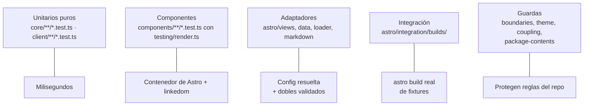

# Tests

## La política

- **TDD estricto para la lógica y el comportamiento.** Todo lo que decide algo (una URL, un orden,
  una validación, un estado del cliente) se escribe test primero: rojo, verde, refactor.
- **Sin tests para lo obvio o puramente visual.** Un ajuste de margen, un color o una clase de
  Tailwind no llevan test: el test solo repetiría el CSS y fallaría con cada retoque sin proteger
  nada. Lo que sí se prueba del CSS son **contratos**: los ratios de contraste, que las dos paletas
  oscuras coincidan, que no haya colores literales, que el `@source` apunte a `src/`.
- **El test describe el comportamiento, en español.** `it('sin editUrl no se renderiza')`, no
  `it('test EditLink 3')`.

## Dónde vive cada tipo de test



| Tipo | Ejemplo | Herramientas |
| --- | --- | --- |
| Núcleo puro | `core/navigation/prev-next.test.ts` | Solo Vitest: entra un dato, sale un dato. |
| Cliente | `client/preferences/consent.test.ts` | Funciones con el entorno inyectado (`Storage`, `matchMedia`, documento de linkedom). |
| Componentes | `components/molecules/navigation/EditLink.test.ts` | `render()` y `text()` de `testing/render.ts`; textos con `stringsFor()`. |
| Plugins de Markdown | `astro/markdown/tables.test.ts` | `testing/markdown.ts`. |
| Vistas de las páginas | `astro/views/doc.test.ts` | Funciones puras sobre una config resuelta con `resolveConfig`. Para lo que necesite `astro:content` hay un doble en `testing/astro-content.ts`. |
| Build completo | `astro/integration/builds/` (`basic`, `short-form`, `outside`, `strict`, `content`) | Cada test se llama por el escenario que construye. Fixtures en `builds/fixtures/` o casos descritos como datos (`testing/case.ts`) construidos con `testing/build.ts`. |
| Guardas del repo | `testing/boundaries.test.ts`, `testing/package-contents.test.ts`, `components/styles/theme.test.ts`, `components/coupling.test.ts` | Leen archivos de configuración o código y fallan si alguien relaja una regla. |
| Migración | `scripts/migrate-mkdocs/**/*.test.ts` | Transformaciones puras de texto. |
| Mutación | `scripts/mutation/**/*.test.ts` | Reparto en trozos y unión de informes: datos que entran, datos que salen. |

## Patrones que se repiten

- **Inyectar el entorno.** Si una función necesita el navegador, recibe lo que usa como parámetro
  (`BootEnv`, `LayoutEnv`, `ConsentEnv`). En el test se pasan dobles; en producción, los reales. Nada
  de _mocks_ de globales.
- **Dobles validados.** Los dobles de `astro:content` y del módulo virtual se construyen con el
  `docsSchema()` real y el plugin real, así que un test no puede pasar con datos que la build
  rechazaría.
- **Errores agregados.** Cuando se prueba una validación, se comprueba que salen **todos** los fallos
  con su ruta (`nav[1].dir`), no solo el primero.
- **Fixtures que se limpian solas.** Las de reglas estrictas escriben casos en `.cases/` y los
  borran; lo que vuelcan las fixtures (`probe.json`, `.cases/`) está en `.gitignore`.

## Ejecutar

```sh
npm test                                   # todo
npm run test:watch                         # vigilancia, para TDD
npx vitest run src/core/navigation         # una carpeta
npx vitest run -t "sin editUrl"            # por nombre
```

Los tests de build (`astro/integration/builds/`) son los lentos: construyen proyectos de Astro de
verdad. Si estás iterando sobre lógica pura, déjalos fuera:

```sh
npx vitest run --exclude '**/builds/**'   # solo los rápidos
```

`vitest.config.ts` usa `getViteConfig` de Astro para que los `.astro`, los alias y el módulo virtual
se resuelvan en los tests exactamente igual que en el build.

## Cobertura y mutación

La cobertura dice qué líneas ejecutan los tests; la mutación, si los tests **notarían** un cambio en
ellas. Una línea cubierta por un test que no comprueba nada cuenta como cubierta, pero sus mutantes
sobreviven.

```sh
npm run test:coverage   # informe de V8 en coverage/
npm run test:mutation   # Stryker sobre src/ y scripts/; informe en reports/mutation/
```

Mutar todo el repositorio son unos 12 000 mutantes y tarda horas, así que en local conviene acotarlo
con `npx stryker run --mutate "src/core/shared/text.ts"`. Stryker guarda lo medido en
`.stryker-cache/incremental.json` y en la siguiente ejecución solo repite lo que ha cambiado.

El workflow **Mutation** (`.github/workflows/mutation.yml`) lo hace en CI, solo a mano:

1. `plan` reparte los ficheros mutables en trozos de peso parecido (líneas de código).
2. Cada trozo corre en su propio job, en paralelo.
3. `merge` une las bases incrementales de los trozos en una sola y la guarda en la caché de Actions.

La entrada `shards` (1 a 20, por defecto 12) fija cuántos trozos. Lánzalo **sobre `main`**: las cachés
de una rama no las ven los PR, y esta base es la que leerán después. Para repetir el reparto en
local: `node scripts/mutation/cli.ts plan --shards 12`.
