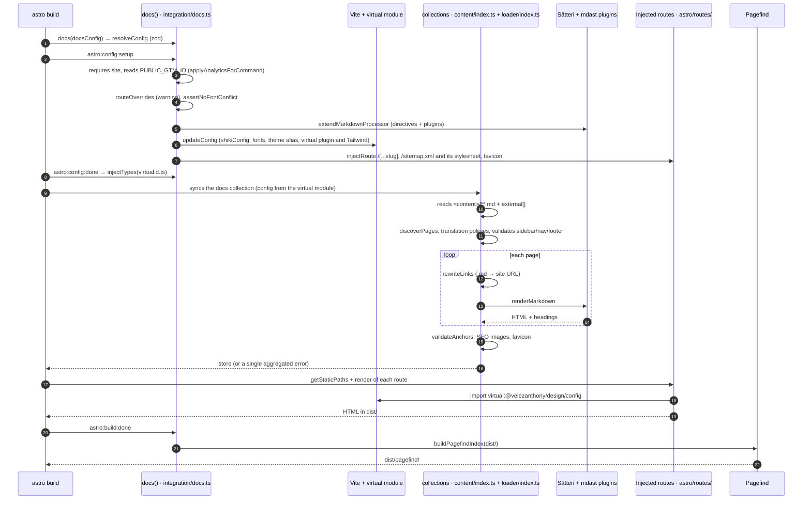

# How the site is generated

This page follows an `astro build` step by step, until the page boots in the browser: what the
integration does at each moment and which file each thing lives in. By the end you will know where to
look when something in the build does not behave as you expect.

The integration has two entry points, one for each file the consumer touches:

- `docs(config)` in `astro.config.mjs` → `src/astro/integration/docs.ts` (`index.ts` only re-exports
  the public API).
- The `content.config.ts` collection (`@velezanthony/design/content`) → `src/astro/content/index.ts`
  and `src/astro/loader/index.ts`.

## The whole journey



## 1. The config is loaded once

`astro.config.mjs` imports `docs.config.mjs` and passes it to `docs()`, which validates it and fills in
the defaults with `resolveConfig` (`src/core/config/resolve.ts`). There is a single resolved config for
the whole integration and the loader.

:::note[Details: the resolved config and why there is a single source]{collapsed}
The config is loaded ONCE: `astro.config.mjs` imports `docs.config.mjs` and passes it to `docs()`,
which runs it through `resolveConfig` (`src/core/config/resolve.ts`: it validates with the zod schema
and fills in the defaults). The resolved config has the same shape as the public one:
`{ site, i18n, content }`, each group with its schema, its type and its resolution in its own module
(`site.ts`, `i18n.ts`, `content.ts`); a function that only needs one part asks for it with
`ConfigPick` (`ConfigPick<'name', 'locales'>`). An error there comes out as an `AstroError` with the
key path (`toAstroError`, in `src/astro/errors.ts`).

The loader is evaluated outside the integration and Astro drops any properties the integration
attaches to its object, so it cannot read the config from there. Nor does it need to import
`docs.config.mjs` itself: the `@velezanthony/design/content` collection imports the virtual module
`virtual:@velezanthony/design/config` (see below), which serves the config the integration already
resolved. There is a single source by construction: two different configs are impossible, and no
check is needed to guard it. Note: Astro only restarts `astro dev` when `astro.config.mjs` itself
changes, not what it imports. That is why the integration registers `docs.config.mjs` (or its `.js`/
`.ts` variant) with `addWatchFile` if it exists at the root: it only watches it, it does not load it.
:::

## 2. The integration prepares Astro (`astro:config:setup`)

It requires `site`, decides on analytics, warns about the routes the site replaces, extends the
Markdown processor, merges the Astro config (Shiki, fonts, Tailwind, theme alias) and injects the
routes.

:::note[Details: each step of the hook, the route table and the other hooks]{collapsed}
This is where almost everything happens. In order:

1. **Requires `site`.** Without an absolute origin there is no sitemap and no canonical.
2. **Analytics.** `readAnalyticsEnv` reads `PUBLIC_GTM_ID` with Vite's `loadEnv` (in this hook the
   `.env` files are not yet in `process.env`) and `applyAnalyticsForCommand` decides whether it is on
   (it requires `site.analytics.privacyUrl`). Details in
   [Analytics and privacy](../guia/idiomas-seo-y-analitica.md#analytics-and-privacy).
3. **Overrides and conflicts.** `routeOverrides` lists the library routes the consumer replaces with a
   file in `src/pages/` (the home page, the sitemap, `/_design/`…): it is not an error, a warning is
   shown at start-up and the exact routes that are already theirs are not injected.
   `assertNoFontConflict` fails if the consumer declares a font with `--font-plex-sans` or
   `--font-plex-mono`.
4. **Markdown.** `extendMarkdownProcessor` modifies the Sätteri processor of the Astro config **in
   place**: it turns on directives and adds our plugins. If the processor is not Sätteri, it fails
   (see [Markdown](../guia/escribir-paginas.md#markdown)).
5. **`updateConfig`.** It merges into the Astro config:
   - `markdown.shikiConfig.langAlias`: our aliases plus the consumer's (theirs win).
   - `markdown.shikiConfig.themes`: `github-light-default`/`github-dark-default`
     (`src/components/styles/code-themes.ts`), **only if the consumer chose no themes**.
   - `fonts`: IBM Plex Sans and Mono through Astro's fonts API (`src/astro/integration/fonts.ts`).
   - `vite.resolve.alias`: `@velezanthony/design/site-theme` points at the CSS in the `theme` option
     (or at an empty one in the package), which `theme.css` imports last
     (`src/astro/integration/site-theme.ts`).
   - `vite.plugins`: the virtual module plugin and the Tailwind one (`@tailwindcss/vite`), unless the
     site already registered its own (`src/astro/integration/tailwind.ts`).
   - `vite.server.fs.allow`: only if the content folder lies outside the project.
6. **`injectRoute`.** Every route comes from a table, `src/astro/routes/routes.ts` (pattern, container
   and when: `site`, `dev` or an option); site routes have `prerender: true` and dev ones do not:

| Pattern | Container | When |
| --- | --- | --- |
| `/[...slug]` | `doc.astro` | Always: every docs page, in every language. |
| `/sitemap.xml` | `sitemap.xml.ts` | Always: the pages or, with `sitemap.include`, the index. |
| `/sitemap-pages.xml` | `sitemap-pages.xml.ts` | With `sitemap.include`: the site's own pages. |
| `/_design/sitemap.css` | `sitemap.css.ts` | Always (the stylesheet the browser uses to render the sitemap). |
| `/_design/favicon.png` | `favicon.png.ts` | Always (the default favicon, with its own namespace). |

The 404 page and the privacy page are not in the table: the library does not inject them, the site
provides them.

**`astro:routes:resolved` and `astro:server:setup`**

`astro:routes:resolved` stores the pages the site has in `src/pages/` (for the SEO panel and the
sitemap). `astro:server:setup`, in dev only, watches those pages and, if there is `static`, mounts the
middleware that serves those folders (`static-folders-dev.ts`).

**`astro:config:done`**

Just one thing: `injectTypes` copies `src/astro/virtual/virtual.d.ts` into the consumer's `.astro/`, so
TypeScript knows `virtual:@velezanthony/design/config`. It goes here because `injectTypes` does not
exist in `config:setup`.
:::

## 3. The virtual module

The resolved config, together with what only Astro knows (`base`, `trailingSlash`…), is served as JSON
in `virtual:@velezanthony/design/config`. The routes and the collection read it.

:::note[Details: how it is built and who imports it]{collapsed}
The pages in `src/astro/routes/` need the resolved config, but they run inside Vite, far from the hook
that knows it. The bridge is a **virtual module** (the same pattern Starlight uses):

- `createVirtualData` (`src/astro/virtual/data.ts`) combines the resolved config (`site`, `i18n`
  without `ui`, `content`) with what only Astro knows (`base`, `siteUrl`, which is Astro's `site` under
  another name so it is not confused with the `site` group, `trailingSlash`, `buildFormat`,
  `publicDir`, `root`) and merges the interface texts per language into `strings`.
- `createVirtualConfigPlugin` (`src/astro/virtual/plugin.ts`) serves that object with `JSON.stringify`
  under the id `virtual:@velezanthony/design/config`. Data only: no functions.
- `src/astro/data/site-config.ts` imports the module and gives it its full type.
- `src/astro/content/index.ts` imports it too: that is where the loader gets the config. Without the
  integration registered, that import does not resolve and the build fails with an `AstroError` asking
  you to add `docs(config)`.
:::

## 4. The loader reads and validates the content

`docsLoader` discovers the pages, rewrites their links, renders the Markdown and validates anchors and
images. It accumulates every error before failing, with file and line.

:::note[Details: the three passes and dev mode]{collapsed}
`docsLoader` (or, with the config already resolved, `docsLoaderFromResolved`, which
`@velezanthony/design/content` uses) is an Astro Content Layer loader. It does a full load (`sync`) in
three passes and **accumulates every error** before failing, so a broken build tells you everything
that is wrong at once, with file and line:

1. **Discover.** It reads the `.md` files of the content folder (`content`, `src/content/docs/` by
   default, which can lie outside the project; with their frontmatter validated) and the `external[]`
   files. `discoverPages` (`src/core/content/discovery.ts`) works out each one's slug, language and
   title. Then it resolves the translation policies and validates `sidebar`, `nav` and `footer.links`
   against the real slugs.
2. **Rewrite and render.** For each page: `rewriteLinks` turns relative `.md` links into site URLs
   (and collects references to validate), `context.renderMarkdown` produces the HTML with the Markdown
   pipeline, and it is saved in the _store_ with its data (`docsSchema`): `slug`, `locale`, `title`,
   `sourcePath`, `order`, `seo`, `translations` and `editPath`.
3. **Validate.** With the headings of ALL pages known, `validateAnchors` checks every `#anchor`; then
   the SEO images and the `public/` favicon are checked.

In `astro dev`, `watchSources` watches the content folder and the external files and reruns the full
load when any file changes (a failure is shown in the log without bringing the server down).

> [!NOTE]
> Each entry's id is `<language>/<slug>` (`es/guia/instalar`, `es/index` for the home page). Routes do
> not use that id: they look up by `data.slug` and `data.locale`.
:::

## 5. The routes render each page

`doc.astro` (the `/[...slug]` route) reads the collection and the virtual module, computes with pure
functions everything the page needs (`docView`) and passes it to components that only render.

:::note[Details: from the entry to the HTML]{collapsed}
`doc.astro` is a **container**: it reads the virtual module and the collection, calls pure core
functions and passes the already computed data to the (presentational) page. For a page
`guide/install.md`:

1. `getStaticPaths` reads every entry and calls `docRoutes`, which returns one route per real page
   (and one per fallback, if the policy is `fallback`). For our file, `param` is `guide/install`.
2. In the render it looks up the entry by `slug` and `contentLocale`, and calls `renderDoc`.
   **`render(entry)` goes in the container, not in the layout**: rendering inside a layout breaks the
   `<head>` in development (astro#13724).
3. It reads the dimensions of the SEO images and calls `docView`, which gathers with pure `core/`
   functions everything the page needs: its section's sidebar, header, previous/next, head tags,
   footer, language texts, edit URL.
4. It passes that object to `DocPage` (`components/pages/`), which only renders with `DocsLayout`. The
   fonts (`<Font>` from `astro:assets`) are injected into the `head` slot from the container, because
   `components/` cannot import `astro:*`.

- `BaseLayout.astro` renders `<html lang>`, imports `theme.css` (the only CSS import in the whole
  library), the `<meta name="theme-color">` tags and the inline script that applies the saved theme
  **before the first paint**, and the consent notice. It imposes no `<body>` layout: it offers the
  `head`, default and `scripts` slots.
- `Head.astro` renders the tags computed by `core/seo/head.ts`.
- `DocsLayout.astro` builds on `BaseLayout`: it puts the layout attributes and their pre-paint script
  on `<html>`, and mounts header, sidebar, content (`.prose`), table of contents and footer in the
  default slot. In `<main>` it leaves the texts the client will need as `data-*` attributes
  (`data-copy-label`, `data-anchor-label`, `data-zoom-label`…) and marks with `data-pagefind-body`
  what gets indexed.
:::

## 6. When the build finishes (`astro:build:done`)

It fixes animated WebP files, prunes orphan images, builds the Pagefind index, adds the `src/pages/`
pages to the sitemap and copies the static folders, in that order.

:::note[Details: the five steps and why in that order]{collapsed}
`runBuildDone` (`src/astro/integration/build/build-done.ts`) does five things, in this order, with no
configuration from the site:

1. `boundAnimationLoops` rewrites infinite animated WebP files (Sharp loses the GIF's loop count and
   re-encodes them this way) so they play once: a demo that never stops is motion the visitor cannot
   pause (WCAG 2.2.2).
2. `pruneOrphanAssets` deletes from `_astro/` the images that no `.html`, `.css`, `.js`, `.xml`,
   `.txt` or `.json` file of the build names. An image used from an `<Image>` and from a Markdown body
   leaves its original copied next to the derived ones; this keeps it from being published.
3. `buildPagefindIndex` (`pagefind.ts`) indexes `dist/` with Pagefind's Node API and writes
   `dist/pagefind/`. See [Search](../guia/navegacion.md#search). It runs after 1 and 2 so it does not
   read assets that are about to be deleted.
4. `addClientPagesToSitemap` adds the `src/pages/` pages to the sitemap, unless the site replaces the
   sitemap.
5. `copyStaticFolders` copies the `static` folders as they are. It runs last: what is published this
   way goes through neither the pruning, the index nor the sitemap.
:::

## Where to look when something fails

Each URL rule has a single owner (rule N6 in [Structure](./estructura.md#numbered-rules)):
`pageUrl`/`pageUrlOf` for pages and `listingPageUrl` for listing pages. If a URL comes out wrong, it
is fixed there and nowhere else.

| Symptom | Start with |
| --- | --- |
| The page does not exist or has another URL | `core/content/discovery.ts`, `core/i18n/availability.ts` (`pageUrl`, `pageUrlOf`: the only ones that build a page's URL) |
| A listing: routes, pager or selector | `core/listing/urls.ts` (`listingPageUrl`: the only one that builds its URLs), `core/listing/view.ts`, `astro/views/doc-listing.ts` |
| A broken or badly rewritten internal link | `core/links/rewrite.ts` |
| Something odd in the Markdown HTML | `astro/markdown/` (the specific plugin) |
| Sidebar, header or previous/next | `core/navigation/` |
| Head tags | `core/seo/meta.ts`, `core/seo/head.ts` |
| A config value does not reach the page | `astro/virtual/data.ts`, `astro/views/doc.ts` |
| A behaviour in the browser | `client/` and its call in `components/layouts/boot.ts` |
| Look and feel | `components/styles/theme.css` and the component in `components/` |

## By feature

Open only the one you need.

:::note[The browser: client boot]{collapsed}
There are three module `<script>`s, one per level. `BaseLayout.astro` boots what every document needs
(theme and consent) with `bootBase`; `Article.astro` boots the content (tabs, copy, anchors, zoom,
diagrams and table of contents) with `bootArticle`, so it works outside the docs too;
`DocsLayout.astro` boots what is specific to a docs page:

```astro
<script>
  import { bootDocs } from './boot';

  bootDocs();
</script>
```

`bootBase` and `bootDocs` (`src/components/layouts/boot.ts`) and `bootArticle`
(`src/components/boot/article.ts`) wire up the client in a fixed order: first theme and consent, then
layout, search and the year, and finally the content (tabs, copy, anchors, zoom and table of
contents).

Three decisions worth knowing before touching it:

- **Injectable `BootEnv`.** `bootDocs` receives the environment (document, storage, media queries,
  clipboard…) as a parameter, with `browserEnv()` as the default. So `BootEnv` lives in
  `components/boot/env.ts`, shared by the boot functions; `boot.test.ts` runs it with doubles, without
  browser globals.
- **Each `init*` ignores what the page does not have.** A page without tabs does not fail in
  `initTabs`; there is simply nothing to wire up.
- **Texts arrive through `data-*`.** `client/` cannot import values from `core/`, so the resolved
  catalogue travels in the HTML.
:::

:::note[Routes, URLs, SEO and languages]{collapsed}
Routes, SEO and languages share one piece: the **URL policy** (`UrlPolicy`: `base`, `trailingSlash`
and `defaultLocale`). Every URL of the site, the sitemap, the canonical or the `hreflang` comes from
`pageUrl` (`src/core/i18n/availability.ts`), so no two places compute the same URL differently.

- **The page route.** `/[...slug]` → `src/astro/routes/doc.astro`. Its `getStaticPaths` calls
  `docRoutes` (`src/astro/views/doc.ts`), which returns one route per real page and, with the
  `fallback` policy, one **fallback route** per missing translation. `docView` computes everything the
  page needs with pure functions from `src/core/`.
- **The sitemap.** `src/astro/routes/sitemap.xml.ts` → `sitemapXml` (`views/pages.ts`) →
  `buildSitemap` (`core/seo/sitemap.ts`). With `include`, `sitemapIndexXml` → `buildSitemapIndex`, and
  `sitemapIncludes` rejects paths on another domain.
- **`src/pages/` pages in the sitemap** (`clientSitemapEntries`). In `astro dev` the endpoints request
  them from the server itself (`loadClientSitemapEntries`); at build time there is no server, so
  `astro:build:done` (`addClientPagesToSitemap`) recognises which generated pages belong to the site by
  their route pattern, reads their HTML from `dist/` with the same `readHead` and adds them to the
  already written sitemap.
- **`<lastmod>`.** It is read with a single `git log` call for the whole repository, not one per file.
  A shallow clone gives no dates on purpose: its single commit would give every page today's date, and
  a false `<lastmod>` is worse than none.
- **The sitemap style.** The XML links `_design/sitemap.css` (a relative path, valid with any `base`),
  served by `sitemap.css.ts` with `sitemapCss` (`components/styles/sitemap.ts`). The palette is read
  from `theme.css` when the site is generated, and the title and note come from `sitemap.title` and
  `sitemap.note` of the default language. It is CSS and not XSLT because Chrome is retiring XSLT.
- **SEO.** The cascade is resolved field by field in `resolveMeta` (`src/core/seo/meta.ts`): the
  frontmatter (or `external[].seo`) wins, then `site.seo` and, as a last resort, the `h1` as the
  title. `buildHead` (`core/seo/head.ts`) emits the tags; `core/seo/image-checks.ts` warns about OG
  images that are too large or badly proportioned.
- **Languages.** The translation policy is decided per group in `resolvePolicies`
  (`src/core/i18n/translation-policy.ts`). `Page.slug` is the identity (file without the language
  suffix) and `Page.urlSlug` its own URL; `urlSlugOf(page)` (`src/core/content/slug.ts`) returns the
  right one. The `i18n.ui` schema is generated from the catalogue keys (`src/core/i18n/ui-strings.ts`).
:::

:::note[Navigation]{collapsed}
All the computing is pure and lives in `src/core/navigation/`; the components in `src/components/` only
render what they receive. The shape validation of `content.nav` (https, overlapping `dir`s) happens in
the schema; the one that needs to know the pages (a `dir` without pages, a `slug` that does not
exist), in the loader, with `validateNav` (`core/navigation/nav-sections.ts`). The sidebar saves its
scroll position with `client/layout/sidebar-scroll.ts`, and the footer year is set by
`client/layout/year.ts`.

**`::nav-tree`.** The `navTree` plugin (`astro/markdown/nav-tree.ts`) writes the `##` headings and
leaves a slot per section; the docs page route computes the trees for the language it renders
(`docNavTrees`, `core/navigation/nav-tree.ts`, with `buildSectionSidebar`) and `DocPage` renders each
one in its slot with `NavTree`.
:::

:::note[Folder indexes]{collapsed}
`folderSettings` (`core/config/folders.ts`) resolves the inheritance of `content.folders`; the loader
adds the generated pages (`generatedListingPages`, `core/content/generated-listings.ts`) with the title
from `folderTitles` (`core/navigation/folder-labels.ts`); the docs page route resolves the listing
(`resolveListing`) and computes it (`buildListing`), both in `core/listing/`, with `docListingView`,
and `DocPage` renders it below the content, outside `.prose`, with `Listing` (`ListingList`,
`ListingTable`, `ListingCards` and the `CoverPlaceholder` atom). The interface texts are the
`listing.*` keys. The "Per page" selector is `PaginationBar` (the same piece as the SEO panel table
footer); with JavaScript, `data-auto-navigate` (`client/content/auto-navigate.ts`) goes to page 1 of
the chosen size. The whole listing carries `data-pagefind-ignore`.
:::

:::note[Static folders]{collapsed}
The build copies them to `dist/` at the end of `astro:build:done`
(`astro/integration/build/copy-static-folders.ts`) and `astro dev` serves them with a middleware
(`astro/integration/static-folders-dev.ts`). The shape validation lives in
`core/content/static-folders.ts`, and `rewriteLinks` rewrites links to their files.
:::

:::note[Your own footer]{collapsed}
The integration checks the `site.components.Footer` path and serves the virtual module
`virtual:@velezanthony/design/components/Footer`, which re-exports that file or, without
`site.components`, `DocsFooter`. The docs page route (`astro/routes/doc.astro`) and the SEO panel
routes (`astro/routes/seo-on-page/`) import it and pass it to `DocsLayout` through its `Footer` prop:
components do not read virtual modules. A layout of your own that uses `DocsLayout` can pass its footer
through that same prop.
:::

:::note[Search]{collapsed}
`DocsLayout` marks with `data-pagefind-body` only the `<main>` of indexable pages; the chrome and
`noindex` pages carry `data-pagefind-ignore`. The client prepends the `base` when loading
`pagefind.js` (`pagefindUrl` in `client/search.ts`), and the `/` shortcut is `initSearchShortcut`.
:::

:::note[Markdown]{collapsed}
Astro 7 processes Markdown with **Sätteri** (`@astrojs/markdown-satteri`), a processor based on mdast
trees. The library ships no processor of its own: it **extends the consumer's** in
`astro:config:setup`, just as Starlight does. Everything lives in `src/astro/markdown/`.

**Why only Sätteri**

`extendMarkdownProcessor` (`processor.ts`) checks with `isSatteriProcessor` that the config's processor
is Sätteri and, if it is not, breaks the build with a message saying how to fix it. There is no silent
degradation: callouts and tabs are **content**, and a site that rendered them as plain text without
warning would be a broken site.

If it is, it does two things to the object **in place** (respecting what the consumer already set):

1. `processor.options.features.directive = true`: turns on the `:::` directive syntax.
2. Adds our plugins at the end of `processor.options.mdastPlugins`.

**The pipeline**

The order is fixed by `markdownPlugins` in `register.ts`, and it is not arbitrary:

| Plugin | File | What it does |
| --- | --- | --- |
| `githubAlerts` | `github-alerts.ts` | Turns `> [!NOTE]` into the same callout as the directive. `IMPORTANT` renders as `info` and `CAUTION` as `danger`. |
| `admonitions` | `admonitions.ts` | `:::tip[Title]` → `<aside class="admonition" data-kind>`; with `{collapsed}`, a `<details>`. A container with an unknown name breaks the build. |
| `tabs` | `tabs.ts` | `::::tabs` with `:::tab[Label]` inside → tabs. Without JavaScript they are stacked with their label. |
| `navTree` | `nav-tree.ts` | `::nav-tree` → a `##` per `nav` section and a slot for its tree, which the route fills in the language it renders. |
| `mermaid` | `mermaid.ts` | A `mermaid` block becomes `.docs-mermaid[data-mermaid]` with the code inside, without Shiki. The client replaces it with the SVG; without JavaScript the code is shown. |
| `codeLanguages` | `code-languages.ts` | Warns about fenced blocks without a language and languages Shiki does not know. |
| `restoreDirectives` | `restore-directives.ts` | **The last one**: turns directives nobody claimed back into text. |

Why `restoreDirectives` last? With directives on, Sätteri reads `12:30` or `http://x` as text
directives and swallows them. This plugin recovers the exact source slice for everything no earlier
plugin claimed. And why `mermaid` before `codeLanguages`? Because `mermaid` is not a Shiki language, and
we do not want a warning for something intentional.

All plugins are created with `markdownPlugin` (`env.ts`) and take part in **all the project's
Markdown** that has a file, not just the documentation: that way a collection of your own rendered with
`Article` (a blog, portfolio entries) gets the same. Each plugin knows whether the file is
documentation (`inDocs`, from `path-filter.ts`); only `::nav-tree` uses it, because it renders the
`content.nav` tree, and outside the documentation it breaks the build. Outside the documentation,
without a language suffix, the language of the texts comes from the folder (`projects/en/x.md`).

**Screenshots and tables**

CSS cannot tell a paragraph with text from one without, so the screenshot is marked positively:
`Article` puts `p.docs-screenshot` on the paragraph whose only content is an image
(`core/content/screenshots.ts`), and the CSS renders only that paragraph as a screenshot. In the same
way, `Article` wraps each `<table>` in a `div.table-scroll` (`core/content/scrollable-tables.ts`),
without repeating one written by hand. Without `Article` (or with `prose={false}`) there are neither
screenshots nor wrappers.

**Links**

`rewriteLinks` (`src/core/links/rewrite.ts`) runs in the loader, **before** the processor, and
`core/links/fences.ts` keeps it away from what is inside code blocks. A relative image without `./` is
treated as `./img/x.png` because Astro imports images as modules and a path without a prefix would not
be found.
:::

::::note[The SEO panel]{collapsed}
Two tests check that the panel never reaches `dist/`: a unit one (`integration.test.ts`: with `build`
there are no routes, with `dev` there are) and one on a real build (`builds/basic.test.ts`: `dist/`
contains no `seo-on-page` route or any text mentioning it). The limits live in
`src/core/seo-on-page/thresholds.ts` and the text of each fix is built in
`src/core/seo-on-page/analyzers/fixes.ts`: to name the right file, the loader stores in each entry
where it comes from (`kind`: native or external).

**The same data as the site**

For the documentation there is no crawling or HTML reading. The library already knows how it generates
each page, so the panel reuses those same functions: the metadata cascade (`resolveMeta`), the title
suffix (`composeTitle`), the URLs and per-language availability (`buildAvailability`) and the
translation policies. What it shows is, by construction, what ends up in the `<head>`.

The adapter (`src/astro/data/seo-on-page/adapter.ts`) is the only place that knows `astro:content`; the
rest is in layers that do not depend on Astro (`core/seo-on-page/`, `components/seo-on-page/`). The
screens are rendered with `DocsLayout`, like the rest of the site, fed by `panelView`
(`views/seo-on-page/panel.ts`): a sidebar with the panel screens, `noindex`, no analytics and no consent
notice.

:::note[The pages the site adds in `src/pages/`]{collapsed}
A site can have pages of its own besides the documentation (a home page, a CV, a list of projects). The
library has no frontmatter to read for those, so the panel reads them **as a visitor sees them**:

1. The integration stores their routes (`astro:routes:resolved`) and, in dev, the Vite server
   (`astro:server:setup`), in a shared registry (`astro/registry.ts`).
2. `loadClientPages` (`astro/data/client-pages.ts`) expands dynamic routes with their
   `getStaticPaths`, requests each URL from the dev server itself and reads its `<head>` with
   `readHead` (`core/seo/html-head.ts`): title, description, noindex, canonical, `hreflang`, headings,
   Open Graph and JSON-LD. What it reads is reused until a file changes.
3. `clientFacts` (`core/seo-on-page/nodes/client-page.ts`) turns them into tree pages of type `client`
   (label "Astro"). The versions of a page in each language are grouped by their `hreflang`.

They go through the same analysers, and duplicates are searched across all pages. The link graph
(orphans, links to noindex) is still documentation only: their links are not collected. The fixes name
the `<head>` tag (`<title>`, `<meta name="description">`) and the `.astro` file, not a frontmatter key.
:::
::::

:::note[Layout and theme]{collapsed}
**Where the layout state lives**

The state is in `<html>` attributes: `data-left`, `data-right` and `data-width`. The `theme.css` CSS
reacts to them by redefining variables (`--col-left`, `--col-right`, `--page-max`, `--prose-measure`…),
so **no component needs to know which mode it is in**.

The server writes the initial state on `<html>` (`DocsLayout.astro`, through `BaseLayout`'s
`htmlAttrs`), so the config rules even without JavaScript. The inline script (`layoutBootstrapScript`
in `client/layout/layout.ts`) only overrides it with what the visitor saved, and runs in the `<head>`
so there is **no jump** on reload: if it waited for the client module, the page would first paint open
and then collapse. The defaults come from `core/config/layout.ts`; unknown values fail validation.

**The light/dark theme**

- With no choice, the system decides (`prefers-color-scheme`). With a choice, `<html data-theme>` and
  `localStorage` under `theme` (`client/preferences/theme.ts`).
- `theme.css` declares the dark palettes **twice**: once for the system
  (`@media (prefers-color-scheme: dark)` with `:root:not([data-theme='light'])`) and once for the
  choice (`:root[data-theme='dark']`). A test (`theme.test.ts`) requires them to be identical.
- `<meta name="theme-color">` cannot read CSS variables, so `src/components/styles/theme-colors.ts`
  repeats each theme's `--color-canvas`; another test ties them to `theme.css`.

**Your own CSS (`site.theme`)**

The library's `theme.css` imports `@velezanthony/design/site-theme` last, and the integration points
that specifier (with a Vite alias, which Tailwind respects when resolving `@import`) at the site's
file; without `site.theme`, at an empty CSS file in the package (`src/astro/integration/site-theme.ts`).
Tailwind scans the root of the site's project, and the library adds its own `src/` with `@source`.
:::

## Next step

Everyday commands, tests and recipes for the usual changes: [Maintenance](./mantenimiento.md).
