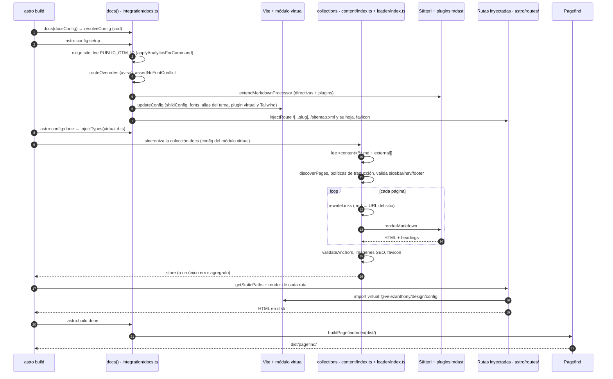

---
seo:
  title: "Cómo se genera el sitio: la integración de Astro paso a paso"
  description: "Qué hace la integración en cada hook de Astro, el módulo virtual, las rutas inyectadas y el loader de contenido, siguiendo un astro build de principio a fin."
---

# Cómo se genera el sitio

Esta página sigue un `astro build` paso a paso, hasta que la página arranca en el navegador: qué hace la integración en cada momento y en qué
archivo vive cada cosa. Al terminarla sabrás dónde mirar cuando algo del build no se comporte como
esperas.

La integración tiene dos puertas de entrada, una por cada archivo que toca el consumidor:

- `docs(config)` en `astro.config.mjs` → `src/astro/integration/docs.ts` (`index.ts` solo reexporta la API pública).
- La colección de `content.config.ts` (`@velezanthony/design/content`) →
  `src/astro/content/index.ts` y `src/astro/loader/index.ts`.

## El recorrido completo



## 1. La config se carga una vez

`astro.config.mjs` importa `docs.config.mjs` y se lo pasa a `docs()`, que lo valida y rellena los
valores por defecto con `resolveConfig` (`src/core/config/resolve.ts`). Hay una sola config resuelta
para toda la integración y el loader.

:::note[Detalle: la config resuelta y por qué hay una sola fuente]{collapsed}
La config se carga UNA vez: `astro.config.mjs` importa `docs.config.mjs` y se lo pasa a `docs()`, que
lo pasa por `resolveConfig` (`src/core/config/resolve.ts`: valida con el esquema zod y rellena los
valores por defecto). La config resuelta tiene la misma forma que la pública: `{ site, i18n, content }`,
cada grupo con su esquema, su tipo y su resolución en su módulo (`site.ts`, `i18n.ts`, `content.ts`);
una función que solo necesita una parte la pide con `ConfigPick` (`ConfigPick<'name', 'locales'>`). Un error ahí sale como `AstroError` con la ruta de la clave (`toAstroError`, en
`src/astro/errors.ts`).

El loader se evalúa fuera de la integración y Astro descarta las propiedades que esta le adjunte a
su objeto, así que no puede leerla de ahí. Tampoco hace falta que importe `docs.config.mjs` por su
cuenta: la colección de `@velezanthony/design/content` importa el módulo virtual
`virtual:@velezanthony/design/config` (ver más abajo), que sirve la config que la integración ya
resolvió. Hay una sola fuente por construcción: dos configs distintas no son posibles, y no hace falta
ninguna comprobación que lo vigile. Ojo: Astro solo reinicia `astro dev` cuando cambia el propio
`astro.config.mjs`, no lo que este importa. Por eso la integración registra `docs.config.mjs` (o su
variante `.js`/`.ts`) con `addWatchFile` si existe en la raíz: solo lo vigila, no lo carga.
:::

## 2. La integración prepara Astro (`astro:config:setup`)

Exige `site`, decide la analítica, avisa de las rutas que sustituye el sitio, extiende el procesador de
Markdown, fusiona la config de Astro (Shiki, fuentes, Tailwind, alias del tema) e inyecta las rutas.

:::note[Detalle: cada paso del hook, la tabla de rutas y los otros hooks]{collapsed}
Es donde ocurre casi todo. En orden:

1. **Exige `site`.** Sin origen absoluto no hay sitemap ni canonical.
2. **Analítica.** `readAnalyticsEnv` lee `PUBLIC_GTM_ID` con `loadEnv` de Vite (en este hook los
   `.env` aún no están en `process.env`) y `applyAnalyticsForCommand` decide si se activa (exige `site.analytics.privacyUrl`). Detalle en
   [Analítica y privacidad](../guia/idiomas-seo-y-analitica.md#analítica-y-privacidad).
3. **Sustituciones y conflictos.** `routeOverrides` lista las rutas de la librería que el
   consumidor sustituye con un fichero de `src/pages/` (la portada, el sitemap, `/_design/`…):
   no es un error, se avisa al arrancar y las rutas exactas que ya son suyas no se inyectan.
   `assertNoFontConflict` falla si el consumidor declara una fuente con `--font-plex-sans` o
   `--font-plex-mono`.
4. **Markdown.** `extendMarkdownProcessor` modifica **en sitio** el procesador Sätteri de la config de
   Astro: activa las directivas y añade nuestros plugins. Si el procesador no es Sätteri, falla (ver
   [Markdown](../guia/escribir-paginas.md#markdown)).
5. **`updateConfig`.** Fusiona en la config de Astro:
   - `markdown.shikiConfig.langAlias`: nuestros alias más los del consumidor (mandan los suyos).
   - `markdown.shikiConfig.themes`: `github-light-default`/`github-dark-default` (`src/components/styles/code-themes.ts`),
     **solo si el consumidor no eligió temas**.
   - `fonts`: IBM Plex Sans y Mono vía la API de fuentes de Astro (`src/astro/integration/fonts.ts`).
   - `vite.resolve.alias`: `@velezanthony/design/site-theme` apunta al CSS de la opción `theme` (o a
     uno vacío del paquete), que `theme.css` importa en último lugar
     (`src/astro/integration/site-theme.ts`).
   - `vite.plugins`: el plugin del módulo virtual y el de Tailwind (`@tailwindcss/vite`), salvo que el
     sitio ya registrase el suyo (`src/astro/integration/tailwind.ts`).
   - `vite.server.fs.allow`: solo si la carpeta de contenido queda fuera del proyecto.
6. **`injectRoute`.** Todas las rutas salen de una tabla, `src/astro/routes/routes.ts` (patrón, contenedor y cuándo: `site`, `dev` o una opción); las del sitio llevan `prerender: true` y las de dev, no:

| Patrón | Contenedor | Cuándo |
| --- | --- | --- |
| `/[...slug]` | `doc.astro` | Siempre: todas las páginas de docs, en todos los idiomas. |
| `/sitemap.xml` | `sitemap.xml.ts` | Siempre: las páginas o, con `sitemap.include`, el índice. |
| `/sitemap-pages.xml` | `sitemap-pages.xml.ts` | Con `sitemap.include`: las páginas propias. |
| `/_design/sitemap.css` | `sitemap.css.ts` | Siempre (la hoja con la que el navegador pinta el sitemap). |
| `/_design/favicon.png` | `favicon.png.ts` | Siempre (el favicon por defecto, con espacio de nombres propio). |

La 404 y la página de privacidad no están en la tabla: la librería no las inyecta, las pone el sitio.

**`astro:routes:resolved` y `astro:server:setup`**

`astro:routes:resolved` guarda las páginas que el sitio tiene en `src/pages/` (para el panel SEO y el
sitemap). `astro:server:setup`, solo en dev, vigila esas páginas y, si hay `static`, monta el
middleware que sirve esas carpetas (`static-folders-dev.ts`).

**`astro:config:done`**

Solo una cosa: `injectTypes` copia `src/astro/virtual/virtual.d.ts` al `.astro/` del consumidor, para
que TypeScript conozca `virtual:@velezanthony/design/config`. Va aquí porque `injectTypes` no existe
en `config:setup`.
:::

## 3. El módulo virtual

La config resuelta, junto con lo que solo sabe Astro (`base`, `trailingSlash`…), se sirve como JSON en
`virtual:@velezanthony/design/config`. Lo leen las rutas y la colección.

:::note[Detalle: cómo se arma y quién lo importa]{collapsed}
Las páginas de `src/astro/routes/` necesitan la config resuelta, pero se ejecutan dentro de
Vite, lejos del hook que la conoce. El puente es un **módulo virtual** (el mismo patrón que usa
Starlight):

- `createVirtualData` (`src/astro/virtual/data.ts`) junta la config resuelta (`site`, `i18n` sin
  `ui`, `content`) con lo que solo sabe Astro (`base`, `siteUrl`, que es el `site` de Astro con
  otro nombre para no confundirlo con el grupo `site`, `trailingSlash`, `buildFormat`, `publicDir`, `root`) y fusiona los
  textos de interfaz por idioma en `strings`.
- `createVirtualConfigPlugin` (`src/astro/virtual/plugin.ts`) sirve ese objeto con
  `JSON.stringify` bajo el id `virtual:@velezanthony/design/config`. Solo datos: nada de funciones.
- `src/astro/data/site-config.ts` importa el módulo y le pone su tipo completo.
- `src/astro/content/index.ts` también lo importa: de ahí saca el loader la config. Sin la
  integración registrada, ese import no resuelve y la build falla con un `AstroError` que pide añadir `docs(config)`.
:::

## 4. El loader lee y valida el contenido

`docsLoader` descubre las páginas, reescribe sus enlaces, renderiza el Markdown y valida anclas e
imágenes. Acumula todos los errores antes de fallar, con archivo y línea.

:::note[Detalle: las tres pasadas y el modo dev]{collapsed}
`docsLoader` (o, con la config ya resuelta, `docsLoaderFromResolved`, que usa `@velezanthony/design/content`) es un loader de la Content Layer de Astro. Hace una carga completa (`sync`) en tres
pasadas y **acumula todos los errores** antes de fallar, para que un build roto te diga todo lo que
está mal de una vez, con archivo y línea:

1. **Descubrir.** Lee los `.md` de la carpeta de contenido (`content`, `src/content/docs/` por defecto, y puede estar fuera del proyecto; con su frontmatter validado) y los archivos de
   `external[]`. `discoverPages` (`src/core/content/discovery.ts`) deduce slug, idioma y título de
   cada uno. Después resuelve las políticas de traducción y valida `sidebar`, `nav` y `footer.links`
   contra los slugs reales.
2. **Reescribir y renderizar.** Para cada página: `rewriteLinks` convierte los enlaces `.md`
   relativos en URLs del sitio (y recoge referencias para validar), `context.renderMarkdown` produce el
   HTML con el pipeline de Markdown, y se guarda en el _store_ con sus datos (`docsSchema`):
   `slug`, `locale`, `title`, `sourcePath`, `order`, `seo`, `translations` y `editPath`.
3. **Validar.** Con los encabezados de TODAS las páginas ya conocidos, `validateAnchors` comprueba
   cada `#ancla`; después se comprueban las imágenes SEO y el favicon de `public/`.

En `astro dev`, `watchSources` vigila la carpeta de contenido y los externos y relanza la carga
completa al cambiar cualquier archivo (un fallo se muestra en el log sin tirar el servidor).

> [!NOTE]
> El id de cada entrada es `<idioma>/<slug>` (`es/guia/instalar`, `es/index` para la portada). Las
> rutas no usan ese id: buscan por `data.slug` y `data.locale`.
:::

## 5. Las rutas pintan cada página

`doc.astro` (la ruta `/[...slug]`) lee la colección y el módulo virtual, calcula con funciones puras
todo lo que la página necesita (`docView`) y se lo pasa a componentes que solo pintan.

:::note[Detalle: de la entrada al HTML]{collapsed}
`doc.astro` es un **contenedor**: lee el módulo virtual y la colección, llama a funciones puras del
núcleo y pasa a la página (presentacional) los datos ya calculados. Para una página `guia/instalar.md`:

1. `getStaticPaths` lee todas las entradas y llama a `docRoutes`, que devuelve una ruta por página
   real (y por cada reserva, si la política es `fallback`). Para nuestro archivo, `param` es
   `guia/instalar`.
2. En el render busca la entrada por `slug` y `contentLocale`, y llama a `renderDoc`.
   **`render(entry)` va en el contenedor, no en el layout**: renderizar dentro de un layout rompe el
   `<head>` en desarrollo (astro#13724).
3. Lee las dimensiones de las imágenes SEO y llama a `docView`, que reúne con funciones puras de
   `core/` todo lo que la página necesita: barra lateral de su sección, cabecera, anterior/siguiente,
   etiquetas del head, pie, textos del idioma, URL de edición.
4. Pasa ese objeto a `DocPage` (`components/pages/`), que solo pinta con `DocsLayout`. Las fuentes (`<Font>` de `astro:assets`) se inyectan en la ranura
   `head` desde el contenedor, porque `components/` no puede importar `astro:*`.

- `BaseLayout.astro` pinta `<html lang>`, importa `theme.css` (la única importación de CSS de toda la
  librería), los `<meta name="theme-color">` y el script inline que aplica el tema guardado **antes
  del primer pintado**, y el aviso de consentimiento. No impone el diseño del `<body>`: ofrece las
  ranuras `head`, la de por defecto y `scripts`.
- `Head.astro` pinta las etiquetas que calculó `core/seo/head.ts`.
- `DocsLayout.astro` se apoya en `BaseLayout`: pone en `<html>` los atributos de disposición y su
  script previo al pintado, y monta en la ranura de por defecto cabecera, barra lateral, contenido
  (`.prose`), índice y pie. En el `<main>` deja los textos que el cliente necesitará como atributos `data-*` (`data-copy-label`,
  `data-anchor-label`, `data-zoom-label`…) y marca con `data-pagefind-body` lo que se indexa.
:::

## 6. Al terminar el build (`astro:build:done`)

Ajusta los WebP animados, poda imágenes huérfanas, genera el índice de Pagefind, añade al sitemap las
páginas de `src/pages/` y copia las carpetas estáticas, en ese orden.

:::note[Detalle: los cinco pasos y por qué en ese orden]{collapsed}
`runBuildDone` (`src/astro/integration/build/build-done.ts`) hace cinco cosas, en este orden, sin que el
sitio configure nada:

1. `boundAnimationLoops` reescribe los WebP animados infinitos (Sharp pierde las vueltas del GIF y los
   recodifica así) para que se reproduzcan una vez: una demo que no para es movimiento que el visitante
   no puede detener (WCAG 2.2.2).
2. `pruneOrphanAssets` borra de `_astro/` las imágenes que ningún `.html`, `.css`, `.js`, `.xml`, `.txt`
   ni `.json` del build nombra. Una imagen usada desde un `<Image>` y desde un cuerpo Markdown deja su
   original copiado junto a las derivadas; así no se publica.
3. `buildPagefindIndex` (`pagefind.ts`) indexa `dist/` con la API de Node de Pagefind y escribe
   `dist/pagefind/`. Ver [Búsqueda](../guia/navegacion.md#la-búsqueda). Va después de 1 y 2 para
   no leer recursos que se van a borrar.
4. `addClientPagesToSitemap` suma al sitemap las páginas de `src/pages/`, salvo que el sitio sustituya
   el sitemap.
5. `copyStaticFolders` copia las carpetas de `static` tal cual. Va la última: lo publicado así no pasa
   por la poda, el índice ni el sitemap.
:::

## Dónde mirar cuando algo falla

Cada regla de URL tiene un único dueño (la regla N6 de [Estructura](./estructura.md#las-reglas-numeradas)): `pageUrl`/`pageUrlOf` para las páginas y `listingPageUrl` para
las de un listado. Si una URL sale mal, se arregla ahí y en ningún otro sitio.

| Síntoma | Empieza por |
| --- | --- |
| La página no existe o tiene otra URL | `core/content/discovery.ts`, `core/i18n/availability.ts` (`pageUrl`, `pageUrlOf`: las únicas que forman la URL de una página) |
| Un listado: rutas, paginador o selector | `core/listing/urls.ts` (`listingPageUrl`: la única que forma sus URLs), `core/listing/view.ts`, `astro/views/doc-listing.ts` |
| Un enlace interno roto o mal reescrito | `core/links/rewrite.ts` |
| Algo raro en el HTML del Markdown | `astro/markdown/` (el plugin concreto) |
| Barra lateral, cabecera o anterior/siguiente | `core/navigation/` |
| Etiquetas del head | `core/seo/meta.ts`, `core/seo/head.ts` |
| Un dato de la config no llega a la página | `astro/virtual/data.ts`, `astro/views/doc.ts` |
| Un comportamiento en el navegador | `client/` y su llamada en `components/layouts/boot.ts` |
| Aspecto visual | `components/styles/theme.css` y el componente en `components/` |

## Por funcionalidad

Abre solo la que necesites.

:::note[El navegador: arranque del cliente]{collapsed}
Hay tres `<script>` de módulo, uno por nivel. `BaseLayout.astro` arranca lo de todo documento (el
tema y el consentimiento) con `bootBase`; `Article.astro` arranca el contenido (pestañas, copiar,
anclas, zoom, diagramas e índice) con `bootArticle`, así que sirve también fuera de docs;
`DocsLayout.astro` arranca lo propio de una página de docs:

```astro
<script>
  import { bootDocs } from './boot';

  bootDocs();
</script>
```

`bootBase` y `bootDocs` (`src/components/layouts/boot.ts`) y `bootArticle` (`src/components/boot/article.ts`) cablean el cliente en un orden fijo: primero el tema y el consentimiento, después la disposición, la búsqueda y el año, y al final el contenido (pestañas, copiar, anclas, zoom e índice).

Tres decisiones que conviene conocer antes de tocarlo:

- **`BootEnv` inyectable.** `bootDocs` recibe el entorno (documento, almacenamiento, consultas de
  medios, portapapeles…) como parámetro, con `browserEnv()` como valor por defecto. Así
  `BootEnv` vive en `components/boot/env.ts`, compartido por los arranques; `boot.test.ts` lo ejecuta con dobles, sin globales del navegador.
- **Cada `init*` ignora lo que la página no tiene.** Una página sin pestañas no falla en
  `initTabs`; simplemente no hay nada que cablear.
- **Los textos llegan por `data-*`.** `client/` no puede importar valores de `core/`, así que el
  catálogo ya resuelto viaja en el HTML.
:::

:::note[Rutas, URLs, SEO e idiomas]{collapsed}
Rutas, SEO e idiomas comparten una misma pieza: la **política de URLs** (`UrlPolicy`: `base`,
`trailingSlash` y `defaultLocale`). Cada URL del sitio, del sitemap, del canonical o del `hreflang`
sale de `pageUrl` (`src/core/i18n/availability.ts`), así que no hay dos sitios que calculen la misma
URL de formas distintas.

- **La ruta de las páginas.** `/[...slug]` → `src/astro/routes/doc.astro`. Su `getStaticPaths` llama
  a `docRoutes` (`src/astro/views/doc.ts`), que devuelve una ruta por cada página real y, con la
  política `fallback`, una **ruta de reserva** por cada traducción ausente. `docView` calcula todo lo
  que la página necesita con funciones puras de `src/core/`.
- **El sitemap.** `src/astro/routes/sitemap.xml.ts` → `sitemapXml` (`views/pages.ts`) →
  `buildSitemap` (`core/seo/sitemap.ts`). Con `include`, `sitemapIndexXml` → `buildSitemapIndex`, y
  `sitemapIncludes` rechaza las rutas de otro dominio.
- **Las páginas de `src/pages/` en el sitemap** (`clientSitemapEntries`). En `astro dev` los
  endpoints las piden al propio servidor (`loadClientSitemapEntries`); en el build no hay servidor, así
  que `astro:build:done` (`addClientPagesToSitemap`) reconoce cuáles de las páginas generadas son del
  sitio por el patrón de su ruta, lee su HTML de `dist/` con el mismo `readHead` y las añade al
  sitemap ya escrito.
- **`<lastmod>`.** Se lee con una sola llamada a `git log` para todo el repositorio, no una por
  archivo. Un clon superficial no da fechas a propósito: su único commit pondría la de hoy a todas las
  páginas, y un `<lastmod>` falso es peor que ninguno.
- **El estilo del sitemap.** El XML enlaza `_design/sitemap.css` (ruta relativa, vale con cualquier
  `base`), que sirve `sitemap.css.ts` con `sitemapCss` (`components/styles/sitemap.ts`). La paleta se
  lee de `theme.css` al generar el sitio, y el título y la nota salen de `sitemap.title` y
  `sitemap.note` del idioma por defecto. Es CSS y no XSLT porque Chrome retira XSLT.
- **El SEO.** La cascada se resuelve campo a campo en `resolveMeta` (`src/core/seo/meta.ts`): el
  frontmatter (o `external[].seo`) gana, después `site.seo` y, como último recurso, el `h1` como
  título. `buildHead` (`core/seo/head.ts`) emite las etiquetas; `core/seo/image-checks.ts` avisa de
  las imágenes OG grandes o mal proporcionadas.
- **Los idiomas.** La política de traducciones se decide por grupo en `resolvePolicies`
  (`src/core/i18n/translation-policy.ts`). `Page.slug` es la identidad (archivo sin sufijo de idioma)
  y `Page.urlSlug` la URL propia; `urlSlugOf(page)` (`src/core/content/slug.ts`) devuelve la que toca.
  El esquema de `i18n.ui` se genera desde las claves del catálogo (`src/core/i18n/ui-strings.ts`).
:::

:::note[La navegación]{collapsed}
Todo el cálculo es puro y vive en `src/core/navigation/`; los componentes de `src/components/` solo
pintan lo que reciben. La validación de forma de `content.nav` (https, `dir` solapados) se hace en el
esquema; la que necesita conocer las páginas (un `dir` sin páginas, un `slug` que no existe), en el
loader, con `validateNav` (`core/navigation/nav-sections.ts`). La barra lateral guarda su
desplazamiento con `client/layout/sidebar-scroll.ts`, y el año del pie lo pone `client/layout/year.ts`.

**`::nav-tree`.** El plugin `navTree` (`astro/markdown/nav-tree.ts`) escribe los `##` y deja un hueco
por sección; la ruta de las páginas de docs calcula los árboles del idioma que pinta (`docNavTrees`,
`core/navigation/nav-tree.ts`, con `buildSectionSidebar`) y `DocPage` pinta cada uno en su hueco con
`NavTree`.
:::

:::note[Los índices de carpeta]{collapsed}
`folderSettings` (`core/config/folders.ts`) resuelve la herencia de `content.folders`; el loader añade
las páginas generadas (`generatedListingPages`, `core/content/generated-listings.ts`) con el título de
`folderTitles` (`core/navigation/folder-labels.ts`); la ruta de las páginas de docs resuelve el listado
(`resolveListing`) y lo calcula (`buildListing`), los dos en `core/listing/`, con `docListingView`, y
`DocPage` lo pinta debajo del contenido, fuera de `.prose`, con `Listing` (`ListingList`,
`ListingTable`, `ListingCards` y el átomo `CoverPlaceholder`). Los textos de la interfaz son las claves
`listing.*`. El selector «Por página» es `PaginationBar` (la misma pieza que el pie de la tabla del
panel SEO); con JavaScript, `data-auto-navigate` (`client/content/auto-navigate.ts`) lleva a la página
1 del tamaño elegido. El listado entero lleva `data-pagefind-ignore`.
:::

:::note[Las carpetas estáticas]{collapsed}
El build las copia a `dist/` al final de `astro:build:done` (`astro/integration/build/copy-static-folders.ts`)
y `astro dev` las sirve con un middleware (`astro/integration/static-folders-dev.ts`). La validación de
forma vive en `core/content/static-folders.ts`, y `rewriteLinks` reescribe los enlaces a sus archivos.
:::

:::note[El pie propio]{collapsed}
La integración comprueba la ruta de `site.components.Footer` y sirve el módulo virtual
`virtual:@velezanthony/design/components/Footer`, que reexporta ese archivo o, sin
`site.components`, `DocsFooter`. Lo importan la ruta de las páginas de docs (`astro/routes/doc.astro`)
y las del panel SEO (`astro/routes/seo-on-page/`), que se lo pasan a `DocsLayout` por su prop `Footer`:
los componentes no leen módulos virtuales. Un layout propio que use `DocsLayout` puede pasarle su pie
por esa misma prop.
:::

:::note[La búsqueda]{collapsed}
`DocsLayout` marca con `data-pagefind-body` solo el `<main>` de las páginas indexables; el cromo y las
páginas `noindex` llevan `data-pagefind-ignore`. El cliente antepone la `base` al cargar `pagefind.js`
(`pagefindUrl` en `client/search.ts`), y el atajo `/` es `initSearchShortcut`.
:::

:::note[El Markdown]{collapsed}
Astro 7 procesa Markdown con **Sätteri** (`@astrojs/markdown-satteri`), un procesador basado en
árboles mdast. La librería no trae su propio procesador: **extiende el del consumidor** en
`astro:config:setup`, igual que hace Starlight. Todo vive en `src/astro/markdown/`.

**Por qué solo Sätteri**

`extendMarkdownProcessor` (`processor.ts`) comprueba con `isSatteriProcessor` que el procesador de
la config sea Sätteri y, si no lo es, rompe el build con un mensaje que dice cómo arreglarlo. No hay
degradación silenciosa: las cajas de aviso y las pestañas son **contenido**, y un sitio que las
pintara como texto plano sin avisar sería un sitio roto.

Si lo es, hace dos cosas sobre el objeto **en sitio** (respetando lo que el consumidor ya configuró):

1. `processor.options.features.directive = true`: activa la sintaxis `:::` de directivas.
2. Añade nuestros plugins al final de `processor.options.mdastPlugins`.

**El pipeline**

El orden lo fija `markdownPlugins` en `register.ts`, y no es arbitrario:

| Plugin | Archivo | Qué hace |
| --- | --- | --- |
| `githubAlerts` | `github-alerts.ts` | Convierte `> [!NOTE]` en la misma caja de aviso que la directiva. `IMPORTANT` se pinta como `info` y `CAUTION` como `danger`. |
| `admonitions` | `admonitions.ts` | `:::tip[Título]` → `<aside class="admonition" data-kind>`; con `{collapsed}`, un `<details>`. Un contenedor con nombre desconocido rompe el build. |
| `tabs` | `tabs.ts` | `::::tabs` con `:::tab[Etiqueta]` dentro → pestañas. Sin JavaScript se ven apiladas con su etiqueta. |
| `navTree` | `nav-tree.ts` | `::nav-tree` → un `##` por sección de `nav` y el hueco de su árbol, que rellena la ruta en el idioma que pinta.  |
| `mermaid` | `mermaid.ts` | Un bloque `mermaid` pasa a `.docs-mermaid[data-mermaid]` con el código dentro, sin Shiki. El cliente lo sustituye por el SVG; sin JavaScript se lee el código. |
| `codeLanguages` | `code-languages.ts` | Avisa de bloques con fence sin lenguaje y de lenguajes que Shiki no conoce. |
| `restoreDirectives` | `restore-directives.ts` | **El último**: devuelve a texto las directivas que nadie reclamó. |

¿Por qué `restoreDirectives` al final? Con las directivas activas, Sätteri interpreta `12:30` o
`http://x` como directivas de texto y se las traga. Este plugin recupera el trozo exacto del fuente
para todo lo que ningún plugin anterior reclamó. ¿Y por qué `mermaid` antes de `codeLanguages`?
Porque `mermaid` no es un lenguaje de Shiki, y no queremos un aviso por algo que es intencionado.

Todos los plugins se crean con `docsPlugin` (`env.ts`), que los **limita a la documentación**: solo
participan en archivos de la carpeta de contenido (`content`, `src/content/docs/` por defecto) y en los `external` declarados
(`path-filter.ts`). Cualquier otro Markdown del proyecto del consumidor queda intacto.

**Capturas y tablas**

El CSS no distingue un párrafo con texto de uno sin él, así que la captura se marca en positivo:
`Article` pone `p.docs-screenshot` en el párrafo cuyo único contenido es una imagen
(`core/content/screenshots.ts`), y el CSS pinta como captura solo ese párrafo. Del mismo modo,
`Article` envuelve cada `<table>` en un `div.table-scroll` (`core/content/scrollable-tables.ts`), sin
repetir uno escrito a mano. Sin `Article` (o con `prose={false}`) no hay ni capturas ni envoltorio.

**Enlaces**

`rewriteLinks` (`src/core/links/rewrite.ts`) se ejecuta en el loader, **antes** del procesador, y
`core/links/fences.ts` evita tocar lo que hay dentro de bloques de código. Una imagen relativa sin `./`
se trata como `./img/x.png` porque Astro importa las imágenes como módulos y una ruta sin prefijo no
la encontraría.
:::

::::note[El panel SEO]{collapsed}
Que el panel no llegue a `dist/` lo comprueban dos tests: uno unitario (`integration.test.ts`: con
`build` no hay rutas, con `dev` sí) y otro sobre una build real (`builds/basic.test.ts`: `dist/` no
contiene ninguna ruta `seo-on-page` ni texto que la mencione). Los límites viven en
`src/core/seo-on-page/thresholds.ts` y el texto de cada arreglo se construye en
`src/core/seo-on-page/analyzers/fixes.ts`: para nombrar el archivo correcto, el loader guarda en cada
entrada de dónde viene (`kind`: nativa o externa).

**Los mismos datos que el sitio**

Para la documentación no hay rastreo ni lectura de HTML. La librería ya sabe cómo genera cada página, así que el panel
reutiliza esas mismas funciones: la cascada de metadatos (`resolveMeta`), el sufijo del título
(`composeTitle`), las URLs y la disponibilidad por idioma (`buildAvailability`) y las políticas de
traducción. Lo que enseña es, por construcción, lo que sale en el `<head>`.

El adaptador (`src/astro/data/seo-on-page/adapter.ts`) es el único sitio que conoce
`astro:content`; el resto está en capas que no dependen de Astro (`core/seo-on-page/`,
`components/seo-on-page/`). Las pantallas se pintan con `DocsLayout`, como el resto del sitio, alimentado por
`panelView` (`views/seo-on-page/panel.ts`): barra lateral con las pantallas del panel, `noindex`, sin analítica ni
aviso de consentimiento.

:::note[Las páginas que añade el sitio en `src/pages/`]{collapsed}
Un sitio puede tener páginas propias además de la documentación (una portada, un CV, una lista de
proyectos). De esas la librería no tiene frontmatter que leer, así que el panel las lee **como las
ve un visitante**:

1. La integración guarda sus rutas (`astro:routes:resolved`) y, en dev, el servidor de Vite
   (`astro:server:setup`), en un registro compartido (`astro/registry.ts`).
2. `loadClientPages` (`astro/data/client-pages.ts`) expande las rutas dinámicas con su
   `getStaticPaths`, pide cada URL al propio servidor de desarrollo y lee su `<head>` con `readHead`
   (`core/seo/html-head.ts`): título, descripción, noindex, canonical, `hreflang`, encabezados, Open
   Graph y JSON-LD. Lo leído se reutiliza hasta que cambia un fichero.
3. `clientFacts` (`core/seo-on-page/nodes/client-page.ts`) las convierte en páginas del árbol de tipo
   `client` (etiqueta «Astro»). Las versiones de una página en cada idioma se agrupan por sus
   `hreflang`.

Pasan por los mismos analizadores, y los duplicados se buscan entre todas las páginas. El grafo de
enlaces (huérfanas, enlaces a noindex) sigue siendo solo de la documentación: sus enlaces no se
recogen. Los arreglos nombran la etiqueta del `<head>` (`<title>`, `<meta name="description">`) y el
`.astro`, no una clave de frontmatter.
:::
::::

:::note[La disposición y el tema]{collapsed}
**Dónde vive el estado de la disposición**

El estado está en atributos de `<html>`: `data-left`, `data-right` y `data-width`. El CSS de
`theme.css` reacciona a ellos redefiniendo variables (`--col-left`, `--col-right`, `--page-max`,
`--prose-measure`…), de modo que **ningún componente necesita saber en qué modo está**.

El estado inicial lo escribe el servidor en `<html>` (`DocsLayout.astro`, a través de `htmlAttrs` de `BaseLayout`), así que la config manda también
sin JavaScript. El script inline (`layoutBootstrapScript` en `client/layout/layout.ts`) solo lo pisa con lo
que guardó el visitante, y corre en el `<head>` para que al recargar **no haya saltos**: si esperara
al módulo de cliente, la página se pintaría primero abierta y después se plegaría. Los valores por
defecto salen de `core/config/layout.ts`; los desconocidos fallan la validación.

**El tema claro/oscuro**

- Sin elección, manda el sistema (`prefers-color-scheme`). Con elección, `<html data-theme>` y
  `localStorage` bajo `theme` (`client/preferences/theme.ts`).
- `theme.css` declara las paletas oscuras **dos veces**: una para el sistema
  (`@media (prefers-color-scheme: dark)` con `:root:not([data-theme='light'])`) y otra para la
  elección (`:root[data-theme='dark']`). Un test (`theme.test.ts`) exige que sean idénticas.
- `<meta name="theme-color">` no puede leer variables CSS, así que `src/components/styles/theme-colors.ts`
  repite el `--color-canvas` de cada tema; otro test los sujeta a `theme.css`.

**El CSS propio (`site.theme`)**

`theme.css` de la librería importa `@velezanthony/design/site-theme` en último lugar, y la integración
apunta ese especificador (con un alias de Vite, que Tailwind respeta al resolver `@import`) al archivo
del sitio; sin `site.theme`, a un CSS vacío del paquete (`src/astro/integration/site-theme.ts`). Tailwind
escanea la raíz del proyecto del sitio, y la librería añade su propio `src/` con `@source`.
:::

## Siguiente paso

Los comandos del día a día, los tests y las recetas de cambios habituales: [Mantenimiento](./mantenimiento.md).
