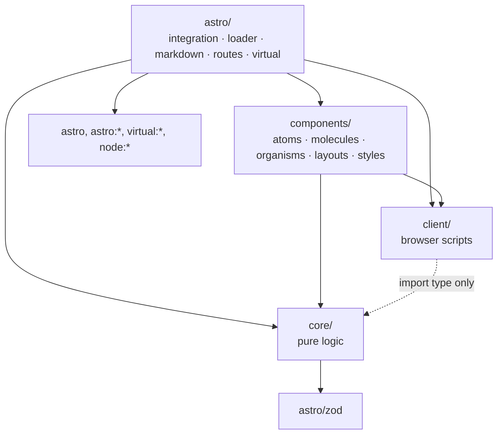

# Structure

This page explains how `src/` is split, what each part may import and what each file does. By the end
you will know where a new change goes and why ESLint rejects certain imports.

## The layers

| Layer | What it contains | May import |
| --- | --- | --- |
| `core/` | Pure logic: config, content, links, navigation, i18n, SEO, analytics. | Only `core/` and `astro/zod`. |
| `client/` | Browser JavaScript: theme, search, consent, tabs, zoom… | Only **types** from `core/` (`import type`). |
| `components/` | Presentational `.astro` components and styles. They receive props; they do not fetch data. | `core/` and `client/`. No `astro`, `astro:*`, `virtual:*` or the `astro/` folder. |
| `astro/` | The adapter: integration, loader, Markdown plugins, routes, virtual module. | Everything, with the sublayer rules below. It is the only layer that knows Astro. |
| `testing/` | Test utilities (not shipped). | Everything. |



The arrows are the only allowed directions. Notice what is **not** there:

- `core/` points at nothing but zod: no Node (`node:*`), no Astro, no virtual module. It is pure.
- `client/` imports no values from the core. Browser code is bundled for the client, and pulling in
  values from `core/` would put code in the bundle that does nothing in the browser. The data it needs
  reaches it through `data-*` attributes in the HTML.
- `components/` does not see `astro/`: a component reads neither the collection nor the virtual
  module. That is done by the **routes** in `astro/routes/` (containers), which pass the model to the
  pages in `components/pages/` (presentational: they only render).

## Numbered rules

Some repo rules carry a code (`N1`, `N4`…) so they can be cited in comments, in `eslint.config.mjs`
and in commit messages. The numbering has gaps: these are the rules that still apply. This is the list,
with where each one is explained:

| Code | Rule | Where |
| --- | --- | --- |
| N1 | A component does not derive: it receives a view model already computed by a pure function, and URLs reach it through a port. | [Recipes](./mantenimiento.md#recipes) |
| N2 | Every URL that links a listing comes from a single function, and a test checks that each link exists. | [Maintenance](./mantenimiento.md#tests) |
| N3 | Inside `astro/`, `data/` does not import `routes/`, `views/` or `components/`. | [Sublayers of `astro/`](#sublayers-of-astro) |
| N4 | Inside `core/`, the config does not depend on the domains that use it, and shared code knows no domain. | [Dependencies inside `core/`](#dependencies-inside-core-n4) |
| N5 | Types come from the zod schema (`z.infer`), not from an interface repeating the fields. | [Recipes](./mantenimiento.md#recipes) |
| N6 | Each URL rule has a single owner: if a URL comes out wrong, it is fixed there. | [Where to look when something fails](./build.md#where-to-look-when-something-fails) |
| N8 | What CSS cannot tell apart is marked in the HTML, positively (`p.docs-screenshot`). | [Maintenance](./mantenimiento.md#conventions) |
| N9 | Two or more optional parameters go in a named object. | [Maintenance](./mantenimiento.md#conventions) |
| N10 | An organism only composes molecules and atoms. | [Recipes](./mantenimiento.md#recipes) |
| N11 | Every setting that changes per folder lives in `content.folders` and is inherited in one place. | [Recipes](./mantenimiento.md#recipes) |
| N12 | Every option with a closed set of values is an exported constant. | [Recipes](./mantenimiento.md#recipes) |
| N13 | The config has three groups, each with its own module. | [Recipes](./mantenimiento.md#recipes) |
| N14 | The frontmatter only carries the page's content. | [Recipes](./mantenimiento.md#recipes) |
| N15 | The config's public types are checked with cases in `src/testing/config-types.ts`. | [Maintenance](./mantenimiento.md#tests) |

### Dependencies inside `core/` (N4)

Inside the core there are directions too:

- **`core/config/`** imports no **values** from `core/navigation/`, `core/listing/`, `core/seo/` or
  `core/seo-on-page/`: those domains read the config, not the other way round. It may use
  `core/content/`, `core/i18n/` and `core/shared/`, and types from any of them with `import type`.
  That is why `DEFAULT_TOC_DEPTH` lives in `core/config/layout.ts` and `core/navigation/toc-entries.ts`
  imports it from there.
- **`core/shared/`** imports no `core/` domain: text, pagination and generic URLs anyone can use
  (`paginate`, `humanize`, `folderLabel`, `withBase`).

### Sublayers of `astro/`

Inside `astro/`, data and presentation do not import each other either: only `routes/` knows both.

- `views/` (view models) does not import `astro:*`, the `astro` package or `data/`, nor `components/`.
- `loader/` does not import `integration/`.
- `data/` does not import `routes/`, `views/` or `components/` (not even their types). If a route
  needs data and a view, it reads the data from `data/` and passes it to `views/`: `routes/doc.astro`
  reads the commit dates, optimises the covers (`data/covers.ts`) and calls `docListingView`. No
  exceptions: the panel adapter (`data/seo-on-page/`) does not either; the panel routes build their
  links (`views/seo-on-page/hrefs`).
- The route builds the site context (`siteContext`) once per render and passes it to each view
  (`docView`, `docListingView`, `docNavTrees`); `docRoutes` resolves each route's listing once.

### The development panel fence

The `seo-on-page` panel only exists in development, so nothing published may import it: not
`components/` (outside `components/seo-on-page/`), not `client/` (outside `client/seo-on-page/`), not
`astro/routes/` (outside `routes/seo-on-page/`). The panel texts live in `core/seo-on-page/labels.ts`
so both its views and its components read them without crossing over.

## How ESLint enforces it

`eslint.config.mjs` applies `@typescript-eslint/no-restricted-imports` per folder with a
`layer(folder, paths, patterns)` function:

- Relative imports are detected by folder name (`relativeTo([...])`, or `siblingOf([...])` for the
  `astro/` sublayers), and `astro:*`, `virtual:*` and `node:*` by pattern.
- The `astro` package goes through `paths` (exact match), so as not to catch `astro/zod` too.
- In `client/` and in `core/config`, `allowTypeImports: true` lets `import type` through.

`src/testing/boundaries.test.ts` lints snippets with each layer's path and checks that every forbidden
import **still fires**: if someone deletes a rule, the test fails.

## The other ESLint rules

- **No `enum`.** The package ships uncompiled `.ts` and `enum` is not erasable syntax. Instead, an
  `as const` object plus a derived type:

  ```ts
  export const MissingTranslation = { LINK: 'link', OMIT: 'omit', FALLBACK: 'fallback' } as const;
  export type MissingTranslation = (typeof MissingTranslation)[keyof typeof MissingTranslation];
  ```

  That is how `MissingTranslation`, `PanelState`, `LayoutWidth` and `NavIcon` are built.
- **No type-aware linting.** `astro check` already owns the types, and the parser would have to
  generate a `.tsx` for every `.astro`.
- **Accessibility.** `eslint-plugin-astro` with its `jsx-a11y-recommended` config.
- **Formatting.** `eslint-config-prettier` goes last: formatting is Prettier's job alone.
- `playground/` is in `ignores`: it is a consumer with its own checks.

## Why it is done this way

- **Fast, reliable tests.** Almost all logic is in `core/` and is tested with pure functions. What
  needs Astro is tested with the Astro container (`testing/render.ts`) or with fixture builds.
- **A single place that changes with Astro.** When Astro changes an API, the impact stays in
  `astro/`. The rest does not notice.
- **Reusable components.** As `components/` only receives props, a component can be rendered in a test
  or another page without setting up the collection or the virtual module.

## The `src/` map

Tests live **next to their file** (`slug.ts` and `slug.test.ts`), so only the code appears here (no
test fixtures either). Paths are relative to `src/`. A test, `src-map.test.ts`, checks that the map
names every file and folder. The descriptions in the trees are in Spanish, as in the code comments.

::::tabs
:::tab[core/]
**`core/`: pure logic**

```text
core/
├── author.ts              Quien mantiene la librería: firma por defecto de sus docs
├── errors.ts              DocsError (archivo, línea, pista) y DocsErrors (varios a la vez)
├── config/
│   ├── schema.ts          Esquema zod de la config pública (compone `site`, `i18n`, `content` y valida lo que cruza grupos); de aquí sale DocsUserConfig
│   ├── site.ts            `site`: esquema, ResolvedSite y resolveSite (nombre, favicon, tema, componentes, pie, disposición, `seo` y `analytics`)
│   ├── i18n.ts            `i18n`: esquema, ResolvedI18n y resolveI18n (idiomas, `missing` y textos de interfaz)
│   ├── content.ts         `content`: esquema, ResolvedContent y resolveContent (carpeta, exclusiones, externas, estáticas, edición, `nav`, `sidebar` y `folders`)
│   ├── shared-schemas.ts  Piezas de esquema compartidas: textos traducibles, imágenes, JSON-LD y el `seo` de una página
│   ├── resolve.ts         Valida y rellena valores por defecto → ResolvedConfig { site, i18n, content } (la misma forma que la pública); ConfigPick
│   ├── layout.ts          PanelState, LayoutWidth y la disposición por defecto
│   ├── folders.ts         `folders`: ListingView, TreeShow, ALL_FOLDERS, su esquema y la herencia por carpeta (folderSettings, con declaredAt); valida sus claves
│   ├── nav.ts             NavIcon y los tipos de los elementos de nav
│   └── footer.ts          Tipos del pie
├── content/
│   ├── content-dir.ts     Carpeta de las páginas nativas por defecto y su validación
│   ├── static-folders.ts  Carpetas de `static` (publicadas tal cual): validación, a qué carpeta casa una petición y qué excluye
│   ├── exclude.ts         Patrones de `exclude` (estilo `.gitignore`) → qué `.md` no se publica
│   ├── discovery.ts       Archivos → páginas (slug, idioma, título, orden); externos
│   ├── frontmatter.ts     Separa y valida el frontmatter (conserva las líneas del cuerpo)
│   ├── generated-listings.ts  Índices generados según `folders`: qué carpetas, qué página lista (listsFolder), las generadas, el `index.md` que gana y el error de un `_index.md` sin `generate`
│   ├── stored-page.ts     Una entrada de la colección (su forma, sin Astro) → Page
│   ├── slug.ts            guia/index → guia, index → '' (portada); qué es un _index y de qué carpeta
│   ├── screenshots.ts     El único dueño de la marca de captura: un párrafo con una sola imagen → p.docs-screenshot (lo usa Article)
│   ├── scrollable-tables.ts  El único dueño del .table-scroll: envuelve cada <table> (lo usa Article) sin repetir uno escrito a mano
│   └── title.ts           Primer h1 o title del frontmatter; sin ninguno, error
├── i18n/
│   ├── locale.ts          Idiomas, sufijos de archivo, idioma de una URL
│   ├── availability.ts    pageUrl y pageUrlOf (LAS funciones de URLs), prefijo de idioma y qué idiomas tiene cada página
│   ├── translation-policy.ts  MissingTranslation, políticas por grupo, rutas de reserva
│   └── ui-strings.ts      Catálogo de textos de interfaz en/es, translate() e interpolación
├── links/
│   ├── rewrite.ts         Enlaces relativos (.md y archivos de `static`) → URLs del sitio, con referencias para validar
│   ├── anchors.ts         Índice de encabezados y validación de #anclas
│   └── fences.ts          No tocar enlaces dentro de bloques de código
├── listing/               El índice generado de una carpeta
│   ├── options.ts         resolveListing: el listado resuelto (lista o paginado) desde los ajustes de `folders`
│   ├── entries.ts         buildListing (visitante de nav-walk): entradas, secciones y orden por fecha
│   ├── covers.ts          Portada guardada, la que se pinta y el dibujo de la librería
│   ├── urls.ts            Dueño de las URLs de un listado: page/ y per-page/, posiciones y nombres reservados
│   └── view.ts            ListingView (unión por disposición), el puerto ListingHrefs y buildListingView
├── navigation/
│   ├── sidebar.ts         Árbol de la barra lateral desde la config y las páginas (profundidad: `tree.depth` de `folders`)
│   ├── folder-labels.ts   Qué grupo declarado es dueño de cada carpeta (groupFolders: su etiqueta enlaza la página de la carpeta) y el título de una carpeta sin `_index.md`
│   ├── sidebar-slugs.ts   Valida los slugs de sidebar
│   ├── nav-sections.ts    Secciones por dir, validación de nav
│   ├── nav-sidebar.ts     La barra lateral de un ámbito (NavScope: una sección o las páginas sin sección) y la de una página (buildScopedSidebar, con `tree.show`)
│   ├── folder-tree.ts     `tree.show: TreeShow.ALL`: el árbol completo de una carpeta (secciones como grupos, páginas sin sección) sobre nav-walk
│   ├── nav-walk.ts        El único recorrido de la nav: ámbitos, árboles de contenido y de ruta, visitantes
│   ├── nav-entries.ts     Elementos de la cabecera ya resueltos para una página
│   ├── nav-tree.ts        Árbol de cada sección para ::nav-tree (visitante de nav-walk) y los huecos que deja en el HTML
│   ├── prev-next.ts       Anterior / siguiente en el orden aplanado
│   ├── page-window.ts     Qué números de página enseñar en una paginación y dónde van los huecos
│   ├── toc-entries.ts     Encabezados de Astro → entradas del índice «En esta página»
│   ├── edit-href.ts       Enlace para editar el archivo en el repositorio
│   ├── footer.ts          Vista del pie y validación de sus enlaces
│   └── label.ts           Etiqueta por idioma con recurso al idioma por defecto
├── seo/
│   ├── meta.ts            Cascada página > base > derivado de título, descripción e imagen
│   ├── title.ts           Sufijo del título (página > sitio > `name`, o ninguno) y `título | sufijo`
│   ├── head.ts            Etiquetas del head: title, canonical, hreflang, OG, twitter
│   ├── page-head.ts       El head de una página del sitio que no es de docs: meta, alternates y JSON-LD extra
│   ├── seo-schema.ts      El bloque `seo` del frontmatter como fragmento zod reutilizable
│   ├── json-ld.ts         Schemas JSON-LD del sitio y de cada página
│   ├── sitemap.ts         XML con alternates y lastmod (también el de las páginas de docs); límite de 50 000 URLs
│   ├── lastmod.ts         Salida de git log → fecha por archivo; fecha de cada URL del sitemap
│   ├── indexable.ts       Qué URLs son noindex
│   ├── client-pages.ts    Las páginas que el consumidor tiene en src/pages/ y sus rutas dinámicas
│   ├── html-head.ts       Lee del HTML construido lo que una página dice de sí misma
│   ├── image-refs.ts      Qué imágenes SEO hay que comprobar
│   ├── image-checks.ts    Peso y proporción de la imagen OG (avisos)
│   └── favicon.ts         Favicon por defecto (/_design/favicon.png) o el del consumidor
├── analytics/resolve.ts   PUBLIC_GTM_ID / gtmId → id validado y enlace de privacidad por idioma
├── shared/
│   ├── text.ts            Plurales, listas legibles y el nombre legible de una carpeta
│   ├── paginate.ts        La única matemática de páginas (trozo, páginas, rango): panel SEO e índices
│   ├── urls.ts            Quita las barras finales de la base
│   └── tones.ts           TagTone: los tonos de Tag y de las marcas del panel
└── seo-on-page/           La lógica del panel SOLO de dev (ver Integración → SEO on page)
```

The panel keeps its logic in `core/seo-on-page/`, pure as well: it starts from a tree of pages,
analyses it and prepares the model of each screen.

```text
core/seo-on-page/
├── tree/                  El árbol de páginas sobre el que trabaja todo el panel
│   ├── types.ts           SeoPage, SeoTree, Issue y los tipos que comparten todos
│   ├── input.ts           Lo que el análisis recibe de cada página
│   ├── build-tree.ts      Entradas → árbol, con sus problemas y su orden estable
│   ├── keys.ts            Clave de una página en un idioma y su etiqueta
│   └── locale-cells.ts    Estado de cada idioma de una página (falta, reserva, omitida)
├── nodes/                 Cada porción del árbol, calculada desde su fuente
│   ├── meta.ts            Título, descripción y de dónde vienen
│   ├── headings.ts        Encabezados en el orden del documento
│   ├── locales.ts         Idiomas disponibles y su estado
│   ├── navigation.ts      La parte de la config que la navegación necesita
│   ├── content.ts         Enlaces e imágenes del cuerpo, tal como los deja el loader
│   └── client-page.ts     Las páginas del consumidor entran al árbol
├── analyzers/             Un análisis por tipo de problema; cada uno devuelve Issue
│   ├── issue.ts           Construye un Issue con su gravedad por defecto
│   ├── metadata.ts        Título y descripción frente a los límites del buscador
│   ├── headings.ts        Un solo H1 y sin saltos de nivel
│   ├── canonical.ts       Cada idioma es canónico de sí mismo
│   ├── multilingual.ts    Traducciones ausentes y políticas en conflicto
│   ├── links.ts           Enlaces a noindex y páginas huérfanas
│   ├── images.ts          Imágenes sin texto alternativo y OG fuera de medida
│   └── fixes.ts           Dónde se arregla cada problema (frontmatter o .astro)
├── pages/                 El modelo de cada pantalla, ya digerido
│   ├── links.ts           Puerto de enlaces: lo implementa astro/ para respetar base y barra final
│   ├── overview/          Resumen: model.ts, coverage.ts, indexing.ts
│   ├── listing/           Tabla de páginas: model.ts, rows.ts, entries.ts, group.ts, have.ts,
│   │                      matrix.ts, kinds.ts, severities.ts, selection.ts, common.ts
│   └── inspector/         Una página: model.ts, compare.ts
├── queries/               Consultas puras sobre el árbol
│   ├── url-filters.ts     Filtros de la tabla ↔ query de la URL
│   ├── filter.ts          Qué problemas cumplen los filtros
│   ├── page-sizes.ts      Tamaños de página de la tabla (por defecto y elegibles)
│   ├── priorities.ts      Qué arreglar primero
│   ├── summary.ts         Resumen de schemas
│   ├── outline.ts         Esquema de encabezados con sus saltos
│   ├── heading-counts.ts  Qué falla en la estructura de encabezados
│   ├── code-spans.ts      Trocea un mensaje en texto y nombres de código
│   └── clip.ts            Recorta con «…» como el buscador
├── report/                El informe «copiar para la IA»
│   ├── scope.ts           De qué trata un informe: sitio, página o filtro
│   ├── report.ts          Informe de un alcance
│   ├── texts.ts           Los textos que el diálogo necesita, ya generados
│   ├── prompt.ts          El prompt de cada problema
│   ├── issue-section.ts   Sección de problemas del informe
│   ├── issues-report.ts   Tabla de una página para el informe
│   ├── lacks-report.ts    Lo que le falta a cada entrada
│   ├── lacks.ts           Recuentos «sin …»
│   ├── kinds.ts           Nombres de los tipos de problema en el informe
│   ├── content-dirs.ts    Carpetas de las páginas nativas
│   ├── format.ts          Valor con su longitud y su ancho
│   └── size.ts            Cuánto ocupa un texto
├── catalog.ts             Catálogo de problemas: gravedad, certeza y por qué importa
├── severity.ts            Las gravedades y su orden
├── thresholds.ts          Límites de título y descripción
├── pixels.ts              Estimación del ancho en píxeles
├── have.ts                Qué tiene cada entrada (columnas de «Qué tiene»)
├── key-place.ts           Dónde vive cada clave: frontmatter de un .md o head de un .astro
├── site-files.ts          Los archivos del sitio que el panel enseña (robots, sitemap…)
└── labels.ts              Textos del panel: los comparten sus vistas y sus componentes
```
:::
:::tab[client/]
**`client/`: the browser**

Each file exports `init*` functions that receive what they need (document, `Storage`,
`matchMedia`…) instead of reading globals, so they can be tested with doubles.

```text
client/
├── diagrams/           Diagramas de Mermaid
│   ├── mermaid.ts        Convierte los bloques .docs-mermaid en SVG con los colores del tema
│   ├── diagram-viewer.ts Visor a pantalla completa: zoom, arrastre y teclado
│   ├── diagram-view.ts   La matemática del visor, sin DOM
│   ├── selector.ts       El selector de los bloques, aparte para buscarlos sin cargar Mermaid
│   └── token.ts          Lee un token de color del <html> ya resuelto al tema activo
├── layout/             La disposición de la página
│   ├── layout.ts         Columnas plegables y ancho; script previo al pintado
│   ├── rail.ts           A partir de qué ancho existe el raíl de los laterales
│   ├── nav-open.ts       Pliega o abre el menú antes del primer pintado
│   ├── sidebar-scroll.ts Recuerda el desplazamiento de la barra lateral
│   ├── toc.ts            Resalta la sección visible en el índice
│   └── year.ts           Año del pie con el reloj del visitante
├── content/            Lo que enriquece el contenido
│   ├── anchors.ts        Enlace a cada encabezado
│   ├── zoom.ts           Ampliación de imágenes en un <dialog>
│   ├── copy-code.ts      Botón de copiar en los bloques de código
│   ├── auto-navigate.ts  Un select[data-auto-navigate] lleva a la URL elegida (el «Por página» de un listado)
│   └── tabs.ts           Pestañas accesibles con teclado
├── preferences/        Lo que elige el visitante y se guarda
│   ├── theme.ts          Tema claro/oscuro, script previo al pintado, revelado circular
│   ├── consent.ts        Banner de consentimiento, carga de GTM, borrado de cookies
│   └── storage.ts        Acceso seguro a localStorage/sessionStorage y sus claves
├── seo-on-page/        El JavaScript del panel SOLO de dev
│   ├── boot.ts           Arranque del panel
│   ├── auto-submit.ts    Los filtros envían su formulario al cambiar
│   ├── kinds-all.ts      La casilla «Todos» de los tipos de problema
│   ├── popover.ts        Los <details> emergentes se cierran al pulsar fuera
│   └── report.ts         El diálogo «Copiar para la IA»
├── clipboard.ts        Copiar con confirmación o fallo
├── text.ts             Rellena las {variables} de una plantilla (el cliente no importa translate())
├── search.ts           Pagefind: carga bajo la base, resultados, atajo «/»
└── transition.ts       Envoltorio de la View Transitions API con movimiento reducido
```
:::
:::tab[components/]
**`components/`: what you see**

Atomic design. No component reads data on its own: everything comes through props, texts included
(`strings: UiStrings`).

```text
components/
├── atoms/
│   ├── form/        Checkbox, FieldError, HelpText, Input, Label, Radio, Select, Switch, Textarea
│   ├── actions/     Button, Link, CookieSettingsButton (reabre el aviso de consentimiento);
│   │                variants.ts: las clases de cada variante de Link, que reutilizan el botón y los índices
│   └── display/     Heading, Icon, InlineList, Tag, Text, CoverPlaceholder (portada de un índice),
│                    DateLabel (<time> con la fecha ya formateada)
├── molecules/
│   ├── form/        FormField, RadioGroup y describedby.ts (el aria-describedby de un campo)
│   ├── navigation/  EditLink, LocaleSwitch, NavList, NavTree, Pagination, PrevNext, TableOfContents,
│   │                PageLink (enlace con la insignia de idioma), SectionPath (camino «Sección › Grupo»),
│   │                ListingTree (árbol de un índice generado), PerPageSelector (el «Por página» de un
│   │                listado: navegación, con enlaces en <noscript>), PaginationBar
│   │                (fila de pie: por página a un lado, rango y paginador al otro)
│   ├── content/     Admonition, FallbackNotice, SectionHead, Tabs, ListingCard (una tarjeta de un índice)
│   └── controls/    PanelToggle, ThemeToggle
├── organisms/
│   ├── chrome/      DocsHeader, DocsFooter, Sidebar, SidebarList, SearchBox, BackToTop, ConsentBanner, Head
│   └── content/     Article (contenido con diagramas y anclas, y la columna del índice y un aside);
│                    Listing con ListingList, ListingTable y ListingCards (las disposiciones de un índice generado)
├── seo-on-page/ Lo propio del panel SOLO de dev, por nivel atómico (lo genérico va arriba)
│   ├── atoms/       IssueBadge (sobre Tag), SeverityTag, CertaintyTag, LengthMeter, LocaleBadge,
│   │                Note, StateMark
│   ├── molecules/   SerpPreview, OgPreview, ResultsCount, InfoHiddenNote, FiltersForm,
│   │                OverviewCard, StatRow, CodeSpans, InspectorSection, CopyPromptButton, DataTable,
│   │                EmptyNotice, Kpi, LocaleDetailCard, PanelNotice, ReportButton, RowHeader,
│   │                TableHead, ViewSwitch
│   ├── organisms/   Una sección por componente, agrupadas por pantalla; PanelIntro va suelta
│   │   ├── overview/    OverviewKpis y las tarjetas del Resumen (FixFirstCard, CoverageCard,
│   │   │                IndexingCard, SchemasCard, KindsCard, SiteFilesCard, RouteOverridesNotice)
│   │   ├── listing/     PagesListing, PagesTable, EntriesTable, HaveTable, LanguageMatrix,
│   │   │                CommonIssueNotice, TableFooter
│   │   ├── inspector/   InspectorHeader, FixList, PublishedFacts, Translations, SchemasList,
│   │   │                HeadingsOutline
│   │   └── shared/      ClientPageFailures, ReportDialog (las usan varias pantallas)
│   ├── pages/       OverviewPage, PagesPage, InspectorPage: las pantallas del panel, presentacionales
│   └── tables.ts    Clases de la celda y del filete de las tablas del listado
├── boot/        Arranque del JavaScript de cliente que comparten layouts y organismos, sin subir de nivel
│   ├── env.ts       BootEnv y browserEnv(): el navegador inyectable que reciben los `init*`
│   └── article.ts   bootArticle: pestañas, copiar, anclas, zoom, diagramas e índice de un `Article`
├── pages/       Páginas presentacionales: reciben el modelo por props y solo pintan (DocPage)
├── layouts/
│   ├── BaseLayout.astro     <html>, <head>, tema, CSS y consentimiento; sin cabecera ni pie
│   ├── DocsLayout.astro     Página de docs sobre BaseLayout: cabecera, barra, contenido, índice, pie
│   └── boot.ts              Arranque del JavaScript de las páginas (bootBase, bootDocs)
├── styles/
│   ├── theme.css            El punto de entrada: Tailwind y el resto de hojas, en orden
│   ├── site-theme.css       Vacío: lo que `theme.css` importa si el sitio no define `theme`
│   ├── tokens.css           Tokens y paletas de color (claro y oscuro con light-dark())
│   ├── base.css             Reglas base, como las barras de desplazamiento con los colores del tema
│   ├── chrome.css           Disposición de las páginas de docs (columnas, raíl, ancho)
│   ├── components.css       Avisos y anclas de títulos, también fuera de `.prose`
│   ├── prose.css            La prosa del contenido
│   ├── code.css             Bloques de código y su paleta oscura
│   ├── motion.css           Transiciones, solo con movimiento permitido
│   ├── theme-colors.ts      --color-canvas de cada tema para <meta name="theme-color">
│   ├── code-themes.ts       Temas de Shiki emparejados con los tokens
│   └── sitemap.ts           Lee la paleta de tokens.css para la hoja del sitemap
└── assets/favicon.png       Favicon por defecto
```
:::
:::tab[astro/]
**`astro/`: the adapter**

Inside `astro/`, data (`data/`) and presentation (`views/`, `routes/`) do not import each other: only
`routes/` knows both (see [Sublayers](#sublayers-of-astro)).

```text
astro/
├── config.ts                La política de URLs y la config validada o un error de Astro
├── errors.ts                DocsError → AstroError (toAstroError, orAstroError)
├── registry.ts              Rutas del cliente y contador de cambios que la integración comparte con el panel
├── integration/
│   ├── index.ts             Exports públicos: docs, defineDocsConfig, defineDocsSite…
│   ├── docs.ts              docs(): la integración y sus hooks
│   ├── config.ts            defineDocsConfig y los nombres de los archivos de config
│   ├── define-docs-site.ts  defineDocsSite: la config de Astro de un sitio de docs
│   ├── analytics-env.ts     Lee PUBLIC_GTM_ID con loadEnv
│   ├── route-overrides.ts   Avisa de las rutas de la librería que src/pages/ sustituye
│   ├── client-pages.ts      Guarda las páginas del consumidor al resolver las rutas
│   ├── fs-allow.ts          Carpetas que Vite debe servir si el contenido está fuera del proyecto
│   ├── site-theme.ts        Alias de Vite al CSS propio del sitio (opción `theme`)
│   ├── components.ts        El archivo del pie de las páginas de docs (opción `components.Footer`)
│   ├── static-folders-dev.ts  Middleware de dev que sirve las carpetas de `static`
│   ├── tailwind.ts          El plugin de Tailwind, salvo que el sitio ya lo registrase
│   ├── fonts.ts             IBM Plex y el choque de variables de fuente
│   └── build/
│       ├── build-done.ts    Lo que corre en astro:build:done
│       ├── client-sitemap.ts  Suma las páginas del consumidor al sitemap
│       ├── pagefind.ts      Índice de búsqueda tras el build
│       ├── copy-static-folders.ts  Copia a dist/ las carpetas de `static`, tal cual
│       ├── prune-orphan-assets.ts   Borra de `_astro/` los recursos que ningún texto del build enlaza
│       └── bound-animation-loops.ts   Limita a una pasada los WebP animados infinitos
├── loader/
│   ├── index.ts             docsLoader / docsLoaderFromResolved: descubrir, renderizar, validar
│   ├── schema.ts            docsSchema: los datos de cada entrada
│   ├── frontmatter.ts       Lee y valida YAML con archivo y línea
│   ├── repo-root.ts         repoRoot o el .git más cercano, para editPath
│   ├── images.ts            Comprueba las imágenes de public/
│   ├── covers.ts            Comprueba la portada (`index.image`) de cada página; si falta, avisa
│   ├── favicon.ts           Comprueba el favicon local
│   ├── slug-routes.ts       Un `slug` del frontmatter en una ruta de la librería o de src/pages/
│   └── watch.ts             Recarga en astro dev
├── content/
│   ├── index.ts             `collections`: la colección docs con la config del módulo virtual
│   └── missing-integration.ts  El aviso «falta docs(config)» si el módulo virtual no existe
├── markdown/                Plugins mdast y su registro (ver Integración → Markdown)
│   ├── register.ts          Los plugins en su orden
│   ├── processor.ts         Engancha los plugins al procesador de Markdown
│   ├── env.ts               Lo que los plugins saben del sitio
│   ├── path-filter.ts       Qué Markdown transforman nuestros plugins
│   ├── admonitions.ts       Directivas :::tipo
│   ├── github-alerts.ts     Citas > [!NOTE] como cajas de aviso
│   ├── tabs.ts              ::::tabs con :::tab[Etiqueta]
│   ├── nav-tree.ts          ::nav-tree → un h2 por sección de nav y el hueco de su árbol
│   ├── mermaid.ts           Bloques mermaid → .docs-mermaid
│   ├── code-languages.ts    Alias de lenguajes que Shiki no trae
│   └── restore-directives.ts  Devuelve a texto las directivas que nadie reclamó
├── routes/                  SOLO lo que Astro sirve: rutas y endpoints (las inyecta la integración)
│   ├── routes.ts            La tabla de rutas: patrón, fichero y cuándo se inyecta
│   ├── doc.astro            /[...slug]
│   ├── Fonts.astro          Las fuentes de designFonts() (components/ no importa astro:*)
│   ├── sitemap.xml.ts       Endpoint del sitemap (o el índice, con sitemap.include)
│   ├── sitemap-pages.xml.ts Endpoint con las páginas propias cuando sitemap.xml es un índice
│   ├── sitemap.css.ts       Endpoint de la hoja de estilo del sitemap
│   ├── pages-sitemap.ts     Las entradas del sitemap de las páginas propias
│   ├── favicon.png.ts       Endpoint del favicon por defecto
│   └── seo-on-page/         Panel SOLO de dev (ver Integración → SEO on page)
│       └── overview.astro, pages.astro, page.astro
├── views/                   Lógica pura que prepara los datos de cada página (con sus tests)
│   ├── doc.ts               docRoutes (con el listado de cada ruta ya resuelto), docView y docNavTrees
│   ├── doc-listing.ts       El índice generado de una ruta: sus opciones, sus páginas, sus entradas y su paginación
│   ├── index-covers.ts      Portadas del índice → URLs (con la base o con el `getImage` que pasa la ruta)
│   ├── chrome.ts            Lo que cabecera y pie necesitan del sitio
│   ├── pages.ts             El sitemap de las páginas y su índice, como error de Astro si falla
│   └── seo-on-page/
│       ├── hrefs.ts         Rutas del panel y enlaces entre pantallas
│       ├── panel.ts         Lo que DocsLayout recibe en cada pantalla (como docView)
│       └── report.ts        El modelo del diálogo «Copiar para la IA» de cada pantalla
├── data/                    El ÚNICO sitio que lee Astro: la colección y el módulo virtual
│   ├── docs-collection.ts   getDocs / renderDoc tipados para la colección docs
│   ├── site-config.ts       La config del módulo virtual con su tipo completo
│   ├── site.ts              `designStrings` y `gtmId`: la subruta pública `site`
│   ├── image-sizes.ts       Lee los tamaños de las imágenes sociales
│   ├── page-head.ts         `pageHead`: el head de una página del sitio con la config del módulo virtual (subruta `seo`)
│   ├── client-pages.ts      Lee las páginas del consumidor y las que no se pudieron leer
│   ├── last-modified.ts     Fecha de modificación por archivo: un git log para todos, o la fecha del archivo
│   ├── covers.ts            `optimizeCover`: la URL de una portada con `getImage` de astro:assets
│   ├── file-last-modified.ts  `fileLastModified`: la de un solo archivo, la subruta pública `last-modified`
│   └── seo-on-page/
│       └── adapter.ts       Colección + config → SeoInput → árbol (el único que lee astro:content)
└── virtual/
    ├── plugin.ts            Plugins de Vite de virtual:@velezanthony/design/config y del pie
                             (virtual:@velezanthony/design/components/Footer)
    ├── data.ts              Qué viaja en el módulo virtual
    └── virtual.d.ts         Sus tipos, copiados al .astro/ del consumidor
```
:::
:::tab[testing/ and pages/]
**`testing/` and `pages/` (not shipped)**

- `testing/render.ts`: renders a component with the Astro container and returns it as DOM
  (linkedom).
- `testing/strings.ts`: `stringsFor('es', overrides)` to pass texts to components.
- `testing/astro-content.ts` and `testing/virtual.ts`: doubles of `astro:content` and of the virtual
  module, validated with the real schema so they do not drift.
- `testing/markdown.ts`: renders Markdown with the library plugins.
- `testing/search.ts`: searches the Pagefind index of a `dist/`.
- `testing/seo-page.ts`: a panel tree page with sensible values.
- `testing/listing-items.ts`: generated index entries for the tests of its views.
- `testing/build.ts` and `testing/case.ts`: build minimal consumer projects described as data, for
  the integration tests (with an environment clean of Vitest variables).
- `testing/contrast.ts`: WCAG luminance and contrast for the palette tests.
- `testing/config.ts`: `withConfig(...pieces)` merges pieces of test config group by group (`site`,
  `i18n`, `content`).
- `testing/config-types.ts`: type test for `defineDocsConfig` (a valid case with the constants and
  `@ts-expect-error` on what it must reject); not executed, `npm run check` checks it.
- `testing/boundaries.test.ts`: the layer rule (see [How ESLint enforces it](#how-eslint-enforces-it)).
- `testing/src-map.test.ts`: checks that this map names every file and folder in `src/`.
- `pages/index.astro`: the minimal page `npm run dev` serves at the root.
:::
::::

## The public contract

What a consumer can import is fixed in the `"exports"` of `package.json`:

| Subpath | Points to |
| --- | --- |
| `@velezanthony/design/integration` | `src/astro/integration/index.ts` |
| `@velezanthony/design/loader` | `src/astro/loader/index.ts` |
| `@velezanthony/design/content` | `src/astro/content/index.ts` |
| `@velezanthony/design/components/*` | `src/components/*` |
| `@velezanthony/design/theme.css` | `src/components/styles/theme.css` |
| `@velezanthony/design/site-theme` | `src/components/styles/site-theme.css` |
| `@velezanthony/design/theme-colors` | `src/components/styles/theme-colors.ts` |
| `@velezanthony/design/code-themes` | `src/components/styles/code-themes.ts` |
| `@velezanthony/design/client/theme` | `src/client/preferences/theme.ts` |
| `@velezanthony/design/client/consent` | `src/client/preferences/consent.ts` |
| `@velezanthony/design/client/storage` | `src/client/preferences/storage.ts` |
| `@velezanthony/design/client/toc` | `src/client/layout/toc.ts` |
| `@velezanthony/design/last-modified` | `src/astro/data/file-last-modified.ts` |
| `@velezanthony/design/head` | `src/core/seo/head.ts` |
| `@velezanthony/design/ui-strings` | `src/core/i18n/ui-strings.ts` |
| `@velezanthony/design/site` | `src/astro/data/site.ts` |
| `@velezanthony/design/seo` | `src/astro/data/page-head.ts` |
| `@velezanthony/design/seo-schema` | `src/core/seo/seo-schema.ts` |
| `@velezanthony/design/fonts` | `src/astro/routes/Fonts.astro` |

Moving a file one of these subpaths points to is a breaking change for consumers.
`src/astro/integration/public-api.test.ts` pins what the integration exports.


## Next step

How the site is generated, step by step: [How the site is generated](./build.md).
