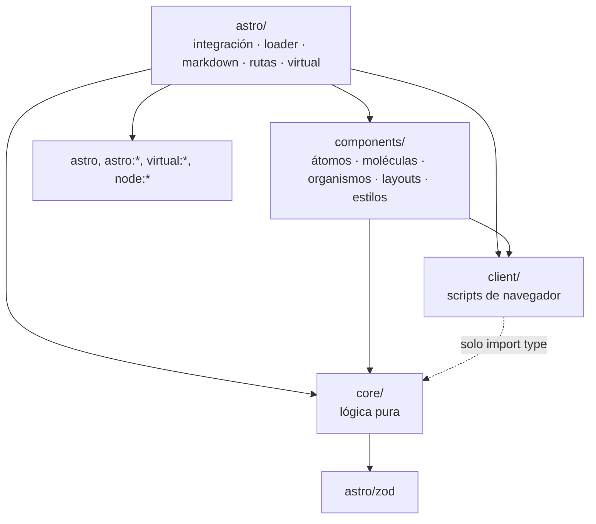

---
seo:
  title: "Estructura de src: capas, reglas y mapa de archivos"
  description: "Las capas de src/ y qué puede importar cada una, las reglas numeradas, cómo las hace cumplir ESLint y el mapa de cada archivo, más el contrato público del paquete."
---

# Estructura

Esta página explica cómo se reparte `src/`, qué puede importar cada parte y qué hace cada archivo. Al
terminarla sabrás dónde va un cambio nuevo y por qué ESLint rechaza ciertos imports.

## Las capas

| Capa | Qué contiene | Puede importar |
| --- | --- | --- |
| `core/` | Lógica pura: config, contenido, enlaces, navegación, i18n, SEO, analítica. | Solo `core/` y `astro/zod`. |
| `client/` | JavaScript del navegador: tema, búsqueda, consentimiento, pestañas, zoom… | Solo **tipos** de `core/` (`import type`). |
| `components/` | Componentes `.astro` presentacionales y estilos. Reciben props, no buscan datos. | `core/` y `client/`. Nada de `astro`, `astro:*`, `virtual:*` ni la carpeta `astro/`. |
| `astro/` | El adaptador: integración, loader, plugins de Markdown, rutas, módulo virtual. | Todo, con las reglas de subcapa de más abajo. Es la única capa que conoce Astro. |
| `testing/` | Utilidades de test (no se distribuye). | Todo. |



Las flechas son las únicas direcciones permitidas. Fíjate en lo que **no** hay:

- `core/` no apunta a nada salvo a zod: ni Node (`node:*`), ni Astro, ni el módulo virtual. Es puro.
- `client/` no importa valores del núcleo. El código de navegador se empaqueta para el cliente, y
  arrastrar valores de `core/` metería en el bundle código que no pinta nada en el navegador. Los
  datos que necesita le llegan por atributos `data-*` del HTML.
- `components/` no ve `astro/`: un componente no lee la colección ni el módulo virtual. Eso lo hacen las
  **rutas** de `astro/routes/` (contenedores), que le pasan el modelo a las páginas de
  `components/pages/` (presentacionales: solo pintan).

## Las reglas numeradas

Algunas reglas del repo llevan un código (`N1`, `N4`…) para poder citarlas en comentarios, en
`eslint.config.mjs` y en los mensajes de commit. La numeración tiene huecos: son las reglas que siguen
vigentes. Esta es la lista, con dónde se explica cada una:

| Código | Regla | Dónde |
| --- | --- | --- |
| N1 | Un componente no deriva: recibe un modelo de vista ya calculado por una función pura, y las URLs le llegan por un puerto. | [Recetas](./mantenimiento.md#recetas) |
| N2 | Toda URL que enlaza un listado sale de una sola función, y un test comprueba que cada enlace existe. | [Mantenimiento](./mantenimiento.md#tests) |
| N3 | Dentro de `astro/`, `data/` no importa `routes/`, `views/` ni `components/`. | [Subcapas de `astro/`](#subcapas-de-astro) |
| N4 | Dentro de `core/`, la config no depende de los dominios que la usan, y lo compartido no conoce ningún dominio. | [Dependencias dentro de `core/`](#dependencias-dentro-de-core-n4) |
| N5 | Los tipos salen del esquema zod (`z.infer`), no de una interfaz que repita los campos. | [Recetas](./mantenimiento.md#recetas) |
| N6 | Cada regla de URL tiene un único dueño: si una URL sale mal, se arregla ahí. | [Una página de principio a fin](./build.md#dónde-mirar-cuando-algo-falla) |
| N8 | Lo que el CSS no distingue se marca en el HTML, en positivo (`p.docs-screenshot`). | [Mantenimiento](./mantenimiento.md#convenciones) |
| N9 | Dos o más parámetros opcionales van en un objeto con nombre. | [Mantenimiento](./mantenimiento.md#convenciones) |
| N10 | Un organismo solo compone moléculas y átomos. | [Recetas](./mantenimiento.md#recetas) |
| N11 | Todo ajuste que cambia por carpeta vive en `content.folders` y se hereda en un solo sitio. | [Recetas](./mantenimiento.md#recetas) |
| N12 | Toda opción de valores cerrados es una constante exportada. | [Recetas](./mantenimiento.md#recetas) |
| N13 | La config tiene tres grupos, cada uno con su módulo. | [Recetas](./mantenimiento.md#recetas) |
| N14 | El frontmatter solo lleva el contenido de la página. | [Recetas](./mantenimiento.md#recetas) |
| N15 | Los tipos públicos de la config se comprueban con casos en `src/testing/config-types.ts`. | [Mantenimiento](./mantenimiento.md#tests) |

### Dependencias dentro de `core/` (N4)

Dentro del núcleo también hay direcciones:

- **`core/config/`** no importa **valores** de `core/navigation/`, `core/listing/`, `core/seo/` ni
  `core/seo-on-page/`: esos dominios leen la config, no al revés. Puede usar `core/content/`,
  `core/i18n/` y `core/shared/`, y tipos de cualquiera con `import type`. Por eso
  `DEFAULT_TOC_DEPTH` vive en `core/config/layout.ts` y `core/navigation/toc-entries.ts` lo importa
  de ahí.
- **`core/shared/`** no importa ningún dominio de `core/`: texto, paginación y URLs genéricas que
  cualquiera puede usar (`paginate`, `humanize`, `folderLabel`, `withBase`).

### Subcapas de `astro/`

Dentro de `astro/` los datos y la presentación tampoco se importan entre sí: solo `routes/` conoce a los dos.

- `views/` (modelos de vista) no importa `astro:*`, el paquete `astro` ni `data/`, y tampoco `components/`.
- `loader/` no importa `integration/`.
- `data/` no importa `routes/`, `views/` ni `components/` (tampoco sus tipos). Si una ruta necesita
  datos y una vista, los lee de `data/` y se los pasa a `views/`: `routes/doc.astro` lee las fechas de
  commit y optimiza las portadas (`data/covers.ts`) y llama a `docListingView`.
  Sin excepciones: el adaptador del panel (`data/seo-on-page/`) tampoco; las rutas del panel arman
  sus enlaces (`views/seo-on-page/hrefs`).
- La ruta construye el contexto del sitio (`siteContext`) una vez por render y lo pasa a cada vista
  (`docView`, `docListingView`, `docNavTrees`); `docRoutes` resuelve el listado de cada ruta una vez.

### Valla del panel de desarrollo

El panel `seo-on-page` solo existe en desarrollo, así que nada de lo publicado puede importarlo: ni
`components/` (fuera de `components/seo-on-page/`), ni `client/` (fuera de `client/seo-on-page/`), ni
`astro/routes/` (fuera de `routes/seo-on-page/`). Los textos del panel viven en
`core/seo-on-page/labels.ts` para que tanto sus vistas como sus componentes los lean sin cruzarse.

## Cómo lo hace cumplir ESLint

`eslint.config.mjs` aplica `@typescript-eslint/no-restricted-imports` por carpeta con una función
`layer(folder, paths, patterns)`:

- Los imports relativos se detectan por el nombre de la carpeta (`relativeTo([...])`, o
  `siblingOf([...])` para las subcapas de `astro/`), y `astro:*`, `virtual:*` y `node:*` por patrón.
- El paquete `astro` va por `paths` (coincidencia exacta), para no atrapar también `astro/zod`.
- En `client/` y en `core/config`, `allowTypeImports: true` deja pasar los `import type`.

`src/testing/boundaries.test.ts` lintea fragmentos con la ruta de cada capa y comprueba que cada
import prohibido **sigue saltando**: si alguien borra una regla, el test falla.

## El resto de reglas de ESLint

- **Sin `enum`.** El paquete publica `.ts` sin compilar y `enum` no es sintaxis borrable. En su
  lugar, un objeto `as const` más un tipo derivado:

  ```ts
  export const MissingTranslation = { LINK: 'link', OMIT: 'omit', FALLBACK: 'fallback' } as const;
  export type MissingTranslation = (typeof MissingTranslation)[keyof typeof MissingTranslation];
  ```

  Así están `MissingTranslation`, `PanelState`, `LayoutWidth` y `NavIcon`.
- **Sin linting con tipos.** `astro check` ya es el dueño de los tipos, y el parser tendría que
  generar un `.tsx` por cada `.astro`.
- **Accesibilidad.** `eslint-plugin-astro` con su configuración `jsx-a11y-recommended`.
- **Formato.** `eslint-config-prettier` va el último: el formato es solo cosa de Prettier.
- `playground/` está en `ignores`: es un consumidor con sus propias comprobaciones.

## Por qué así

- **Tests rápidos y fiables.** Casi toda la lógica está en `core/` y se prueba con funciones puras.
  Lo que necesita Astro se prueba con el contenedor de Astro (`testing/render.ts`) o con builds de
  fixtures.
- **Un solo sitio que cambia con Astro.** Cuando Astro cambia una API, el impacto queda en
  `astro/`. El resto no lo nota.
- **Componentes reutilizables.** Como `components/` solo recibe props, un componente se puede renderizar en
  un test o en otra página sin montar la colección ni el módulo virtual.

## El mapa de `src/`

Los tests viven **junto a su archivo** (`slug.ts` y `slug.test.ts`), así que aquí solo aparece el
código (tampoco las fixtures de los tests). Las rutas son relativas a `src/`. Un test, `src-map.test.ts`,
comprueba que este mapa nombra cada archivo y cada carpeta.

::::tabs
:::tab[core/]
**`core/`: la lógica pura**

```text
core/
├── author.ts              Quien mantiene la librería: firma por defecto de sus docs
├── errors.ts              DocsError (archivo, línea, pista) y DocsErrors (varios a la vez)
├── config/
│   ├── schema.ts          Esquema zod de la config pública (compone `site`, `i18n`, `content` y valida lo que cruza grupos); de aquí sale DocsUserConfig
│   ├── site.ts            `site`: esquema, ResolvedSite y resolveSite (nombre, favicon, tema, componentes, pie, disposición, `seo` y `analytics`)
│   ├── i18n.ts            `i18n`: esquema, ResolvedI18n y resolveI18n (idiomas, `missing` y textos de interfaz)
│   ├── content.ts         `content`: esquema, ResolvedContent y resolveContent (carpeta, exclusiones, externas, estáticas, edición, `nav`, `sidebar` y `folders`)
│   ├── shared-schemas.ts  Piezas de esquema compartidas: textos traducibles, imágenes, JSON-LD y el `seo` de una página
│   ├── resolve.ts         Valida y rellena valores por defecto → ResolvedConfig { site, i18n, content } (la misma forma que la pública); ConfigPick
│   ├── layout.ts          PanelState, LayoutWidth y la disposición por defecto
│   ├── folders.ts         `folders`: ListingView, TreeShow, ALL_FOLDERS, su esquema y la herencia por carpeta (folderSettings, con declaredAt); valida sus claves
│   ├── nav.ts             NavIcon y los tipos de los elementos de nav
│   └── footer.ts          Tipos del pie
├── content/
│   ├── content-dir.ts     Carpeta de las páginas nativas por defecto y su validación
│   ├── static-folders.ts  Carpetas de `static` (publicadas tal cual): validación, a qué carpeta casa una petición y qué excluye
│   ├── exclude.ts         Patrones de `exclude` (estilo `.gitignore`) → qué `.md` no se publica
│   ├── discovery.ts       Archivos → páginas (slug, idioma, título, orden); externos
│   ├── frontmatter.ts     Separa y valida el frontmatter (conserva las líneas del cuerpo)
│   ├── generated-listings.ts  Índices generados según `folders`: qué carpetas, qué página lista (listsFolder), las generadas, el `index.md` que gana y el error de un `_index.md` sin `generate`
│   ├── stored-page.ts     Una entrada de la colección (su forma, sin Astro) → Page
│   ├── slug.ts            guia/index → guia, index → '' (portada); qué es un _index y de qué carpeta
│   ├── screenshots.ts     El único dueño de la marca de captura: un párrafo con una sola imagen → p.docs-screenshot (lo usa Article)
│   ├── scrollable-tables.ts  El único dueño del .table-scroll: envuelve cada <table> (lo usa Article) sin repetir uno escrito a mano
│   └── title.ts           Primer h1 o title del frontmatter; sin ninguno, error
├── i18n/
│   ├── locale.ts          Idiomas, sufijos de archivo, idioma de una URL
│   ├── availability.ts    pageUrl y pageUrlOf (LAS funciones de URLs), prefijo de idioma y qué idiomas tiene cada página
│   ├── translation-policy.ts  MissingTranslation, políticas por grupo, rutas de reserva
│   └── ui-strings.ts      Catálogo de textos de interfaz en/es, translate() e interpolación
├── links/
│   ├── rewrite.ts         Enlaces relativos (.md y archivos de `static`) → URLs del sitio, con referencias para validar
│   ├── anchors.ts         Índice de encabezados y validación de #anclas
│   └── fences.ts          No tocar enlaces dentro de bloques de código
├── listing/               El índice generado de una carpeta
│   ├── options.ts         resolveListing: el listado resuelto (lista o paginado) desde los ajustes de `folders`
│   ├── entries.ts         buildListing (visitante de nav-walk): entradas, secciones y orden por fecha
│   ├── covers.ts          Portada guardada, la que se pinta y el dibujo de la librería
│   ├── urls.ts            Dueño de las URLs de un listado: page/ y per-page/, posiciones y nombres reservados
│   └── view.ts            ListingView (unión por disposición), el puerto ListingHrefs y buildListingView
├── navigation/
│   ├── sidebar.ts         Árbol de la barra lateral desde la config y las páginas (profundidad: `tree.depth` de `folders`)
│   ├── folder-labels.ts   Qué grupo declarado es dueño de cada carpeta (groupFolders: su etiqueta enlaza la página de la carpeta) y el título de una carpeta sin `_index.md`
│   ├── sidebar-slugs.ts   Valida los slugs de sidebar
│   ├── nav-sections.ts    Secciones por dir, validación de nav
│   ├── nav-sidebar.ts     La barra lateral de un ámbito (NavScope: una sección o las páginas sin sección) y la de una página (buildScopedSidebar, con `tree.show`)
│   ├── folder-tree.ts     `tree.show: TreeShow.ALL`: el árbol completo de una carpeta (secciones como grupos, páginas sin sección) sobre nav-walk
│   ├── nav-walk.ts        El único recorrido de la nav: ámbitos, árboles de contenido y de ruta, visitantes
│   ├── nav-entries.ts     Elementos de la cabecera ya resueltos para una página
│   ├── nav-tree.ts        Árbol de cada sección para ::nav-tree (visitante de nav-walk) y los huecos que deja en el HTML
│   ├── prev-next.ts       Anterior / siguiente en el orden aplanado
│   ├── page-window.ts     Qué números de página enseñar en una paginación y dónde van los huecos
│   ├── toc-entries.ts     Encabezados de Astro → entradas del índice «En esta página»
│   ├── edit-href.ts       Enlace para editar el archivo en el repositorio
│   ├── footer.ts          Vista del pie y validación de sus enlaces
│   └── label.ts           Etiqueta por idioma con recurso al idioma por defecto
├── seo/
│   ├── meta.ts            Cascada página > base > derivado de título, descripción e imagen
│   ├── title.ts           Sufijo del título (página > sitio > `name`, o ninguno) y `título | sufijo`
│   ├── head.ts            Etiquetas del head: title, canonical, hreflang, OG, twitter
│   ├── page-head.ts       El head de una página del sitio que no es de docs: meta, alternates y JSON-LD extra
│   ├── seo-schema.ts      El bloque `seo` del frontmatter como fragmento zod reutilizable
│   ├── json-ld.ts         Schemas JSON-LD del sitio y de cada página
│   ├── sitemap.ts         XML con alternates y lastmod (también el de las páginas de docs); límite de 50 000 URLs
│   ├── lastmod.ts         Salida de git log → fecha por archivo; fecha de cada URL del sitemap
│   ├── indexable.ts       Qué URLs son noindex
│   ├── client-pages.ts    Las páginas que el consumidor tiene en src/pages/ y sus rutas dinámicas
│   ├── html-head.ts       Lee del HTML construido lo que una página dice de sí misma
│   ├── image-refs.ts      Qué imágenes SEO hay que comprobar
│   ├── image-checks.ts    Peso y proporción de la imagen OG (avisos)
│   └── favicon.ts         Favicon por defecto (/_design/favicon.png) o el del consumidor
├── analytics/resolve.ts   PUBLIC_GTM_ID / gtmId → id validado y enlace de privacidad por idioma
├── shared/
│   ├── text.ts            Plurales, listas legibles y el nombre legible de una carpeta
│   ├── paginate.ts        La única matemática de páginas (trozo, páginas, rango): panel SEO e índices
│   ├── urls.ts            Quita las barras finales de la base
│   └── tones.ts           TagTone: los tonos de Tag y de las marcas del panel
└── seo-on-page/           La lógica del panel SOLO de dev (ver Integración → SEO on page)
```

El panel guarda su lógica en `core/seo-on-page/`, también pura: parte de un árbol de páginas, lo analiza
y prepara el modelo de cada pantalla.

```text
core/seo-on-page/
├── tree/                  El árbol de páginas sobre el que trabaja todo el panel
│   ├── types.ts           SeoPage, SeoTree, Issue y los tipos que comparten todos
│   ├── input.ts           Lo que el análisis recibe de cada página
│   ├── build-tree.ts      Entradas → árbol, con sus problemas y su orden estable
│   ├── keys.ts            Clave de una página en un idioma y su etiqueta
│   └── locale-cells.ts    Estado de cada idioma de una página (falta, reserva, omitida)
├── nodes/                 Cada porción del árbol, calculada desde su fuente
│   ├── meta.ts            Título, descripción y de dónde vienen
│   ├── headings.ts        Encabezados en el orden del documento
│   ├── locales.ts         Idiomas disponibles y su estado
│   ├── navigation.ts      La parte de la config que la navegación necesita
│   ├── content.ts         Enlaces e imágenes del cuerpo, tal como los deja el loader
│   └── client-page.ts     Las páginas del consumidor entran al árbol
├── analyzers/             Un análisis por tipo de problema; cada uno devuelve Issue
│   ├── issue.ts           Construye un Issue con su gravedad por defecto
│   ├── metadata.ts        Título y descripción frente a los límites del buscador
│   ├── headings.ts        Un solo H1 y sin saltos de nivel
│   ├── canonical.ts       Cada idioma es canónico de sí mismo
│   ├── multilingual.ts    Traducciones ausentes y políticas en conflicto
│   ├── links.ts           Enlaces a noindex y páginas huérfanas
│   ├── images.ts          Imágenes sin texto alternativo y OG fuera de medida
│   └── fixes.ts           Dónde se arregla cada problema (frontmatter o .astro)
├── pages/                 El modelo de cada pantalla, ya digerido
│   ├── links.ts           Puerto de enlaces: lo implementa astro/ para respetar base y barra final
│   ├── overview/          Resumen: model.ts, coverage.ts, indexing.ts
│   ├── listing/           Tabla de páginas: model.ts, rows.ts, entries.ts, group.ts, have.ts,
│   │                      matrix.ts, kinds.ts, severities.ts, selection.ts, common.ts
│   └── inspector/         Una página: model.ts, compare.ts
├── queries/               Consultas puras sobre el árbol
│   ├── url-filters.ts     Filtros de la tabla ↔ query de la URL
│   ├── filter.ts          Qué problemas cumplen los filtros
│   ├── page-sizes.ts      Tamaños de página de la tabla (por defecto y elegibles)
│   ├── priorities.ts      Qué arreglar primero
│   ├── summary.ts         Resumen de schemas
│   ├── outline.ts         Esquema de encabezados con sus saltos
│   ├── heading-counts.ts  Qué falla en la estructura de encabezados
│   ├── code-spans.ts      Trocea un mensaje en texto y nombres de código
│   └── clip.ts            Recorta con «…» como el buscador
├── report/                El informe «copiar para la IA»
│   ├── scope.ts           De qué trata un informe: sitio, página o filtro
│   ├── report.ts          Informe de un alcance
│   ├── texts.ts           Los textos que el diálogo necesita, ya generados
│   ├── prompt.ts          El prompt de cada problema
│   ├── issue-section.ts   Sección de problemas del informe
│   ├── issues-report.ts   Tabla de una página para el informe
│   ├── lacks-report.ts    Lo que le falta a cada entrada
│   ├── lacks.ts           Recuentos «sin …»
│   ├── kinds.ts           Nombres de los tipos de problema en el informe
│   ├── content-dirs.ts    Carpetas de las páginas nativas
│   ├── format.ts          Valor con su longitud y su ancho
│   └── size.ts            Cuánto ocupa un texto
├── catalog.ts             Catálogo de problemas: gravedad, certeza y por qué importa
├── severity.ts            Las gravedades y su orden
├── thresholds.ts          Límites de título y descripción
├── pixels.ts              Estimación del ancho en píxeles
├── have.ts                Qué tiene cada entrada (columnas de «Qué tiene»)
├── key-place.ts           Dónde vive cada clave: frontmatter de un .md o head de un .astro
├── site-files.ts          Los archivos del sitio que el panel enseña (robots, sitemap…)
└── labels.ts              Textos del panel: los comparten sus vistas y sus componentes
```
:::
:::tab[client/]
**`client/`: el navegador**

Cada archivo exporta funciones `init*` que reciben lo que necesitan (documento, `Storage`,
`matchMedia`…) en vez de leer globales, para poder probarlas con dobles.

```text
client/
├── diagrams/           Diagramas de Mermaid
│   ├── mermaid.ts        Convierte los bloques .docs-mermaid en SVG con los colores del tema
│   ├── diagram-viewer.ts Visor a pantalla completa: zoom, arrastre y teclado
│   ├── diagram-view.ts   La matemática del visor, sin DOM
│   ├── selector.ts       El selector de los bloques, aparte para buscarlos sin cargar Mermaid
│   └── token.ts          Lee un token de color del <html> ya resuelto al tema activo
├── layout/             La disposición de la página
│   ├── layout.ts         Columnas plegables y ancho; script previo al pintado
│   ├── rail.ts           A partir de qué ancho existe el raíl de los laterales
│   ├── nav-open.ts       Pliega o abre el menú antes del primer pintado
│   ├── sidebar-scroll.ts Recuerda el desplazamiento de la barra lateral
│   ├── toc.ts            Resalta la sección visible en el índice
│   └── year.ts           Año del pie con el reloj del visitante
├── content/            Lo que enriquece el contenido
│   ├── anchors.ts        Enlace a cada encabezado
│   ├── zoom.ts           Ampliación de imágenes en un <dialog>
│   ├── copy-code.ts      Botón de copiar en los bloques de código
│   ├── auto-navigate.ts  Un select[data-auto-navigate] lleva a la URL elegida (el «Por página» de un listado)
│   └── tabs.ts           Pestañas accesibles con teclado
├── preferences/        Lo que elige el visitante y se guarda
│   ├── theme.ts          Tema claro/oscuro, script previo al pintado, revelado circular
│   ├── consent.ts        Banner de consentimiento, carga de GTM, borrado de cookies
│   └── storage.ts        Acceso seguro a localStorage/sessionStorage y sus claves
├── seo-on-page/        El JavaScript del panel SOLO de dev
│   ├── boot.ts           Arranque del panel
│   ├── auto-submit.ts    Los filtros envían su formulario al cambiar
│   ├── kinds-all.ts      La casilla «Todos» de los tipos de problema
│   ├── popover.ts        Los <details> emergentes se cierran al pulsar fuera
│   └── report.ts         El diálogo «Copiar para la IA»
├── clipboard.ts        Copiar con confirmación o fallo
├── text.ts             Rellena las {variables} de una plantilla (el cliente no importa translate())
├── search.ts           Pagefind: carga bajo la base, resultados, atajo «/»
└── transition.ts       Envoltorio de la View Transitions API con movimiento reducido
```
:::
:::tab[components/]
**`components/`: lo que se ve**

Diseño atómico. Ningún componente lee datos por su cuenta: todo llega por props, incluidos los
textos (`strings: UiStrings`).

```text
components/
├── atoms/
│   ├── form/        Checkbox, FieldError, HelpText, Input, Label, Radio, Select, Switch, Textarea
│   ├── actions/     Button, Link, CookieSettingsButton (reabre el aviso de consentimiento);
│   │                variants.ts: las clases de cada variante de Link, que reutilizan el botón y los índices
│   └── display/     Heading, Icon, InlineList, Tag, Text, CoverPlaceholder (portada de un índice),
│                    DateLabel (<time> con la fecha ya formateada)
├── molecules/
│   ├── form/        FormField, RadioGroup y describedby.ts (el aria-describedby de un campo)
│   ├── navigation/  EditLink, LocaleSwitch, NavList, NavTree, Pagination, PrevNext, TableOfContents,
│   │                PageLink (enlace con la insignia de idioma), SectionPath (camino «Sección › Grupo»),
│   │                ListingTree (árbol de un índice generado), PerPageSelector (el «Por página» de un
│   │                listado: navegación, con enlaces en <noscript>), PaginationBar
│   │                (fila de pie: por página a un lado, rango y paginador al otro)
│   ├── content/     Admonition, FallbackNotice, SectionHead, Tabs, ListingCard (una tarjeta de un índice)
│   └── controls/    PanelToggle, ThemeToggle
├── organisms/
│   ├── chrome/      DocsHeader, DocsFooter, Sidebar, SidebarList, SearchBox, BackToTop, ConsentBanner, Head
│   └── content/     Article (contenido con diagramas y anclas, y la columna del índice y un aside);
│                    Listing con ListingList, ListingTable y ListingCards (las disposiciones de un índice generado)
├── seo-on-page/ Lo propio del panel SOLO de dev, por nivel atómico (lo genérico va arriba)
│   ├── atoms/       IssueBadge (sobre Tag), SeverityTag, CertaintyTag, LengthMeter, LocaleBadge,
│   │                Note, StateMark
│   ├── molecules/   SerpPreview, OgPreview, ResultsCount, InfoHiddenNote, FiltersForm,
│   │                OverviewCard, StatRow, CodeSpans, InspectorSection, CopyPromptButton, DataTable,
│   │                EmptyNotice, Kpi, LocaleDetailCard, PanelNotice, ReportButton, RowHeader,
│   │                TableHead, ViewSwitch
│   ├── organisms/   Una sección por componente, agrupadas por pantalla; PanelIntro va suelta
│   │   ├── overview/    OverviewKpis y las tarjetas del Resumen (FixFirstCard, CoverageCard,
│   │   │                IndexingCard, SchemasCard, KindsCard, SiteFilesCard, RouteOverridesNotice)
│   │   ├── listing/     PagesListing, PagesTable, EntriesTable, HaveTable, LanguageMatrix,
│   │   │                CommonIssueNotice, TableFooter
│   │   ├── inspector/   InspectorHeader, FixList, PublishedFacts, Translations, SchemasList,
│   │   │                HeadingsOutline
│   │   └── shared/      ClientPageFailures, ReportDialog (las usan varias pantallas)
│   ├── pages/       OverviewPage, PagesPage, InspectorPage: las pantallas del panel, presentacionales
│   └── tables.ts    Clases de la celda y del filete de las tablas del listado
├── boot/        Arranque del JavaScript de cliente que comparten layouts y organismos, sin subir de nivel
│   ├── env.ts       BootEnv y browserEnv(): el navegador inyectable que reciben los `init*`
│   └── article.ts   bootArticle: pestañas, copiar, anclas, zoom, diagramas e índice de un `Article`
├── pages/       Páginas presentacionales: reciben el modelo por props y solo pintan (DocPage)
├── layouts/
│   ├── BaseLayout.astro     <html>, <head>, tema, CSS y consentimiento; sin cabecera ni pie
│   ├── DocsLayout.astro     Página de docs sobre BaseLayout: cabecera, barra, contenido, índice, pie
│   └── boot.ts              Arranque del JavaScript de las páginas (bootBase, bootDocs)
├── styles/
│   ├── theme.css            El punto de entrada: Tailwind y el resto de hojas, en orden
│   ├── site-theme.css       Vacío: lo que `theme.css` importa si el sitio no define `theme`
│   ├── tokens.css           Tokens y paletas de color (claro y oscuro con light-dark())
│   ├── base.css             Reglas base, como las barras de desplazamiento con los colores del tema
│   ├── chrome.css           Disposición de las páginas de docs (columnas, raíl, ancho)
│   ├── components.css       Avisos y anclas de títulos, también fuera de `.prose`
│   ├── prose.css            La prosa del contenido
│   ├── code.css             Bloques de código y su paleta oscura
│   ├── motion.css           Transiciones, solo con movimiento permitido
│   ├── theme-colors.ts      --color-canvas de cada tema para <meta name="theme-color">
│   ├── code-themes.ts       Temas de Shiki emparejados con los tokens
│   └── sitemap.ts           Lee la paleta de tokens.css para la hoja del sitemap
└── assets/favicon.png       Favicon por defecto
```
:::
:::tab[astro/]
**`astro/`: el adaptador**

Dentro de `astro/` los datos (`data/`) y la presentación (`views/`, `routes/`) no se importan entre sí:
solo `routes/` conoce a los dos (ver [Capas](#subcapas-de-astro)).

```text
astro/
├── config.ts                La política de URLs y la config validada o un error de Astro
├── errors.ts                DocsError → AstroError (toAstroError, orAstroError)
├── registry.ts              Rutas del cliente y contador de cambios que la integración comparte con el panel
├── integration/
│   ├── index.ts             Exports públicos: docs, defineDocsConfig, defineDocsSite…
│   ├── docs.ts              docs(): la integración y sus hooks
│   ├── config.ts            defineDocsConfig y los nombres de los archivos de config
│   ├── define-docs-site.ts  defineDocsSite: la config de Astro de un sitio de docs
│   ├── analytics-env.ts     Lee PUBLIC_GTM_ID con loadEnv
│   ├── route-overrides.ts   Avisa de las rutas de la librería que src/pages/ sustituye
│   ├── client-pages.ts      Guarda las páginas del consumidor al resolver las rutas
│   ├── fs-allow.ts          Carpetas que Vite debe servir si el contenido está fuera del proyecto
│   ├── site-theme.ts        Alias de Vite al CSS propio del sitio (opción `theme`)
│   ├── components.ts        El archivo del pie de las páginas de docs (opción `components.Footer`)
│   ├── static-folders-dev.ts  Middleware de dev que sirve las carpetas de `static`
│   ├── tailwind.ts          El plugin de Tailwind, salvo que el sitio ya lo registrase
│   ├── fonts.ts             IBM Plex y el choque de variables de fuente
│   └── build/
│       ├── build-done.ts    Lo que corre en astro:build:done
│       ├── client-sitemap.ts  Suma las páginas del consumidor al sitemap
│       ├── pagefind.ts      Índice de búsqueda tras el build
│       ├── copy-static-folders.ts  Copia a dist/ las carpetas de `static`, tal cual
│       ├── prune-orphan-assets.ts   Borra de `_astro/` los recursos que ningún texto del build enlaza
│       └── bound-animation-loops.ts   Limita a una pasada los WebP animados infinitos
├── loader/
│   ├── index.ts             docsLoader / docsLoaderFromResolved: descubrir, renderizar, validar
│   ├── schema.ts            docsSchema: los datos de cada entrada
│   ├── frontmatter.ts       Lee y valida YAML con archivo y línea
│   ├── repo-root.ts         repoRoot o el .git más cercano, para editPath
│   ├── images.ts            Comprueba las imágenes de public/
│   ├── covers.ts            Comprueba la portada (`index.image`) de cada página; si falta, avisa
│   ├── favicon.ts           Comprueba el favicon local
│   ├── slug-routes.ts       Un `slug` del frontmatter en una ruta de la librería o de src/pages/
│   └── watch.ts             Recarga en astro dev
├── content/
│   ├── index.ts             `collections`: la colección docs con la config del módulo virtual
│   └── missing-integration.ts  El aviso «falta docs(config)» si el módulo virtual no existe
├── markdown/                Plugins mdast y su registro (ver Integración → Markdown)
│   ├── register.ts          Los plugins en su orden
│   ├── processor.ts         Engancha los plugins al procesador de Markdown
│   ├── env.ts               Lo que los plugins saben del sitio
│   ├── path-filter.ts       Qué Markdown transforman nuestros plugins
│   ├── admonitions.ts       Directivas :::tipo
│   ├── github-alerts.ts     Citas > [!NOTE] como cajas de aviso
│   ├── tabs.ts              ::::tabs con :::tab[Etiqueta]
│   ├── nav-tree.ts          ::nav-tree → un h2 por sección de nav y el hueco de su árbol
│   ├── mermaid.ts           Bloques mermaid → .docs-mermaid
│   ├── code-languages.ts    Alias de lenguajes que Shiki no trae
│   └── restore-directives.ts  Devuelve a texto las directivas que nadie reclamó
├── routes/                  SOLO lo que Astro sirve: rutas y endpoints (las inyecta la integración)
│   ├── routes.ts            La tabla de rutas: patrón, fichero y cuándo se inyecta
│   ├── doc.astro            /[...slug]
│   ├── Fonts.astro          Las fuentes de designFonts() (components/ no importa astro:*)
│   ├── sitemap.xml.ts       Endpoint del sitemap (o el índice, con sitemap.include)
│   ├── sitemap-pages.xml.ts Endpoint con las páginas propias cuando sitemap.xml es un índice
│   ├── sitemap.css.ts       Endpoint de la hoja de estilo del sitemap
│   ├── pages-sitemap.ts     Las entradas del sitemap de las páginas propias
│   ├── favicon.png.ts       Endpoint del favicon por defecto
│   └── seo-on-page/         Panel SOLO de dev (ver Integración → SEO on page)
│       └── overview.astro, pages.astro, page.astro
├── views/                   Lógica pura que prepara los datos de cada página (con sus tests)
│   ├── doc.ts               docRoutes (con el listado de cada ruta ya resuelto), docView y docNavTrees
│   ├── doc-listing.ts       El índice generado de una ruta: sus opciones, sus páginas, sus entradas y su paginación
│   ├── index-covers.ts      Portadas del índice → URLs (con la base o con el `getImage` que pasa la ruta)
│   ├── chrome.ts            Lo que cabecera y pie necesitan del sitio
│   ├── pages.ts             El sitemap de las páginas y su índice, como error de Astro si falla
│   └── seo-on-page/
│       ├── hrefs.ts         Rutas del panel y enlaces entre pantallas
│       ├── panel.ts         Lo que DocsLayout recibe en cada pantalla (como docView)
│       └── report.ts        El modelo del diálogo «Copiar para la IA» de cada pantalla
├── data/                    El ÚNICO sitio que lee Astro: la colección y el módulo virtual
│   ├── docs-collection.ts   getDocs / renderDoc tipados para la colección docs
│   ├── site-config.ts       La config del módulo virtual con su tipo completo
│   ├── site.ts              `designStrings` y `gtmId`: la subruta pública `site`
│   ├── image-sizes.ts       Lee los tamaños de las imágenes sociales
│   ├── page-head.ts         `pageHead`: el head de una página del sitio con la config del módulo virtual (subruta `seo`)
│   ├── client-pages.ts      Lee las páginas del consumidor y las que no se pudieron leer
│   ├── last-modified.ts     Fecha de modificación por archivo: un git log para todos, o la fecha del archivo
│   ├── covers.ts            `optimizeCover`: la URL de una portada con `getImage` de astro:assets
│   ├── file-last-modified.ts  `fileLastModified`: la de un solo archivo, la subruta pública `last-modified`
│   └── seo-on-page/
│       └── adapter.ts       Colección + config → SeoInput → árbol (el único que lee astro:content)
└── virtual/
    ├── plugin.ts            Plugins de Vite de virtual:@velezanthony/design/config y del pie
                             (virtual:@velezanthony/design/components/Footer)
    ├── data.ts              Qué viaja en el módulo virtual
    └── virtual.d.ts         Sus tipos, copiados al .astro/ del consumidor
```
:::
:::tab[testing/ y pages/]
**`testing/` y `pages/` (no se distribuyen)**

- `testing/render.ts`: renderiza un componente con el contenedor de Astro y lo devuelve como DOM
  (linkedom).
- `testing/strings.ts`: `stringsFor('es', overrides)` para pasar textos a los componentes.
- `testing/astro-content.ts` y `testing/virtual.ts`: dobles de `astro:content` y del módulo virtual,
  validados con el esquema real para que no diverjan.
- `testing/markdown.ts`: renderiza Markdown con los plugins de la librería.
- `testing/search.ts`: busca en el índice de Pagefind de un `dist/`.
- `testing/seo-page.ts`: una página del árbol del panel con valores razonables.
- `testing/listing-items.ts`: entradas de un índice generado para los tests de sus disposiciones.
- `testing/build.ts` y `testing/case.ts`: construyen proyectos consumidores mínimos descritos como
  datos, para los tests de integración (con un entorno limpio de variables de Vitest).
- `testing/contrast.ts`: luminancia y contraste WCAG para los tests de la paleta.
- `testing/config.ts`: `withConfig(...trozos)` junta trozos de config de prueba grupo a grupo (`site`,
  `i18n`, `content`).
- `testing/config-types.ts`: test de tipos de `defineDocsConfig` (un caso válido con las constantes y
  `@ts-expect-error` en lo que debe rechazar); no se ejecuta, lo comprueba `npm run check`.
- `testing/boundaries.test.ts`: la regla de capas (ver [Capas](#cómo-lo-hace-cumplir-eslint)).
- `testing/src-map.test.ts`: comprueba que este mapa nombra cada archivo y cada carpeta de `src/`.
- `pages/index.astro`: la página mínima que sirve `npm run dev` en la raíz.
:::
::::

## El contrato público

Lo que un consumidor puede importar está fijado en `"exports"` del `package.json`:

| Subruta | Apunta a |
| --- | --- |
| `@velezanthony/design/integration` | `src/astro/integration/index.ts` |
| `@velezanthony/design/loader` | `src/astro/loader/index.ts` |
| `@velezanthony/design/content` | `src/astro/content/index.ts` |
| `@velezanthony/design/components/*` | `src/components/*` |
| `@velezanthony/design/theme.css` | `src/components/styles/theme.css` |
| `@velezanthony/design/site-theme` | `src/components/styles/site-theme.css` |
| `@velezanthony/design/theme-colors` | `src/components/styles/theme-colors.ts` |
| `@velezanthony/design/code-themes` | `src/components/styles/code-themes.ts` |
| `@velezanthony/design/client/theme` | `src/client/preferences/theme.ts` |
| `@velezanthony/design/client/consent` | `src/client/preferences/consent.ts` |
| `@velezanthony/design/client/storage` | `src/client/preferences/storage.ts` |
| `@velezanthony/design/client/toc` | `src/client/layout/toc.ts` |
| `@velezanthony/design/last-modified` | `src/astro/data/file-last-modified.ts` |
| `@velezanthony/design/head` | `src/core/seo/head.ts` |
| `@velezanthony/design/ui-strings` | `src/core/i18n/ui-strings.ts` |
| `@velezanthony/design/site` | `src/astro/data/site.ts` |
| `@velezanthony/design/seo` | `src/astro/data/page-head.ts` |
| `@velezanthony/design/seo-schema` | `src/core/seo/seo-schema.ts` |
| `@velezanthony/design/fonts` | `src/astro/routes/Fonts.astro` |

Mover un archivo a los que apunta una de estas subrutas es un cambio incompatible para los
consumidores. `src/astro/integration/public-api.test.ts` sujeta lo que exporta la integración.

## Siguiente paso

Cómo se genera el sitio, paso a paso: [Cómo se genera el sitio](./build.md).
