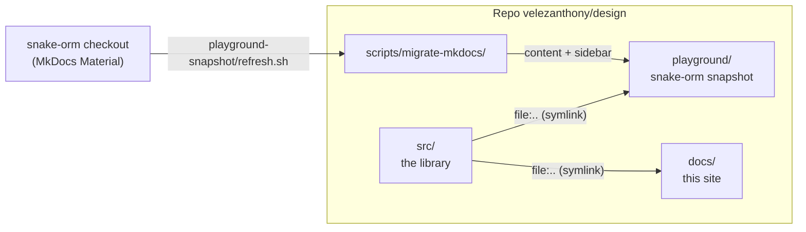

# Internals

> [!IMPORTANT]
> This library does not accept contributions. If you want to adapt it, fork it: this section explains
> how it is designed and how to maintain it.

This section is the maintenance documentation: I write it for myself and for anyone maintaining their
own copy. Start here to learn what is in the repository and why only part of it reaches whoever
installs the library. If you are going to fork it, continue with [Fork the library](./hacer-un-fork.md).

## What is in the repo

| Folder | What it is | Shipped? |
| --- | --- | --- |
| `src/` | The library | Yes: it is the only thing that ships |
| `playground/` | A real consumer with snake-orm content | No |
| `docs/` | This site, built with the library itself | No |
| `scripts/` | The MkDocs migrator and CI utilities | No |
| `astro.config.mjs` + `src/pages/` | A minimal project, without the integration, for `npm run dev` and `npm run check` | No |



- **`playground/`** is a consumer made with the Astro scaffold, as in
  [Your first site](../guia/primer-sitio.md), but it depends on `file:..`: editing `src/` hot-reloads
  it. Its content (two languages, generated API, an external `CHANGELOG.md`) exercises almost
  everything, and `showcase/` covers what snake-orm does not use. It is regenerated with
  `scripts/playground-snapshot/refresh.sh <snake-orm checkout> <python with griffe2md>`, which only
  labels a code block without a language when it is unambiguous (`console` or `sql`). It is outside
  ESLint, Prettier and the root `tsconfig.json`.
- **`docs/`** is this site: in Spanish and English, two sections and analytics only when deployed. It
  is the best smoke test: if a change in `src/` breaks something used here, `npm run docs:build` fails.
  It is published with `.github/workflows/docs.yml` (see
  [Publish a release](./versiones.md#the-documentation-site)).

```sh
npm run playground:dev   # or :build, :check
npm run docs:dev         # or :build (must finish without warnings), :check
```

## Why only `src/` goes into the package

`playground/` and `docs/` are npm workspaces and share `node_modules` with the library, but none of
them reaches whoever installs `github:velezanthony/design#v0.2.0`. There are six independent barriers:

| Barrier | What it does |
| --- | --- |
| The `"files"` allowlist | Only `src/` (minus `pages/`, `testing/`, `fixtures/` and the `*.test.ts`), `README.md` and `package.json` go in. |
| A git dependency gets packed | npm clones the repo and packs it with the `npm pack` rules: `"files"` rules from git too. |
| A dependency's workspaces are ignored | npm only reads `"workspaces"` in the root project. |
| Tailwind only scans `src/` | The `@source '../../'` in `theme.css` points at `src/`; a test pins it. |
| A guard test | `src/testing/package-contents.test.ts` runs `npm pack --dry-run` and fails if anything slips in. |
| Each workspace has its own output | `playground/dist/` and `docs/dist/` are in `.gitignore`; the site deploys with its own workflow. |

:::tip[Check it yourself]{collapsed}
Check it from the root; the expected output is `[ 'README.md', 'package.json' ]`:

```sh
npm pack --dry-run --json | node -e 'const [p] = JSON.parse(require("fs").readFileSync(0)); console.log(p.files.map((f) => f.path).filter((f) => !f.startsWith("src/")))'
```
:::

> [!WARNING]
> A new folder outside `src/` stays out on its own. What needs care is adding something inside `src/`
> that must not ship (a fixture with another name, a test helper): add its negated pattern to
> `"files"` and check it with `npm pack --dry-run`.

## The MkDocs migrator

What it does is explained in [Migrate from MkDocs](../guia/migrar-desde-mkdocs.md). Each conversion is
a **pure function** (it takes text and returns `{ output, log }`) in its own module, with its test next
to it; I/O is injected. Its tests run in `npm test`.

| Folder | Responsibility |
| --- | --- |
| `cli.ts` | Parses arguments and wires the modules. |
| `conversions/blocks/` | Blocks: callouts (`!!!`, `???`), tabs, code, mkdocstrings and `<div markdown>` cards. |
| `conversions/inline/` | Running text: icons, `attr_list`, heading ids, autorefs and links. |
| `checks/` | Checks on the result: leftovers, links to stubs and anchors. |
| `pipeline/` | The pure composition, in a fixed order, and its utilities. |
| `modes/` | `in-place` and `to-folder` (`--out`), with what they share: reading `mkdocs.yml`, suggested config, warnings and `--api`. |
| `api/` | `generate-api.py` (griffe2md) and its clean-up, for any Python repo. |
| `io/` | Node fs and git, the git guard, flag validation and the report texts. |

`scripts/playground-snapshot/refresh.sh` lives apart because it uses the migrator; the migrator does
not depend on snake-orm.

## Next step

If you are going to maintain your own copy: [Fork the library](./hacer-un-fork.md). Otherwise, continue
with [Structure](./estructura.md).
