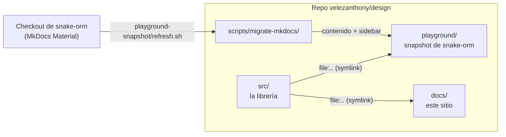

---
seo:
  title: "Por dentro: cómo está hecha la librería"
  description: "Qué hay en el repositorio (la librería, el playground, este sitio y el migrador), cómo se relacionan y por qué solo src/ llega al paquete. Para mantener un fork."
---

# Por dentro

> [!IMPORTANT]
> Esta librería no acepta contribuciones. Si quieres adaptarla, haz un fork: esta sección explica cómo
> está pensada y cómo mantenerla.

Esta sección es la documentación de mantenimiento: la escribo para mí y para quien mantenga su propia
copia. Empieza aquí para saber qué hay en el repositorio y por qué solo una parte llega a quien instala
la librería. Si vas a hacer un fork, sigue después con [Hacer un fork](./hacer-un-fork.md).

## Qué hay en el repo

| Carpeta | Qué es | ¿Se distribuye? |
| --- | --- | --- |
| `src/` | La librería | Sí: es lo único que viaja |
| `playground/` | Un consumidor real con contenido de snake-orm | No |
| `docs/` | Este sitio, hecho con la propia librería | No |
| `scripts/` | El migrador de MkDocs y utilidades de CI | No |
| `astro.config.mjs` + `src/pages/` | Un proyecto mínimo, sin la integración, para `npm run dev` y `npm run check` | No |



- **`playground/`** es un consumidor hecho con el scaffold de Astro, como en
  [Tu primer sitio](../guia/primer-sitio.md), pero depende de `file:..`: editar `src/` lo recarga en
  caliente. Su contenido (dos idiomas, API generada, un `CHANGELOG.md` externo) ejercita casi todo, y
  `showcase/` prueba lo que snake-orm no usa. Se regenera con
  `scripts/playground-snapshot/refresh.sh <checkout de snake-orm> <python con griffe2md>`, que solo
  etiqueta un bloque de código sin lenguaje cuando es inequívoco (`console` o `sql`). Está fuera de
  ESLint, Prettier y del `tsconfig.json` de la raíz.
- **`docs/`** es este sitio: en español e inglés, dos secciones y analítica solo en el despliegue. Es el
  mejor test de humo: si un cambio en `src/` rompe algo que se usa aquí, `npm run docs:build` falla. Se
  publica con `.github/workflows/docs.yml` (ver [Publicar una versión](./versiones.md#el-sitio-de-documentación)).

```sh
npm run playground:dev   # o :build, :check
npm run docs:dev         # o :build (debe terminar sin avisos), :check
```

## Por qué solo `src/` entra en el paquete

`playground/` y `docs/` son workspaces de npm y comparten `node_modules` con la librería, pero nada de
ellos llega a quien instala `github:velezanthony/design#v0.2.0`. Hay seis barreras independientes:

| Barrera | Qué hace |
| --- | --- |
| La lista blanca `"files"` | Solo entran `src/` (menos `pages/`, `testing/`, `fixtures/` y los `*.test.ts`), `README.md` y `package.json`. |
| Una dependencia de git se empaqueta | npm clona el repo y lo empaqueta con las reglas de `npm pack`: `"files"` manda también desde git. |
| Los workspaces de una dependencia se ignoran | npm solo mira `"workspaces"` en el proyecto raíz. |
| Tailwind solo escanea `src/` | El `@source '../../'` de `theme.css` apunta a `src/`; un test lo fija. |
| Un test de guarda | `src/testing/package-contents.test.ts` ejecuta `npm pack --dry-run` y falla si se cuela algo. |
| Cada workspace tiene su salida | `playground/dist/` y `docs/dist/` están en `.gitignore`; el sitio se despliega con su propio workflow. |

:::tip[Compruébalo tú]{collapsed}
Compruébalo desde la raíz; la salida esperada es `[ 'README.md', 'package.json' ]`:

```sh
npm pack --dry-run --json | node -e 'const [p] = JSON.parse(require("fs").readFileSync(0)); console.log(p.files.map((f) => f.path).filter((f) => !f.startsWith("src/")))'
```
:::

> [!WARNING]
> Una carpeta nueva fuera de `src/` se queda fuera sola. Lo que exige cuidado es añadir dentro de
> `src/` algo que no deba viajar (una fixture con otro nombre, un helper de tests): añade su patrón
> negado a `"files"` y compruébalo con `npm pack --dry-run`.

## El migrador de MkDocs

Lo que hace se explica en [Migrar desde MkDocs](../guia/migrar-desde-mkdocs.md). Cada conversión es
una **función pura** (recibe texto y devuelve `{ output, log }`) en su módulo, con su test al lado; la
E/S llega inyectada. Sus tests entran en `npm test`.

| Carpeta | Responsabilidad |
| --- | --- |
| `cli.ts` | Parsea argumentos y cablea los módulos. |
| `conversions/blocks/` | Bloques: cajas de aviso (`!!!`, `???`), pestañas, código, mkdocstrings y tarjetas `<div markdown>`. |
| `conversions/inline/` | Texto corrido: iconos, `attr_list`, ids de encabezado, autorefs y enlaces. |
| `checks/` | Comprobaciones del resultado: restos, enlaces a stubs y anclas. |
| `pipeline/` | La composición pura, en orden fijo, y sus utilidades. |
| `modes/` | `in-place` y `to-folder` (`--out`), con lo que comparten: lectura de `mkdocs.yml`, config sugerida, avisos y `--api`. |
| `api/` | `generate-api.py` (griffe2md) y su limpieza, para cualquier repo de Python. |
| `io/` | fs y git de Node, la guarda de git, la validación de flags y los textos del informe. |

`scripts/playground-snapshot/refresh.sh` vive aparte porque usa el migrador; el migrador no depende de
snake-orm.

## Siguiente paso

Si vas a mantener tu propia copia: [Hacer un fork](./hacer-un-fork.md). Si no, sigue con
[Estructura](./estructura.md).
