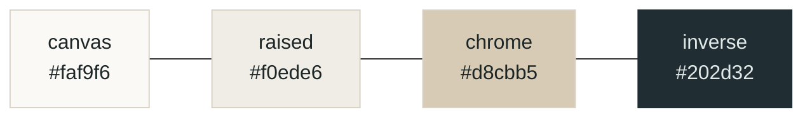

# Palette and tokens

Every colour, text size and measure is a Tailwind 4 **token** declared in the `@theme` block of
`src/components/styles/theme.css`. A `--color-accent` token generates the utilities `text-accent`,
`bg-accent`, `border-accent`… and also exists as a CSS variable. No component writes literal colours:
a `theme.test.ts` test checks it in the prose, callout and tab rules.

## Surfaces

Four planes, from lightest to heaviest. In light mode:

| Token | Value | Where it is used | Contrast with the canvas |
| --- | --- | --- | --- |
| `--color-canvas` | `#faf9f6` (warm white) | Content background | — |
| `--color-raised` | `#f0ede6` (stone) | The sidebar plane | 1.10:1 |
| `--color-chrome` | `#d8cbb5` (mocha) | The header | 1.51:1 |
| `--color-inverse` | `#202d32` (anthracite) | The inverted footer | 13.45:1 |



In dark mode the roles invert (heavier is lighter: `raised` and `chrome` lighten over a `#141311`
canvas), **except the footer**, which stays the darkest.

The text neutrals (`ink`, `muted`, `faint`) are an OKLCH ramp with **hue 195**, the same as the accent.
That is why they must not be replaced with Tailwind's default greys: they would lose their harmony with
the green.

## Accent: `accent` versus `accent-line`

The green comes in two strengths, and the difference is about **accessibility**, not taste:

- `--color-accent` (`#2b665f`): for **text** (links, the current page). It gives 6.30:1 on the canvas
  and 5.67:1 on the plane: it passes AA (4.5:1) on both.
- `--color-accent-line` (`#367c75`, the palette's teal): for what **is not text** (underlines, bars,
  borders), where WCAG asks for 3:1. As text it would give 4.18:1 on the plane and 3.06:1 on the
  header: it does not reach AA.
- `--color-accent-soft` (`#e2efec`): tinted backgrounds; the accent gives 5.62:1 on it.

On the header (mocha) **only `ink` is used for text** (9.67:1): neither `muted` nor the accent reach
4.5:1 there.

## Why each token notes its ratio

```css
--color-muted: #515a5a; /*  6.74:1  AA  (6.07) */
```

The first number is the contrast against the canvas; the one in brackets, against the plane. They are
noted because **changing a colour without looking at its ratio is the quickest way to break
accessibility**, and the comment makes you see it when you edit it. But the comment is not the
guarantee: the test is.

`src/components/styles/theme.test.ts` extracts the light and dark palettes from `theme.css` and checks
a list of text/background pairs with `contrast()` (`src/testing/contrast.ts`):

- 4.5:1 for normal text: `ink`, `muted`, `faint`, `accent`, `state-live`, `state-wip` and `danger` on
  `canvas` and `raised`; `accent` on `accent-soft`; `canvas` on `accent`.
- 1.2:1 for `rule` on `canvas` (so the rule is visible).

If you change a value, update the comment with the new ratio and let the test say whether it still
holds. If you add a text token, add its pair to the `pairs` list.

## The themes, twice

The dark palette is declared twice in `theme.css`:

1. `@media (prefers-color-scheme: dark) { :root:not([data-theme='light']) { … } }`: the system is in
   dark mode and the visitor has not chosen light.
2. `:root[data-theme='dark'] { … }`: the visitor chose dark.

`theme.test.ts` requires both blocks to be **identical** and complete. If you touch a dark colour,
touch it in both. And `src/components/styles/theme-colors.ts` repeats each theme's canvas for
`<meta name="theme-color">`; `theme-colors.test.ts` ties it to `theme.css`.

## The footer: re-themed by scope

The footer is an inverted surface: light ink on anthracite. Instead of painting each piece with another
class, `.surface-inverse` **redefines the tokens in its scope** (it is public: a site can put it on its
own footer or band):

```css
.surface-inverse {
  --color-ink: var(--color-inverse-ink);
  --color-muted: var(--color-inverse-muted);
  --color-faint: var(--color-inverse-muted);
  --color-accent: var(--color-inverse-ink);
  --color-accent-line: var(--color-inverse-muted);
  background-color: var(--color-inverse);
  color: var(--color-ink);
}
```

Everything inside (links, the cookie button, the focus ring) uses the usual utilities (`text-muted`,
`text-accent`) and inherits the inverted values. A new component in the footer does not need to know
it is in the footer. Focus switches to the light ink because the green would give 2.9:1 on the
anthracite. In dark mode the footer barely stands out from the background (1.03:1), so it keeps a rule
at the top.

## Other tokens

- **States**: `state-live` (maintained), `state-wip` (experimental), `danger` (error). They are the
  colours of the `tip`, `warning` and `danger` callouts.
- **Typography**: `--font-sans` and `--font-mono` point at the IBM Plex variables that `fonts.ts`
  declares; `--text-display`, `--text-row`, `--text-label`.
- **Measures**: `--container-measure` (42rem, about 78 characters), `--container-measure-full` (52rem,
  at full width), `--container-page` (80rem). The layout uses its own variables (`--col-left`,
  `--rail`, `--wide-max`…) that change with the `<html>` attributes (see
  [Look and feel](../guia/personalizar.md#look-and-feel)).
- **Code**: the Shiki themes are `github-light-default` and `github-dark-default` (`code-themes.ts`);
  in dark mode the block background is `--code-dark-bg`, because GitHub's is bluish.

## Next step

When the change is ready, publish it: [Publish a release](./versiones.md).
