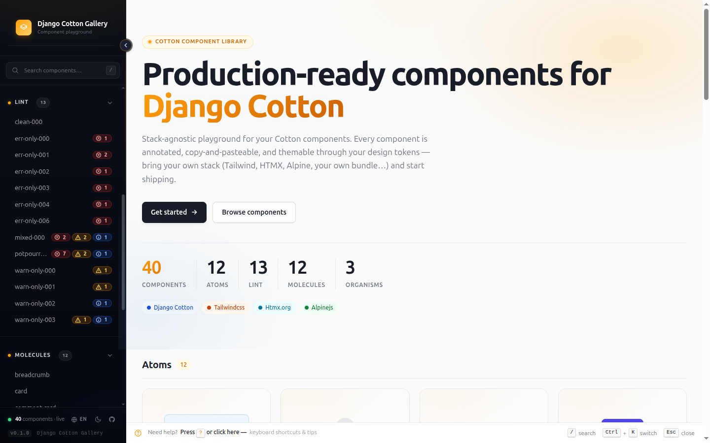
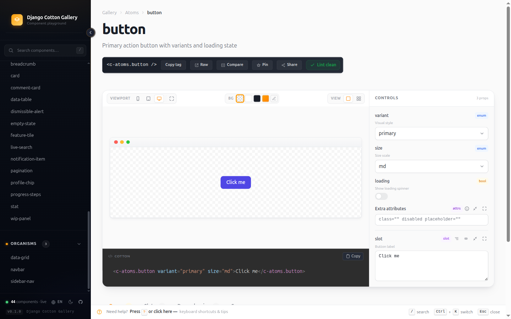
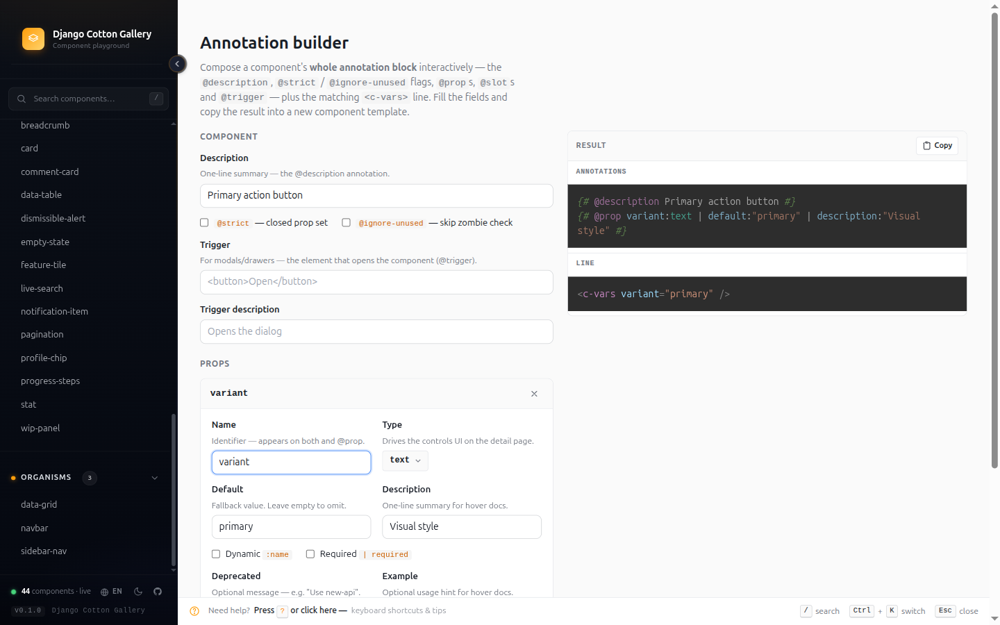
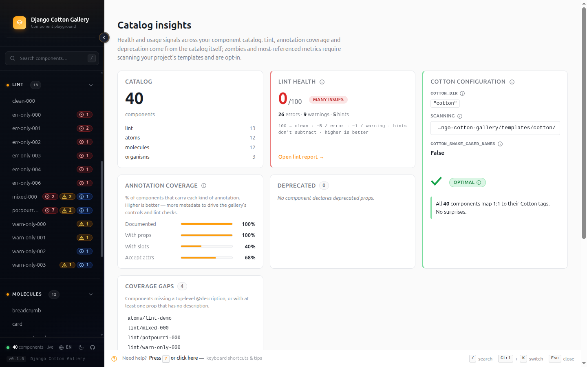

# Escaparate

Una página que solo existe en el playground, para probar lo que las docs de snake-orm no usan:
imágenes que se abren en grande y un admonition plegado. Las capturas son de las docs de
django-cotton-gallery.

## Imágenes

Pulsa cualquier captura (o enfócala y pulsa Intro) para abrirla. Escape, el botón de cerrar o un
clic fuera la devuelven a su sitio.

La página de detalle de un componente, con sus props y slots:

## Lado a lado

::::tabs
:::tab[Constructor]

:::
:::tab[Insights]

:::
::::

## Plegado

:::tip[Ábreme]{collapsed}
Este admonition empieza cerrado. Por debajo es un `
`, así que funciona sin JavaScript.
:::
