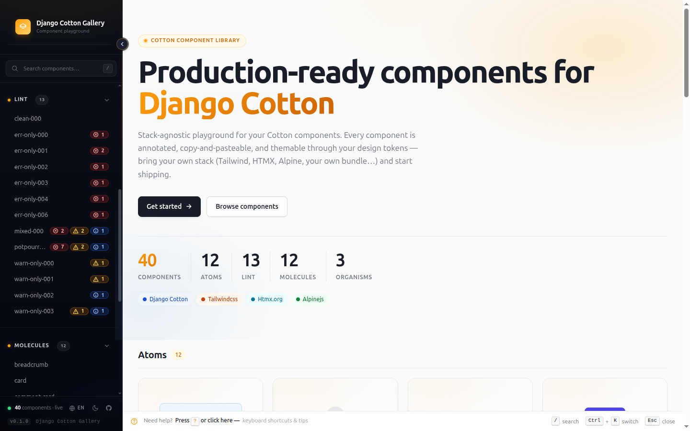
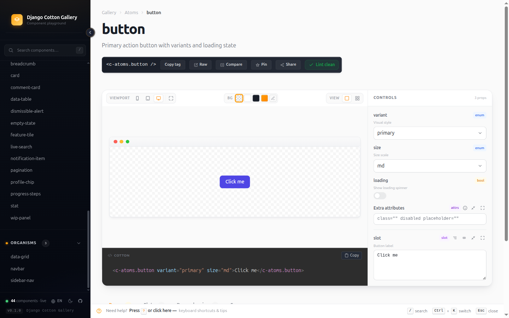
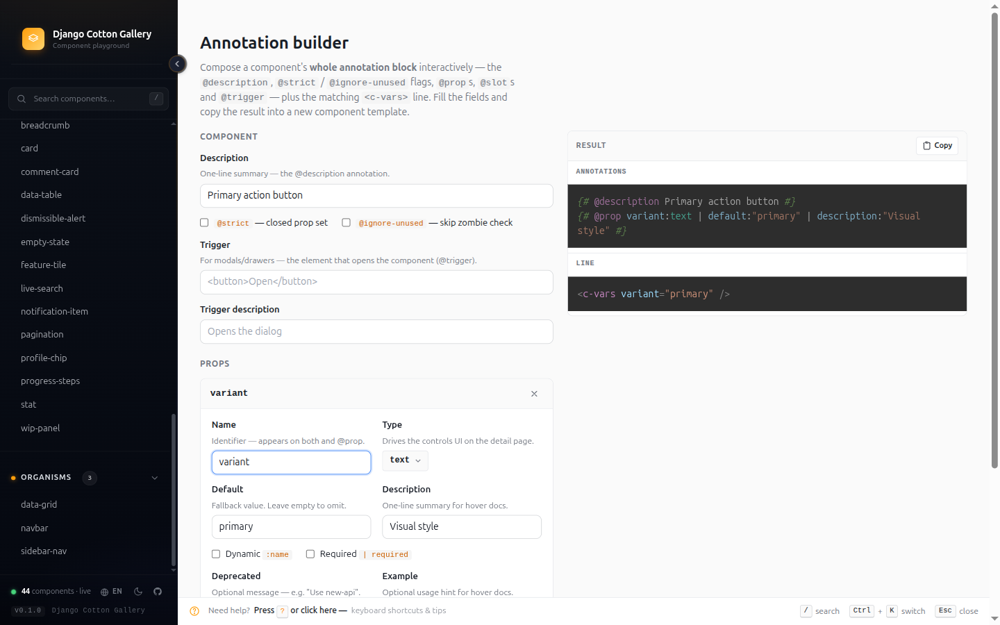
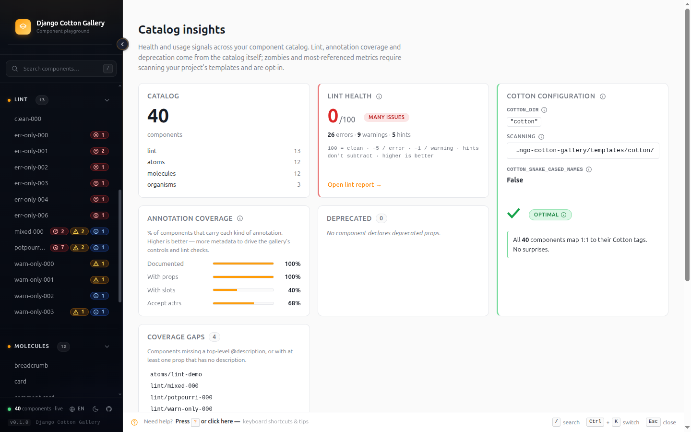
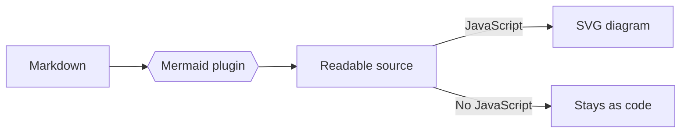

# Showcase

A page that exists only in the playground, to try what the snake-orm docs never use: images you
can open bigger, and a collapsed admonition. The screenshots come from the django-cotton-gallery
docs.

## Images

Click any screenshot (or focus it and press Enter) to open it. Escape, the close button or a click
outside brings it back.

The detail page of a component, with its props and slots:

## Side by side

::::tabs
:::tab[Builder]

:::
:::tab[Insights]

:::
::::

## Collapsed

:::tip[Open me]{collapsed}
This admonition starts closed. It is a `
` underneath, so it works without JavaScript.
:::

## Diagram

A fenced block with the `mermaid` language is drawn as an SVG that follows the site palette and theme. It carries the `mermaid` label and a button to copy its source, like any code block, plus one to open it full screen, where you can zoom and pan. The library only loads Mermaid on pages that have a diagram.

